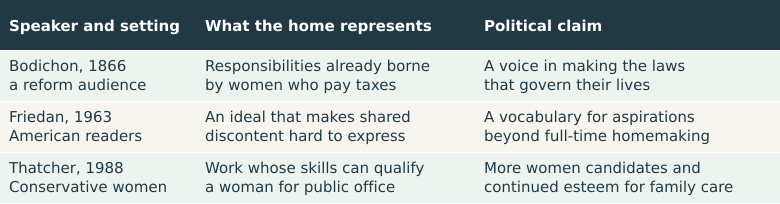
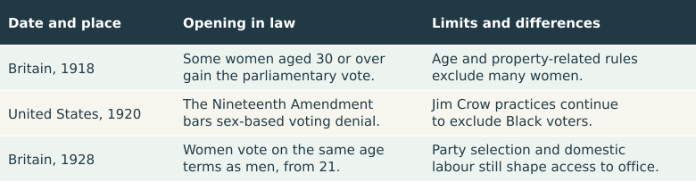

# Analyse et commentaire de textes ou documents en anglais — Corrigé guidé

*Corrigé rédigé par IA, non officiel. Signalez toute erreur.*

**Rédaction** · GPT-6.2 Astra Ultra · vitesse non renseignée · 26 novembre 2026

## Introduction

**Reading prompt.** Start with a single shared object, the household. Contrast what Bodichon and Thatcher ask their audiences to do with it. Use Bolt to frame the puzzle and ask what Cooper and Friedan can reveal that the comparison would otherwise miss.

In 1866 Barbara Bodichon asked her Manchester audience to consider what became of widows whose landlord refused to renew their tenancies. In 1988 Margaret Thatcher invited an audience of Conservative women in London to think of balancing the national books as a housewife might balance the family budget. Both women drew on the experience of running a household to make a case for political authority. They used that experience to rather different ends. In her 1993 comparative history, Christine Bolt offers a clue to the divergence. The separation of home from the world of production and government raised obstacles to women's participation, yet it also gave reformers a language in which to claim a public voice. The American educator Anna Julia Cooper, writing in 1892, and the author Betty Friedan, writing in 1963, test how much that language could express. How could a claim made in the name of women's experience enlarge their freedom when the right to define that experience was itself contested? The uses to which these writers put the home reveal why political inclusion required a change in institutions, in who could speak for women and in what counted as a public problem.

## Making private responsibilities count in public

**Reading prompt.** In document 2, locate the reported evictions and the counterfactual about the vote. Ask what the example establishes, who transmits it and whose economic position gives the example its force.

Bodichon's argument in document 2 turns on what her listeners already concede. Women can be held responsible for taxes and public duties. Why should their competence vanish at the point where representatives are elected? Her Suffolk farmers supply the case that an abstract account of citizenship might miss. Landlords have an incentive to keep an enfranchised tenant, whereas seven widows on one estate, the farmers tell her, have been evicted. These are reported cases, followed by a counterfactual about what a vote might have secured. The appeal to her audience works because it does not depend on proving malice in every landlord or legislator. A group with no electoral weight is easy to overlook even in a system that its beneficiaries regard as fair.

The exercise of the vote would also alter voters themselves. Bodichon's list of roads, drains and water brings government very close to home. Reading about these matters and debating them could turn practical knowledge into an informed public judgement. Her intervention accompanied the petition for women's suffrage presented to Parliament in 1866, on the eve of a Reform Act that would extend the male electorate. Her qualification that women should vote if duly qualified carries considerable weight. Her farmer and businesswoman fit an existing regime of property and political respectability. A domestic servant who shares the widowed tenant's exposure to an employer has much less place in her argument. Bolt's observation in document 1 that middle-class reformers predominated helps to explain both the force and the social limits of this example.

Cooper also asks the reader to consider an ordinary house, this time a house on fire. The man who leaves the supposed household matter to his wife becomes ridiculous the moment their home is in danger. For Cooper, questions of labour, education, religion and government already affect women, so a woman cannot sensibly stand outside them. Whereas Bodichon asks how participation can give women a wider sense of public affairs, Cooper makes the range of women's existing interests the starting point for political authority. Both lines of reasoning could grow out of the doctrine of separate spheres that Bolt describes. They draw very different boundaries around the constituency entitled to cross the threshold.

## Whose experience could speak for women?

**Reading prompt.** Follow the photographic comparison to its conclusion in document 4. For document 5, place the household inventory next to the question it prompts. Test the implied constituency of each writer against Bolt’s distinctions.

Cooper wrote after Reconstruction, when the formal abolition of slavery and the constitutional protection of citizenship coexisted with the advance of segregation and voter suppression in the South. Her title announces a Black woman's authorship and geographical position. The first-person aspirations she places in the mouth of an imagined speaker connect personal distinction to a collective future. Her photographic image of a sensitised plate gives the present unusual power to impress its features on what comes after. By entrusting Black women with that future, Cooper takes issue both with a political culture that largely excluded them and with accounts of racial advancement that left men in charge. The image also gives them a formidable burden of responsibility. Her language of the youth and development of a people belongs to the racial thinking of her century, even as she uses it to claim intellectual and civic authority. A modern reader can identify an interaction between racial and sexual exclusion here without attributing today's terminology to Cooper.

Bolt makes this intervention historically intelligible, but Cooper also changes what one can see in Bolt. The historian explains why many Black and immigrant women found middle-class organisations remote from their immediate needs. Cooper is evidence in her own right of Black women setting an agenda and addressing a public. The presence of an organised movement and the presence of independent political thought cannot be measured by exactly the same evidence. Bolt likewise complicates any simple claim that one side of the Atlantic led the other. American federalism allowed reformers to make gains state by state, yet this could delay a national settlement. Britain's centralised Parliament limited the number of points of access but could extend a reform nationally. British campaigners learned from American reform, and American organisers later looked to Britain for examples of labour legislation. Transatlantic exchange carried different projects in both directions.

Friedan's opening in document 5 brings this question of representation into mid-twentieth-century America. Her suburban wife can choose appliances, drive her children to activities and find that almost everyone tells her she is fortunate. A list of purchasable objects makes the language of choice sound plentiful, until the abrupt question “Is this all?” exposes how few decisions about her own future it contains. Writing in 1963, Friedan restores a public vocabulary for a dissatisfaction that magazine advice, experts and even other wives encouraged women to interpret as a private failing. Wartime employment had offered many women a public image of industrial competence. Postwar domestic advertising offered an educated woman a different picture of achievement. Yet a working-class mother or a Black woman already earning a living in another woman's home might wish for decent pay, childcare or time with her own family. Cooper's earlier intervention and Bolt's account of class division help locate the constituency in Friedan's description. The suburban wife's distress is real, and turning it into a universal account would obscure the work that sustains her household.

## What survived the extension of the franchise?

**Reading prompt.** Keep three events apart when reading document 3: winning a vote, being elected and taking a seat. Track how applause and the list of policies turn past victories into an appeal to this particular audience.

Thatcher opens document 3 with two anniversaries. In 1918 Britain enfranchised women aged thirty and over who met specified qualifications. In 1928 women obtained the parliamentary vote on equal terms with men, from twenty-one. In the United States the Nineteenth Amendment of 1920 prohibited disenfranchisement on grounds of sex, while Jim Crow restrictions continued to bar many Black citizens from the polls. New rights changed the available channels for contesting power. Party selection, discriminatory practices and the unequal division of time continued to affect who could actually use them. Thatcher herself asks her listeners both to stand for office and to select more women. Having a vote does not confer the power to appear on the ballot.

At a Conservative conference the anniversary also becomes a claim to party ownership. Thatcher names Emmeline Pankhurst, emphasising her later Conservative affiliation, and Nancy Astor, the first woman to take her seat in the Commons in 1919. Constance Markievicz had been elected in 1918 but did not take her seat. Such precise distinctions matter in a speech celebrating precedents. By placing Pankhurst, Astor and her own premiership in a single sequence, Thatcher leaves in the background the disagreements between suffragists, the militancy of Pankhurst's earlier movement and the work of women in other parties. Bolt's comparison instead attends to antagonisms and reversals. The indications of applause and laughter show which political community this particular version of the past helps to constitute.

The argument moves from daring women to claim a party nomination to defending a family-centred distribution of care. Thatcher celebrates entry into medicine, law and accountancy, then transfers a housewife's supposed budgeting skills to national government. She also praises the vastly greater volume of care provided by families than by the state. Her references to Family Credit, the budget and broadcasting standards turn a celebration of domestic choice into an argument about public policy. For Friedan, the insistence that a woman can find fulfilment in one prescribed vocation deprives her of the words to ask for another life. For Thatcher, recognition of homemaking is part of the freedom to choose and part of the case for expecting families to carry substantial responsibilities. The contrast sharpens Friedan's use of the American critic who dismissed Simone de Beauvoir's account as applicable to French women alone. Once discontent is classified as foreign, private or merely individual, its claim on public debate can be set aside before anyone has to answer it.

## Conclusion

**Reading prompt.** Bring back one object from each primary source, such as a tenancy, a threatened house, a household purchase or a budget. Explain how it becomes evidence of a claim that other people may contest.

The home ran through these debates because it supplied both the evidence for a claim and a means of narrowing who could make it. A Suffolk widow's tenancy gave Bodichon a reason for enfranchisement. An endangered house gave Cooper a reason for Black women's authority in public life. The American suburb gave Friedan a way to make a shared predicament audible, while Thatcher found in family care a language for political leadership and for limiting public provision. Bolt explains why a doctrine could outlive changes in the law by furnishing rival sides with usable arguments. The most consequential change across the dossier is who gains the standing to describe ordinary life as a matter of common concern, and who can question the settlement made in its name.
