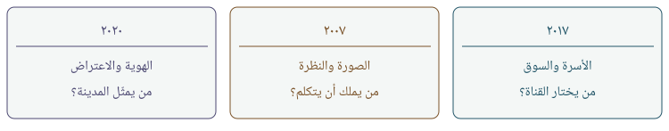

# BEL B/L — Arabe 2024 · Corrigé brut

*Corrigé rédigé par IA, non officiel. Signalez toute erreur.*

**Rédaction** · GPT-6.2 Astra Ultra · vitesse non renseignée · 26 novembre 2026

## من يملك حق الحكم على الأغنية المصوّرة؟

::: {lang=ar}

تجمع الأوراق مقالين صحفيين وخبرا عن أغنية راب. تمتد تواريخ النشر من سنة ٢٠٠٧ إلى سنة ٢٠٢٠. لكل وثيقة جمهورها وموقفها من الصورة، ولذلك لا يجوز أن ننسب إلى الجمهور كله رأيا ورد على لسان صحفي أو متحدث واحد.

:::

## التحليل والتعليق

### من شاشة البيت إلى شاشة الجمهور

::: {lang=ar}

اشترى حسن أبو سعيد تلفازا آخر يتجنب به ما يراه أبناؤه على الشاشة. قد يحل الجهاز الجديد مسألة اختيار القناة، ولكنه لا يجيب عن السؤال الذي أثار الشجار في الأسرة الفلسطينية. من يختار الصور التي تستحق المشاهدة، وباسم أي قيم؟ ينقل مقال محمود الفطافطة المنشور في صحيفة دنيا الوطن سنة ٢٠١٧ الخلاف من البيت إلى سوق الإنتاج الغنائي. وكانت الباحثة مي المهدي قد تناولت في القدس العربي سنة ٢٠٠٧ مسألة أخرى متصلة به، هي نظرة المتفرج إلى المرأة وعلاقة تلك النظرة بالحياة السياسية. أما خبر الجزيرة في شباط ٢٠٢٠ فيتتبع الخلاف الذي أثارته أغنية «بنت مكة» على يوتيوب وتويتر. تجتمع النصوص حول مادة ثقافية واحدة، لكن المتفرج فيها يتغير موقعه. فقد يكون ابنا في موضع الاتهام، أو رجلا يتوهم أن له سلطة على الصورة، أو شخصا يشارك علنا في صنع الجدل حولها.

:::

### من يتحمل المسؤولية في الوثيقة الفلسطينية؟

::: {lang=ar}

يضع عنوان الوثيقة الأولى الشباب والمنتجين في جهتين غير متكافئتين. ينسب إلى الشباب الضياع، وإلى المنتجين لحنا يحقق لهم الربح. غير أن الشهادات التي يجمعها الكاتب أعقد من هذا التقابل. يربط الدكتور صباغ انتشار النوع الغنائي بتراجع الأوضاع العامة وفقدان الانتماء وتغليب الربح. وينقل المرشد التربوي محمد الشلالدة النقاش إلى المدرسة حين يصف تنافس الطلبة على معرفة آخر أغنية. أما أستاذة علم الاجتماع سُهى هندية فتُبقي مجالا لأغنية مصوّرة ملتزمة، وإن عدّتها قليلة أمام سيل الإنتاج التجاري. ويبقى سؤال الملكية مهما في شهادة الإعلامي ماهر خليل، إذ يلفت النظر إلى استثمار رجال أعمال عرب في القنوات المتخصصة. فإذا كان بعض المتحدثين يعدّ الظاهرة غريبة عن المجتمع، فإن بنيتها الاقتصادية، في الشهادات نفسها، تقوم على قرارات تُتخذ من داخله أيضا.

ولا يتكلم الشابان اللذان يستمع إليهما الصحفي بصوت واحد. يفضّل عبد اللطيف حاج علي أحيانا سماع الأغنية في المذياع، بحيث يستطيع فصل اللحن عن المنظر، ويعترف بما يضيعه الإفراط في المشاهدة من وقت. وتقول ديما حسن إن المشاهدة لا تلغي رقابة الضمير، وتنتقد من يجعل متابعة الأغاني شغله الدائم. ثم يغلق الكاتب مساحة التردد حين يصف هذه الأغاني بالسمّ الأخلاقي ويدعو الأسرة والمربين ورجال الدين إلى التصدي لأضرارها. هنا حدّ التحقيق: تتعدد الأصوات في المتن، وتمنح الخاتمة الحكم الأخلاقي الكلمة الأخيرة. ولا تسمح تلك الشهادات المحدودة بقياس نسبة المدمنين بين الشباب.

:::

### السخرية من المشاهد ومن الواعظ

::: {lang=ar}

تبدأ مي المهدي من مفارقة تكشف حدود التفسير الأخلاقي. يستطيع الرجل أن يلقي أمام زوجته خطابا عن انحطاط الفن، ثم يجلس مفتونا أمام الشاشة في مقهى. تكاد هيئة الجالسين، بعيونهم المشدودة إلى التلفاز، تنقض كلامهم قبل أن تتدخل الكاتبة بالتعليق. وتحيط بالمغنية قصور وسيارات وشواطئ، فيوعد المتفرج بامتلاك عالم كامل لا تسمح له حياته العادية بدخوله. ليست المشكلة إذن في طول المشاهدة وحده. إن منطق الإعلان يجعل المرأة عنصرا في مشهد الثراء، ويعوّد الرجل أن ينظر إليها من خارج تجربتها وشخصيتها.

تذهب المهدي أبعد من ذلك حين تقارن الجاذبية البصرية للأغنية برتابة الخطب السياسية والجلسات البرلمانية. يتيح الاستعراض هروبا من واقع صعب، بينما يمكن للخطاب السياسي المتكرر أن يشتت الانتباه بدوره. وتتابع الكاتبة صورة المرأة الصامتة في فيلم استهلاكي، ثم تنتقل إلى مذيعات الأخبار وإعلان تتحدث فيه طفلتان عن مستحضر للبشرة. يكشف هذا الانتقال أن تحوّل المظهر إلى معيار للقيمة يتجاوز الأغنية إلى الإعلام الموجَّه إلى الكبار والصغار. وحين تقترح الكاتبة في النهاية إحضار خبراء في المنطق وتشكيل لجنة دولية تدرس سر المشاهدة، فإن الإفراط في رسمية الحل يسخر من طريقة معالجة الظاهرة. مع ذلك، يشبه حكمها العام على الثقافة العربية بعض إطلاقات الوثيقة الأولى. فالمشهد الساخر أقدر على كشف تناقض بعينه منه على إثبات صفة ثابتة لمجتمع كامل.

:::

### من تمثّل «بنت مكة»؟

::: {lang=ar}

يغيّر خبر الجزيرة في ٢٠٢٠ زاوية النظر. فالمرأة هنا صاحبة أداء تنشره على قناتها، ويصبح السؤال عما يحق لها أن تقوله عن المدينة التي تختار الانتساب إليها. يذكر الخبر أن المغنية السعودية ذات الأصل الإريتري صوّرت الأغنية في مقهى بمكة، وشاركها أطفال في الرقص. اعترض مغردون على ما عدّوه إساءة إلى صورة فتيات مكة، وطالب بعضهم بوضع حد لمثلها. وأورد الخبر توجيها من إمارة المنطقة بإحالة المنتجين إلى الجهات المختصة للتحقيق. ينبغي التمييز بين الإحالة والحكم، وبين ما يؤكده الحساب الرسمي وما يقوله المعلقون عن دوافع غيرهم. ورأى آخرون أن في الهجوم دوافع عنصرية وأن مغنية أخرى ربما لقيت قبولا. ينقل الخبر هذا التأويل ولا يقدّم دليلا يثبت أنه يفسر كل اعتراض.

هكذا تنقلب علاقة الصوت بالصورة. كانت المغنية في مقال المهدي تُختزل إلى صورة صامتة في خيال المتفرج. أما في خبر مكة فيختلف الجمهور حول حق مغنية بعينها في أن تقدم نفسها على أنها صوت محلي. ووسم الرفض يجعل مشاهدة الأغنية فعلا قد يتبعه تعليق وضغط على السلطات، كما يتيح نشر ردود مخالفة. ومع ذلك فإن انتقاء التغريدات لا يقدّم صورة إحصائية عن السعوديين. ومثلما كان على القارئ أن يميز بين الضمير الفردي والوعظ في التحقيق الفلسطيني، عليه هنا أن يميز بين حماية سمعة جماعة واحتكار الحق في تمثيلها. يكشف الخلاف في النهاية ما لا يكشفه الحكم على جودة الأغنية وحدها، أي توزيع حق الكلام بين منتج ومغنية وجمهور وسلطة.

:::

## إيضاحات للقراءة

### من شاشة البيت إلى شاشة الجمهور

::: {lang=ar}

تبدأ الوثيقة الأولى بحكاية عائلية ثم تتسع إلى سلسلة أسئلة حول الأسرة والمجتمع والمنتجين. تشكّل تلك الأسئلة إطار التحقيق الصحفي، ولا تعني أن شراء الجهاز الثاني أنهى النزاع أو أن جميع الشباب يتفقون في أذواقهم.

:::

### من يتحمل المسؤولية في الوثيقة الفلسطينية؟

::: {lang=ar}

تخص الوثيقة الأولى الصفحتين ١ و٢ من ملف المسابقة. يميّز الطالب بين كلمات المتحدثين وبين صيغة الجمع «نرى» في الخاتمة التي تحمل حكم الكاتب. أما التمييز بين الصورة والصوت فهو جزء من شهادة شاب، ويمكن أن يصبح أداة لتحليل موقف النص كله.

:::

### السخرية من المشاهد ومن الواعظ

::: {lang=ar}

يمتد مقال مي المهدي بين الصفحتين ٢ و٣. تجعل الكاتبة ازدواجية موقف المشاهد موضوعا للنقد. وعند مقارنة الجمهور بالغائبين عن القرار السياسي، تعرض تأويلا لاستعمال الصورة، لا نتائج استطلاع ميداني.

:::

### من تمثّل «بنت مكة»؟

::: {lang=ar}

الوثيقة الثالثة خبر مؤرخ في ٢٠ شباط ٢٠٢٠، في الصفحة الثالثة من الملف. عنوانه يتحدث عن جدل، ويورد رأيا مخالفا في نهايته. يجب أن تظل دعوى العنصرية منسوبة إلى أصحابها وأن يظل الإجراء الرسمي في حدود التحقيق الذي ذكره الخبر.

:::

::: {lang=ar}

لا يشتمل الموضع المخصَّص لتقرير اللجنة في فهرس المدرسة لسنة ٢٠٢٤ على رابط. يستند هذا التعليق إلى الصفحات الثلاث من ملف الموضوع الرسمي، وهي تحمل في الكرّاس الأصلي الأرقام ١٥ إلى ١٧.

:::

## المصادر

[الموضوع الرسمي](https://www.ens.psl.eu/sites/default/files/2024_blses_sujet_analyse_commentaire_arabe.pdf) · [فهرس المدرسة](https://www.ens.psl.eu/rapports-et-sujets-du-concours-2024-section-des-lettres-groupe-bl)
