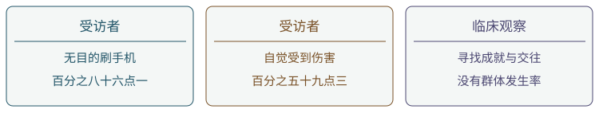

# BEL B/L — Chinois 2024 · Corrigé brut

*Corrigé rédigé par IA, non officiel. Signalez toute erreur.*

**Rédaction** · GPT-6.2 Astra Ultra · vitesse non renseignée · 26 novembre 2026

## 从无目的刷屏到游戏失控，怎样理解屏幕背后的需要？

两篇材料都刊于二〇二三年的《中国青年报》。七月十四日的文章报道了一项关于媒介使用习惯的问卷调查；八月三十一日的报道则借助临床工作者的观察分析青少年的游戏问题。先弄清楚各自在说谁，才能比较它们怎样解释失控，又怎样分配责任。

## 分析与评论

### 同样是停不下来，问题出在哪里？

吃午饭本来只要二十分钟，一部一小时的纪录片却让受访者把学习挪到了后面。这个例子值得留意，因为纪录片通常被认为有益。问题出在观看者失去了决定何时停下来的能力，而内容的好坏不足以解释这种变化。第二篇材料也写到一个日常约定：孩子答应只玩半小时，最后却一再延长时间。两个例子看似相同，能说明的事情却不一样。第一个揭示日常生活中注意力怎样被占用，第二个属于持续失控并已经妨碍生活的一组表现。两篇报道的共同问题可以这样提出：一个原来能够满足需要的工具，为什么会反过来支配使用者的时间？回答这个问题，既要看屏幕给了人什么，也要看现实生活里缺了什么。

### 问卷量出了哪些感受？

第一篇报道开头的百分之八十六点一格外醒目。调查由中国青年报社社会调查中心联合问卷网进行，受访者共一千五百零一人。这项比例指自述会漫无目的刷手机的人，并不是临床诊断。排在前三位的习惯分别为无节制刷短视频（百分之五十四点九）、过度关注热搜（百分之四十三点四）和过量浏览娱乐信息（百分之四十二）。有人可能同时选中几项，因此不能把三个比例相加后解释为人数。报道也列出未经核实就转发信息等行为。它关心的不仅是用了多长时间，还包括什么信息进入生活，以及人是否仍在判断其可信度。

受访者中，百分之五十九点三觉得自己受到不良媒介习惯的伤害，百分之四十二点二报告难以专注，百分之四十点二感到陪伴家人或线下社交的时间减少。这些是受访者对自身经验的判断。报道没有交代抽样框和长期跟踪结果，不能凭它断定每一项后果都是手机单独造成的。不过，个人叙述让比例的意义变得具体：有人睡得晚，第二天早晨一睁眼又开始刷，半小时一晃就过去了。害怕错过消息使人不断刷新，而频繁在线又使人更怕掉队。这里出现了一个自我加强的循环。百分之六十七点六的人希望学会筛选可靠而有价值的信息，也说明相当一部分人想重新掌握选择权，而不是放弃获取信息的便利。

### 当游戏成了现实生活的替代

第二篇报道把焦点从“有多少人”转向“孩子为什么回来继续玩”。北京回龙观医院成瘾医学中心的心理治疗师刘艳说到三个连在一起的变化：行为失去控制，游戏排到了生活中其他活动之前，明知产生负面后果仍难以停止。孩子可能忽略吃饭和睡觉，成绩下滑，与父母发生冲突。只看屏幕时间，很难区别一次假期里的长时间娱乐和已经造成明显功能损害的持续行为。报道把游戏称作一种补偿，正是为了说明：一件已经带来痛苦的事，仍可能让孩子在某一方面得到眼下难以替代的东西。

这些东西可以是完成任务的成就感、和同伴一起活动的快乐，也可以是暂时躲开压力的机会。于健瑾进一步把问题带回家庭。假如孩子一开口就遭到斥责，在现实中经常被否定，网络上的交谈也许比饭桌上的交谈更能让他感到被听见。这个解释没有免去孩子的一切责任，也没有证明每个沉迷者的父母都有同样的问题。它的价值在于改变提问方式。只问“怎么又不守约”，容易把行为理解为故意对抗；问“今天游戏里有什么让你舍不得离开”，才可能发现同伴关系或生活压力出了什么问题。文章把某种行为说成“自救”，描述的是孩子寻找补偿的用意，其后果仍可能损害日常生活。

### 两种尺度下的自主

两篇报道对“需要”的理解既相通又不同。刷热搜的人是怕失去与外界的联系，进入游戏的孩子也可能在寻找现实中欠缺的联系。可是，前者可能需要停下来核实消息，决定哪些内容值得继续读；后者若已经难以睡觉、上学或维持关系，仅仅关掉设备并不能为他提供替代的交往机会。第一篇的长处是显示自述困扰的范围，第二篇的长处是使人理解个别行为为何反复出现。两者的局限也正好互补：调查中的数字不能代替对一个孩子的了解，临床观察同样不能说明全体青少年的情况。真正的自主，既包括有能力放下屏幕，也包括放下以后有值得回去的生活。

## 阅读与辨析

### 同样是停不下来，问题出在哪里？

第一篇的对象是受访者，其中有人讲到学习和家庭，并不等于一千五百零一人全是青少年。第二篇讨论青少年游戏成瘾，材料提供的是解释和个案式描述，没有提供患病率。两种材料不能合并计算出一个比例。

### 问卷量出了哪些感受？

七月的标题是“越刷越心累”，正文却以几个层次来说明“心累”：身体不适、作息推迟、注意力分散、社交减少和信息变窄。访谈帮助读者理解感受，问卷不能仅凭同一时间的自述证明因果联系。

### 当游戏成了现实生活的替代

八月三十一日的文章以专家访谈为主。成就感、交往和情绪表达是并列的可能需要。结尾要求父母也反省自己的说话方式，所以行动的主体从孩子一人扩展到家庭。文章并未比较各类原因出现的频率。

### 两种尺度下的自主

两份材料都承认网络能够提供信息或满足交往需要。把所有屏幕活动一概归为疾病，会使第一篇的调查失真，也会抹去第二篇对“功能损害”的限定。

材料一见试题文件第１至２页，材料二见第３至４页。两文所引证据的性质以及数字的适用范围，是比较两篇报道的依据。

## 出处

[试题](https://www.ens.psl.eu/sites/default/files/2024_blses_sujet_analyse_commentaire_chinois.pdf) · [评审报告](https://www.ens.psl.eu/sites/default/files/2024_bl_rapport_ecrit_chinois.pdf)
