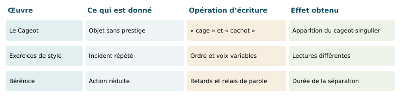

# B/L 2024 · Composition française · Corrigé guidé

*Corrigé rédigé par IA, non officiel. Signalez toute erreur.*

**Rédaction** · GPT-6.2 Astra Ultra · vitesse non renseignée · 26 novembre 2026

**La littérature, la pauvreté du sujet et la souveraineté de l’écrivain** · Écrit commun, 6 heures.

« La littérature joue d’étranges tours : plus le sujet est pauvre, plus l’écrivain est roi. » Bernard Frank, Portraits et aphorismes, 2002.

En vous appuyant sur des textes littéraires précis et variés, sans vous limiter à un genre, vous discuterez ce propos.

## Du mot de Frank à une thèse vérifiable

L’aphorisme désigne d’abord un agent inattendu. C’est la littérature elle-même qui « joue » et qui peut surprendre l’écrivain. La seconde proposition fait pourtant de cet écrivain un roi. Pour éprouver cette tension, distinguer trois sens de « pauvre ». Le cageot de Ponge manque de prestige, l’événement de Queneau manque de conséquences, la séparation de Racine comporte peu de péripéties. Une vie de domestique, quant à elle, peut être jugée insignifiante par le milieu qui la regarde. Ces différences permettent de discuter le rapport de proportion indiqué par « plus… plus… ».

**Question de travail.** Par quelle opération une matière réputée mince rend-elle perceptible l’autorité d’une écriture, et jusqu’où la matière conserve-t-elle le pouvoir d’orienter cette écriture ? Cette question appelle des passages vérifiables. Pour chaque exemple, désigner ce que le résumé ferait disparaître et mesurer l’effet obtenu dans le texte.

## Dissertation

On peut raconter *Bérénice* en une phrase. Titus aime une reine et se sépare d’elle. Racine présente même la simplicité de l’action comme une difficulté qu’il s’est donnée. Entre le peu que retient le résumé et les cinq actes que réclame la séparation, il y a toute la place d’un art. Le mot de Bernard Frank, « La littérature joue d’étranges tours : plus le sujet est pauvre, plus l’écrivain est roi », donne à cet écart la force d’une loi. « Pauvre » peut désigner une matière de faible prestige, mais aussi un argument qui fournit peu d’événements ou qui semble épuisé d’avance. Être « roi », est-ce disposer d’une liberté accrue, ou rendre sensible une puissance que le prestige du sujet aurait masquée ? La différence importe. Une matière ténue peut rendre le travail de l’écrivain éclatant tout en lui opposant des contraintes particulièrement sévères. La proposition invite à examiner ce qui, dans une œuvre, donne à une autorité littéraire les moyens de s’exercer.

### I. Là où le sujet promet peu, le geste de l’écrivain devient perceptible

> [!INDICATION]
> Chez Queneau, garder constants les deux moments de l’histoire. Si l’on passe du récit inversé à l’interrogatoire, quelle sorte d’intérêt apparaît en l’absence de fait nouveau ? La comparaison isole un effet propre à la forme.

L’éloge de la grandeur d’un héros et l’admiration pour le poème qui le chante peuvent se confondre. Que le poème entreprenne l’éloge d’un cageot, et cette confusion devient difficile. Dans « Le Cageot », Francis Ponge fait naître le nom de l’objet entre deux mots, « cage » et « cachot ». Ce début fait attendre la captivité. Or les fruits étoufferaient dans une boîte fermée, et la caissette ajourée est faite pour être brisée. En quelques phrases, le jeu sur les syllabes conduit à la matérialité du bois, puis à l’existence brève de cet instrument du marché. L’objet jetable reçoit un portrait singulier parce qu’une phrase sait corriger l’attente produite par la précédente. Le pouvoir du poète s’éprouve dans ce passage. On aurait pu remplacer un cageot par un autre au marché, on ne peut remplacer le mot « cageot » par « caisse » dans cette entrée en matière sans perdre l’amorce du poème.

Le manque peut porter sur l’action elle-même. Dans les *Exercices de style*, Raymond Queneau reconduit son lecteur dans le même autobus. Une querelle avec un voisin, puis la rencontre ultérieure du voyageur à propos d’un bouton de son pardessus, suffisent. La version en « Rétrograde » modifie l’ordre de découverte des faits. « Interrogatoire » les fait dépendre d’une suite de questions et de réponses. Dans un cas il faut reconstruire la succession, dans l’autre on en vient à se demander qui exige ces renseignements sur un incident insignifiant. Le maintien de l’anecdote sert d’instrument de comparaison. Dès qu’un fait change de place ou de voix, il change de portée. Voilà un premier « tour » de la littérature. La répétition qui devrait épuiser l’intérêt rend les différences d’écriture plus sensibles à chaque reprise.

### II. La pénurie d’événements oblige autant qu’elle libère

> [!INDICATION]
> Tester la réciproque de l’aphorisme. La matière mythique d’Antigone est forte avant même le lever du rideau. Qui parle le premier et quelles raisons le spectateur a-t-il déjà entendues lorsque Créon défend son décret ?

Cependant la tournure « plus… plus… » promet davantage que ces exemples ne prouvent. Une expérience de lecture rend visible l’invention. Elle ne garantit pas que l’invention soit plus aisée, ni que l’auteur puisse décider de tout. Racine écarte de *Bérénice* l’accumulation des péripéties et le dénouement sanglant. Dès lors le moment où Titus dira ce que Rome exige de lui devient capital. Il demande à Antiochus de parler pour lui. Ce messager aime lui-même celle à qui il doit annoncer la séparation. Le délai prend ainsi un sens différent pour chacun des trois personnages. Et lorsque Bérénice imagine « dans un mois, dans un an », l’alexandrin donne une durée à l’avenir vide que la décision vient d’ouvrir. Rien de mince, ici, dans la dignité des protagonistes, l’histoire romaine ou la violence de la perte. Seul le matériau événementiel a été réduit. La brièveté du résumé impose au dramaturge un travail de rythme et de distribution de la parole qu’un rebondissement aurait pu lui épargner.

Une matière déjà consacrée offre d’ailleurs des prises qu’aucun sujet neuf ne fournirait. Dans l’*Antigone* de Sophocle, le spectateur peut connaître le destin de la fille d’Œdipe. Le prologue fait cependant entendre le projet d’ensevelir Polynice dans un entretien entre deux sœurs, avant que Créon puisse exposer en public sa politique. Ismène fait sentir ce que coûte à deux femmes isolées la désobéissance au souverain. Quand Créon prend la parole, son pouvoir doit donc se mesurer à une expérience et à des liens que la scène a déjà rendus sensibles. Disposer ainsi l’entrée des voix est un choix d’auteur. La richesse des traditions et des obligations contradictoires accroît ici ses moyens. Elle ne l’empêche nullement de régner sur l’ordre des apparitions.

### III. Le pouvoir d’écrire se mesure à ce qu’il laisse apparaître du sujet

> [!INDICATION]
> Dans Un cœur simple, distinguer le jugement de la société sur l’existence de Félicité, la perception du personnage et la manière dont la voix narrative rend les deux lectures possibles. Le sujet change alors de valeur au cours de la lecture.

Il faut enfin se demander qui déclare le sujet pauvre. Dans *Un cœur simple*, raconter la vie d’une domestique de province semble supposer qu’une existence sans rang et sans grands voyages est dénuée de matière romanesque. Flaubert fait plutôt de cette apparente évidence un problème de point de vue. Lorsque Félicité se représente l’Esprit saint sous les traits de son perroquet Loulou, un lecteur peut relever la discordance entre l’oiseau empaillé et la dignité de l’image religieuse. Il lui faut pourtant compter avec les pertes successives que le récit a fait éprouver à Félicité. Loulou concentre alors un attachement et la possibilité sensible d’une consolation. Dans la scène finale, la perception de la mourante occupe la phrase. Décider souverainement si elle est ridicule ou si elle est sainte fermerait ce que l’écriture a précisément réussi à tenir ensemble. L’autorité du narrateur se manifeste dans la rigueur avec laquelle il fait place à une conscience qui échapperait à un jugement social expéditif.

Même le cageot de Ponge résiste à son couronnement. Le dernier mouvement du poème prononce un jugement sur le temps qu’il convient de lui consacrer. En interrompant le développement, le poète règle la durée de son texte sur la précarité de la chose. Il exerce son pouvoir jusque dans le choix de s’arrêter. Chez Racine, de même, les personnages de rang royal découvrent que le rang ne leur procure aucune maîtrise sur l’amour, le temps ou le devoir. Il y a quelque ironie à saluer l’écrivain « roi » au moment où l’une des démonstrations les plus éclatantes de son art consiste à faire entendre l’impuissance d’un empereur. La littérature sait redistribuer les rapports de grandeur que ses matières paraissaient lui offrir tout faits.

Le mot de Frank est donc exact comme expérience de perception. Lorsque l’anecdote ou le prestige se retire, l’ordre des mots, des voix et des scènes devient manifeste. Érigé en loi de proportion, il méconnaîtrait les ressources d’une tradition dense et les exigences d’un sujet mince. Le plus étrange des tours serait que l’écrivain, en faisant admirer son pouvoir, retire en même temps au lecteur le droit de juger pauvre ce dont il vient de lire l’histoire.

*Sources* · [Sujet officiel](https://www.ens.psl.eu/sites/default/files/2024_blses_sujet_composition_francaise.pdf) · [Rapport du jury](https://www.ens.psl.eu/sites/default/files/2024_bl_rapport_ecrit_francais.pdf).
