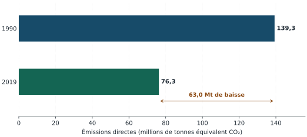

# ENS · B/L · Économie (oral commun) — 12 juin, dossier 2 2024 · Corrigé guidé

*Corrigé rédigé par IA, non officiel. Signalez toute erreur.*

**Rédaction** · GPT-6.2 Astra Ultra · vitesse non renseignée · 26 novembre 2026

**Révision** · GPT-6.2 Astra Ultra · vitesse non renseignée · 26 novembre 2026

Le jury propose un sujet unique accompagné de documents. La préparation dure 1 h 30, l’exposé et l’entretien durent chacun 15 minutes. [Sujet officiel](https://www.ens.psl.eu/sites/default/files/bl_sujets_oraux_economie_2_12062024.pdf) · [Rapport du jury](https://www.ens.psl.eu/sites/default/files/2024_bl_rapport_oral_economie_epreuve_commune.pdf)

**État des sources.** Restitution textuelle du sujet à son URL identifiée par le calendrier officiel. Le PDF ne peut être téléchargé (HTTP 404). Les cinq pièces sont vérifiées par concordance entre le texte de l’épreuve et les graphiques originaux des éditeurs.

Publications et données de contrôle. [Documents 1 et 4 (IPP102)](https://www.ipp.eu/wp-content/uploads/2025/05/102_Note_IPP_Budget_Green_Firms-4.pdf) · [Documents 2 et 5 (DGEsite)](https://www.entreprises.gouv.fr/files/files/Publications/2023/Themas/themas-dge-n8-decarbonation.pdf)

## La décarbonation de l’industrie française

Une tonne de ciment peut émettre du CO₂ par la réaction chimique de fabrication, même si le four est alimenté par une énergie décarbonée. Comment réduire les émissions associées aux biens que la France produit et consomme, tout en préservant les activités dont la transformation demande du temps ? La réponse exige de localiser les émissions, de donner un prix à la tonne évitée et de contrôler les effets sur les importations.

### Document 1 — Identifier les procédés et les entreprises les plus émetteurs

Les figures 1 et 2 de la note IPP 102 divisent les émissions directes de combustion et de procédé par la valeur ajoutée en 2019, pour les entreprises couvertes par l’EACEI. Les groupes du premier panneau représentent chacun un dixième de la valeur ajoutée de l’échantillon. Le plus intense émet 3,5 kg de CO₂ par euro et représente environ 75 % des émissions directes. Les moyennes sectorielles du second panneau sont pondérées par la valeur ajoutée. La métallurgie domine, les produits minéraux non métalliques atteignent 2,2 kg par euro. Une intensité élevée peut tenir au procédé, à la source d’énergie ou à une valeur ajoutée faible. Le classement ne fournit pas encore le coût de suppression d’une tonne.

> [!INDICATION]
> Au tableau, écrire « tonnes / euro de valeur ajoutée » puis « euros / tonne évitée ». La première grandeur permet le diagnostic, la seconde éclaire le choix des projets.

### Document 2 — Expliquer une baisse sur le territoire

Dans le graphique 2 de la DGE, chaque segment empilé donne des millions de tonnes équivalent CO₂ d’un secteur et la hauteur totale donne les émissions manufacturières. Elles passent de 139,3 Mt en 1990 à 76,3 en 2019, soit −63 Mt ou −45 %. La chimie, la métallurgie et les minéraux contribuent visiblement au recul. Un recul de la production, une modification de sa composition ou une technologie plus sobre réduisent tous la barre. La décomposition complémentaire de la DGE attribue une contribution importante à l’efficacité. Un graphique en niveaux ne suffit pas à isoler cette contribution. Pour comparer deux usines, contrôler aussi le produit, les volumes et le périmètre d’émissions.

Calcul aux deux dates du document 2, graphique 2 de la DGE. Le total couvre les émissions directes territoriales. Isoler les effets du volume produit, de la composition et de l’efficacité exige une décomposition.

### Document 3 — Organiser la rareté des quotas

Delacroix, Picaud et Martinon retracent le marché européen lancé en 2005. Une installation restitue un quota par tonne émise. Avec un prix de 80 euros, supprimer une tonne pour 50 euros et revendre un droit rapporte 30 euros avant coûts fixes. L’entreprise qui doit dépenser 100 euros préfère acquérir le droit. La possibilité d’échanger rapproche les coûts marginaux d’abattement. Le plafond, la surveillance des émissions et son évolution déterminent la contrainte collective. Une attribution initiale gratuite indépendante des décisions courantes conserve le coût d’opportunité du quota utilisé, tout en transférant sa valeur à l’attributaire.

Des références de production antérieures à la crise ont créé des excédents. L’article rapporte 1,3 milliard de tonnes en surplus cumulé stabilisé en 2013 et, pour ArcelorMittal entre 2005 et 2019, 3,7 milliards d’euros de ventes pour 1,8 milliard d’achats. Le solde de 1,9 milliard décrit des transactions. Il faudrait connaître les stocks, coûts d’abattement et allocations pour expliquer le bénéfice économique total. Les 20 à 30 millions de tonnes négociées par jour mesurent une activité financière où un droit peut circuler plusieurs fois. Le retrait progressif des allocations gratuites des secteurs visés et l’ajustement carbone aux frontières modifient concurrence et répartition du coût.

### Document 4 — Séparer coût marginal et charge moyenne

Les figures 3 et 4 de l’IPP comparent la tarification marginale de la combustion et sa moyenne nette des allocations gratuites, selon l’intensité des entreprises. Pour le groupe le plus intense, le signal marginal passe de 31 à 84 euros par tonne, soit 53 euros de plus. En 2022, l’entreprise conserve une incitation marginale élevée malgré des allocations réduisant le paiement moyen. La gratuité accordée selon la production peut aussi infléchir la décision de maintenir cette production. La simulation applique les prix des quotas, les taxes et les règles de 2022 aux entreprises et consommations de 2019. Elle mesure l’effet comptable du changement de paramètres à structure constante. Une estimation des tonnes évitées demanderait la réponse des quantités et un scénario de référence.

### Document 5 — Suivre les émissions de la consommation française

Le graphique 4 de la DGE compare depuis 1995 l’empreinte, ses composantes et l’inventaire territorial. Les lignes partent de 100 en 1995 malgré l’intitulé en MtCO₂e. Leurs variations se lisent relativement à leur propre base, leurs hauteurs ne s’additionnent pas. L’inventaire inclut ce qui est émis en France pour l’exportation. L’empreinte inclut les émissions des importations destinées à la demande finale française, les émissions de la production nationale qui la satisfait et celles des ménages. L’inventaire baisse plus tôt. La composante importée monte jusqu’au début des années 2010, puis se replie tout en restant supérieure à sa base en 2020. Une fermeture suivie d’importations de biens plus carbonés peut alors améliorer l’inventaire et aggraver l’empreinte.

### Conclusion

Combiner plafond crédible, infrastructures et aides évaluées en coût par tonne supplémentaire évitée permet de tenir compte des contraintes propres à chaque procédé. Publier simultanément l’inventaire, l’empreinte et les volumes produits aide à distinguer transformation technologique et déplacement des émissions.

### Préparer l’entretien

**Pourquoi soutenir un projet quand le quota a déjà un prix ?** Une innovation peut bénéficier à d’autres producteurs, ou dépendre d’une infrastructure commune. Comparer les émissions avec et sans aide et vérifier que la subvention déclenche effectivement l’investissement.
