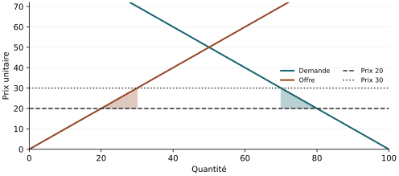

# ENS · B/L · Économie (oral option) — 13 juin 2024 · Corrigé brut

*Corrigé rédigé par IA, non officiel. Signalez toute erreur.*

**Rédaction** · GPT-6.2 Astra Ultra · vitesse non renseignée · 26 novembre 2026

Le billet propose deux leçons au choix. La préparation dure 1 h 30, l’exposé et l’entretien durent chacun 15 minutes. [Sujet officiel](https://www.ens.psl.eu/sites/default/files/bl_sujets_oraux_economie_opt_13062024.pdf) · [Rapport du jury](https://www.ens.psl.eu/sites/default/files/2024_bl_rapport_oral_economie_option.pdf)

## Protectionnisme et commerce international

Un pays peut chercher des clients à l’étranger tout en protégeant ses producteurs de la concurrence des importations. Le protectionnisme regroupe droits de douane, quotas, subventions discriminatoires et certaines exigences de contenu local. Une règle sanitaire peut aussi peser sur les échanges, mais sa justification dépend du risque qu’elle corrige. Dans quelles conditions la protection améliore-t-elle le bien-être des résidents, et que devient ce calcul lorsque les partenaires réagissent ?

### I. Ce que coûte une barrière à un petit pays

Sous concurrence, avec le prix mondial donné, le commerce permet de spécialiser les ressources selon les coûts d’opportunité. Une taxe sur les importations augmente le prix intérieur tant que l’importation reste positive. Les producteurs protégés gagnent, les acheteurs perdent et l’État prélève une recette sur les importations restantes. Les ressources supplémentaires engagées dans la production locale et les achats abandonnés constituent deux pertes sèches.

Au tableau, prenons les demandes et offres intérieures $D=100-p$ et $S=p$. À $p=20$, le pays importe 60 unités. Un droit unitaire de 10 porte le prix à 30 et ramène les importations à 40. La perte de surplus des acheteurs vaut 750, le gain des vendeurs 250 et la recette 400. Les deux triangles de perte valent ensemble 100. Une restriction quantitative donnant le même prix laisse cette fois une rente aux détenteurs des licences. S’ils sont étrangers, la rente ne revient pas aux résidents.

### II. Examiner le motif invoqué et l’instrument choisi

Un grand importateur peut faire baisser le prix reçu par ses fournisseurs étrangers. Le gain de termes de l’échange peut compenser une perte intérieure, mais son ampleur dépend de l’élasticité de l’offre étrangère. Une industrie naissante peut produire un apprentissage dont bénéficient d’autres entreprises. La protection temporaire peut alors se défendre si les gains futurs actualisés dépassent le coût présent. Un soutien ciblé à l’apprentissage évite de taxer tous les usages du bien. Une filière protégée qui fournit un composant renchérit également la production de ses clients exportateurs.

### III. Les partenaires et les travailleurs modifient le bilan

Si chaque grand pays cherche à améliorer ses termes de l’échange, les représailles annulent une partie du gain et contractent les débouchés. Des engagements réciproques peuvent éviter cette issue. À l’intérieur des pays, une hausse du revenu total peut coexister avec des pertes locales durables lorsque les travailleurs ont un métier ou un logement difficiles à déplacer. Formation, assurance de revenu et politiques territoriales n’ont ni le même calendrier ni les mêmes bénéficiaires qu’un tarif. Défendre une mesure exige donc d’identifier la défaillance, la personne qui paie et une condition de réexamen.

## La pauvreté

Le même revenu ne procure pas les mêmes possibilités à une personne seule et à une famille, à un locataire en ville et à un propriétaire sans dette. La pauvreté désigne l’insuffisance durable de ressources ou de conditions de vie pour satisfaire des besoins et participer à la société. Comment mesurer le manque, puis choisir un instrument qui modifie réellement la situation des ménages ?

### I. Choisir une unité et un seuil

Le niveau de vie rapporte le revenu disponible du ménage à ses unités de consommation. L’échelle usuelle attribue 1 au premier adulte, 0,5 aux autres personnes d’au moins 14 ans et 0,3 aux enfants plus jeunes. Deux adultes et deux jeunes enfants comptent ainsi pour 2,1 unités. En mesure relative, un seuil fréquent est 60 % du niveau de vie médian de la population. Un seuil absolu part du coût d’un panier de biens. L’un éclaire la participation à la vie sociale, l’autre des privations matérielles particulières.

Pour cinq personnes seules disposant de 500, 800, 1 500, 1 800 et 2 500 euros, le seuil relatif vaut 900 euros et le taux de pauvreté 40 %. Porter 500 à 700 améliore la situation de la plus pauvre sans modifier le taux. La moyenne des manques sous le seuil passe de $(400+100)/2=250$ à $(200+100)/2=150$ euros. Ce dernier indicateur n’est pas l’intensité médiane publiée par l’Insee. L’exemple montre pourquoi compter les personnes ne suffit pas.

### II. Reconstituer les trajectoires

Chômage, bas salaire horaire, faible durée travaillée et composition familiale n’agissent pas de la même manière. Un emploi peut laisser toute une famille sous le seuil. Un choc de revenu temporaire est plus difficile à lisser sans épargne ni crédit. Des dépenses contraintes de logement élevées limitent la consommation possible à niveau de vie identique. Données longitudinales, indicateurs de privation et recours aux aides complètent donc une photographie monétaire. La pauvreté infantile peut compromettre la santé et la réussite scolaire, puis la mobilité d’une génération à l’autre.

### III. Réduire la profondeur et la durée du manque

Un transfert ciblé relève le revenu à budget donné mais requiert d’atteindre les ménages. La complexité administrative crée du non-recours. Si chaque euro gagné réduit aussitôt la prestation d’un euro, le gain financier d’une reprise d’emploi devient faible. L’allocation dégressive permet de conserver une partie du revenu supplémentaire. Un service public de garde peut améliorer simultanément les chances de l’enfant et l’accès du parent à un emploi. On évaluera donc revenu disponible, privations, accès aux droits et persistance du manque, en distinguant une sortie du seuil d’une amélioration en deçà.
