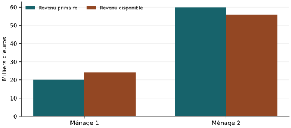

# ENS · B/L · Économie (oral option) — 17 juin, billet 1 2024 · Corrigé guidé

*Corrigé rédigé par IA, non officiel. Signalez toute erreur.*

**Rédaction** · GPT-6.2 Astra Ultra · vitesse non renseignée · 26 novembre 2026

Le billet propose deux leçons au choix. La préparation dure 1 h 30, l’exposé et l’entretien durent chacun 15 minutes. [Sujet officiel](https://www.ens.psl.eu/sites/default/files/bl_sujets_oraux_economie_opt_1_17062024.pdf) · [Rapport du jury](https://www.ens.psl.eu/sites/default/files/2024_bl_rapport_oral_economie_option.pdf)

## Contribution et redistribution

Qui verse et qui reçoit ? Une cotisation qui ouvre un droit à pension, un impôt sans contrepartie individualisée et un transfert sous condition de ressources obéissent à des logiques différentes. Pour évaluer leur effet redistributif, il faut passer des paiements statutaires à leur incidence et choisir entre revenu annuel et ressources sur la vie entière.

### I. Suivre les ressources du ménage

Le revenu disponible additionne les revenus primaires et les prestations monétaires puis retranche les prélèvements directs pertinents. Comparer avant et après permet d’étudier la redistribution verticale entre riches et pauvres. À revenu initial identique, des aides différentes selon le nombre d’enfants ou le handicap relèvent aussi d’une redistribution horizontale. Les prestations en nature comme les soins et l’école exigent une mesure élargie.

Supposons deux ménages aux revenus primaires de 20 et 60 milliers d’euros. Une contribution proportionnelle de 20 % rapporte 16, entièrement reversés sous la forme de 8 à chacun. Les revenus disponibles atteignent 24 et 56. Le rapport passe de 3 à 2,33. Le prélèvement proportionnel, pris isolément, conservait le rapport initial : l’effet vient de la combinaison avec la prestation forfaitaire. Une dépense de fonctionnement ou une modification d’offre de travail changerait le calcul.

> [!INDICATION]
> Écrire au tableau les trois colonnes revenu initial, contribution, prestation. La somme des transferts nets est nulle dans cet exemple construit à budget équilibré.

### II. De la fiche de paie à l’incidence économique

La personne légalement redevable d’une contribution ne supporte pas forcément toute la perte de revenu réel. Sur un marché concurrentiel du travail, le partage d’une cotisation dépend des élasticités de l’offre et de la demande : le côté le moins mobile absorbe davantage de la charge. À court terme un salaire minimum ou des contrats rigides modifient cet ajustement. Un prélèvement sur la consommation peut peser davantage en proportion du revenu annuel des ménages modestes. Sur une vie entière, l’épargne différée et les transmissions modifient encore la comparaison.

### III. Arbitrer assurance, solidarité et incitations

Une assurance sociale mutualise un risque entre bien-portants et malades, actifs employés et chômeurs. Elle peut redistribuer fortement ex post même si les contributions sont proportionnelles au salaire. Un système contributif de retraite reporte du revenu sur le cycle de vie. Plafonds, droits familiaux, minima et différences d’espérance de vie introduisent d’autres effets. Les retraits de prestations au-delà d’un seuil peuvent créer un taux marginal de prélèvement élevé. Pour juger une réforme, il faut simuler les ménages concernés, observer le non-recours et distinguer taux moyen, taux marginal et gain d’assurance.

### Préparer l’entretien

**Pourquoi un ménage bénéficiaire net cette année peut-il avoir été contributeur net ?** Il a pu cotiser en période d’emploi puis percevoir une prestation pendant le chômage ou la retraite.

## Inégalités et mondialisation

La mondialisation associe échanges de biens et de services, mobilité du capital, fragmentation de la production et, dans certaines limites, mobilité des personnes. Les inégalités entre pays, à l’intérieur de chaque pays et entre tous les individus du monde peuvent évoluer différemment. Quels mécanismes rendent compatibles une convergence internationale et des écarts internes croissants ?

### I. Distinguer trois comparaisons

Prenons deux pays de même taille, chacun représenté par deux personnes. Les revenus initiaux sont $(1,3)$ et $(8,12)$, puis deviennent $(2,6)$ et $(8,16)$ en unités réelles comparables. Le rapport des moyennes nationales passe de $10/2=5$ à $12/4=3$. Le rapport interne du pays riche passe pourtant de $12/8=1,5$ à $16/8=2$. Pour mesurer l’inégalité mondiale entre personnes, il faut regrouper les distributions, les pondérer par la population et choisir un indice. Comparer seulement les moyennes nationales perd l’information interne. Une comparaison de pouvoir d’achat suppose des prix rendus comparables.

> [!INDICATION]
> Représenter chaque personne par un point. Les déplacements des deux moyennes et les écarts entre points d’un même pays répondent à deux questions différentes.

### II. L’ouverture rémunère différemment facteurs et territoires

Dans le modèle à deux facteurs et deux biens, avec concurrence, spécialisation incomplète et mobilité sectorielle nationale, la hausse du prix relatif du bien intensif dans un facteur augmente sa rémunération réelle et peut réduire celle de l’autre. Dans une économie où certaines régions sont spécialisées et la mobilité faible, les pertes peuvent être concentrées et persistantes. Les consommateurs gagnent aussi en diversité et parfois en pouvoir d’achat. Une firme capable d’exporter peut étendre son marché, payer davantage certains salariés ou distribuer les gains à ses actionnaires. La délocalisation de tâches et le progrès technique affectent souvent les mêmes qualifications, d’où la difficulté d’attribuer toute divergence salariale aux seules importations.

### III. L’effet final dépend des institutions

L’industrialisation exportatrice peut favoriser le rattrapage d’un pays pauvre si les gains de productivité se diffusent. Une économie spécialisée dans une ressource peut connaître une hausse du revenu national sans diffusion comparable. Formation, assurance chômage, négociation collective et fiscalité modifient le partage des gains. Comparer des régions initialement très ou peu exposées à une hausse externe des importations éclaire les effets locaux sous hypothèses sur leurs trajectoires antérieures. Cela ne mesure pas directement les gains nationaux de consommation. L’ouverture transforme donc des prix et des opportunités. Le patrimoine, le lieu de vie et la politique sociale déterminent comment ces transformations atteignent les ménages.

### Préparer l’entretien

**Une courbe des gains de revenu par percentile mondial suit-elle les mêmes individus ?** Une comparaison de deux distributions en coupe suit des positions dans le classement, dont les occupants peuvent avoir changé.
