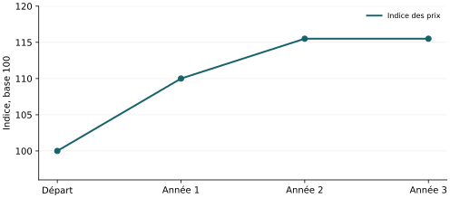

# ENS · B/L · Économie (oral option) — 17 juin, billet 2 2024 · Corrigé brut

*Corrigé rédigé par IA, non officiel. Signalez toute erreur.*

**Rédaction** · GPT-6.2 Astra Ultra · vitesse non renseignée · 26 novembre 2026

Le billet propose deux leçons au choix. La préparation dure 1 h 30, l’exposé et l’entretien durent chacun 15 minutes. [Sujet officiel](https://www.ens.psl.eu/sites/default/files/bl_sujets_oraux_economie_opt_2_17062024.pdf) · [Rapport du jury](https://www.ens.psl.eu/sites/default/files/2024_bl_rapport_oral_economie_option.pdf)

## Causes et conséquences de l’inflation

Une famille peut subir des prix durablement élevés alors que l’inflation baisse déjà. L’inflation mesure le taux de croissance d’un indice général des prix, pondéré par la structure de consommation. L’augmentation du prix d’un produit isolé est d’abord une variation de prix relatif. Comment devient-elle un phénomène agrégé, et qui en supporte le coût ?

### I. Distinguer le niveau, la vitesse et l’étendue du mouvement

Un indice passant de 100 à 110 puis 115,5 connaît successivement 10 % et 5 % d’inflation. S’il reste ensuite à 115,5, l’inflation devient nulle. Une désinflation ralentit la hausse tandis qu’une déflation fait baisser le niveau de l’indice. Les ménages consommant davantage d’énergie peuvent connaître une hausse de coût de la vie supérieure à la moyenne. Le déflateur du PIB couvre, lui, les prix des productions intérieures et ne reprend pas le même panier.

### II. Identifier l’origine pour comprendre la persistance

Une relance de demande augmente les quantités quand des capacités sont disponibles, davantage les prix quand l’appareil productif sature. Un choc sur le coût de l’énergie ou des intrants importés renchérit l’offre et peut réduire simultanément la production. Une dépréciation du change se transmet selon la monnaie de facturation et la politique de marge des entreprises. L’épisode européen de 2021–2023 a combiné réouverture, tensions de livraison et choc énergétique. Une variation isolée du prix du gaz relève une fois le niveau des prix. La poursuite de l’inflation dépend ensuite des nouveaux chocs, de l’indexation, des négociations de salaires et des anticipations. L’identité $MV=PY$ ne détermine à elle seule ni la vitesse de circulation, ni la production, ni la direction de la causalité.

### III. Mesurer les pertes et choisir la réponse

Avec un salaire nominal en hausse de 4 % et des prix en hausse de 8 %, le salaire réel varie de $1,04/1,08-1$, soit environ −3,7 %. Une dette nominale ancienne à taux fixe s’allège en valeur réelle au détriment du créancier si la hausse des prix surprend. Les nouvelles dettes et les contrats indexés s’ajustent différemment. Une banque centrale qui relève son taux réduit crédit et demande avec délai. Elle peut prévenir un désancrage des anticipations sans produire davantage de gaz. Des transferts ciblés protègent les ménages les plus exposés tout en préservant le signal de rareté. Le choix de politique dépend de l’origine du choc et de sa propagation au revenu réel.

## Justice sociale et biens publics

Un phare accessible à tous et un hôpital ouvert à tous n’ont pas les mêmes contraintes économiques. Un bien public pur est non rival et non excluable. L’accès universel à un service public peut au contraire nécessiter des places, du personnel et des règles de priorité. Comment articuler une offre collectivement efficace avec un partage juste de sa charge et de ses bénéfices ?

### I. Additionner les bénéfices d’un usage simultané

Si deux résidents profitent chacun de la même quantité d’éclairage, la disposition marginale à payer collective est la somme de leurs dispositions individuelles. Pour des valeurs marginales $8-q$ et $6-q$, positives dans la zone étudiée, et un coût marginal constant de 6, l’optimum intérieur est $q=4$ car $(8-4)+(6-4)=6$. Pris séparément, aucun résident n’attribue 6 à la quatrième unité. Un financement volontaire peut donc produire trop peu par comportement de passager clandestin. L’offre publique, un contrat collectif ou une règle commune peuvent organiser la contribution, avec un problème de révélation des préférences.

### II. Qui compte et combien pèse sa demande ?

Une unité de revenu a généralement plus de valeur pour un ménage pauvre. Une somme de consentements à payer reflète donc à la fois les préférences et les moyens. Une politique peut retenir l’égalité des droits, l’égalité d’accès effectif ou l’amélioration prioritaire de la situation des moins favorisés. À prélèvement identique, la localisation d’une infrastructure peut concentrer ses avantages dans les quartiers déjà équipés. Inversement, une prévention environnementale peut profiter davantage aux populations les plus exposées. Il faut observer l’usage et l’incidence territoriale, en plus du budget voté.

### III. Concevoir le financement et l’accès ensemble

Un péage à l’entrée d’un ouvrage non saturé peut écarter des usagers alors que leur coût marginal d’usage est nul. Une fois la congestion forte, un prix de pointe fait tenir compte du temps perdu par les autres. Un abonnement social ou un transfert forfaitaire peut compenser la charge sans supprimer l’incitation à décaler ses déplacements. Impôts progressifs et financement local engagent des principes distincts selon que les bénéfices débordent ou non les frontières de la commune. L’efficacité indique les bénéfices et les coûts marginaux pertinents. La justice exige en plus un choix explicite sur les droits, les ressources et l’accès.
