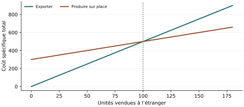

# ENS · B/L · Économie (oral option) — 17 juin, billet 3 2024 · Corrigé brut

*Corrigé rédigé par IA, non officiel. Signalez toute erreur.*

**Rédaction** · GPT-6.2 Astra Ultra · vitesse non renseignée · 26 novembre 2026

Le billet propose deux leçons au choix. La préparation dure 1 h 30, l’exposé et l’entretien durent chacun 15 minutes. [Sujet officiel](https://www.ens.psl.eu/sites/default/files/bl_sujets_oraux_economie_opt_3_17062024.pdf) · [Rapport du jury](https://www.ens.psl.eu/sites/default/files/2024_bl_rapport_oral_economie_option.pdf)

## Les multinationales

Une entreprise peut vendre dans cent pays en fabriquant dans un seul. Une multinationale contrôle ou coordonne au contraire des activités productives dans plusieurs pays, notamment par un investissement direct et une filiale. Pourquoi confier l’activité étrangère à une entreprise du groupe et quels en sont les effets sur les économies d’accueil et d’origine ?

### I. Arbitrer entre exportation, contrat et implantation

Une entreprise possède parfois une marque, un procédé ou une organisation qu’elle peut exploiter à l’étranger. Exporter évite de dupliquer l’usine mais occasionne des coûts de transport et de frontière. Une licence économise le coût d’implantation tout en posant un problème de contrôle de la qualité ou de protection du savoir-faire. L’investissement horizontal rapproche la production du débouché. L’investissement vertical répartit différentes étapes selon coûts, compétences et fournisseurs.

Supposons un coût spécifique de 5 par unité exportée contre 2 pour une production sur place, plus un coût fixe de 300. L’implantation coûte moins cher pour $300+2q<5q$, donc au-delà de 100 unités. À 60 unités, exporter coûte 300 contre 420 sur place. À 140, exporter coûte 700 contre 580. À prix et qualité comparables, un marché plus grand favorise donc l’implantation. Des règles de contenu local ou un risque de rupture de livraison peuvent changer le seuil.

### II. Une filiale modifie l’emploi et les capacités productives

Dans le pays d’accueil, une implantation nouvelle crée potentiellement des emplois, de la demande pour les fournisseurs et un apprentissage. Le rachat d’un établissement existant change d’abord son propriétaire. Le gain dépend de la diffusion des techniques, des compétences disponibles et du pouvoir de négociation des travailleurs. Dans le pays d’origine, le déplacement d’une étape peut réduire certains emplois et abaisser les coûts des autres établissements. Observer que les multinationales paient mieux ne suffit pas à établir une causalité : elles sélectionnent souvent des secteurs, des travailleurs et des sites plus productifs.

### III. Les institutions encadrent une firme organisée au-delà des frontières

Les biens intermédiaires traversant plusieurs frontières gonflent les flux bruts par rapport aux valeurs ajoutées nationales. Les prix de transfert affectent le lieu de déclaration des bénéfices, sous réserve des règles fiscales. La concurrence entre territoires peut attirer des capacités productives ou déplacer une base taxable avec peu d’activité réelle. Normes, concurrence et coordination fiscale poursuivent ainsi des objectifs différents. Le bilan d’une implantation se juge sur l’alternative crédible, la valeur ajoutée locale, les apprentissages et les coûts publics engagés.

## Le capital humain

Une qualification, l’expérience et la santé augmentent parfois la capacité productive d’une personne. Elles s’acquièrent au cours du temps et restent attachées à celui ou celle qui les possède. En quoi l’idée d’investissement explique-t-elle l’éducation, et quelles limites rencontre-t-elle pour rendre compte des salaires et des inégalités ?

### I. Comparer un coût immédiat à des gains différés

Se former coûte en frais, en effort et en revenu auquel on renonce. Les gains peuvent être salariaux, professionnels et non marchands. Pour un coût initial de 10 000 et un supplément de revenu de 4 000 à la fin de chacune des trois années suivantes, la valeur actualisée nette à 5 % est $-10\,000+4\,000(1/1,05+1/1,05^2+1/1,05^3)$, soit environ 893 euros. Une probabilité d’achèvement plus faible ou un coût d’opportunité plus élevé peut renverser le choix. Une personne sans garantie ne peut facilement emprunter en donnant ses compétences futures en gage.

### II. Séparer acquisition de compétences et sélection

Une formation générale augmente la productivité dans plusieurs entreprises tandis qu’une compétence spécifique rapporte surtout dans la relation d’emploi présente. Cela modifie le partage du financement et le risque de départ. Un diplôme peut également signaler une aptitude préexistante difficile à observer. La corrélation positive entre années d’étude et salaire mélange apprentissage, sélection et accès à certains métiers. Une réforme de scolarité obligatoire peut fournir une variation d’exposition plus indépendante du milieu familial. L’effet identifié concerne les élèves dont la réforme a effectivement changé le parcours.

### III. Le rendement social peut différer du rendement privé

Une population formée favorise la diffusion des innovations et peut améliorer la santé ou la participation civique. L’avantage privé de passer devant d’autres candidats à un emploi rare peut, à l’inverse, excéder la hausse de production collective. L’origine sociale agit sur la préparation, l’information, le coût d’une poursuite d’études et la capacité à supporter un échec. Une bourse traite la contrainte financière. Orientation, formation de base et qualité de l’enseignement agissent ailleurs. Une politique doit donc évaluer les compétences acquises, la distribution de l’accès et les effets sur les autres travailleurs, au-delà du seul salaire des diplômés.
