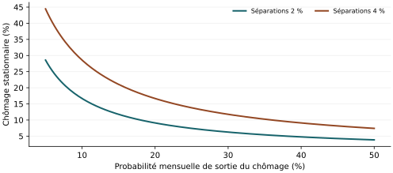

# ENS · B/L · Économie (oral option) — 18 juin 2024 · Corrigé guidé

*Corrigé rédigé par IA, non officiel. Signalez toute erreur.*

**Rédaction** · GPT-6.2 Astra Ultra · vitesse non renseignée · 26 novembre 2026

Le billet propose deux leçons au choix. La préparation dure 1 h 30, l’exposé et l’entretien durent chacun 15 minutes. [Sujet officiel](https://www.ens.psl.eu/sites/default/files/bl_sujets_oraux_economie_opt_1_18062024.pdf) · [Rapport du jury](https://www.ens.psl.eu/sites/default/files/2024_bl_rapport_oral_economie_option.pdf)

## Flexibilité et rigidités du marché du travail

Pour une entreprise, ajuster ses effectifs à une chute des commandes peut préserver son activité. Pour un salarié, l’assurance de conserver son poste encourage l’acquisition de compétences spécifiques. La flexibilité désigne plusieurs marges d’ajustement des effectifs, du temps de travail, des tâches et des rémunérations. À quelles conditions ces marges réduisent-elles le chômage ou en déplacent-elles seulement le risque ?

### I. Comprendre les flux derrière le taux de chômage

Avec deux états seulement, emploi et chômage, supposons qu’une fraction mensuelle $s$ des employés perde son emploi et qu’une fraction $f$ des chômeurs en retrouve un. À l’état stationnaire, $s(1-u)=fu$, soit $u=s/(s+f)$. Avec $s=2\%$ et $f=18\%$, le taux de chômage vaut 10 %. Une réforme qui fait passer les probabilités à 3 % et 27 % laisse ce taux à 10 %, mais les emplois durent moins longtemps et les chômeurs sortent plus vite. Un stock identique peut donc masquer un partage différent de l’insécurité. Le modèle ignore les entrées et sorties d’activité.

> [!INDICATION]
> Comparer ensuite les durées moyennes de chômage dans ce modèle géométrique. Elles passent de $1/0,18$ à $1/0,27$ mois environ.

### II. Les institutions modifient plusieurs comportements à la fois

Un coût de séparation réduit certains licenciements et peut décourager une embauche incertaine. L’effet net sur le stock d’emplois dépend des deux marges et de la conjoncture. La protection peut favoriser la coopération et l’investissement en formation. Si elle diffère fortement selon le contrat, l’entreprise peut réserver une protection élevée à un noyau stable et faire porter l’ajustement aux nouveaux arrivants. Un salaire réel supérieur au salaire de concurrence peut limiter la demande en concurrence parfaite. Lorsqu’un employeur dispose d’un pouvoir de monopsone, un salaire minimum modéré peut au contraire relever salaire et emploi. Il faut donc préciser la structure du marché avant d’interpréter un salaire peu flexible.

### III. Assurer les transitions et préserver les appariements de valeur

Face à un choc temporaire, le chômage partiel partage les heures et préserve un savoir-faire. S’il maintient durablement des emplois devenus non viables, il peut ralentir les réallocations. Assurance chômage, accompagnement, formation et portabilité de droits peuvent sécuriser les personnes qui changent d’employeur. Un contrat plus souple ne crée pas à lui seul des offres si la demande globale s’effondre. Il faut comparer taux d’emploi, salaires, durée du chômage, mobilités choisies et exposition des débutants, avec un groupe de comparaison crédible.

### Préparer l’entretien

**Une durée moyenne de chômage plus faible suffit-elle à conclure à une amélioration ?** Il faut savoir vers quel emploi ou vers quelle situation les personnes sortent et à quelle fréquence elles reviennent au chômage.

## Politique monétaire en économie ouverte

Une hausse de taux peut freiner l’achat d’un logement et attirer des capitaux étrangers. Le canal du change lie alors les décisions de la banque centrale à l’inflation importée, à la demande adressée au pays et aux bilans en devises. Quelle autonomie reste-t-il lorsque les capitaux circulent et que le gouvernement s’engage sur un taux de change ?

### I. Ajouter le taux de change au mécanisme de transmission

Notons $e$ le prix d’une unité de monnaie étrangère en monnaie nationale. Une baisse de $e$ est une appréciation nationale. Pour des placements comparables, sans prime de risque, l’absence d’écart anticipé de rendement s’écrit approximativement $i-i^*=(E[e_{t+1}]-e_t)/e_t$. À change futur anticipé égal à 1 et à taux étranger de 2 %, un taux national de 4 % donne $e_t$ proche de $1/1,02=0,98$. L’appréciation immédiate est alors compatible avec une dépréciation attendue. L’exercice est conditionnel aux anticipations. En situation de crise, une prime de risque ou un changement des anticipations peut dominer l’effet du taux.

> [!INDICATION]
> Écrire l’unité de $e$ à côté de la formule. Pour un importateur qui paie un dollar, la facture en monnaie locale diminue quand $e$ baisse.

### II. Le régime de change répartit l’ajustement

En change flottant avec capitaux mobiles et prix rigides, un assouplissement monétaire réduit le coût du crédit et peut déprécier la monnaie. Les biens nationaux deviennent moins chers relativement aux biens étrangers, mais les importations énergétiques renchérissent. Le solde commercial peut se dégrader d’abord si les quantités contractuelles réagissent lentement. En change fixe crédible avec parfaite mobilité des capitaux, le taux national suit le taux extérieur hors prime. Une banque centrale qui essaie de baisser durablement son taux doit vendre des réserves pour défendre la parité, ce qui retire de la liquidité. Le triangle d’incompatibilité exprime l’impossibilité de conserver simultanément change fixe, capitaux parfaitement mobiles et politique monétaire autonome.

### III. Les bilans et l’union monétaire nuancent le choix

Une dépréciation alourdit la dette en monnaie étrangère des entreprises dont les recettes sont nationales. La contraction des bilans peut limiter la relance par les exportations. Dans une union monétaire, les membres partagent le taux nominal et le change extérieur. Si l’inflation anticipée nationale diffère, les taux réels diffèrent aussi. Les stabilisations budgétaires, la mobilité des travailleurs et l’assurance financière entre régions prennent alors plus d’importance. L’efficacité de la politique monétaire se juge donc sous un régime de change précis et en tenant compte des dettes, des délais commerciaux et de la crédibilité.

### Préparer l’entretien

**La baisse du taux fait-elle obligatoirement baisser la monnaie ?** Le résultat est conditionnel aux anticipations, à la prime de risque et au régime de change. Un assouplissement déjà anticipé peut être incorporé au cours courant.
