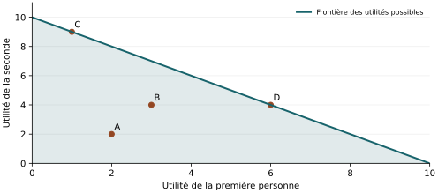

# ENS · B/L · Économie (oral option) — 20 juin, billet 1 2024 · Corrigé guidé

*Corrigé rédigé par IA, non officiel. Signalez toute erreur.*

**Rédaction** · GPT-6.2 Astra Ultra · vitesse non renseignée · 26 novembre 2026

Le billet propose deux leçons au choix. La préparation dure 1 h 30, l’exposé et l’entretien durent chacun 15 minutes. [Sujet officiel](https://www.ens.psl.eu/sites/default/files/bl_sujets_oraux_economie_opt_1_20062024.pdf) · [Rapport du jury](https://www.ens.psl.eu/sites/default/files/2024_bl_rapport_oral_economie_option.pdf)

## L’optimalité en économie

Une répartition peut utiliser toutes les ressources tout en laissant certaines personnes très pauvres. Un optimum est défini relativement à un objectif, à des contraintes et à un ensemble de décisions accessibles. L’optimum individuel d’une firme, l’efficacité au sens de Pareto et un maximum de bien-être collectif répondent-ils à la même question ?

### I. Identifier les contraintes et le critère

Le consommateur choisit un panier sous contrainte budgétaire. À un optimum intérieur avec deux biens divisibles, le taux marginal de substitution égale le rapport des prix. Pour une firme concurrentielle, produire une unité supplémentaire est profitable tant que son prix dépasse son coût marginal, sous réserve de la fermeture et des coûts fixes. Au niveau collectif, une allocation est efficace au sens de Pareto si aucune autre allocation réalisable ne peut améliorer quelqu’un sans détériorer la situation d’au moins une autre personne.

Supposons que les couples d’utilités réalisables vérifient $u+v\le10$ et $u,v\ge0$. On peut passer de $A=(2,2)$ à $B=(3,4)$ au bénéfice des deux personnes. Les points $C=(1,9)$ et $D=(6,4)$ sont tous deux efficaces. Un critère maximin préfère D, puisque le plus petit niveau d’utilité passe de 1 à 4. Avec la somme non pondérée des utilités mesurées sur l’échelle retenue, C et D sont à égalité. L’optimum social dépend du jugement distributif.

> [!INDICATION]
> Trouver une amélioration de Pareto à partir de B. Passer de B à D accroît le bien-être de la première personne sans diminuer celui de la seconde.

### II. Quand un équilibre décentralisé est-il efficace ?

Pour des marchés complets, des agents preneurs de prix et des préférences localement non saturées, un équilibre concurrentiel est efficace au sens de Pareto. Si une autre allocation améliorait quelqu’un sans léser personne, son coût total aux prix d’équilibre excéderait celui des ressources disponibles. Ce résultat ne choisit pas la distribution des dotations initiales. Sous des hypothèses de convexité supplémentaires, prix et transferts forfaitaires peuvent, dans un modèle approprié, soutenir certaines allocations efficaces choisies par la collectivité.

### III. Revenir à l’optimum accessible

Une pollution produit un écart entre coûts marginaux privé et social. Un monopole restreint les échanges malgré un coût inférieur à la disposition à payer de certains acheteurs. Une assurance imparfaite peut laisser des risques importants non couverts. L’autorité qui intervient rencontre des contraintes d’information et d’incitation. En présence de plusieurs distorsions, corriger une seule condition de premier rang peut déplacer le problème. L’évaluation compare alors les résultats réalisables sous ces contraintes, en précisant qui gagne, qui perd et selon quel critère l’action est préférable.

### Préparer l’entretien

**Tout point efficace maximise-t-il le bien-être du plus défavorisé ?** Les points C et D sont un contre-exemple. L’efficacité décrit ce qu’il reste possible d’améliorer conjointement, le maximin classe les répartitions.

## Concurrence et régulation

Mettre plusieurs vendeurs en concurrence peut discipliner leurs prix. Construire plusieurs réseaux de distribution d’eau parallèles peut aussi gaspiller des ressources. Pourquoi la régulation doit-elle parfois ouvrir un marché et parfois encadrer un opérateur qui reste seul ?

### I. Le pouvoir de marché restreint les quantités

Sous concurrence et sans externalité, le prix égal au coût marginal autorise tous les échanges dont le bénéfice dépasse le coût. Considérons une demande inverse $p=100-q$ et un coût marginal constant de 20. La quantité efficace vaut 80. Un monopoliste à prix unique égalise recette marginale $100-2q$ et coût marginal, d’où $q=40$, $p=60$. La perte sèche vaut $(80-40)(60-20)/2=800$. Le profit du vendeur n’est pas entièrement une perte collective : une partie correspond à une redistribution du surplus des acheteurs.

> [!INDICATION]
> Distinguer au tableau le rectangle de transfert des acheteurs et le triangle des échanges abandonnés. Pour ces unités-là, aucun acteur ne reçoit le surplus perdu.

### II. Préserver une concurrence qui puisse effectivement s’exercer

Les ententes réduisent la pression concurrentielle sans exiger la présence d’un vendeur unique. Une fusion peut accroître le pouvoir de marché, mais aussi réduire certains coûts ou améliorer la qualité. L’autorité examine les substituts pertinents, l’entrée potentielle et la capacité de réaliser les gains annoncés. Dans une plateforme, les effets de réseau peuvent attirer de nouveaux utilisateurs tout en rendant leur départ collectif difficile. Interopérabilité ou accès non discriminatoire peuvent faciliter l’entrée, avec des coûts techniques et de confidentialité à examiner.

### III. Réguler prix et qualité lorsque les coûts fixes dominent

Un réseau de coût $C(q)=F+cq$ peut approvisionner tout le marché à un coût inférieur à celui de deux réseaux identiques. Au tarif $p=c$, l’opérateur ne couvre pas $F$. Un abonnement peut financer le réseau, mais exclure certains ménages. Une subvention a un coût budgétaire. Un plafond tarifaire pluriannuel incite à réduire les coûts, avec un risque de sous-investissement ou de baisse de qualité. La séparation entre infrastructure et fourniture peut ouvrir la seconde activité tout en encadrant l’accès à la première. Concurrence et régulation sont donc complémentaires lorsque les règles facilitent l’entrée et protègent simultanément la continuité du service.

### Préparer l’entretien

**La présence de deux firmes garantit-elle un prix proche du coût marginal ?** Le résultat dépend de leurs capacités, de la différenciation et des possibilités d’entente tacite ou explicite.
