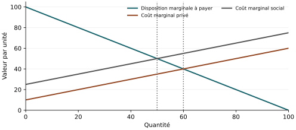

# ENS · B/L · Économie (oral option) — 20 juin, billet 2 2024 · Corrigé brut

*Corrigé rédigé par IA, non officiel. Signalez toute erreur.*

**Rédaction** · GPT-6.2 Astra Ultra · vitesse non renseignée · 26 novembre 2026

Le billet propose deux leçons au choix. La préparation dure 1 h 30, l’exposé et l’entretien durent chacun 15 minutes. [Sujet officiel](https://www.ens.psl.eu/sites/default/files/bl_sujets_oraux_economie_opt_2_20062024.pdf) · [Rapport du jury](https://www.ens.psl.eu/sites/default/files/2024_bl_rapport_oral_economie_option.pdf)

## Gouvernance mondiale

Un État qui réduit ses émissions supporte localement une partie des coûts alors que les bénéfices climatiques franchissent les frontières. Les échanges, la stabilité financière et les ressources communes posent également des problèmes de coordination. La gouvernance mondiale désigne les règles et organisations par lesquelles des États et d’autres acteurs traitent ces interdépendances. À quelles conditions un engagement collectif tient-il en l’absence d’autorité fiscale mondiale ?

### I. Expliquer pourquoi des pays souverains choisissent trop peu de coopération

Deux pays peuvent chacun financer un effort coûtant 6 à celui qui le réalise et rapportant 4 à chacun. Si aucun n’agit, les gains sont $(0,0)$. Si seul A agit, ils valent $(-2,4)$. Si les deux agissent, ils valent $(2,2)$. Chacun préfère individuellement laisser l’autre agir, quelle que soit sa décision. Les deux seraient pourtant mieux si chacun contribuait. La structure du problème change si les contributions donnent aussi des avantages locaux importants ou si les pays sont de tailles différentes.

### II. Rendre les engagements observables et réciproques

La répétition des interactions donne de la valeur à une bonne réputation. Les États doivent toutefois pouvoir mesurer les efforts et distinguer une fraude d’un choc extérieur. Les accords commerciaux organisent des engagements réciproques et des procédures de règlement des différends. Pour le climat, rendre comparables les émissions, les réductions et la couverture des engagements améliore le contrôle. Des clubs de pays peuvent réserver certains avantages à leurs membres, sans assurer automatiquement l’adhésion des autres. Une taxe à la frontière peut limiter des fuites de production mais accroître les tensions sur les méthodes de calcul et l’accès des pays pauvres au marché.

### III. Négocier aussi la répartition des gains et des risques

Un même prix du carbone fait peser des charges relatives distinctes sur des pays dont les revenus, l’appareil productif et les responsabilités historiques diffèrent. Financements, transferts technologiques et adaptation des calendriers peuvent rendre un accord acceptable. Les institutions financières internationales peuvent fournir une liquidité en cas de crise, avec des questions de conditionnalité et de représentation. Il faut apprécier une institution à la fois par rapport au problème transfrontalier traité, au respect des engagements, à la voix accordée aux participants et à son effet distributif. Un accord moins ambitieux mais vérifiable peut améliorer la situation si une règle plus exigeante ne rassemble personne.

## Externalités

Une entreprise peut produire un bien vendu sur un marché tout en affectant la santé de riverains qui ne participent pas à la transaction. Une externalité est l’effet non compensé d’une action sur le bien-être ou les possibilités de production d’un tiers, en dehors de la variation ordinaire d’un prix de marché. Comment mesurer l’écart entre décisions privées et collectives, puis choisir une correction ?

### I. Passer du coût privé au coût social

Prenons une demande marginale $100-q$, un coût marginal privé $10+q/2$ et un dommage marginal externe constant de 15. L’équilibre concurrentiel vérifie $100-q=10+q/2$, soit $q=60$. Le coût social est $25+q/2$ et l’optimum vérifie $q=50$. Les dix unités excédentaires coûtent collectivement plus qu’elles ne rapportent. La perte triangulaire vaut $10\times15/2=75$. Une taxe unitaire de 15 conduit à la quantité efficace. Sa recette vaut alors 750, qui ne constitue pas en elle-même le gain collectif. La restauration du surplus vient des unités évitées.

### II. Différentes institutions peuvent internaliser l’effet

Une taxe fixe un prix des émissions et laisse s’ajuster les quantités. Des permis échangeables fixent une quantité totale et laissent le prix refléter les coûts marginaux de réduction. Pour un dommage local, une même tonne peut affecter différemment les riverains selon le lieu. Une norme technique est parfois plus facile à contrôler, mais peut imposer des efforts très coûteux à certaines entreprises. Avec droits bien définis, parties peu nombreuses, information et coûts de transaction négligeables, la négociation peut réaliser des améliorations mutuelles. Des millions de victimes dispersées créent des coûts de mesure et d’organisation considérables.

### III. Agir aussi sur les bénéfices externes et la distribution

La vaccination ou la diffusion des connaissances peut procurer un bénéfice à d’autres personnes. Une subvention peut rapprocher bénéfice marginal privé et social à condition d’atteindre l’activité effectivement génératrice d’externalités. Les institutions de propriété intellectuelle encouragent l’invention mais peuvent freiner sa diffusion. Pour une taxe sur les carburants, les possibilités de substitution diffèrent entre citadins et ménages isolés. Redistribuer forfaitairement les recettes peut réduire l’effet distributif tout en conservant l’incitation marginale. La politique doit donc relier le dommage mesurable, les coûts de réduction, le contrôle possible et la compensation des personnes exposées.
