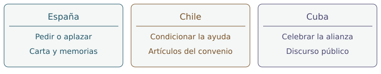

# BEL B/L — Espagnol 2024 · Corrigé guidé

*Corrigé rédigé par IA, non officiel. Signalez toute erreur.*

**Rédaction** · GPT-6.2 Astra Ultra · vitesse non renseignée · 26 novembre 2026

## ¿Qué precio tiene el apoyo de un aliado?

El expediente reúne una carta de 1938, unas memorias publicadas en 1977 sobre una entrevista de 1940, un convenio firmado en 1952 y un discurso de 1975. Cada texto permite observar quién se dirige a quién y con qué autoridad. La fecha de publicación de las memorias importa tanto como la del encuentro que narran.

## Análisis y comentario

### Una amistad que es preciso explicar

**Pista** Identifique primero el acto que realiza cada documento. Una promesa de amistad, una cláusula jurídica y una justificación retrospectiva no prueban el mismo tipo de hecho.

Cuando Juan Negrín tiende la mano a Stalin al final de su carta, declara salvar la distancia entre los dos extremos de Europa. En Moa, casi cuatro décadas después, Fidel Castro recibe a Edward Gierek como representante de un pueblo hermano. Ambos gestos designan la política internacional como amistad entre pueblos. El convenio chileno-estadounidense, en cambio, se extiende minuciosamente sobre lo que debe hacer cada parte. Y el recuerdo que Ramón Serrano Suñer conserva de Hendaya precisa cómo se puede evitar un compromiso que un interlocutor mucho más poderoso desea obtener. ¿Qué margen de decisión conserva un Estado cuando necesita la ayuda de otro? La pregunta exige atender a los destinatarios. El solicitante habla en privado, el memorialista se defiende ante la posteridad, un tratado crea obligaciones y el orador invita al público a ratificar una alianza ya existente.

### Solicitar y aplazar · Dos momentos españoles

**Pista** En la carta, relacione la fórmula contra el halago con la petición que sigue. En las memorias, contraste la profesión de resistencia con lo que el autor admite sobre sus expectativas en 1940.

En noviembre de 1938 Negrín, presidente del Consejo de Ministros de la República, escribe después de los acuerdos de Múnich y cuando la contienda española entra en su tramo final. Declara que procurará refrenar su pluma para no halagar a Stalin y, de inmediato, asegura que sin su apoyo se habrían perdido la libertad y la democracia españolas. La aparente reserva le permite presentar la alabanza como una verdad que sería deshonesto callar. Pero el remitente necesita más que un agradecimiento bilateral. Convierte la supervivencia de la República en asunto europeo. Si España cae, teme que ni siquiera pase el verano de 1939 sin una guerra general. La predicción muestra su modo de razonar en 1938. El desenlace posterior no convierte en inevitables las decisiones que entonces intentaba cambiar.

El diagnóstico de otros gobiernos cumple la misma función persuasiva. Negrín atribuye a Chamberlain simpatías hacia los dictadores, recelo ante la URSS y prejuicios de clase. De Francia reprocha la dependencia de Londres, pero distingue a quienes podrían reconocer intereses comunes aun discrepando políticamente. Deposita otra esperanza en Roosevelt y en un acercamiento soviético-estadounidense. En la parte española insiste en la desproporción entre los apoyos externos de ambos bandos. Llama «seguro» frente a la próxima guerra a lo que pide para la presente. Así ofrece al destinatario un argumento de interés propio junto al lenguaje de la gratitud. Las promesas de victoria y la valoración elogiosa del apoyo soviético se leen a la luz de esa solicitud.

En las memorias de Serrano Suñer, ministro del régimen de Franco, el problema de 1940 se formula al revés. El interlocutor alemán presiona para que España se sume a su causa. En 1977 el autor se atribuye la virtud de haber resistido sin provocar una ruptura. Invoca el diario del general Jodl como testimonio externo y admite algo incómodo para su defensa: él y Franco esperaban una victoria alemana en el continente y querían sacar ventaja del nuevo orden. Lo que dice temer es un exceso de esa victoria. Su propuesta de aproximarse a Italia y a la Francia de Vichy revela hasta qué punto su margen se concebía dentro de aquel horizonte. También observa que el poder absoluto perjudicaba a Franco en una negociación. El ministro podía aplazar una respuesta alegando que carecía de poderes, mientras que Franco carecía precisamente de esa instancia superior. El detalle sirve al memorialista para justificar su propia intervención. La escueta salvedad sobre el protocolo de Hendaya y la insistencia en las previsiones compartidas desaconsejan aceptar sin reservas el relato de una resistencia concertada. La no entrada formal de España en la guerra no demuestra por sí sola una oposición del régimen franquista al Eje.

### Medir la reciprocidad en el convenio de 1952

**Pista** Subraye los sujetos de los artículos I, IV, V, VII y IX. ¿Qué ocurre cuando después de una obligación expresada en plural aparece como sujeto únicamente el Gobierno de Chile?

En Santiago de Chile, el acuerdo suscrito el 9 de abril de 1952 por Eduardo Yrarrázaval y Claude G. Bowers se promulga el 6 de julio y se publica el 21. El texto vincula a los gobiernos de Gabriel González Videla y Harry Truman. En el preámbulo, el Tratado Interamericano de Ayuda Recíproca y la Carta de la ONU sitúan el pacto bilateral dentro de una obligación continental y de un ideal de paz universal. Se declaran igualmente auténticas las versiones española e inglesa. Hasta ahí, cada fórmula subraya la igualdad jurídica de los dos interlocutores. Para ver las consecuencias de esa igualdad hay que leer los verbos de las cláusulas.

El artículo I empieza por las obligaciones de «cada uno» de los gobiernos, pero enseguida particulariza las condiciones del uso que Chile dará a la ayuda recibida y limita su facultad de transferirla. El artículo IV contempla gastos de funcionamiento en moneda chilena y exenciones tributarias. El V regula el estatuto diplomático del personal que observará la ejecución del acuerdo. En el VII, Chile facilitará el suministro de materias primas que necesiten los Estados Unidos. La cláusula reserva a la vez un espacio para las necesidades del consumo interno y la exportación comercial chilena. Finalmente, el artículo IX invoca el «mundo libre» y compromete recursos nacionales en la medida que permita la economía de Chile. La gradación importa: la paz fundamenta las obligaciones, pero el distinto papel de proveedor y receptor reparte de manera desigual las facultades de decisión y los costes. La propia selección deja fuera algunos apartados. Permite observar la arquitectura del compromiso, sin establecer con qué resultados se aplicó en cada caso.

### Moa · Hacer visible una comunidad socialista

**Pista** Localice la pregunta sobre Moa y las acotaciones del acto. ¿Qué añade el emplazamiento minero al homenaje a un dirigente polaco?

En enero de 1975 Castro habla durante la visita a Cuba del dirigente polaco Edward Gierek. Su relato parte de Carlos Roloff, el polaco que combatió por la independencia cubana y a quien Martí admiró. Esa evocación alarga la historia de la amistad más allá de la pertenencia contemporánea al bloque socialista. Luego, la cifra de seis millones de muertos polacos durante la Segunda Guerra Mundial y la imagen de Varsovia en ruinas dan al elogio una dimensión de duelo. El paso decisivo se produce cuando el orador presenta la llegada del socialismo como culminación de la independencia. Destaca el papel del Ejército Rojo y silencia la invasión soviética del este de Polonia en 1939 y las restricciones a su soberanía de posguerra. Su afirmación de que Polonia estaría entre las diez primeras potencias industriales forma parte del elogio ceremonial. No aporta ninguna medida que permita verificar esa clasificación.

El lugar desde el que se pronuncian estas palabras se vuelve argumento. En una antigua zona minera dominada por intereses estadounidenses, Castro pregunta a los asistentes dónde se encuentran «hoy». La respuesta está delante de ellos, bajo la forma de instalaciones que describe como propiedad cubana. Promete ampliar la industria con ayuda soviética e incorpora al futuro a obreros, estudiantes e incluso a los niños que han recibido a la delegación. Los aplausos consignados en la transcripción pautan las afirmaciones, desde el recuerdo de Roloff hasta las exclamaciones dirigidas a Gierek. Registran la escenificación de una adhesión pública. No permiten atribuir una opinión privada a cada asistente. La analogía con Chile resulta reveladora: en ambos casos hay recursos minerales y cooperación exterior. El convenio negocia su circulación y su coste. El discurso convierte la propiedad y la capacidad de decidir sobre ellos en una victoria narrada ante la comunidad.

### Negociar la dependencia

**Pista** Regrese al precio del apoyo exterior y compare dos géneros distintos. Distinga la legitimación de una política de sus resultados históricos.

Del «seguro» de Negrín al «mundo libre» del convenio y al internacionalismo de Castro, una causa de alcance universal sirve para pedir, regular o agradecer una relación concreta. Serrano Suñer permite ver el reverso del procedimiento: también la negativa a asumir un compromiso puede presentarse retrospectivamente como una prueba de lucidez nacional. Las cuatro fuentes no describen alianzas intercambiables. Al reunirlas, se ve en qué circunstancias una amistad proclamada amplía el margen de un gobierno y en qué circunstancias encubre, admite o intenta negociar su dependencia. La respuesta más precisa está cada vez en la distancia entre lo que el hablante reivindica para su país y lo que, de hecho, puede decidir.

## Notas de lectura

### Una amistad que es preciso explicar

La primera carta se sitúa durante la Guerra Civil española. La entrevista de Hendaya pertenece a la Segunda Guerra Mundial, pero la reconstrucción citada aparece en España durante la Transición. El convenio chileno y el acto cubano corresponden a distintas configuraciones de la Guerra Fría.

### Solicitar y aplazar · Dos momentos españoles

El documento 1 tiene interlocutor preciso y el pronombre de cortesía lo interpela directamente. En el documento 2, la cita de Jodl y las referencias a Berlín pretenden garantizar la credibilidad del yo que recuerda. El encuentro de Franco y Hitler es del 23 de octubre de 1940. La selección no reproduce el protocolo al que alude el memorialista.

### Medir la reciprocidad en el convenio de 1952

La fecha de firma figura al pie del convenio, distinta de la promulgación y de la publicación. El artículo VII no otorga una disponibilidad absoluta de los recursos de Chile. Las cantidades y las condiciones se acordarán, teniendo en cuenta el mercado interior y las exportaciones. Estas precisiones matizan la asimetría sin eliminarla.

### Moa · Hacer visible una comunidad socialista

El discurso cubano procede del 14 de enero de 1975. La secuencia temporal va de la independencia cubana y la guerra sufrida por Polonia al presente industrial de Moa y al futuro anunciado. Los aplausos y las aclamaciones pertenecen al documento transcrito y son parte de su construcción retórica.

### Negociar la dependencia

El contraste entre bilateralismo y horizonte mundial atraviesa los cuatro documentos. Debe conservarse la diferencia entre España republicana y España franquista, entre dos países latinoamericanos y entre las situaciones de 1952 y 1975.

La lectura histórica sitúa cada declaración en el momento y ante el auditorio para los que fue pronunciada o escrita. El comentario no presupone que la amistad invocada baste para demostrar la igualdad de los aliados.

## Fuentes

[Enunciado oficial](https://www.ens.psl.eu/sites/default/files/2024_blses_sujet_analyse_commentaire_espagnol.pdf) · [Informe del jurado](https://www.ens.psl.eu/sites/default/files/2024_bl_rapport_ecrit_espagnol_epreuve_a_option.pdf)
