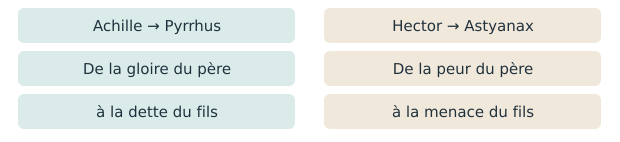

# B/L 2024 · Explication d’un texte français · 10 juin · Corrigé guidé

*Corrigé rédigé par IA, non officiel. Signalez toute erreur.*

**Rédaction** · GPT-6.2 Astra Ultra · vitesse non renseignée · 26 novembre 2026

**Autocontrôle** · GPT-6.2 Astra Ultra · vitesse non renseignée · 26 novembre 2026

Le feuillet réunit 9 billets, lus de haut en bas puis de page en page. Le cartouche de choix du billet 3 est coupé dans le PDF. Les pages des œuvres sont celles inscrites par le jury. [Feuillet du jury](https://www.ens.psl.eu/sites/default/files/bl_sujets_oraux_francais_10062024.pdf)

> [!METHODE]
> Préparation de 1 h 30, puis 20 minutes de présentation et 10 minutes d’entretien. Situez le passage, lisez-le à voix haute et suivez les mouvements du texte jusqu’à sa dernière phrase. Le jury seul peut interrompre la lecture. [Rapport B/L](https://www.ens.psl.eu/sites/default/files/2024_bl_rapport_oral_francais.pdf)

## Billet 1

Page 1 du fac-similé. Le texte 1 a été choisi.

### Jean-Paul Sartre, Les Mots

**Bornes du billet** · P. 37, de « J’ai commencé ma vie… » à « … sentaient le champignon ».

L’écrivain ramasse d’emblée une existence en une phrase. Le passé composé du commencement appelle le futur de la fin, mais l’incise qui marque le doute rend ce portrait moins solennel. Le souvenir ramène ensuite au temps d’avant la lecture. Les livres occupent l’espace de la maison comme les objets d’un culte. L’enfant se croit honoré par leur poussière. Le grand-père, maladroit pour ses propres gants, se transforme en officiant dès qu’il ouvre un volume. L’enfant imite le regard du fidèle avant de savoir déchiffrer. À mesure qu’il s’approche, la bibliothèque se change en collection de corps. L’huître suggère à la fois une coquille difficile à ouvrir et une chair humide. L’odeur de champignon achève cette découverte par le nez. L’adulte fait ainsi sentir le prestige du livre et le travail d’imagination qui l’a produit.

> [!INDICATION]
> Pourquoi conclure sur une odeur ?

Le lecteur attendait peut-être le premier mot compris. L’odeur replace l’enfant en deçà du sens écrit et fait entrer une matière organique dans le sanctuaire familial.

[Référence de lecture](https://www.devenirenseignant.gouv.fr/media/16342/download)

### Charles Perrault, Cendrillon

**Bornes du billet** · Contes, p. 163–165, de « Alors ses deux sœurs la reconnurent… » jusqu’à la fin, « … ou des parrains ou des marraines ». Les moralités sont comprises.

La scène s’ouvre sur le regard des deux sœurs. En reconnaissant la jeune femme admirée au bal, elles découvrent que leur jugement sur la fille du foyer les avait trompées. Leur geste de supplication reçoit une réponse rapide de Cendrillon, qui les relève et les embrasse. Le mariage princier et les mariages qu’elle procure ensuite à ses sœurs étendent ce dénouement au groupe familial. La prose pourrait s’arrêter sur cette redistribution des places. Le passage aux vers invite cependant à réexaminer la réussite. Une première moralité distingue la beauté reçue de la bonne grâce acquise auprès de la marraine. Une seconde accorde par avance toutes les qualités imaginables, puis fait tomber la pointe sur l’appui des parrains et marraines. Le pluriel laisse apercevoir les protections de la vie de cour sous le merveilleux.

> [!INDICATION]
> Qu’apporte la seconde moralité à la première ?

La première dégage un mérite qui peut s’apprendre. La seconde demande qui donne à ce mérite une occasion de paraître et transforme la fée du récit en figure de la protection sociale.

[Référence de lecture](https://upload.wikimedia.org/wikipedia/commons/2/24/M%C3%A9moires%2C_contes_et_autres_uvres_de_Charles_Perrault_%28IA_mmoiresconteseta00perr%29.pdf)

## Billet 2

Page 1 du fac-similé. Le texte 1 a été choisi.

### Jean de La Fontaine, Le Renard et les Poulets d’Inde

**Bornes du billet** · Fables, t. II, p. 249, fable entière.

La Fontaine donne à un arbre les dimensions d’une place forte. Le vocabulaire du siège grandit les deux camps, tandis que les noms familiers des oiseaux et leur perchoir maintiennent l’écart comique. La bravade indignée du renard paraît d’abord condamnée par les sentinelles et le clair de lune. Pourtant cette lumière le rend aussi parfaitement visible pour son numéro de théâtre. Ses transformations successives, que la comparaison avec Arlequin invite à jouer à voix haute, produisent du mouvement en bas et une immobilité mortelle en haut. Les vers courts coupent la série des gestes et font sentir leur vivacité. La répétition qui compte les prises transforme chaque chute en gain. Les deux derniers vers dégagent un paradoxe d’observation. La surveillance exclusive du danger a précisément épuisé la faculté de lui résister.

> [!INDICATION]
> Quel rôle attribuer au clair de lune ?

Il favorise d’abord le guet des oiseaux. Lorsque le siège devient spectacle, la même clarté donne sa scène au renard. Une condition jugée favorable change de sens.

[Référence de lecture](https://fr.wikisource.org/wiki/Le_Renard_et_les_Poulets_d%E2%80%99Inde)

### François-René de Chateaubriand, Mémoires d’outre-tombe

**Bornes du billet** · T. 3 tel que noté, p. 736–737, de « Grâce à… » à la fin, p. 737.

La locution initiale attribue à l’âge inhabituellement avancé du mémorialiste le temps nécessaire à l’achèvement du livre. Appeler l’ouvrage un monument permet de regarder en arrière, comme si le travail et la vie avaient déjà pris fin. La voix pourtant écrit encore. Le retour vers la fenêtre et les notations de l’heure font entrer dans le bilan la lumière d’un matin précis. Une lune s’efface et le soleil paraît. Le paysage porte désormais la relation entre le monde qui finit avec l’auteur et un avenir que sa génération ne verra pas. Le dernier mouvement ramène à la fosse et au geste de descendre. Après avoir édifié un monument, le narrateur peut poser sa plume. Le titre de l’œuvre prend alors son sens temporel pour le lecteur qui lui survit.

> [!INDICATION]
> Comment dire la dernière phrase à voix haute ?

Faire entendre l’arrêt auprès de la fosse avant le mouvement de descente. Le délai que la syntaxe ménage entre les gestes donne une dernière durée au présent d’écriture.

[Référence de lecture](https://chateaubriand-lenchanteur.fr/journal/conclusion-des-memoires/)

## Billet 3

Page 2 du fac-similé. Le cartouche de choix est absent du scan.

### Marivaux, Le Jeu de l’amour et du hasard

**Bornes du billet** · Acte II, scène XI, p. 825–826, de « C’est donc ce garçon qui vient de sortir » à « mais je n’y entends rien ».

Orgon désigne d’abord un absent par « ce garçon ». Silvia s’empresse de préciser son statut de domestique. Le père ajoute une épithète flatteuse que Silvia reprend pour la récuser. La scène repose sur deux connaissances inégales. Le père et Mario savent qui se cache sous les habits de Bourguignon, tandis que Silvia doit expliquer une inclination qu’elle croit socialement déplacée. Elle essaie de réduire le débat à son aversion pour le prétendu maître. Mario s’empare du mot « naturelle » pour retourner l’intensité de cette aversion contre son explication. À la fin, Silvia reprend les expressions qui l’ont blessée en les accumulant. Sa déclaration d’incompréhension restitue avec une exactitude comique tout ce qu’elle voudrait pouvoir écarter. Marquer les changements d’interlocuteur fait mieux entendre cet étau familial.

> [!INDICATION]
> Que révèle la répétition du verbe « dégoûter » ?

Elle suspend la discussion sur les faits pour isoler le mot de Mario. Le discours qui prétend à l’indifférence se met à vibrer sur l’insinuation du frère.

[Référence de lecture](https://classiques.app/livres/marivaux/le-jeu-de-l-amour-et-du-hasard/acte-ii-scene-xi)

### Marcel Proust, Du côté de chez Swann

**Bornes du billet** · P. 168–169, de « En effet c’était une épine, mais rose » à « … d’un pompadour provincial ».

L’apparition de l’aubépine rose commence par une correction minuscule du nom de la fleur. Tout ce qui suit donne une mesure au plaisir de cette différence. L’image de la fête religieuse conduit aux ornements qui entourent les fleurs, puis à une échelle des valeurs propre à Combray. Les biscuits roses sont plus chers et le fromage aux fraises rappelle un plaisir que l’enfant a lui-même fabriqué. Les longues parenthèses reproduisent la circulation du regard entre l’arbuste, l’église, la boutique et la table. La fin revient à la question de l’auteur de cette parure. La nature a la spontanéité d’une commerçante qui prépare un reposoir et le goût local d’un décor rococo. L’émerveillement de l’enfant demeure perceptible jusque dans la légère distance prise avec ses critères.

> [!INDICATION]
> À quoi sert le détail du fromage ?

Le prix des biscuits révélait une valeur collective. Les fraises écrasées dans la crème rendent cette préférence intime et gustative, avant que la couleur ne revienne à la fleur.

[Référence de lecture](https://proust-personnages.fr/extraits-2/morceaux-choisis/les-aubepines/)

## Billet 4

Page 2 du fac-similé. Le texte 2 a été choisi.

### Agrippa d’Aubigné, Les Tragiques

**Bornes du billet** · Livre premier, « Misères », p. 47–49, v. 97–130 inclus.

« Je veux peindre » annonce une image à construire devant l’auditeur. L’allégorie rassemble la France et ses deux confessions dans un seul corps maternel. Les gestes des enfants détournent la nourriture commune et l’espace protecteur du sein en un lieu de lutte. Les noms bibliques d’Ésaü et de Jacob orientent la lecture du poète réformé. Le plus fort attaque, tandis que son frère supporte d’abord les coups avant de se défendre. Les verbes d’action successifs empêchent de confondre communauté de désastre et identité des responsabilités. Au moment où les deux forces menacent le corps qui les nourrit, la mère cesse d’être seulement l’objet du tableau. Sa plainte finale fait entendre sa voix. Entre le lait attendu et le sang offert se mesure littéralement l’impossibilité de nourrir encore les deux camps.

> [!INDICATION]
> Pourquoi réserver à la mère le dernier mot ?

Le premier vers donnait la parole au poète qui voulait peindre. La voix maternelle prend en charge à la fin le jugement et fait entendre ce que la scène a coûté au pays.

[Référence de lecture](https://cte.univ-setif2.dz/moodle/pluginfile.php/7947/mod_folder/content/0/La%20litt%C3%A9rature%20fran%C3%A7aise%20au%20XVI%C3%A8me%20si%C3%A8cle.pdf?forcedownload=1)

### Voltaire, Dictionnaire philosophique

**Bornes du billet** · P. 75–76, article « Abbé » en entier.

Une question de conversation ouvre une entrée de dictionnaire. Voltaire emprunte l’étymologie de l’abbé, « père », pour proposer à son destinataire deux usages très différents du nom. La paternité réelle reçoit un éloge à la fois civique et presque religieux. En face, le vêtement, la tonsure et l’attente d’un bénéfice forment une définition peu glorieuse du titre mondain. L’histoire des premiers monastères introduit ensuite une autre forme de paternité, celle du supérieur que des pauvres choisissaient parmi eux. Répété devant les revenus et les signes de puissance des abbés, l’adjectif « pauvre » devient une accusation. Le conflit des privilèges ecclésiastiques avec les obligations du pays prolonge l’expérience. Le mot que le lecteur croyait connaître devient l’instrument d’une enquête sur l’institution.

> [!INDICATION]
> Comment rendre l’ironie de « pauvre » ?

La première occurrence a sa valeur matérielle ordinaire. Garder le même ton en lisant la richesse qui suit suffit à rendre sensible la contradiction du personnage.

[Référence de lecture](https://fr.wikisource.org/wiki/Dictionnaire_philosophique/portatif_-_6e_ed._-_Londres_%281767%29/Abb%C3%A9)

## Billet 5

Page 3 du fac-similé. Le texte 1 a été choisi.

### Jean Ogier de Gombauld, « Je vogue sur la mer… »

**Bornes du billet** · Anthologie de la poésie baroque française, t. I, p. 212, poème entier. Le billet écrit « Gombauld ».

Le premier vers met le lecteur en mer avec le sujet qui parle. Par beau temps déjà, la crainte lui fait voir le vent qui se lève. Les couples de termes de la fin du quatrain distribuent les échecs entre la force et la prudence, chacune insuffisante à son heure. Le second quatrain substitue à la conduite active l’abandon au courant et étend le risque à tous les hommes. Les termes de fond et de rive donnent à la mort deux issues possibles de navigation. Au premier tercet, le poème livre enfin l’équivalence entre monde et mer. L’écoute des Sirènes attire au moment même où la crainte s’éveille. Le dernier tercet resserre la vision sur les obstacles et sur le gouffre. Le Ciel donne au danger maritime la profondeur d’un jugement spirituel.

> [!INDICATION]
> Quand expliciter la valeur de la mer ?

On peut relever d’abord les indices de l’âme et du salut. Marquer ensuite la pause du neuvième vers préserve le moment où le sonnet interprète lui-même son image.

[Référence de lecture](https://manierisme.univ-rouen.fr/spip/index.html%3F3-2-4-Vagabonde-Inconstance.html)

### Marguerite Yourcenar, Nouvelles orientales

**Bornes du billet** · P. 20–21, de « Le jour, assis sur un tapis… » à « … par mes larmes ». Nouvelle « Comment Wang-Fô fut sauvé ». Le possessif manuscrit se lit « mes » ou « nos ». Le texte de comparaison porte « nos larmes ».

Le souverain parle à l’artiste qu’il a fait comparaître. Le tapis dont l’enfant connaissait tout le dessin fixe d’abord l’étroitesse d’une enfance protégée. Les paumes posées sur les genoux deviennent dans l’imagination une carte des fleuves. Les tableaux fournissent au futur empereur les couleurs de la mer, les silhouettes des femmes et des guerriers. Chaque comparaison rend visible la beauté qu’il reprochera au peintre de lui avoir apprise. Quand les portes s’ouvrent, le mouvement du voyage oppose à ces images la boue, les pierres et l’inconfort d’un corps emporté en litière. Les comparaisons basculent alors dans le dégoût. L’accusation adressée à Wang-Fô culmine dans une autre image de peintre, celle d’un monde aux taches confuses. Pour condamner l’art, l’empereur parle encore sa langue.

> [!INDICATION]
> Où finit le mouvement de l’accusation dans le billet ?

À l’image des taches effacées par les larmes. La transcription scolaire consultée porte « nos larmes », le manuscrit semble donner « mes larmes ». L’enjeu sûr est le brouillage de la vision. La sentence prononcée ensuite se situe hors extrait.

[Référence de lecture](https://fr.scribd.com/document/885323627/Fleurs-d-Encre-Francais-Cycle-4-3e-HQ-ORG-9782017066682-ouni-Pw)

## Billet 6

Page 3 du fac-similé. Le texte 1 a été choisi.

### Étienne de La Boétie, Discours de la servitude volontaire

**Bornes du billet** · P. 132–133, de « Pour ce coup, je ne voudrais… » à « … de celui duquel on n’a reçu que bien ».

La modestie du début donne à une question politique la forme d’un étonnement partagé. La gradation, des hommes aux nations, augmente le nombre des sujets, puis fait ressortir l’unicité du tyran. Les relatives reprennent ses pouvoirs un à un pour en rapporter chaque fois l’origine à ceux qui les subissent. À l’indignation succède pourtant un examen des circonstances. Une force extérieure peut contraindre un peuple et l’obéissance peut aussi prolonger des liens de gratitude. Le dernier cas imagine une communauté protégée par un homme prévoyant, courageux et soigneux. Lui donner ensuite davantage de pouvoir revient à changer la situation dans laquelle il avait fait ses preuves. En distinguant la bonté des intentions et la sagesse de la décision, la concession finale rend la difficulté plus aiguë.

> [!INDICATION]
> Pourquoi terminer sur le bien reçu ?

On comprend ainsi un ressort de l’obéissance qui échappe au seul calcul de la peur. Faire confiance à un bienfaiteur peut être généreux même quand l’institution qu’on crée est imprudente.

[Référence de lecture](https://hurlus.fr/laboetie1562_servitude/laboetie1562_servitude.pdf)

### Edmond Rostand, Cyrano de Bergerac

**Bornes du billet** · Acte V, scène 6, p. 348–350, du v. 2549 « Pas là ! non ! pas dans ce fauteuil » à la fin, « mon panache ».

Le fauteuil serait la place assignée au malade. Les fragments de phrases qui le refusent permettent de voir Cyrano chercher une autre position, debout, avec l’arbre pour ultime appui. L’épée donne une forme scénique à l’affrontement avec la mort. Les témoins voient des coups dans le vide, tandis que les noms prononcés font apparaître aux yeux du personnage le mensonge, les compromis et les lâchetés avec lesquels il a toujours refusé de composer. Le vers se fragmente entre les gestes, les reprises et le souffle qui s’épuise. Les insignes de succès peuvent être arrachés. Il reste à nommer ce que personne ne saurait prendre. La question de Roxane retarde ce dernier nom. Le panache devient la manière même de tenir sa parole jusqu’à la chute.

> [!INDICATION]
> Quel rapport y a-t-il entre le fauteuil et le dernier mot ?

Le premier geste refuse une mise en scène de la mort imposée par d’autres. Le dernier mot revendique la façon dont Cyrano en a lui-même réglé l’allure.

[Référence de lecture](https://fr.wikisource.org/wiki/Cyrano_de_Bergerac_%28Rostand%29/Acte_V)

## Billet 7

Page 4 du fac-similé. Le texte 2 a été choisi.

### Théophile Gautier, « Lied »

**Bornes du billet** · Émaux et Camées, p. 86, poème désigné par son titre.

Quatre quatrains, quatre repères dans l’année. La reprise du mois en tête de chaque strophe tient lieu de battue à une petite chanson dont les rimes se croisent. Avril donne à la Terre la couleur et les hésitations de la jeunesse. En juin, la pâleur et l’image des blés qui dissimulent les amants substituent le désir au premier éveil. Août fait entrer la bacchante et transforme le jus du raisin en sang. La poussée des couleurs et des gestes atteint là son point le plus vif. Décembre raccourcit ironiquement cette histoire passionnée en une scène domestique. La neige poudre la petite vieille et l’Hiver ronfle à ses côtés. Le dernier son déplace la douceur lyrique vers une tendresse familière.

> [!INDICATION]
> Les quatre tableaux ont-ils le même ton ?

Le cadre des quatrains reste régulier. L’allure passe de la réserve au mouvement bacchique puis au détail comique du sommeil, ce qui fait entendre le vieillissement.

[Référence de lecture](https://fr.wikisource.org/wiki/%C3%89maux_et_Cam%C3%A9es/Lied)

### Jacques-Bénigne Bossuet, Sermon sur la mort

**Bornes du billet** · Sermons, Le Carême du Louvre, p. 146–147, de « Me sera-t-il permis… » à « … l’entremise de la sainte Vierge ».

La question initiale demande aux yeux délicats de la cour la permission d’ouvrir un tombeau. Les courtisans sont déjà devenus spectateurs au moment où l’orateur paraît solliciter leur accord. L’épisode de Lazare lui permet de reprendre l’invitation à venir et à voir. Adressée d’abord au Christ, elle revient vers les fidèles, puis l’impératif à la première personne associe le prédicateur au mouvement. Les propos entendus lors des funérailles reproduisent ensuite le fonctionnement de l’oubli. Celui qui vient d’énoncer la mortalité humaine se soustrait à sa propre phrase. Le rapprochement entre l’ensevelissement des corps et celui des pensées rend cette esquive presque visible. La fin change l’auditoire en communauté qui demande une grâce par l’entremise de Marie, seuil de la suite du sermon.

> [!INDICATION]
> Quelle transition conduit de la cour à la prière ?

Le passage des yeux des courtisans au « nous » inclut l’orateur dans la même résistance intérieure. La demande finale peut alors être prononcée au nom de tous.

[Référence de lecture](https://fr.wikisource.org/wiki/Sermon_sur_la_mort)

## Billet 8

Page 4 du fac-similé. Le texte 1 a été choisi.

### Jean Racine, Andromaque

**Bornes du billet** · Acte I, scène 2, v. 143–172 inclus.

Oreste parle au nom des Grecs. Il commence par distinguer sa voix personnelle du mandat qu’il exerce et par inscrire Pyrrhus dans la gloire d’Achille. Les deux moitiés du vers rapprochent les victoires du père et du fils. La réserve qui suit utilise justement cette filiation pour blâmer la pitié de Pyrrhus. La mémoire endeuillée des familles grecques donne un visage collectif à la demande. Par une question puis par l’image d’Hector incendiant les vaisseaux, Oreste prête ensuite à l’enfant la force future du père. Le serpent élevé dans le sein déplace enfin le risque jusque chez Pyrrhus. Les impératifs finaux lui présentent la vengeance grecque comme sa propre sécurité. L’ambassadeur a ainsi changé une conjecture en injonction sans qu’Astyanax ait accompli aucun acte.

> [!INDICATION]
> À quel moment le danger change-t-il de destinataire ?

Après les ports menacés et les souvenirs grecs, Oreste s’adresse directement à Pyrrhus. Le redoublement de l’impératif « assurez » fait coïncider l’intérêt prêté au roi et celui de ses mandants.

[Référence de lecture](https://fr.wikisource.org/wiki/Andromaque/%C3%89dition_Mesnard%2C_1865/Acte_I)

### Émile Zola, La Fortune des Rougon

**Bornes du billet** · P. 37–38, du début à « … et suintait la sève ».

Le narrateur guide d’abord le regard à l’entrée de Plassans, en situant sur la route le terrain qui sera l’un des lieux majeurs du récit. Les noms locaux et le rappel des souvenirs des anciens changent la description en enquête sur les états successifs d’un même emplacement. Le terrain était un cimetière encombré que la ville a cessé d’utiliser. Une fois laissé à lui-même, il devient d’une fertilité inquiétante. À la profondeur du sol où demeurent les corps répond le foisonnement visible des herbes et des tiges. L’odeur et l’humidité rapprochent le lecteur de la terre. La sueur de mort du début trouve un écho dans la sève finale. La continuité de ce vocabulaire oblige à lire ensemble décomposition et croissance.

> [!INDICATION]
> Pourquoi s’arrêter à la sève ?

Le dernier verbe garde une matérialité que l’on pourrait appliquer à un corps. Il achève la métamorphose du lieu tout en laissant subsister la trace de ses morts.

[Référence de lecture](https://fr.wikisource.org/wiki/Page%3AEmile_Zola_-_La_Fortune_des_Rougon.djvu/4)

## Billet 9

Page 5 du fac-similé. Le texte 1 a été choisi.

### François Rabelais, Gargantua

**Bornes du billet** · Prologue de l’auteur, p. 7–8, de « Et, posé… » à « … vie oeconomicque » (graphie du billet).

Le premier mouvement concède franchement le plaisir du sens littéral. Une invitation à poursuivre conduit ensuite à un maître de lecture inattendu, le chien devant un os. La question au lecteur l’engage à se souvenir des gestes de l’animal. Les verbes qui les détaillent transforment le spectacle comique en modèle d’attention, de patience et de désir. Puis l’os laisse paraître la valeur de sa moelle et la série d’impératifs transporte l’expérience dans l’activité de lire. L’enveloppe dont on riait devient la condition matérielle de la découverte. Les derniers mots élargissent cette nourriture à la religion, à l’ordre politique et à la conduite de la maison. L’extrait s’arrête sur cette promesse d’interprétation. La question sur les allégories d’Homère vient ensuite.

> [!INDICATION]
> Que désigne la « vie oeconomicque » ?

Le mot renvoie au gouvernement de la maison. La dernière énumération fait passer de la religion et de la cité à cet espace familier et élargit ainsi la portée du livre.

[Référence de lecture](https://fr.wikisource.org/wiki/Gargantua_%28%C3%89dition_Juste_1535%29_%E2%80%94_Prologue_de_lauteur)

### Gérard de Nerval, « El Desdichado »

**Bornes du billet** · Les Chimères, p. 5, sonnet entier.

Les définitions successives du premier vers semblent assurer une identité. Pourtant chacune désigne une perte, et le prince à la tour abolie joint au deuil une souveraineté privée d’assise. Le luth est constellé alors même que l’étoile est morte. L’image du soleil noir conserve cette puissance de faire voir l’obscur. Le second quatrain passe de l’énoncé à la demande. Un lieu d’Italie et des végétaux nommés composent une scène que la parole voudrait retrouver. L’interrogation du neuvième vers redistribue ensuite l’identité entre figures mythiques et historiques. Le dernier tercet donne au sujet la traversée d’Orphée. Il tire de son instrument deux voix, celle de la sainte et celle de la fée. Le chant accueille la pluralité qu’une définition unique semblait devoir résoudre.

> [!INDICATION]
> Comment faire entendre le mouvement du sonnet ?

Distinguer l’affirmation initiale, l’appel à la deuxième personne puis l’interrogation de la volta. La phrase finale accueille deux registres dans le même acte musical.

[Référence de lecture](https://fr.wikisource.org/wiki/Les_Chim%C3%A8res/El_Desdichado)
