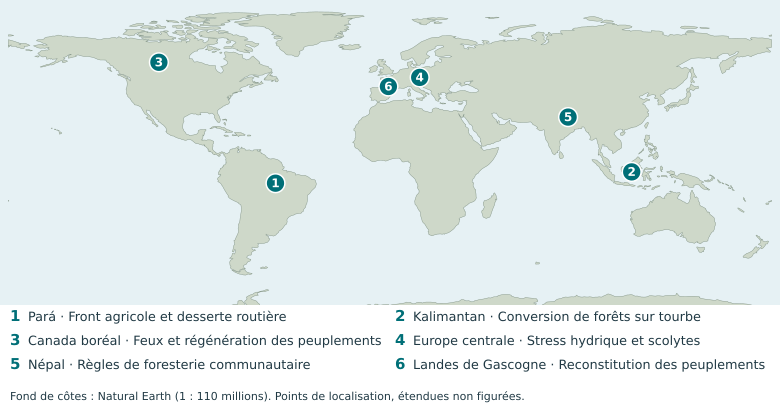
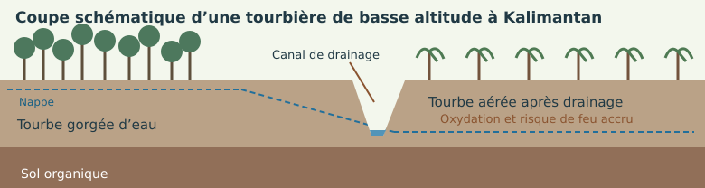

# Les espaces forestiers face aux changements globaux — Corrigé

*Corrigé rédigé par IA, non officiel. Signalez toute erreur.*

**Rédaction** · GPT-6.2 Astra Ultra · vitesse non renseignée · 26 novembre 2026

## Composition

À Bornéo, deux parcelles contiguës peuvent encore paraître vertes depuis l’espace. Dans l’une, la forêt humide abrite des arbres de différents âges, des espèces qui se déplacent entre les étages du couvert et des usages villageois. Dans l’autre, des rangées de palmiers à huile ont remplacé la forêt. Retenir la seule couleur masquerait la conversion d’un milieu en plantation agricole autant que le déplacement des activités et des droits d’usage. La FAO définit d’ailleurs la forêt par des critères de superficie, de hauteur et de couvert, mais aussi d’usage dominant du sol. La catégorie statistique est un point de départ pour interroger des paysages très différents.

Les espaces forestiers associent peuplements végétaux, sols, animaux, propriétaires, habitants et filières à des échelles emboîtées. Les changements globaux désignent des transformations durables du système terrestre liées notamment aux activités des sociétés. Réchauffement, modifications des usages du sol, perturbations des cycles de l’eau et du carbone, érosion de la biodiversité interagissent. Le marché mondial du bois ou du soja transmet certaines pressions, tandis qu’une tempête ou un foyer de ravageurs en manifestent localement certaines conséquences. Pourquoi ces dynamiques planétaires produisent-elles, d’un massif à l’autre, des trajectoires forestières si différentes, et à quelles conditions agir sur un territoire peut-il infléchir le changement à d’autres échelles ?

Au sud et à l’est de l’Amazonie brésilienne, la progression de fronts agricoles dessine un arc de déboisement. Dans le Pará, la route BR-163 donne accès à des terres dont la valeur varie avec la possibilité d’acheminer les récoltes. Des dessertes secondaires pénètrent le massif, puis coupes, pâturages et grandes cultures dessinent une mosaïque. L’élevage bovin occupe directement une part importante des terres déboisées. L’extension du soja peut reprendre d’anciens pâturages et déplacer l’élevage vers d’autres marges. Le lien entre un acheteur lointain et une parcelle dépend donc du crédit, des infrastructures, de la politique foncière et des règles effectivement appliquées dans la municipalité. Les territoires autochtones et les aires protégées interrompent localement la progression du front, avec des capacités de défense inégales.

À Bornéo, les pistes d’exploitation sélective et les concessions destinées au palmier à huile produisent des coupures dans l’habitat avant même la disparition de tout couvert. Un animal arboricole qui évite une clairière ne parcourt plus le même territoire. Les lisières connaissent une lumière, un vent et une humidité différents de ceux du sous-bois. Dans les basses terres tourbeuses de Kalimantan, drainer le sol pour la production abaisse la nappe et expose de la matière organique accumulée à l’oxydation. La sécheresse renforce alors le risque d’incendie du sol lui-même. En Amazonie et à Bornéo, une infrastructure de transport contribue ainsi à un changement global des usages du sol. La nature du sol et les modes de fragmentation modifient les conséquences écologiques.

D’autres forêts demeurent cartographiées au même endroit tout en changeant de composition. Dans les montagnes du centre de l’Europe, l’épicéa planté en peuplements homogènes à relativement basse altitude est vulnérable à la succession d’étés chauds et secs. Les arbres affaiblis résistent moins aux scolytes, dont le développement peut être accéléré par des températures favorables. La mortalité ouvre des trouées et crée une abondance soudaine de bois déprécié à récolter, suivie d’un délai de plusieurs décennies avant la maturité des nouveaux arbres. Dans les forêts boréales canadiennes, les incendies appartiennent à la dynamique écologique. Un intervalle entre deux feux trop court pour que certains arbres aient produit des graines peut néanmoins interrompre leur régénération. La localisation d’un feu isolé explique peu de choses sans l’histoire du peuplement, la répétition des épisodes et le régime climatique dans lequel ils s’insèrent.

Un arbre transfère à l’atmosphère une partie de l’eau que ses racines prélèvent. À l’échelle d’une parcelle, l’ombre et l’évapotranspiration tempèrent la chaleur et l’humidité de l’air. À l’échelle de l’Amazonie, une partie de cette vapeur est transportée puis retombe en pluie sous le vent. Remplacer de grandes surfaces de forêt par des pâturages modifie le bilan hydrique et peut accentuer le stress d’autres peuplements. Des lisières plus sèches deviennent plus sensibles au passage du feu. Cette boucle dépend de l’étendue des conversions et de la variabilité des pluies. Elle ne permet pas d’attribuer chaque sécheresse à une cause unique, ni de fixer un seuil identique pour tout le bassin. Dans les Andes tropicales, le maintien du couvert sur certains versants limite l’érosion des sols qui alimentent en sédiments les vallées en aval. La réponse d’un bassin versant dépend aussi des pentes, des sols et de l’intensité des précipitations.

Le temps change le bilan autant que l’échelle. La biomasse d’une forêt mature et la tourbe accumulée constituent des stocks. Leur variation annuelle représente un flux. Une jeune plantation en croissance peut absorber du carbone rapidement tout en conservant pendant longtemps un stock très inférieur à celui du massif abattu. À Bornéo, des pertes provenant du sol drainé se poursuivent même lorsque la plantation verdit. Au Canada en 2023, les fumées des incendies ont atteint des métropoles du nord-est des États-Unis. Les émissions, la qualité de l’air et la santé de citadins éloignés relient alors des territoires qui ne sont ni administrés ni habités par les mêmes acteurs. Attribuer automatiquement à toute surface arborée la même valeur climatique effacerait ces trajectoires et ces transferts.

La diversité biologique réagit également à la disposition des espaces. Un îlot forestier peut conserver pendant quelques années des espèces dont les effectifs sont déjà trop faibles pour se renouveler durablement. Un corridor entre deux massifs peut faciliter leur déplacement avec le changement d’altitude ou de latitude de certaines conditions climatiques. Le corridor doit toutefois convenir à l’espèce concernée. Une haie est un passage pour certains oiseaux, sans remplacer l’intérieur d’une forêt humide pour d’autres. Les populations riveraines qui récoltent des fruits, chassent sous réglementation ou collectent du bois-énergie perçoivent des changements de disponibilité parfois invisibles dans un inventaire des surfaces. L’espace que l’on mesure et celui que l’on pratique ne renseignent donc pas sur la même dimension du changement.

Les choix de sylviculture distribuent les risques futurs. Après les tempêtes Martin de 1999 et Klaus de 2009, les Landes de Gascogne ont dû traiter beaucoup de bois à la fois et financer la reconstitution du massif de pin maritime. Planter des essences variées, maintenir des feuillus le long des cours d’eau ou conserver des îlots âgés peut diversifier les habitats et les réactions aux perturbations. Les sols sableux, les débouchés industriels et les revenus attendus par des propriétaires nombreux contraignent ces options. Une essence adaptée au climat actuel doit encore convenir au site dans plusieurs décennies. La diversification, la régénération naturelle et le suivi de parcelles permettent de comparer des réponses, sans promettre partout le même peuplement final.

La conservation peut déplacer ses propres coûts. Au Brésil, le renforcement du suivi satellitaire et des contrôles à partir de 2004 a accompagné une forte baisse du déboisement en Amazonie légale jusqu’au début des années 2010. L’identification d’une coupe sur une image ne dit toutefois pas qui détient les droits sur la terre, ni qui peut faire appliquer la règle. Une mesure limitée à une filière ou à un biome peut repousser la pression vers d’autres activités ou vers le Cerrado voisin. Un achat présenté comme exempt de déboisement exige donc de suivre les changements d’usage et les fournisseurs indirects. Sécuriser les droits territoriaux des communautés et documenter les déplacements de la pression étend l’évaluation au-delà de la limite administrative du projet.

Au Népal, la foresterie communautaire donne à des groupes d’usagers des responsabilités dans la gestion de forêts, notamment en moyenne montagne. Des règles locales sur les coupes et le pâturage peuvent permettre au couvert de se reconstituer. Une restriction saisonnière n’a pourtant pas le même coût pour le ménage qui achète du combustible et pour la personne qui doit le ramasser à pied. Qui siège au comité et quel prélèvement reste autorisé sont des questions écologiques autant que politiques, car elles orientent la pression future sur le massif et ses alentours. À l’échelle internationale, un projet rémunéré pour les émissions évitées doit établir ce qui se serait vraisemblablement passé, vérifier la durée du stockage et repérer un éventuel report des coupes. Le gain local de couvert devient une contribution démontrable à la régulation planétaire à ces conditions précises.

Une route qui ouvre un front agricole et des sécheresses qui entravent la régénération transforment durablement les massifs. En retour, la configuration des peuplements modifie les flux d’eau, les habitats et le stockage du carbone. Deux parcelles également vertes peuvent ainsi appeler des politiques distinctes. Préserver une tourbière, connecter deux habitats ou garantir un droit d’usage exige de suivre les effets de chaque décision sur les territoires voisins et dans la durée.
