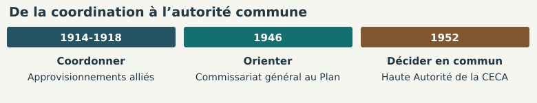

# Histoire contemporaine — Oral du 10 juin 2024 — Corrigé

*Corrigé rédigé par IA, non officiel. Signalez toute erreur.*

**Rédaction** · GPT-6.2 Astra Ultra · vitesse non renseignée · 26 novembre 2026

Le rapport prévoit 1 h 30 de préparation, vingt minutes d’exposé sur un seul des deux sujets, puis dix minutes d’entretien. Les chronologies et l’atlas autorisés permettent de situer les cas étudiés. Chaque proposition reçoit ici sa propre réponse. Le gras signalé pour chaque billet est celui du feuillet officiel.

## Billet 1

**Intitulé en gras sur le feuillet** · Vivre à la campagne en France 1870-1940

### Vivre à la campagne en France 1870-1940

En 1870, habiter un village ne dit pas encore si l’on exploite une terre, travaille à façon pour une manufacture ou vit d’une rente. Comment le quotidien change-t-il quand l’État, le marché et la guerre rapprochent ces campagnes des villes ?

La République arrive au village par des institutions qui s’y implantent sans faire disparaître les manières de vivre locales. En 1870, les campagnes réunissent encore la majorité des habitants. Elles ne constituent pas une paysannerie uniforme. Un journalier dépend de l’embauche saisonnière, un fermier verse un loyer, un propriétaire travaille et peut transmettre sa terre. L’artisan, le curé et le secrétaire de mairie participent eux aussi à la vie du bourg. La famille organise ensemble travail, soin et vieillesse. Selon les régions, des ouvriers alternent emploi industriel et travaux agricoles.

L’école primaire gratuite puis obligatoire et laïque dans les années 1880, la conscription et les migrations multiplient les expériences hors du village. Le chemin de fer facilite la commercialisation du vin ou du lait et rend la production sensible aux prix nationaux. Les viticulteurs du Midi qui manifestent en 1907 illustrent la capacité d’une société rurale à se mobiliser dans une économie marchande. La Grande Guerre frappe de plein fouet des familles qui doivent maintenir les exploitations. Monuments aux morts et associations d’anciens combattants inscrivent cette épreuve dans l’espace quotidien. Dans l’entre-deux-guerres, cars, bicyclette et électrification modifient inégalement les conditions d’habitation. Au recensement de 1931, la population urbaine dépasse la population rurale en métropole. « Vivre à la campagne » décrit donc désormais une expérience minoritaire à l’échelle nationale, diverse selon la distance au bourg, le sexe et la propriété.

La mobilisation de 1914 laisse aux femmes et aux anciens une part accrue des travaux. Celui qui revient découvre des exploitations endeuillées mais aussi des habitudes acquises en son absence. Un monument aux morts porte des noms de cultivateurs et d’artisans du même village. Il rappelle combien cette société reste plus diverse que la seule profession agricole.

### Les collaborateurs en Europe pendant la Seconde Guerre mondiale

Dans plusieurs pays occupés, des ressortissants prêtent leur concours au pouvoir allemand. Parler de collaborateurs suppose d'identifier leur initiative, leur position et les contraintes dont ils font l’objet. Pourquoi le même terme recouvre-t-il des pratiques et des responsabilités si différentes ?

En Norvège, le nom de Vidkun Quisling, chef d’un mouvement fasciste local devenu chef de gouvernement en 1942 sous occupation, devient synonyme de trahison. Aux Pays-Bas, le mouvement d’Anton Mussert recherche lui aussi la faveur de l’occupant sans obtenir la maîtrise de l’État. L’idéologie fournit des volontaires, mais le rapport de forces demeure asymétrique.

Après la défaite de 1940, Pétain engage une politique de collaboration avec l’Allemagne dont Montoire devient un symbole. Des administrations françaises appliquent leurs propres politiques antisémites et participent à la persécution et à la déportation des Juifs. Les responsabilités d’un ministre, d’un chef de service et d’un exécutant se situent à des niveaux différents, mais l’existence d’une hiérarchie n’abolit pas toute capacité de décision. À Paris, certains partis et journaux collaborationnistes souhaitent une victoire allemande et une transformation fasciste de la France. Le rôle de la Milice, fondée en 1943, illustre la radicalisation de la répression française au service du régime et de l’occupant.

Dans les régions soviétiques occupées, des auxiliaires locaux participent aux persécutions, sur fond de coercition, de nationalismes et d’antisémitisme. Une population placée sous domination n’endosse pas collectivement leurs actes. Les preuves d’une décision, d’un bénéfice ou d’un concours aux persécutions sont essentielles. Après la libération, des justices nationales poursuivent des trajectoires individuelles, avec des catégories et des temporalités distinctes. La collaboration a ainsi une histoire transnationale et des institutions locales qui en déterminent la portée.

## Billet 2

**Intitulé en gras sur le feuillet** · Les sociétés industrielles et la désindustrialisation

### Jean Monnet

En 1950, le projet qui associe la France et la République fédérale d’Allemagne dans le charbon et l’acier porte le nom de Robert Schuman. Jean Monnet en est pourtant un artisan décisif. Comment un homme qui ne fonde sa légitimité ni sur une élection ni sur un parti peut-il modifier les règles du jeu entre États ?

Issu d’une famille de négociants de Cognac, Monnet acquiert une expérience internationale dans les échanges puis dans la coordination des approvisionnements alliés pendant la Grande Guerre. Secrétaire général adjoint de la Société des Nations, il observe les limites d'une coopération dépendante de l'accord des gouvernements. Pendant la Seconde Guerre mondiale, ses contacts britanniques et américains servent de nouveau la mobilisation économique.

En France, il devient en 1946 commissaire général au Plan. Des commissions de modernisation réunissent administrations, producteurs et syndicats autour de priorités d’équipement. L’instrument agit sur l’investissement et l’information. L’unification des choix reste négociée. Pour le charbon et l’acier, il veut confier des décisions à une autorité commune, qui doit rendre une nouvelle rivalité franco-allemande politiquement et matériellement plus difficile.

Premier président de la Haute Autorité de la CECA en 1952, il continue ensuite à promouvoir l’intégration par son Comité d’action pour les États-Unis d’Europe. Le rejet français de la Communauté européenne de défense en 1954 montre ce que la méthode doit aux parlements. Monnet construit des dispositifs durables, tandis que leur adoption et leur démocratisation incombent à d’autres.

### Les sociétés industrielles et la désindustrialisation

Une usine peut perdre des emplois tout en fabriquant davantage. Désindustrialisation désigne donc plusieurs phénomènes : recul de l’emploi industriel, baisse relative de la valeur ajoutée ou fermeture absolue d’établissements. Pourquoi leurs effets sociaux sont-ils souvent plus durables que la fermeture elle-même ?

La grande usine organise des territoires où l’employeur fournit logement, formation et parfois protection sociale. Dans la Ruhr, le charbon alimente la sidérurgie et les villes s’agencent autour des puits. À Detroit, l’automobile soutient un réseau de fournisseurs et une culture syndicale. L’essor de la consommation produit une concentration de compétences, mais aussi une dépendance à une branche.

À partir des années 1960-1970, gains de productivité, concurrence, déplacement des investissements et essor des services recomposent ces systèmes. Externaliser le nettoyage ou la comptabilité peut faire passer statistiquement un emploi dans les services sans déplacer son lieu de travail. La fermeture des aciéries de Lorraine provoque au contraire des pertes industrielles locales et des mobilisations autour de Longwy en 1979. Le chômage atteint aussi commerces et familles.

Les reconversions par la formation, de nouvelles entreprises ou la culture réutilisent inégalement les équipements. Dans la Ruhr, un haut-fourneau devenu patrimoine garde visible le travail ancien sans restituer son nombre d’emplois. Une région perd donc autant un horizon d’embauche pour les enfants et des ressources municipales qu’une quantité d’acier produite.

## Billet 3

**Intitulé en gras sur le feuillet** · Radio et télévision en France des années 1930 aux années 1980

### Radio et télévision en France des années 1930 aux années 1980

Dans les années 1930, la radio entre au foyer plus tôt que la télévision. Les stations publiques voisinent avec des postes privés, tandis que le transistor facilitera après guerre une écoute personnelle. L’appel du 18 Juin à la BBC et l’antenne de Radio-Paris sous occupation font entendre, depuis des lieux différents, des prétentions concurrentes à parler pour la France. Une audience réduite au premier jour peut avoir une postérité politique considérable.

Un journal télévisé regardé au café dans les années 1950, une allocution présidentielle et un jeu financé par la publicité appartiennent-ils à la même histoire ? Technique de transmission, institution, industrie de programmes et pratique domestique, la télévision modifie l’espace public sans le dominer d’emblée ni uniformément.

Après 1945, l’équipement est coûteux, la couverture incomplète et la télévision se développe dans le cadre du monopole d’État de la radiodiffusion. Des émissions se regardent collectivement avant que le poste ne devienne courant au foyer. Le journal, les dramatiques et les événements sportifs organisent des rendez-vous communs. De Gaulle fait de l’allocution télévisée un moyen d’adresse directe aux citoyens. La création de l’ORTF en 1964 et les débats de 1968 sur l’indépendance de l’information montrent la proximité de l’audiovisuel public et de l’exécutif. Plusieurs chaînes, la couleur et le progrès de l’équipement transforment les conditions d’écoute.

L’éclatement de l’ORTF en 1974 multiplie les organismes ; il ne règle pas à lui seul la question de l’indépendance. Les réformes du début des années 1980, l’ouverture de Canal+ en 1984 et la privatisation de TF1 en 1987 modifient le financement et la concurrence pour les audiences. Les annonceurs, programmateurs, journalistes et téléspectateurs participent à des degrés différents à la définition de ce qui est visible. Dans la famille, le choix du programme et les usages de l’appareil dépendent aussi de l’âge, du genre et des conditions de logement. L’histoire du média relie donc trois transformations dont les rythmes diffèrent : le réseau national, les institutions du pouvoir de montrer et les manières quotidiennes de regarder.

La réforme de 1982 ouvre un nouvel espace aux radios locales privées, puis Canal+ apparaît en 1984 et TF1 est privatisée en 1987. Le public peut davantage choisir sa station ou sa chaîne, tandis que la publicité et la mesure d’audience influencent la programmation. Suivre les appareils, les institutions et les usages explique mieux cette histoire que l’idée d’un média remplaçant mécaniquement l’autre.

### La croissance économique dans les pays occidentaux 1945-1990

L’Europe occidentale et le Japon connaissent après 1945 une croissance plus rapide que les États-Unis, pourtant au centre du système. Pourquoi les pays les plus endommagés peuvent-ils rattraper une partie du niveau de production américain, et pourquoi ce rattrapage finit-il par ralentir ?

La reconstruction renouvelle des équipements et mobilise une main-d’œuvre encore agricole. L’aide Marshall soutient les importations indispensables en Europe. Le Japon bénéficie d’un fort investissement et de débouchés extérieurs. Les parités de Bretton Woods et les négociations commerciales favorisent la prévisibilité des paiements. Les arrangements nationaux diffèrent toutefois entre économie sociale de marché en RFA et planification indicative française.

Gains de productivité, énergie relativement bon marché et hausse des salaires alimentent la consommation de logements, d’automobiles et d’appareils ménagers. L’immigration fournit des travailleurs aux usines et aux chantiers. Les femmes entrent plus nombreuses dans le salariat sans accéder aux mêmes revenus. Croissance du PIB et redistribution de ses fruits demeurent deux questions distinctes.

La suspension en 1971 de la convertibilité-or du dollar et les chocs pétroliers de 1973 et 1979 rendent visibles des tensions déjà engagées. Inflation et chômage coexistent, les anciennes régions industrielles se fragilisent, tandis que services et technologies progressent. Après 1973 il y a ralentissement à partir de niveaux élevés et non disparition générale de la croissance.

## Billet 4

**Intitulé en gras sur le feuillet** · Les crises politiques en France, de la 3e à la 5e République

### Les crises politiques en France, de la 3e à la 5e République

À quel moment une crise de gouvernement devient-elle crise de régime ? Il faut demander quelle règle du pouvoir est contestée, qui peut encore trancher et comment la sortie de crise modifie les institutions.

Quelles crises mettent en jeu l’existence du régime et lesquelles relèvent du fonctionnement courant du parlementarisme ? De 1870 à 1879, défaite, Commune et conflits avec la majorité monarchiste menacent la consolidation de la République. La dissolution décidée pendant la crise du 16 mai 1877 puis la victoire électorale des républicains tranchent en faveur de la prépondérance parlementaire. Dans les années 1880, la popularité de Boulanger donne une expression personnelle à des revendications très diverses de révision du régime.

L’affaire Dreyfus divise ensuite la société sur la justice, l’armée, l’antisémitisme et la nation. Elle favorise des engagements civiques et une recomposition des forces républicaines. Les scandales, les oppositions au parlementarisme et la dépression des années 1930 alimentent la crise du 6 février 1934. La riposte antifasciste contribue au rapprochement des gauches. L’instabilité ministérielle est fréquente, mais l’administration et les majorités continuent souvent de fonctionner. En revanche, la défaite de 1940, le vote du 10 juillet et les actes constitutionnels de Pétain mettent fin aux institutions républicaines en métropole. La chute du régime réclame donc une explication de la conjoncture de guerre autant que de ses fragilités antérieures.

En mai 1958, l’insurrection à Alger et l’impuissance du pouvoir civil à régler la guerre placent la IVe République en péril. De Gaulle est investi le 1er juin et la nouvelle Constitution est approuvée par référendum en septembre. Le changement de régime passe par une procédure légale sous une forte contrainte politique.

En mai 1968, une crise universitaire s’étend aux usines puis pose la question de l’autorité gouvernementale. Dissolution et élections permettent au pouvoir de reprendre l’initiative sans changer de Constitution. En 1969, l’échec référendaire entraîne le départ de De Gaulle, non la fin de la Ve République. La gravité d’une crise sociale ne préjuge donc pas de sa traduction institutionnelle.

### L'Etat providence en Europe de l'Ouest au 20e s.

Maladie, vieillesse, chômage et charges familiales menacent les ressources d’un ménage à différents moments de la vie. L’État providence organise une prise en charge collective d’une partie de ces risques. Comment les pays d’Europe occidentale construisent-ils des protections durables sans adopter un modèle unique ?

**Les réformes d’avant 1945 inscrivent la question sociale dans le droit.** Les assurances sociales allemandes héritées de l’époque de Bismarck associent couverture de certains travailleurs et cotisations. En Grande-Bretagne, les réformes libérales du début du XXe siècle mettent notamment en place pensions et assurance. En France, retraites ouvrières et paysannes de 1910 puis assurances sociales de l’entre-deux-guerres restent marquées par des limites de champ et des différences professionnelles. Syndicats, mutuelles, Églises et employeurs participent de façons diverses à ces constructions. Guerre et chômage de masse renforcent la demande de sécurité collective.

**Après 1945, les protections s’étendent selon des principes différents.** Le rapport Beveridge de 1942 alimente le projet britannique ; le National Health Service, créé en 1948, offre des soins principalement financés par l’impôt. En France, la Sécurité sociale instituée en 1945 repose largement sur les cotisations et les droits liés au travail, avec des régimes différents. Les États scandinaves développent des services et des prestations à large couverture. Croissance, emploi et hausse des ressources publiques permettent d’élargir les droits. Cependant la carrière masculine continue sert souvent de référence, et les travailleurs précaires, certaines femmes ainsi que des migrants n’accèdent pas partout aux mêmes garanties.

**À partir des années 1970, financement et légitimité sont rediscutés.** Chômage, vieillissement et augmentation des dépenses de santé exercent des pressions différentes selon les régimes. Réductions, réformes de cotisations, ciblage des prestations et maintien de services universels alimentent les conflits politiques. Au Royaume-Uni dans les années Thatcher, la critique de l’intervention publique est vive, mais les grandes institutions de protection sociale ne disparaissent pas. À la fin du siècle, l’État providence reste un ensemble de compromis nationaux évolutifs entre solidarité, assurance et redistribution.

Le National Health Service britannique fondé en 1948 offre un terrain de comparaison avec les caisses françaises de Sécurité sociale. Le premier fournit principalement un service financé par l’impôt, les secondes organisent notamment des prestations et remboursements liés à l’affiliation. Le patient peut ainsi relever de droits publics dans les deux cas sans rencontrer le même guichet.

## Billet 5

**Intitulé en gras sur le feuillet** · La fin des empires coloniaux en Afrique

### Appartenir à une minorité religieuse en France 1870-1990

Les protestants, les juifs puis un nombre croissant de musulmans ne constituent pas une minorité homogène. Qu’est-ce qui, dans la vie d’une personne, relève de la conviction, du regard social ou de la catégorie imposée par l’administration ?

Sous la IIIe République, les protestants disposent d’Églises diverses et investissent parfois école ou philanthropie. Les citoyens juifs peuvent pratiquer, s’éloigner des cultes ou se sentir assignés à une origine par l’antisémitisme que révèle l’affaire Dreyfus. La séparation de 1905 garantit en métropole la liberté de conscience sous un régime de séparation, avec des exceptions territoriales, notamment en Alsace-Moselle après 1918.

**Les persécutions interrompent brutalement ces vies.** Sous l’Occupation, Vichy adopte de sa propre initiative un statut des Juifs en octobre 1940 et participe à des exclusions, spoliations, arrestations et déportations dans le cadre de la persécution nazie. La rafle du Vélodrome d’Hiver en juillet 1942 illustre le rôle de la police française. Les risques varient notamment avec la nationalité, l’âge, les réseaux familiaux et le lieu. Les Juifs ne sont pas uniquement des victimes passives. Entraide, secours aux enfants, refus et engagements dans diverses résistances font partie de leur histoire. La persécution frappe des personnes selon des catégories imposées, quelle que soit leur pratique religieuse.

Après 1945, les arrivées de juifs d’Afrique du Nord transforment synagogues et pratiques. L’installation durable de familles musulmanes rend visibles des besoins d’aumônerie, de lieux de prière et de sépulture. Une histoire du regard majoritaire ne suffit pas : les solidarités locales, les unions mixtes, les transmissions familiales et les non-pratiquants donnent plusieurs manières d’appartenir.

### La fin des empires coloniaux en Afrique

Peut-on dater la fin d’un empire du seul jour de l’indépendance ? Le continent africain permet de comparer négociation, guerre et persistance de dépendances.

En 1954, l’insurrection en Algérie ouvre une guerre qui s’achève par l’indépendance en 1962. En 1990, la Namibie accède à son tour à la souveraineté. Entre ces deux dates, l’Afrique change de carte politique. Pourquoi les voies et les résultats de la décolonisation sont-ils si différents ?

**Les revendications nationales rencontrent un contexte international nouveau.** Syndicats, partis, anciens combattants et mouvements étudiants formulent des projets variés de réforme ou d’indépendance. Après 1945, la légitimité du régime colonial est de plus en plus contestée à l’ONU. Bandung en 1955 donne une visibilité internationale aux solidarités afro-asiatiques. Le Maroc et la Tunisie deviennent indépendants en 1956, le Ghana en 1957. En Afrique occidentale française, les réformes successives de représentation puis le référendum de 1958 ouvrent des trajectoires distinctes, dont l’indépendance immédiate de la Guinée.

**Autour de 1960, les transferts de souveraineté se multiplient.** De nombreux territoires français et le Congo belge deviennent indépendants en 1960. Le Congo connaît rapidement sécessions et ingérences internationales, montrant que souveraineté juridique et contrôle effectif du territoire ne coïncident pas nécessairement. En Algérie, l’importance du peuplement européen et la volonté de maintenir l’Algérie française contribuent à la longueur de la guerre. Les accords d’Évian en 1962 conduisent au cessez-le-feu puis à l’indépendance au milieu de violences et de départs massifs.

**L’Afrique australe et l’empire portugais prolongent les décolonisations.** Le changement de régime à Lisbonne en 1974 accélère l’indépendance de l’Angola et du Mozambique en 1975. Des guerres civiles inscrites dans la guerre froide suivent dans ces pays. Le Zimbabwe accède à l’indépendance reconnue en 1980 et la Namibie en 1990 après une longue administration sud-africaine. Les États africains cherchent aussi à peser collectivement via l’Organisation de l’unité africaine créée en 1963. À la fin de la période, le contrôle d’une économie dépendante des exportations, l’intégration de populations diverses et la construction d’institutions demeurent des enjeux ouverts.

L’indépendance du Ghana en 1957, sous la conduite de Nkrumah, donne un retentissement panafricain à la souveraineté d’une ancienne colonie britannique. Au Congo belge, l’indépendance de 1960 débouche sur une crise où sécession du Katanga, intérêts miniers et intervention internationale se rencontrent. L’achèvement d’un transfert juridique peut ouvrir une nouvelle lutte pour maîtriser effectivement le territoire et ses ressources.

## Billet 6

**Intitulé en gras sur le feuillet** · Contester la modernisation en France 1940-1990

### Contester la modernisation en France 1940-1990

Après 1940, le pouvoir de Vichy exalte la terre tout en réorganisant autoritairement des professions. Après la Libération, la modernisation devient un projet national de productivité et d’équipement. Qui peut en discuter les objectifs quand elle est présentée comme une nécessité technique ?

À Tignes, la mise en eau du barrage en 1952 oblige les habitants à quitter l’ancien village. La production d’électricité bénéficie à un réseau national. La perte du lieu d’habitation, des terres et de la mémoire se concentre dans une vallée. Des compensations monétaires n’épuisent pas cette différence d’échelle.

Après 1968, syndicats, riverains, défenseurs de l’environnement et agriculteurs formulent des objections distinctes. Sur le Larzac, des exploitants s’opposent durant les années 1970 à l’extension du camp militaire, projet abandonné en 1981. À Plogoff, le conflit sur un projet de centrale nucléaire engage l’information du public et le pouvoir de décider des usages du littoral. Des ouvriers qui réclament de maintenir leur usine peuvent, de leur côté, contester les modalités d’une restructuration tout en défendant la production.

La contestation porte donc sur le partage des coûts, les lieux de décision ou le sens donné au progrès. Elle peut modifier un projet et rendre visibles des formes de vie négligées sans rejeter tout changement.

### les diasporas dans le monde 1919-1990

Une diaspora relie plusieurs lieux de dispersion entre eux et à un lieu d’origine réel ou remémoré. Comment des départs parfois contraints produisent-ils des institutions durables, au lieu de simples flux successifs d’émigration ?

Après 1918, les survivants arméniens installés au Proche-Orient, en France ou aux États-Unis forment associations, écoles et lieux de culte. Une nouvelle génération née ailleurs peut hériter d’un récit collectif sans avoir elle-même migré. La diaspora juive est plus ancienne et plurielle. Les persécutions nazies bouleversent ses foyers européens. La création d’Israël en 1948 modifie les relations entre communauté dispersée, lieu de refuge et État sans mettre fin à la pluralité des appartenances.

Les familles chinoises établies en Asie du Sud-Est offrent une comparaison. Le commerce, les circulations familiales et scolaires traversent les frontières, tandis que les indépendances redéfinissent les conditions de citoyenneté dans les pays de résidence. Certains liens se maintiennent malgré les divisions politiques de la guerre froide. Entre familles d’un même lieu d’origine, classe sociale, génération et langue font varier ces liens.

Les diasporas ne sont donc ni unies par nature ni vouées à disparaître par intégration. Remises d’argent, correspondances, commémorations et changements de nationalité permettent d’en reconstituer concrètement l’histoire.

## Billet 7

**Intitulé en gras sur le feuillet** · La mort en France 1870-1990

### La mort en France 1870-1990

En France, un monument portant les noms des morts de 1914-1918 place l’histoire des familles au centre du village. Or, au cours du siècle, les Français meurent plus âgés et davantage en institution. Comment un événement intime change-t-il de lieu, de causes et de sens public ?

À la fin du XIXe siècle, mortalité infantile et maladies infectieuses pèsent lourdement sur les familles. Eau potable, hygiène, vaccination puis traitements modifient les risques de mourir tôt. Les lois de laïcisation des cimetières et la liberté des funérailles établie en 1887 reconnaissent des choix de rites. Leur exercice varie avec les communes, les croyances et les ressources.

La Grande Guerre impose des deuils de masse, parfois sans corps à inhumer près des proches. Les monuments dissocient le lieu du souvenir et celui de la sépulture. Pendant l’Occupation, déportations et extermination laissent des familles dans l’incertitude sur le sort de leurs proches. Commémorer appartient alors à une histoire politique de la reconnaissance autant qu’à une histoire domestique.

Après 1945, recul de la mortalité précoce et allongement de la vie déplacent la mort vers les âges élevés. L’hôpital devient un lieu majeur de fin de vie et les professions funéraires prennent davantage en charge les gestes matériels. Cette médicalisation n’efface ni disparités de classe et de sexe ni rites familiaux ou religieux. La mort devient plus tardive et autrement visible.

### Libéraux et conservateurs en Europe occidentale 1919-1990

Le libéral entend limiter les pouvoirs et protéger les libertés, souvent le marché. Le conservateur privilégie la continuité des institutions, des hiérarchies ou des traditions. Comment ces deux familles ont-elles pu s’allier alors que certaines de leurs priorités s’opposaient ?

Au Royaume-Uni, le déclin du Parti libéral comme force de gouvernement après 1918 profite au travaillisme et aux conservateurs. La question du libre-échange et celle de la protection sociale déplacent les alliances. Sur le continent, une droite catholique accepte parfois une intervention de l’État que des libéraux économiques jugent excessive. L’Italie fasciste et l’Allemagne nazie montrent le prix payé lorsque des élites conservatrices imaginent pouvoir contenir des mouvements qui détruisent le pluralisme.

Après 1945, en RFA, la démocratie chrétienne rassemble des traditions confessionnelles et conservatrices tandis que le FDP représente diverses sensibilités libérales. L’économie sociale de marché associe concurrence encadrée et protection sociale. En Grande-Bretagne, les conservateurs revenus au pouvoir en 1951 conservent l’essentiel du NHS.

Avec Thatcher à partir de 1979, privatisations et mise en cause du pouvoir syndical s’associent à l’affirmation de l’autorité et de la nation. Ce rapprochement est une coalition située. Libéralisme politique, libéralisme économique et conservatisme moral ne dressent jamais une carte unique des partis européens.

## Billet 8

**Intitulé en gras sur le feuillet** · Le dollar dans le monde au 20e siècle

### Habiter en ville en France, de 1870 aux années 1980

À la fin du XIXe siècle, une ouvrière à Roubaix peut loger en courée près de l’usine tandis qu’une famille bourgeoise occupe un appartement raccordé aux nouveaux réseaux. La densité urbaine n’abolit ni les écarts d’hygiène ni les distances sociales. Comment habiter change-t-il quand la ville s’étend au-delà des anciennes limites communales ?

L’adduction d’eau, les égouts et les tramways transforment l’intérieur du logement et les déplacements domicile-travail. Les loyers et les revenus décident de l’accès à ces équipements. Les habitations à bon marché soutenues par la loi Siegfried de 1894 signalent une intervention publique encore limitée. Après 1918, lotissements pavillonnaires, logements surpeuplés et cités-jardins coexistent dans les périphéries.

**La crise du logement change l’échelle de l’intervention publique.** Croissance démographique et urbanisation après 1945 alimentent la demande. Les grands ensembles et les zones à urbaniser en priorité à partir de 1958 constituent une réponse rapide. Chauffage, salle de bains et espace représentent pour beaucoup de familles un progrès sensible. Dans le même temps, bidonvilles, foyers et cités de transit hébergent une partie des migrants et de leurs familles. L’accès au logement social reste sélectif et les commerces, écoles et liaisons de transport suivent parfois les constructions avec retard.

**Le peuplement et la réputation évoluent.** Dans les années 1970-1980, les politiques d’accession au pavillon et la désindustrialisation modifient certaines communes. Les familles qui peuvent partir le font plus facilement, tandis que chômage et difficultés d’accès aux services se concentrent ailleurs. Associations de locataires, clubs et mobilisation municipale construisent toutefois de véritables appartenances locales. L’histoire des banlieues ne se réduit ni à la crise ni à un seul type d’architecture. Elle articule marché foncier, politiques publiques et trajectoires des habitants.

La ville s’habite aussi dans les commerces, les cafés et les écoles, dont l’accessibilité dépend des transports et du temps disponible. Les rénovations de centres anciens et la diffusion de la voiture déplacent activités et ménages. À la fin des années 1980, l’équipement du logement s’est amélioré sans rendre les marchés immobiliers ni les réputations de quartier uniformes.

### Le dollar dans le monde au 20e siècle

Le rôle international du dollar découle d’une capacité américaine à prêter, acheter et inspirer confiance, autant que de règles formellement négociées. À l’issue de la Première Guerre mondiale, les États-Unis sont créanciers et New York concurrence Londres. Les prêts des années 1920 relient notamment versements allemands et règlements des dettes interalliées. Leur interruption pendant la crise révèle la fragilité de cette circulation. La dévaluation américaine des années 1930 illustre la priorité que les gouvernements peuvent donner au redressement intérieur.

Bretton Woods établit en 1944 un système de parités fixes mais ajustables. Le dollar est convertible en or au prix officiel dans les relations avec les autorités monétaires étrangères, les autres monnaies lui étant liées par des parités. Après la pénurie de dollars des premières années d’après-guerre, l’accumulation de créances en dollars fait douter de la possibilité d’une conversion générale en or. Le besoin mondial d’une monnaie de réserve entre alors en tension avec la confiance dans sa garantie. En août 1971, Nixon suspend la convertibilité du dollar en or. Le flottement des principales monnaies s’étend à partir de 1973. Le dollar reste pourtant central dans les réserves, les facturations commerciales et l’endettement. Le durcissement monétaire américain à partir de 1979 accroît les coûts de service de certaines dettes en dollars. La fin d’une règle monétaire internationale n’efface donc pas les réseaux et les asymétries qui soutiennent une devise.

Les derniers remboursements et les échanges de l’après-guerre de 1914-1918 avaient déjà multiplié les créances américaines. Mais Londres gardait des réseaux, et détenir de l’or ne suffisait pas à faire accepter une monnaie partout. Après les chocs pétroliers, des recettes libellées en dollars sont redéposées auprès de banques qui prêtent à d’autres États. La crise de la dette latino-américaine des années 1980 montre l’envers de cette centralité pour des emprunteurs dont les recettes sont en monnaie locale.
