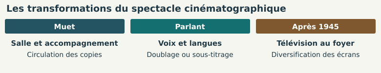

# Histoire contemporaine — Oral du 11 juin 2024 — Corrigé guidé

*Corrigé rédigé par IA, non officiel. Signalez toute erreur.*

**Rédaction** · GPT-6.2 Astra Ultra · vitesse non renseignée · 26 novembre 2026

Le rapport prévoit 1 h 30 de préparation, vingt minutes d’exposé sur un seul des deux sujets, puis dix minutes d’entretien. Les chronologies et l’atlas autorisés permettent de situer les cas étudiés. Chaque proposition reçoit ici sa propre réponse. Le gras signalé pour chaque billet est celui du feuillet officiel.

## Billet 1

**Intitulé en gras sur le feuillet** · La démocratie en Europe de 1919 à 1990

### Entreprises et entrepreneurs en France 1870-1990

**Question de préparation.** Un dirigeant est-il nécessairement propriétaire du capital ?

En 1870, une boutique familiale, un atelier textile et une compagnie de chemins de fer sont tous des entreprises. Leurs dirigeants disposent pourtant de capitaux et d’une autonomie fort différents. Comment les modes de direction évoluent-ils quand grandissent les entreprises et que s’affirme l’intervention de l’État ?

Dans le textile du Nord et la métallurgie du Creusot, des dynasties patronales associent propriété, gestion et influence municipale. Le logement ouvrier et les œuvres sociales répondent aux besoins de recrutement tout en renforçant la dépendance. Les sociétés anonymes et les banques permettent aussi de dissocier la propriété des fonctions de direction.

La guerre de 1914 donne aux commandes publiques un rôle majeur. Citroën passe de la production de guerre à l’automobile en série, mais la crise financière des années 1930 conduit Michelin à reprendre l’entreprise. Après 1945, les dirigeants des groupes nationalisés travaillent avec l’État actionnaire et le Plan. Des PME et des artisans poursuivent en parallèle des activités flexibles de sous-traitance.

Concentration, distribution de masse et internationalisation changent les échelles. Après 1973, les restructurations et les privatisations ouvertes en 1986 modifient de nouveau l’actionnariat. L’entrepreneur demeure un preneur de décisions, mais ses moyens d’agir dépendent de prêteurs, de salariés, de débouchés et de règles publiques.

**Réponse pour l’entretien.** Un ingénieur nommé à la tête d’une entreprise publique et un héritier dirigeant sa société familiale exercent tous deux des fonctions de gestion sous des contrôles différents.

### La démocratie en Europe de 1919 à 1990

**Question de préparation.** Une élection suffit-elle à reconnaître une démocratie ?

Comment la démocratie est-elle passée en Europe par des phases d’extension, de destruction et de réinvention ? Avant 1914, élargissement du suffrage, parlementarisme et organisations de masse connaissent des rythmes inégaux, tandis que les femmes et les populations impériales sont largement exclues. En 1918–1919, chute d’empires et nouvelles constitutions font naître des républiques, mais aussi des tensions sur les frontières et les appartenances nationales. Suffrage, droits des minorités et capacité à changer de gouvernement doivent être distingués.

Dans l’entre-deux-guerres, fascismes, nazisme et autres autoritarismes détruisent des institutions démocratiques. Toutes les sociétés européennes ne suivent pas le même chemin. Après 1945, l’Europe occidentale associe souvent pluralisme politique, État social et intégration régionale. Les « démocraties populaires » à l’Est invoquent une autre légitimité mais restreignent durablement le pluralisme. Les transitions en Grèce, au Portugal et en Espagne dans les années 1970, puis les révolutions de 1989 à l’Est, élargissent l’espace des régimes pluralistes. Leur consolidation dépend d’institutions, de mobilisations et de compromis. L’histoire du siècle n’est donc pas une progression continue vers un modèle unique.

Il faut aussi situer les démocratisations au sud du continent. La révolution portugaise de 1974 ouvre une transition, la dictature des colonels grecs tombe la même année et la Constitution espagnole de 1978 institue une monarchie parlementaire. En 1989, les changements à l’Est engagent d’autres transformations des partis, de l’État et de la propriété. Les élections libres ne surgissent donc ni des mêmes coalitions ni des mêmes contextes diplomatiques.

**Réponse pour l’entretien.** Il faut examiner la liberté de candidature et d’information, la possibilité d’une alternance, la protection des libertés et les institutions qui font respecter le résultat.

## Billet 2

**Intitulé en gras sur le feuillet** · Travailler à l’usine en France des années 1870 aux années 1980

### Travailler à l’usine en France des années 1870 aux années 1980

**Question de préparation.** Quelle différence entre OS et ouvrier professionnel ?

Que signifie « travailler à l’usine » au-delà de la croissance de la production ? À la fin du XIXe siècle, usines textiles, ateliers métallurgiques et grandes installations sidérurgiques organisent des gestes, des horaires et des hiérarchies différents. Travailleurs qualifiés, manœuvres, femmes et travailleurs étrangers ne disposent pas des mêmes salaires ni des mêmes protections. La concentration de la main-d’œuvre favorise des solidarités, mais une partie de la production reste dispersée ou sous-traitée.

La Grande Guerre développe la production en série et bouleverse la répartition des postes. L’entre-deux-guerres voit progresser la rationalisation et le travail à la chaîne, notamment dans l’automobile. Les occupations d’usines de 1936 font du lieu de travail un espace de revendication et de sociabilité. Après 1945, l’essor des grandes entreprises et le recours à une main-d’œuvre immigrée restent marqués par la distinction entre ouvriers spécialisés et ouvriers professionnels. Les conflits de 1968 et des années 1970 portent aussi sur la cadence, la dignité et la parole au travail. Automatisation et fermetures transforment ensuite les carrières et les territoires. La mémoire industrielle conserve les gestes comme les conflits de l’atelier.

À Billancourt, l’usine Renault offre un observatoire de l’enchaînement entre chaîne, hiérarchie de qualification et représentation syndicale. Un ouvrier spécialisé peut maîtriser un poste exigeant sans bénéficier du classement d’un professionnel. Dans les années 1960 et 1970, les ouvriers immigrés affectés à ces tâches contestent les classifications aussi bien que les cadences. La crise des années 1980 met en question la perspective que leurs enfants y trouvent à leur tour une place.

**Réponse pour l’entretien.** « Ouvrier spécialisé » désigne historiquement une catégorie d’emploi, souvent sur un poste fractionné. L’ouvrier professionnel dispose d’une qualification reconnue dans les classifications.

### Religions et politique dans le monde de 1918 aux années 1980

**Question de préparation.** Un État qui se dit laïque cesse-t-il d’administrer le religieux ?

En 1979, une révolution en Iran porte une partie du clergé chiite au pouvoir. En Pologne, la même année, la visite de Jean-Paul II offre une expérience de rassemblement autonome sous un État socialiste. Pourquoi une même catégorie, le religieux, peut-elle désigner un appareil de gouvernement et un lieu de contestation ?

Après 1918, les bolcheviks privent les institutions religieuses de biens et de moyens. La fermeture de lieux de culte et la répression touchent différemment les confessions. En Turquie, la république kémaliste abolit le califat en 1924 tout en organisant un contrôle étatique du culte sunnite. La sécularisation peut donc prendre la forme d’une administration de la religion.

Lors de la partition de l’Inde en 1947, un projet national associé aux musulmans du sous-continent se traduit par des violences et déplacements qui atteignent hindous, sikhs et musulmans. La diversité religieuse demeure à l’intérieur des nouveaux États. Plus tard, aux États-Unis, des Églises noires soutiennent le mouvement des droits civiques par leurs lieux de réunion et leurs cadres.

En Amérique latine, des communautés catholiques engagées en faveur des pauvres s’opposent à des dictatures alors que d’autres secteurs ecclésiaux les ménagent. Les religions agissent ainsi par des institutions, des pratiques collectives et des engagements concurrents. Il faut toujours identifier qui parle au nom de quelle communauté.

**Réponse pour l’entretien.** L’institution turque chargée des affaires religieuses montre qu’une rupture avec le califat peut aller de pair avec une organisation publique de certaines pratiques.

## Billet 3

**Intitulé en gras sur le feuillet** · Génocides et massacres de masse au 20e s.

### Nationalisations et privatisations en France (des années 1870 aux années 1980)

**Question de préparation.** La SNCF de 1937 est-elle entièrement propriété publique ?

Changer de propriétaire modifie-t-il toujours la façon de produire ? Il faut distinguer régulation publique, nationalisation du capital et privatisation. À la fin du XIXe siècle, les réseaux ferroviaires mêlent compagnies privées, concessions et garanties d’État. Le rachat de l’Ouest en 1908 accroît le réseau de l’État sans nationaliser tout le secteur.

Le Front populaire réorganise la Banque de France en 1936 et nationalise des fabrications de guerre. La constitution de la SNCF en 1937 crée une société d’économie mixte à majorité publique. À la Libération, Renault est nationalisée par ordonnance dans un contexte de sanction, tandis que les nationalisations de l’électricité et du gaz de 1946 répondent à la reconstruction et à l’unification des réseaux.

La gauche au pouvoir étend en 1982 la propriété publique à de grandes banques et entreprises industrielles. Dès 1986, le gouvernement de cohabitation engage des privatisations, dont celle de Saint-Gobain. L’alternance transforme les choix d’actionnariat, mais une entreprise privée peut dépendre des marchés publics et une entreprise nationalisée doit trouver des clients. Le statut du capital ne résume donc ni la stratégie industrielle ni le contrôle démocratique.

**Réponse pour l’entretien.** La nouvelle société est d’économie mixte, à majorité publique. L’organisation commune du réseau et l’identité des actionnaires sont deux caractéristiques différentes.

### Génocides et massacres de masse au 20e s.

**Question de préparation.** Pourquoi présenter l’intention dans l’étude d’un génocide ?

En 1948, les Nations unies adoptent la convention pour la prévention et la répression du crime de génocide. Le terme forgé par Raphaël Lemkin en 1944 désigne une réalité que le droit international cherche désormais à définir. Comment comparer les violences collectives du siècle tout en respectant la singularité de chaque histoire ?

**Guerres, États et exclusion de populations.** Pendant la Première Guerre mondiale, les autorités jeunes-turques de l’Empire ottoman organisent à partir de 1915 la destruction des Arméniens d’Anatolie. Les familles sont persécutées en fonction de l’appartenance que leur assignent les autorités. En Europe nazie, les Juifs sont progressivement privés de droits, spoliés puis voués à la destruction à l’échelle du continent dans le contexte de la Seconde Guerre mondiale. Les Roms et les Sinti subissent eux aussi une persécution génocidaire. Dans chacun de ces cas, la guerre élargit les capacités de contrainte, mais c’est l’étude du projet dirigé contre un groupe qui éclaire la qualification de génocide.

**Qualifier sans confondre.** Un massacre de masse peut viser l’élimination d’opposants politiques ou le contrôle d’un territoire et relever juridiquement d’autres crimes internationaux. Au Cambodge, le régime khmer rouge entraîne la mort d’une part considérable de la population entre 1975 et 1979. Les juridictions ont distingué des crimes contre l’humanité et des actes génocidaires contre certains groupes, notamment les Vietnamiens et les Cham. En 1994, les Tutsi du Rwanda sont visés en tant que groupe, tandis que des Hutu opposés aux persécutions sont aussi assassinés. Comparer exige de documenter la désignation des victimes, les décisions politiques et les chronologies locales.

**L’après-violence engage conservation des traces, justice et transmission.** Archives, témoignages de survivants et recherches sur les absents donnent accès à des expériences autrement effacées. Nuremberg, puis les tribunaux internationaux pour l’ex-Yougoslavie et le Rwanda développent des modes différents de poursuite individuelle. Reconnaître les responsabilités et combattre la négation des faits demande parfois plusieurs générations. L’histoire comparée peut ainsi éclairer les conditions d’exclusion et les réponses internationales, sans transformer les expériences des victimes en classement des souffrances.

Comparer aussi les chronologies de reconnaissance. La convention de 1948 donne une définition juridique après plusieurs crimes aujourd’hui étudiés sous ce terme. Une source contemporaine peut témoigner d’une persécution sans disposer du mot forgé plus tard. Les archives, les témoignages des survivants, les décisions judiciaires et les débats historiographiques répondent ainsi à des questions différentes.

**Réponse pour l’entretien.** Le droit international qualifie une intention de destruction visant un groupe protégé, en tout ou partie. Des violences de masse peuvent constituer d’autres crimes sans répondre à ce critère précis.

## Billet 4

**Intitulé en gras sur le feuillet** · Les femmes politiques en France 1936-1991

### Les femmes politiques en France 1936-1991

**Question de préparation.** Où les Françaises votent-elles pour la première fois dans un scrutin nationalement organisé ?

Sous la Troisième République, des femmes participent aux mobilisations, écrivent dans la presse, animent associations, partis et syndicats tout en restant exclues du suffrage national. Hubertine Auclert et d’autres suffragistes rendent cette contradiction politique. Les femmes nommées sous-secrétaires d’État dans le gouvernement de Léon Blum en 1936, dont Cécile Brunschvicg et Irène Joliot-Curie, ne disposent toujours pas du droit de vote. La fonction gouvernementale, la citoyenneté électorale et la sociologie des élues ont donc des histoires distinctes.

L’ordonnance du 21 avril 1944 rend les femmes électrices et éligibles dans les mêmes conditions que les hommes. Les Françaises participent pour la première fois en métropole aux municipales du printemps 1945. Leur présence dans les assemblées reste limitée par les investitures partisanes, la division du travail familial et les normes de légitimité. Les militantes d’associations et de mouvements féministes imposent aussi à l’agenda de nouveaux objets, parmi lesquels les droits reproductifs. Ministre de la Santé, Simone Veil défend le projet sur l’IVG en 1974, adopté définitivement en décembre et promulgué en janvier 1975. Yvette Roudy, ministre des Droits de la femme en 1981, travaille notamment à la loi de 1983 sur l’égalité professionnelle. Les trajectoires ministérielles visibles ne doivent donc faire oublier ni les soutiens collectifs ni les obstacles à l’accès durable au mandat.

Les bornes mettent en évidence deux situations institutionnelles très différentes. En 1936, Cécile Brunschvicg, Suzanne Lacore et Irène Joliot-Curie entrent au gouvernement alors que les Françaises n’ont pas encore le droit de vote national. En 1991, Édith Cresson devient Première ministre, mais cette nomination n’implique pas la parité au Parlement. Entre ces jalons se joue la sélection des candidatures par des partis souvent dirigés par des hommes.

**Réponse pour l’entretien.** Aux municipales d’avril 1945. Leur droit de vote et leur éligibilité avaient été reconnus par l’ordonnance du 21 avril 1944.

### Catholicisme et communisme dans le monde 1919-1991

**Question de préparation.** Pourquoi le cas polonais ne s’applique-t-il pas tel quel à l’Italie ?

En Italie, le Parti communiste participe à la Résistance tandis que la Démocratie chrétienne domine l’après-guerre. Les deux univers se disputent le vote, la sociabilité et la définition de la justice sociale. Comment expliquer à la fois leur antagonisme et les rencontres entre croyants et militants ?

Le communisme soviétique vise la disparition de la religion comme institution indépendante. Fermetures et persécutions touchent des fidèles catholiques, particulièrement dans certains territoires d’Europe orientale. Rome dénonce l’athéisme communiste, notamment dans l’encyclique Divini Redemptoris en 1937. Après 1945, le choix du bloc occidental par les chrétiens-démocrates italiens donne au conflit une dimension électorale et internationale.

Dans les usines françaises, des militants catholiques participent aux mêmes luttes salariales que des syndicalistes communistes. L’expérience des prêtres-ouvriers suscite des tensions avec la hiérarchie. En Amérique latine, après le concile Vatican II et la conférence de Medellín en 1968, des chrétiens cherchent dans l’analyse des classes un langage de critique sociale, sans nécessairement adhérer au parti ou à l’athéisme.

En Pologne, des lieux de culte donnent abri et visibilité aux réseaux de Solidarność. L’effondrement de l’URSS en 1991 ne se réduit pourtant pas à un affrontement religieux. Les relations entre catholicisme et communisme varient avec la liberté d’organisation, l’histoire nationale et la question sociale.

**Réponse pour l’entretien.** En Pologne le parti contrôle l’État. En Italie le PCI appartient à une compétition pluraliste, face à un parti de gouvernement catholique.

## Billet 5

**Intitulé en gras sur le feuillet** · La jeunesse dans le monde occidental de 1945 aux années 1970

### Le Midi rouge, mythes et réalités 1870-1990

**Question de préparation.** À quelle échelle vérifier l’existence d’un « Midi rouge » ?

L’adjectif « rouge » fait du Midi un pays de fidélité à la gauche. Quelle réalité historique désigne cette image alors que villes, montagnes et littoraux votent différemment ? Le Midi viticole, notamment l’Hérault et l’Aude, fournit un terrain plus précis que le sud tout entier.

Sous la IIIe République, sociétés de libre pensée, municipalités républicaines puis radicales et réseaux d’élus défendent la laïcité. Dans les bourgs viticoles, petits propriétaires et ouvriers agricoles ont intérêt à une vendange rémunératrice sans être égaux devant la propriété. La révolte de 1907 contre la mévente rassemble des groupes aux intérêts parfois contradictoires. Elle ne constitue pas un vote de classe uniforme.

La SFIO, puis selon les lieux le PCF, construisent des fidélités municipales et syndicales. Les fêtes, les patronages et les sociabilités laïques entretiennent une mémoire du rouge, tandis qu’il existe aussi des bastions catholiques conservateurs en Aveyron ou dans certaines parties du Gard. Urbanisation, tourisme, migrations et crise viticole transforment ensuite bénéficiaires et bases de la représentation.

En 1990, une ancienne municipalité socialiste et un département aux votes contrastés peuvent partager une image régionale. Le mythe devient à son tour un fait historique quand candidats, presse ou habitants l’emploient pour se reconnaître ou le combattre.

**Réponse pour l’entretien.** Comparer les résultats par commune et par période, la couleur des municipalités et les réseaux militants. Une moyenne méridionale masque des territoires opposés.

### La jeunesse dans le monde occidental de 1945 aux années 1970

**Question de préparation.** Peut-on assimiler tous les jeunes de 1968 à des étudiants ?

Comment un âge de la vie devient-il une catégorie publique transatlantique ? Après 1945, le baby-boom élargit les cohortes des jeunes dans plusieurs pays. La prolongation de la scolarité accroît le temps passé entre l’enfance et l’emploi stable, mais apprentis, étudiants et jeunes agriculteurs n’y disposent pas des mêmes revenus.

Dans les années 1950 et 1960, disques, transistor, vêtements et cinéma font des adolescents une clientèle reconnue. Le rock circule des États-Unis vers l’Europe, puis les groupes britanniques retraversent l’Atlantique. Les vedettes rendent visibles des styles communs sans effacer les barrières de classe ou de couleur. Aux États-Unis, la contribution de musiciens noirs s’inscrit dans une société encore marquée par la ségrégation.

Les mobilisations étudiantes des années 1960 empruntent des réseaux transnationaux, mais les enjeux diffèrent. Contre la guerre du Vietnam aux États-Unis, réforme universitaire en RFA, convergences françaises avec des salariés en mai 1968 : les calendriers ne se superposent pas. Les jeunes conservateurs, les militantes féministes et les ouvriers ont aussi leurs propres cadres.

À partir de la crise des années 1970, l’entrée sur le marché du travail se fait plus difficile. La jeunesse est ainsi simultanément une génération nombreuse, un marché et des groupes sociaux dont les horizons peuvent diverger.

**Réponse pour l’entretien.** La massification universitaire demeure socialement sélective. Beaucoup travaillent déjà et rencontrent le conflit dans l’atelier, les transports ou le quartier.

## Billet 6

**Intitulé en gras sur le feuillet** · Pauvres et pauvreté en France

### Pauvres et pauvreté en France

**Question de préparation.** Pourquoi peut-on devenir moins pauvre en valeur absolue tout en restant sous un seuil relatif ?

La pauvreté désigne une insuffisance de ressources qui dépend aussi des dépenses nécessaires, du logement et des solidarités. Entre 1870 et les années 1990, comment passe-t-on d’un jugement sur les « indigents » à des droits sociaux, alors que la précarité demeure ?

Sous la IIIe République, secours municipaux, bureaux de bienfaisance et œuvres confessionnelles sélectionnent leurs bénéficiaires. La loi de 1893 sur l’assistance médicale gratuite et celle de 1905 sur l’assistance aux vieillards, infirmes et incurables ouvrent des obligations publiques. Handicap, vieillesse ou charge familiale n’exposent pas également tous les ménages. Les solidarités locales secourent tout en imposant parfois un contrôle.

Le chômage des années 1930 montre les limites d’une protection liée à l’emploi. Après 1945, la Sécurité sociale et l’extension des retraites réduisent certains risques mais ne logent pas une famille sans abri. L’appel de l’abbé Pierre pendant l’hiver 1954 rend publique une crise du logement jusque dans les villes de la croissance.

Avec le chômage de longue durée, les catégories d’exclusion et de « nouveaux pauvres » gagnent en visibilité. Le RMI créé en 1988 garantit un revenu minimum sous conditions. Le seuil monétaire relatif, le mal-logement et le renoncement aux soins mesurent des dimensions distinctes. Être pauvre dépend autant de ressources accessibles que de la capacité effective à faire valoir ses droits.

**Réponse pour l’entretien.** Le premier calcul compare un pouvoir d’achat dans le temps. Le second situe le revenu par rapport à celui du reste de la population.

### Le cinéma au 20e siècle

**Question de préparation.** La diffusion mondiale d’un film garantit-elle qu’il est vu partout de la même manière ?

Comment un spectacle né à la fin du XIXe siècle devient-il à la fois industrie, art et pratique collective mondiale ? Les premières projections commerciales des années 1890 donnent lieu à des expérimentations dans plusieurs pays. L’essor de salles, de sociétés de production et de réseaux de distribution stabilise le cinéma comme spectacle populaire. La puissance financière d’Hollywood et le système des studios accompagnent l’internationalisation des films, sans éliminer les cinémas européens, indiens ou japonais.

Le passage au parlant à la fin des années 1920 transforme le travail des acteurs, des salles et des exportateurs. En URSS, en Allemagne et dans les démocraties, le film participe à l’information et à la propagande, mais l’expérience du public ne se déduit pas des intentions des producteurs. Après 1945, néoréalisme italien, Nouvelle Vague française et cinémas issus des indépendances renouvellent la création et la représentation du quotidien. Télévision et vidéo modifient ensuite la fréquentation des salles et les modes de réception, tandis que les superproductions dominent une partie du marché. Censure, festivals et critiques contribuent aussi à donner une valeur artistique aux œuvres.

Le sujet dépasse Hollywood et les salles européennes. Bombay, puis Mumbai, développe une production populaire en plusieurs langues, portée notamment par des chansons et des circuits de distribution. Au Japon, Kurosawa acquiert une reconnaissance internationale dans les années 1950. Les films de Sembène au Sénégal donnent à la décolonisation une dimension de production et de représentation. Demander qui finance, distribue et traduit un film permet de tenir ensemble industrie, création et géographie des publics.

**Réponse pour l’entretien.** Langue, sous-titrage, censure, prix du billet et usages collectifs de la salle transforment sa réception.

## Billet 7

**Intitulé en gras sur le feuillet** · Religion et politique en France 1870-1945

### Religion et politique en France 1870-1945

**Question de préparation.** La séparation interdit-elle aux croyants d’intervenir dans la vie politique ?

En 1870, une large partie de l’épiscopat regarde avec méfiance la République, tandis que des électeurs catholiques s’y rallient. Comment une querelle de régime devient-elle un débat sur les pratiques de l’État, les écoles et les libertés ?

La République laïcise l’école primaire au début des années 1880. Les congrégations enseignantes et les réseaux paroissiaux restent pourtant des lieux de sociabilité politique. Léon XIII invite en 1892 les catholiques français à accepter la République, sans exiger qu’ils approuvent toutes ses lois. Pendant l’affaire Dreyfus, catholiques, protestants et juifs n’agissent ni en blocs uniformes ni dans des situations égales.

La séparation de 1905 garantit le libre exercice des cultes dans les conditions de l’ordre public et met fin au financement concordataire selon ses règles territoriales. Les inventaires suscitent des résistances. La Grande Guerre rapproche des croyants et des républicains dans l’expérience combattante, alors que l’Alsace-Moselle revenue à la France conserve un régime local.

Dans les années 1930, Action catholique, syndicats chrétiens et mouvements juifs diversifient l’engagement. Après 1940, des hiérarchies soutiennent initialement Pétain, tandis que des croyants prennent part au sauvetage ou à la Résistance. La naissance du MRP en 1944 marque l’inscription d’une démocratie chrétienne dans le nouvel ordre républicain.

**Réponse pour l’entretien.** Elle redéfinit les relations entre collectivités publiques et cultes. Les libertés d’association, de conscience et de vote ouvrent des formes d’intervention aux citoyens croyants.

### Musique et société en Europe occidentale 1945-1990

**Question de préparation.** Qu’apporte une histoire des lieux d’écoute ?

Entendre le même disque de Londres à Hambourg suppose des studios, des supports et des publics capables de les acheter. Comment après 1945 les musiques organisent-elles des appartenances sociales dans une Europe occidentale dont les frontières s’ouvrent inégalement ?

La reconstruction restaure orchestres, radios et politiques culturelles. La tradition savante bénéficie d’investissements publics, tandis que jazz, chanson et variétés circulent par clubs ou émissions. Des musiques issues de la diaspora afro-américaine deviennent des références européennes auxquelles les artistes locaux donnent de nouveaux accents.

Dans les années 1960, disques moins coûteux, tourne-disques et transistor permettent une écoute plus personnelle. Le succès des Beatles relie salles britanniques et publics transatlantiques. En France, le yé-yé adapte et commercialise des répertoires étrangers. Le marché distingue des âges et des styles tout en écartant de nombreux artistes de ses grands circuits.

Festival, chanson militante et punk donnent ensuite des scènes aux conflits politiques, à l’ennui urbain ou à la critique des hiérarchies. En Grande-Bretagne, reggae et mobilisations antiracistes rendent audible une société transformée par les migrations issues de l’empire. La circulation d’un rythme crée ainsi des publics communs sans imposer une seule signification.

**Réponse pour l’entretien.** La salle de concert, le club, la radio familiale et l’écoute individuelle diffèrent par le prix, les sociabilités et le pouvoir de choisir la programmation.

## Billet 8

**Intitulé en gras sur le feuillet** · Etre homosexuel(le) en France 1870-1990

### Etre homosexuel(le) en France 1870-1990

**Question de préparation.** Pourquoi ne pas projeter une identité publique actuelle sur tout le XIXe siècle ?

L’absence, dans le code pénal issu de la Révolution, d’une incrimination générale des relations consenties entre personnes de même sexe ne signifie pas que celles-ci puissent être vécues librement. « Être » invite à tenir ensemble comportements, identités, regards policiers et médicaux, et modes de sociabilité, dont les mots et la visibilité changent profondément.

Sous la Troisième République, les espaces de rencontre urbains, les écrits et certaines sociabilités artistiques rendent des liens possibles. Police des mœurs, poursuites pour outrage public à la pudeur, scandale public et normes familiales imposent la prudence. Les archives policières donnent surtout à voir les personnes surveillées, souvent des hommes. Elles documentent beaucoup moins des existences lesbiennes ou des relations discrètes en dehors des grandes villes. L’emploi d’un mot dans une expertise n’établit pas l’identité que la personne se donnait elle-même.

Vichy instaure en 1942 une discrimination d’âge concernant certains actes entre personnes de même sexe ; le principe discriminatoire survit à la Libération. La majoration de la répression de certains outrages publics au début des années 1960 renforce encore la stigmatisation. Arcadie, fondée dans les années 1950, cherche des voies de sociabilité et de reconnaissance. À partir de 1971, le Front homosexuel d’action révolutionnaire et les mouvements lesbiens contestent plus ouvertement les normes sexuelles, y compris les hiérarchies de genre au sein des mouvements militants. En 1982, la suppression du seuil pénal discriminatoire met fin à une différence juridique majeure. Dans les années 1980, le sida entraîne morts, stigmatisations, solidarités et organisations nouvelles, dont AIDES en 1984 et Act Up-Paris en 1989. La fin des discriminations pénales spécifiques et les nouveaux espaces publics ne suppriment donc ni le rejet ni l’inégale possibilité de rendre sa vie visible.

Pour les lesbiennes, la moindre visibilité dans certaines archives de police ne prouve ni absence de relations ni sécurité. La dépendance économique et les normes familiales ont pesé sur les possibilités de faire ménage, se nommer ou militer. Dans les années 1980, la mobilisation contre le sida, avec AIDES fondée en 1984, associe soins, information et lutte contre la stigmatisation. L’égalité pénale conquise en 1982 laisse donc subsister une histoire sociale de la reconnaissance.

**Réponse pour l’entretien.** Les mots, lieux de rencontre et moyens de vivre ouvertement changent. Il faut interpréter les catégories de l’époque tout en examinant ce qu’enregistraient police, médecine ou associations.

### Le communisme dans les pays du Tiers-Monde

**Question de préparation.** Le « Tiers-Monde » désigne-t-il un bloc diplomatique communiste ?

Le communisme a-t-il été une tutelle extérieure, un outil de libération ou une voie de développement pour le tiers-monde ? L’expression « tiers-monde » forgée en 1952 désigne des sociétés très diverses dont beaucoup contestent la domination coloniale. L’Internationale communiste avait déjà formé des militants, mais les mouvements d’indépendance adaptent leurs références à des problèmes nationaux. En Chine en 1949 et au Vietnam, réforme agraire, mobilisations paysannes et construction d’un État se combinent au marxisme.

Bandung en 1955 et le non-alignement manifestent la volonté de ne pas choisir automatiquement un camp. Des dirigeants sollicitent aide économique ou militaire soviétique sans établir un régime communiste. La révolution cubaine de 1959 et les conflits d’indépendance en Afrique australe illustrent d’autres formes de circulation des militants, de l’aide et des modèles. La rupture sino-soviétique offre des partenaires rivaux. Les réformes économiques chinoises après 1978, les crises de régimes et la fin de l’URSS en 1991 modifient ces relations. L’autonomie des acteurs locaux et l’écart entre promesses d’émancipation et pratiques de gouvernement expliquent la diversité des trajectoires.

La conférence de Bandung en 1955 permet de distinguer solidarité afro-asiatique et adhésion communiste. L’Inde de Nehru défend le non-alignement tout en disposant de partis communistes actifs dans une démocratie électorale. À Cuba, après 1959, le rapprochement avec Moscou change l’équilibre des Caraïbes sans transformer toutes les révolutions latino-américaines en copies de Cuba. L’histoire articule donc organisations locales, question agraire, indépendance économique et alliances extérieures.

**Réponse pour l’entretien.** Le terme regroupe des États et des sociétés très hétérogènes. Certains gouvernements se réclament du marxisme, d’autres répriment les communistes ou négocient avec plusieurs puissances.
