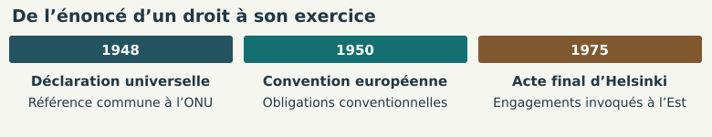

# Histoire contemporaine — Oral du 12 juin 2024 — Corrigé guidé

*Corrigé rédigé par IA, non officiel. Signalez toute erreur.*

**Rédaction** · GPT-6.2 Astra Ultra · vitesse non renseignée · 26 novembre 2026

Le rapport prévoit 1 h 30 de préparation, vingt minutes d’exposé sur un seul des deux sujets, puis dix minutes d’entretien. Les chronologies et l’atlas autorisés permettent de situer les cas étudiés. Chaque proposition reçoit ici sa propre réponse. Le gras signalé pour chaque billet est celui du feuillet officiel.

## Billet 1

**Intitulé en gras sur le feuillet** · L'anticolonialisme en France des années 1880 aux années 1960

### L'anticolonialisme en France des années 1880 aux années 1960

**Question de préparation.** Une critique du coût de l’empire vaut-elle revendication d’égalité ?

Lors du débat colonial de 1885, Clemenceau conteste à Jules Ferry le droit de classer les peuples pour légitimer leur conquête. Cette opposition au nom de principes républicains coexiste avec des critiques économiques ou nationalistes de l’expansion outre-mer. Comment la critique de la conquête devient-elle soutien au droit des colonisés de décider de leur avenir ?

La dénonciation de violences coloniales par des journalistes ou des parlementaires peut viser une réforme du gouvernement impérial. Avant 1914, même une sensibilité socialiste n’implique pas partout une revendication d’indépendance immédiate. Dans l’entre-deux-guerres, les réseaux communistes, des étudiants et des ouvriers issus des colonies font de Paris un carrefour politique. L’Étoile nord-africaine et Messali Hadj portent la revendication algérienne en métropole.

Après 1945, les guerres d’Indochine puis d’Algérie donnent un contenu concret au refus de l’empire. Les mobilisations dénoncent la torture, défendent l’objection ou réclament la négociation. Le Manifeste des 121, en 1960, cristallise un débat sur l’insoumission. D’autres soutiennent l’autodétermination tout en refusant certaines formes de combat.

En 1962, l’indépendance algérienne change l’objet du conflit sans effacer ses divisions. L’anticolonialisme en France a été produit aussi par les colonisés présents en métropole et par des alliances dont l’accord sur la fin de la domination ne réglait pas toutes les divergences.

**Réponse pour l’entretien.** Un opposant peut souhaiter économiser des ressources ou préparer la revanche en Europe sans reconnaître le droit des colonisés de se gouverner.

### Les grands patrons dans le monde occidental 1919-1990

**Question de préparation.** Quel indicateur distinguerait patron-propriétaire et dirigeant salarié ?

Au lendemain de 1918, Henry Ford représente un patron fondateur qui transforme la production de masse et prétend organiser le travail comme le mode de vie des salariés. Que reste-t-il de cette figure lorsque le capital se disperse, que l’État intervient et que l’entreprise devient multinationale ?

Les dynasties industrielles du textile, de la chimie ou de la sidérurgie conservent des ancrages locaux, des sièges d’administrateurs et des relais dans les organisations patronales. Aux États-Unis, Alfred Sloan à General Motors incarne déjà une direction salariée qui coordonne plusieurs divisions. L’autorité patronale peut ainsi reposer sur l’héritage, sur les actionnaires ou sur une expertise reconnue.

La crise de 1929 et la guerre déplacent le rapport aux pouvoirs publics. Le New Deal encadre le salariat et la concurrence, les commandes de guerre donnent ensuite à de grands groupes un rôle stratégique. Après 1945, des dirigeants de firmes privées négocient investissements et salaires avec syndicats et administrations. En France, les entreprises nationalisées ont elles aussi des dirigeants, mais ceux-ci répondent à un actionnaire public.

À partir des années 1970, déréglementation, internationalisation des capitaux et restructurations renforcent selon les pays la pression des investisseurs. Les grands patrons sont donc moins une classe d’individus semblables qu’une position de pouvoir dont les instruments et les contrôles changent.

**Réponse pour l’entretien.** Examiner les droits de vote au capital, le mode de nomination et la capacité du conseil d’administration à révoquer le dirigeant.

## Billet 2

**Intitulé en gras sur le feuillet** · L'armée française dans la nation 1870-1990

### L'armée française dans la nation 1870-1990

**Question de préparation.** En quoi la guerre d’Algérie implique-t-elle directement les familles métropolitaines ?

La défaite de 1870 met en cause l’organisation militaire et l’idée que les Français se font d’eux-mêmes. Comment une institution hiérarchisée devient-elle un lieu d’apprentissage de la citoyenneté tout en traversant de graves crises d’autorité ?

Sous la IIIe République, les lois de recrutement, jusqu’à celle de 1905, généralisent l’obligation de service masculin et réduisent les exemptions. La caserne, les fêtes et les manuels familiarisent les familles avec la nation armée. L’affaire Dreyfus révèle pourtant combien la défense du corps des officiers peut entrer en conflit avec la justice et les droits d’un citoyen.

La mobilisation de 1914 atteint des millions d’hommes, leurs proches et des soldats venus de l’empire, dont les droits restent inégaux. L’Union sacrée ne supprime ni fatigue ni dissentiments. Les monuments et associations d’anciens combattants inscrivent ensuite l’armée dans le deuil, les pensions et la vie municipale.

La rupture de 1940 divise les obéissances entre Vichy, France libre et résistances. Les guerres de décolonisation redéfinissent le rôle des appelés et l’autorité du pouvoir civil. Le putsch d’Alger de 1961 échoue et souligne l’enjeu du contrôle politique. Après 1962, conscription, dissuasion et missions extérieures coexistent. En 1990, le service national demeure, avec une expérience très différente de celle de 1914.

**Réponse pour l’entretien.** Le recours massif aux appelés élargit très au-delà des militaires de carrière l’expérience de la guerre et la contestation de ses buts.

### Le mouvement ouvrier en Europe occidentale 1919-1990

**Question de préparation.** Que différencient négociation collective et cogestion ?

Un ouvrier peut voter socialiste, adhérer à un syndicat chrétien, participer à une coopérative ou ne militer nulle part. Comment les organisations ouvrières européennes transforment-elles une condition sociale en capacité d’action collective ?

Après 1918, la révolution russe partage partis socialistes et communistes. En Allemagne, sociaux-démocrates et communistes conservent des organisations rivales, que le nazisme écrase en 1933. En Grande-Bretagne, le Labour s’appuie sur des liens organiques avec les syndicats. En France, les grèves avec occupations de 1936 renforcent les revendications salariales, les délégués et l’adhésion à la CGT.

Après 1945, la reconnaissance syndicale, la négociation de branche et l’État social changent les moyens d’action. La cogestion en RFA donne à des représentants des salariés une place dans certaines instances des entreprises. En Italie, les mobilisations de l’« automne chaud » de 1969 mettent au premier plan usines et conseils d’atelier. La défense d’un même intérêt de classe n’impose donc pas un modèle unique d’organisation.

Désindustrialisation, féminisation du salariat et immigration déplacent les bases du mouvement. Les grèves britanniques des mineurs de 1984-1985 montrent combien la force d’un syndicat dépend aussi des choix de l’État et de la structure énergétique. Le recul de certains bastions industriels ne signifie pas la disparition du conflit social.

**Réponse pour l’entretien.** La première règle par accord les conditions de travail et de rémunération. La seconde donne une représentation institutionnelle des salariés dans la gouvernance de l’entreprise.

## Billet 3

**Intitulé en gras sur le feuillet** · Louis Aragon et Jean-Paul Sartre, deux figures d'intellectuels engagés

### Louis Aragon et Jean-Paul Sartre, deux figures d'intellectuels engagés

**Question de préparation.** Pourquoi présenter les deux hommes ensemble ?

Aragon adhère au Parti communiste en 1927. Sartre, qui ne prend pas sa carte, se rapproche d’abord de certaines de ses positions puis s’en éloigne. Que peut l’autorité d’un écrivain dans un siècle où partis, presse et revues prétendent eux aussi parler pour l’histoire ?

Le parcours d’Aragon mène du surréalisme à une littérature qui se veut liée au mouvement ouvrier. Pendant l’Occupation, la poésie de Résistance cherche une langue commune à des lecteurs de convictions opposées. Après 1945, sa direction des Lettres françaises et son attachement au PCF l’installent à l’intersection du parti et des milieux littéraires. Les révélations sur le stalinisme et les crises du bloc rendent cette position de plus en plus difficile.

Sartre fonde avec d’autres Les Temps modernes en 1945. L’idée d’une littérature engagée lie la responsabilité de l’auteur aux situations dans lesquelles il intervient. Compagnon de route au début des années 1950, il condamne l’intervention soviétique en Hongrie en 1956. Son engagement anticolonial, notamment contre la guerre d’Algérie, mobilise la préface, la pétition et la revue. Après 1968, il prête sa notoriété à d’autres mobilisations.

Ces parcours invitent à comparer les supports autant que les convictions. La poésie mémorisée et la revue d’intervention ne touchent ni les mêmes lecteurs ni les mêmes rythmes. Ni fidélité partisane ni revendication d’autonomie ne dispense l’intellectuel de répondre de ses silences et de ses ruptures.

**Réponse pour l’entretien.** Leur comparaison révèle deux rapports à l’organisation communiste et deux manières de convertir une réputation littéraire en prise de parole politique.

### Les crises monétaires dans le monde 1919-1990

**Question de préparation.** Pourquoi une dette en monnaie étrangère aggrave-t-elle l’effet d’une dépréciation ?

Une crise monétaire survient lorsque la parité, la confiance dans la monnaie ou la capacité de régler des paiements ne tiennent plus ensemble. Après 1919, les dettes de guerre et l’inégale répartition des réserves rendent fragile le retour aux anciennes parités.

**L’étalon-or est fragilisé par la guerre et la dépression.** À la veille de 1914, de nombreuses monnaies ont une parité fixe liée à l’or. La confiance repose aussi sur les banques centrales et sur la place financière de Londres. La guerre suspend la convertibilité dans plusieurs pays et laisse des situations d’endettement et d’inflation inégales. Le Royaume-Uni revient à l’or en 1925 à sa parité d’avant-guerre au prix de fortes contraintes internes. Face à la dépression, il abandonne la convertibilité en 1931. Dévaluations et zones monétaires concurrentes manifestent l’échec d’une restauration à l’identique.

**Bretton Woods construit un compromis.** En 1944, les négociateurs organisent des parités fixes mais ajustables autour du dollar, lui-même convertible en or pour les autorités monétaires étrangères. Le FMI doit accompagner certains ajustements. Les restrictions aux mouvements de capitaux laissent davantage de place aux politiques d’emploi. Les dollars fournis par les États-Unis facilitent le commerce et la reconstruction. Mais l’accumulation de créances en dollars à l’étranger érode la confiance dans la possibilité de toutes les convertir en or. La monnaie de réserve est à la fois monnaie nationale et instrument collectif.

**La fin des parités fixes ouvre une pluralité de régimes.** Nixon suspend la convertibilité-or du dollar en 1971, et les principales monnaies flottent à partir de 1973. Les accords de la Jamaïque en 1976 entérinent le nouvel ordre. Les chocs de taux de change et de taux d’intérêt compliquent la gestion des dettes, notamment en Amérique latine dans les années 1980. Certains pays cherchent une stabilité régionale, comme les membres du Système monétaire européen créé en 1979. Le dollar conserve une fonction centrale malgré le flottement. Le système du siècle se caractérise ainsi par le déplacement des institutions de confiance et des coûts de l’ajustement.

La crise de la livre en 1931 montre le coût social et politique de la défense d’une parité. À l’autre bout de la période, la crise des dettes latino-américaines ouverte en 1982 lie dette en dollars, hausse des taux et difficultés de paiement des États. Le cours du change, le financement extérieur et la structure de la dette doivent donc être étudiés ensemble, sans confondre crise bancaire, crise de change et défaut souverain.

**Réponse pour l’entretien.** Les recettes fiscales ou commerciales en monnaie nationale peuvent acheter moins de devises alors que le montant dû en dollars reste inchangé.

## Billet 4

**Intitulé en gras sur le feuillet** · Les élections présidentielles en France 1870-1990

### Les élections présidentielles en France 1870-1990

**Question de préparation.** La réforme du suffrage direct entre-t-elle en vigueur lors de l’élection de 1958 ?

Que révèle le mode d’élection du président sur la place du chef de l’État ? Sous les IIIe et IVe Républiques, l’élection par les parlementaires fait de la présidence le produit d’un compromis. En 1873, l’élection de Mac-Mahon intervient avant les lois constitutionnelles de 1875. Après la crise du 16 mai 1877, l’effacement relatif de la présidence tient à la pratique de la responsabilité politique et aux rapports de force. L’élection de René Coty en 1953, au treizième tour, illustre la logique parlementaire de la IVe République.

En 1958, de Gaulle est élu par un collège élargi dans le cadre de la nouvelle Constitution. La réforme approuvée par référendum en 1962 établit le suffrage universel direct. En 1965, le ballottage du général face à François Mitterrand montre que la nouvelle légitimité personnelle reste soumise à une compétition réelle. La télévision, les partis et les alliances du second tour structurent ensuite les campagnes. En 1974, Giscard d’Estaing l’emporte de peu. L’alternance de 1981 puis la réélection de Mitterrand en 1988 après une cohabitation montrent comment la présidence s’articule désormais à des majorités parlementaires parfois distinctes.

La candidature reste une opération de coalition, même sous le suffrage direct. En 1965, la mise en ballottage de De Gaulle donne un poids nouveau à la campagne de l’entre-deux-tours. En 1981, l’élection de François Mitterrand permet une alternance qui ne renverse pas la Constitution. La réélection de 1988 après la première cohabitation rappelle que la confiance du corps électoral et la majorité parlementaire peuvent répondre à des calendriers différents.

**Réponse pour l’entretien.** L’élection de 1958 se fait au collège élargi. Le référendum de 1962 introduit le suffrage universel direct, appliqué en 1965.

### Les Etats Unis et le Pacifique au 20e s.

**Question de préparation.** Pourquoi retenir l’indépendance des Philippines en 1946 ?

Le Pacifique est pour les États-Unis à la fois un océan de circulation, un ensemble de territoires et un espace de concurrence entre États. Hawaï et les Philippines issus de l’expansion de 1898 précèdent les rivalités navales et commerciales des années 1920. Aux Philippines, des promesses d’autonomie coexistent avec la dépendance coloniale.

La guerre du Pacifique fait brutalement basculer ces rapports en 1941. La défaite du Japon en 1945 engage une occupation américaine et des réformes institutionnelles. L’indépendance philippine de 1946 laisse subsister des accords militaires et des liens économiques. Les alliances avec le Japon et avec des États d’Asie orientale encadrent ensuite la politique américaine.

La guerre de Corée internationalise la division de la péninsule, puis la guerre du Vietnam montre les limites de l’intervention américaine. Le rapprochement sino-américain de 1972 ouvre une autre voie. Les échanges avec le Japon, la Corée du Sud et les économies riveraines suscitent en même temps dépendances et conflits commerciaux.

L’océan est donc passé d’une frontière impériale à un réseau d’alliances, de migrations et d’échanges dont aucun gouvernement ne maîtrise seul les effets. Les sociétés insulaires et asiatiques ne sont jamais de simples points sur une carte américaine.

**Réponse pour l’entretien.** Elle fait apparaître à la fois la fin d’un statut colonial et la possibilité de maintenir des relations stratégiques et économiques très étroites.

## Billet 5

**Intitulé en gras sur le feuillet** · Le Parlement en France de la IIIe à la Ve République

### Le Parlement en France de la IIIe à la Ve République

**Question de préparation.** Pourquoi le Sénat importe-t-il sous la IIIe République ?

Le Palais-Bourbon reste un repère monumental tandis que ses pouvoirs changent profondément. Comment expliquer la place variable du Parlement dans la formation des majorités, la fabrication des lois et le contrôle du gouvernement ?

Les lois de 1875 établissent deux chambres. Sous la IIIe République, la crise du 16 mai 1877 puis la victoire des républicains affermissent la responsabilité politique du ministère devant les chambres. Commissions, interpellations et négociations de couloir structurent une vie parlementaire que la seule instabilité des cabinets décrit mal. Le Sénat peut bloquer une réforme, notamment celle du vote féminin.

Le vote des pleins pouvoirs constituants à Pétain le 10 juillet 1940 marque une rupture. En 1946, la IVe République conserve la prééminence de l’Assemblée nationale, qui investit et contrôle le gouvernement. Les divisions partisanes et les guerres coloniales fragilisent les majorités.

En 1958, la Constitution rationalise le parlementarisme, réserve des domaines au pouvoir réglementaire et donne au gouvernement de nouveaux moyens d’encadrer la procédure. Pourtant la motion de censure d’octobre 1962 renverse le gouvernement Pompidou. Après la dissolution, les élections confortent l’exécutif. Les cohabitations montrent que l’existence d’une majorité parlementaire reste décisive pour gouverner.

**Réponse pour l’entretien.** Il participe à la législation, pèse sur les ministères et fait obstacle à certains projets adoptés à la Chambre, dont l’extension du suffrage aux femmes.

### L’industrie européenne 1919-1990

**Question de préparation.** La CECA couvre-t-elle toute l’industrie européenne ?

Les cartes industrielles de 1919 mettent en relation la Ruhr, la Lorraine, les Midlands ou la Silésie. Le charbon, les infrastructures et la main-d’œuvre qualifiée permettent de dépasser les frontières économiques, alors que les frontières politiques changent après la guerre.

**Les conflits européens donnent une portée stratégique aux gisements.** Après 1918, la Sarre et la Haute-Silésie deviennent des enjeux territoriaux et frontaliers. L’occupation de la Ruhr en 1923 associe réparations et sécurité industrielle. Après 1945, plusieurs États nationalisent le charbon, comme la France et le Royaume-Uni, pour reconstruire et organiser l’approvisionnement. La CECA créée en 1951 marque une rupture en instituant une gestion commune franco-allemande et plus largement européenne de secteurs longtemps disputés. À l’est, la Pologne socialiste fait du charbon un pilier de sa production et de ses exportations.

Après 1945, reconstruction et investissements publics modernisent des équipements détruits ou vieillissants. La CECA associe six pays autour du charbon et de l’acier. À l’Est, la planification privilégie souvent l’industrie lourde. À l’Ouest, automobile, chimie et électroménager accompagnent l’élévation de la consommation. Les mêmes statistiques de tonnage n’éclairent pas le confort du travailleur ou les dégâts environnementaux d’un bassin.

Après 1973, fermetures et restructurations atteignent des bassins anciens, tandis que l’aéronautique autour d’Airbus illustre une coopération technologique entre pays. La baisse de l’emploi industriel peut se produire même quand la production augmente. En 1990, l’Europe conserve une base productive substantielle, mais sa géographie, ses branches dominantes et ses liens d’approvisionnement ont changé.

**Réponse pour l’entretien.** Elle porte d’abord sur deux secteurs et six États. Elle rend possible une coopération précise sans unifier d’un coup toutes les politiques industrielles du continent.

## Billet 6

**Intitulé en gras sur le feuillet** · Temps de travail et temps libre en France des années 1880 aux années 1980

### Temps de travail et temps libre en France des années 1880 aux années 1980

**Question de préparation.** Pourquoi compter le travail domestique ?

Au XIXe siècle, une journée à l’atelier, le travail agricole commandé par les saisons et le service domestique ne sont pas mesurés de la même manière. Comment les limites juridiques du temps de travail deviennent-elles un temps disponible effectivement vécu ?

L’organisation ouvrière fait de la journée de huit heures une revendication internationale. La loi de 1906 établit le repos hebdomadaire des salariés concernés, puis celle de 1919 fixe la journée de huit heures. Dérogations, surveillance et formes d’emploi déterminent ce qui change dans une entreprise réelle.

Les accords de Matignon des 7–8 juin reconnaissent notamment des augmentations de salaire et des droits collectifs. Les lois sur les conventions collectives, les deux semaines de congés payés et la semaine de quarante heures inscrivent une partie du changement dans le droit. L’expérience n’est pas identique pour tous les salariés et le congé n’implique pas nécessairement un départ loin du domicile. Les loisirs populaires, les transports et les associations donnent néanmoins une réalité nouvelle à la disponibilité du temps.

La conquête de congés payés n’assure pas à tous la possibilité de partir. Budget, transports et charge domestique expliquent les écarts. Dans l’après-guerre, associations de tourisme, comités d’entreprise et équipements municipaux rendent accessibles certaines pratiques. La télévision occupe également une part croissante du temps à domicile.

En 1982, la semaine passe à trente-neuf heures et la cinquième semaine de congés payés est instituée. Le chômage crée aussi un temps sans emploi qui ne produit ni sécurité de revenu ni liberté de choix. Le loisir procède donc d’une maîtrise sociale du temps aussi bien que d’une réduction du nombre d’heures.

**Réponse pour l’entretien.** Une réduction du temps salarié peut libérer peu de temps personnel si les tâches domestiques et de soins restent longues et inégalement partagées.

### La défense des droits de l’homme depuis 1918

**Question de préparation.** Peut-on confondre déclaration universelle et convention européenne ?

Défendre des droits suppose de les énoncer, d’identifier qui peut les revendiquer et de disposer d’institutions capables d’entendre une plainte. Depuis 1918, leur internationalisation transforme le répertoire des États et des mobilisations, sans effacer la souveraineté, les rapports impériaux ni la sélectivité des protections.

Les traités de minorités et la SDN tentent après 1918 certaines protections internationales. L’Organisation internationale du travail fait des conditions de travail une question négociée entre États, employeurs et travailleurs. Les populations colonisées ne disposent pourtant pas d’une position égale dans ce système ; l’absence d’une nationalité protectrice laisse réfugiés et apatrides particulièrement vulnérables. Après les crimes de masse et la Shoah, la Déclaration universelle de 1948 formule des droits civils, politiques, économiques, sociaux et culturels. C’est un texte de référence dont il faut distinguer la portée déclarative des mécanismes juridictionnels. Les pactes adoptés en 1966 et la Convention européenne des droits de l’homme signée en 1950 traduisent certains principes dans des engagements donnant lieu à des formes différentes de suivi ou de recours.

Les sociétés civiles contribuent à définir ces droits. Luttes anticoloniales, mouvement américain pour les droits civiques, campagnes contre l’apartheid, revendications féministes et mobilisations des familles de disparus en Amérique latine utilisent et transforment le langage de l’universalité. Les accords d’Helsinki de 1975 donnent aussi des prises aux dissidents d’Europe de l’Est. La guerre froide nourrit des dénonciations sélectives, et l’existence d’une convention n’assure pas à chacun les moyens de saisir une institution. Pour apprécier un progrès, il faut donc suivre un droit depuis l’énoncé jusqu’à la possibilité de documenter les violations, de protéger les personnes qui parlent et de faire exécuter une décision.

L’Europe fournit un exemple de passage progressif d’une norme à une procédure. La Convention européenne des droits de l’homme de 1950 lie des États signataires. En France, le droit de recours individuel n’est accepté qu’en 1981. Une convention, une ratification et la possibilité qu’un justiciable engage une procédure correspondent à trois étapes distinctes.

**Réponse pour l’entretien.** La première est adoptée par l’Assemblée générale de l’ONU en 1948. La seconde relève du Conseil de l’Europe et d’un dispositif juridictionnel régional.

## Billet 7

**Intitulé en gras sur le feuillet** · Les anciens combattants dans la société française 1918-1990

### Les anciens combattants dans la société française 1918-1990

**Question de préparation.** Une association d’anciens combattants est-elle nécessairement pacifiste ?

En 1918, revenir du front signifie pour des millions d’hommes retrouver emploi et famille, mais aussi faire reconnaître blessures, maladies ou droits à pension. Comment un groupe défini par un service passé acquiert-il une voix durable tout en se renouvelant avec d’autres guerres ?

La loi de 1919 sur les pensions consacre un droit à réparation. Associations, maisons du combattant et mutuelles accompagnent les dossiers et la sociabilité. La qualification de mutilé ou d’ayant droit a des conséquences matérielles. Les familles, les veuves et les anciens soldats coloniaux ne disposent pas toujours de la même reconnaissance.

**Le traumatisme de 1914-1918 change l’échelle de la commémoration.** Il existe des monuments antérieurs, notamment après 1870-1871. La Grande Guerre frappe cependant un très grand nombre de familles, dont certaines ne disposent d’aucune tombe proche. La loi de 1919 relative à la commémoration des morts pour la France accompagne les initiatives municipales et associatives. Conseils municipaux, anciens combattants, familles et artistes discutent financement, emplacement et iconographie. Les souscriptions et les choix de catalogue expliquent la diffusion de certains motifs, sans supprimer les différences locales.

Les associations défendent des intérêts communs tout en divergeant entre républicanisme, pacifisme et nationalisme. L’ancienne appartenance au front ne prédit pas une orientation politique. Après 1945, résistants, déportés, anciens de 1939-1945 puis des guerres d’Indochine et d’Algérie introduisent des expériences et des calendriers de reconnaissance différents. La guerre d’Algérie reste longtemps désignée officiellement par d’autres termes.

En 1990, les cérémonies réunissent donc plusieurs générations. Comprendre les anciens combattants exige de tenir ensemble droits sociaux, mémoire locale et conflits de qualification.

**Réponse pour l’entretien.** Beaucoup privilégient la paix au nom de l’expérience du front. D’autres soutiennent la défense nationale ou des projets nationalistes. Il faut établir l’orientation de chaque groupe.

### Colonisateurs et colonisés en Afrique et en Asie de 1918 aux années 1970

**Question de préparation.** L’existence d’intermédiaires locaux efface-t-elle la domination ?

Après la Grande Guerre, Français et Britanniques voient leurs empires s’étendre sous la forme nouvelle des mandats de la Société des Nations. Dans les années 1970, les indépendances des possessions portugaises marquent la fin des grands empires territoriaux européens en Afrique. Comment les sociétés européennes ont-elles adhéré à l’empire, vécu son fonctionnement et traversé sa disparition ?

**La domination se réorganise après 1918.** Les vainqueurs récupèrent sous mandat des territoires de l’ancien Empire allemand et de l’Empire ottoman. Écoles, presse, publicité et manifestations comme l’exposition coloniale parisienne de 1931 diffusent une vision hiérarchisée des peuples. Les bénéfices et les engagements impériaux sont pourtant inégalement partagés entre investisseurs, administrations, colons de peuplement et populations de métropole. Les violences de la conquête, la contrainte au travail et les inégalités de droit provoquent des résistances dans les colonies et des critiques politiques en Europe.

**La Seconde Guerre mondiale fragilise la légitimité impériale.** Des populations colonisées participent à la guerre et attendent des droits en retour. Les métropoles dépendent de ressources impériales alors même que leur puissance militaire et financière est ébranlée. En Asie, les défaites face au Japon altèrent le prestige des autorités européennes. Les indépendances de l’Inde et du Pakistan en 1947, puis le conflit d’Indochine et l’indépendance indonésienne reconnue en 1949 montrent des voies différentes. Partis, syndicats et mobilisations nationales des colonisés sont des acteurs centraux de ces transformations.

**Les décolonisations transforment aussi les métropoles.** Des opinions européennes se divisent sur le prix des guerres, le droit des peuples et la place des colons. En France, la guerre d’Algérie affecte les institutions, le contingent, les immigrés et les rapatriés. Au Portugal, les guerres africaines pèsent dans la crise du régime renversé en 1974. L’indépendance modifie les droits et la souveraineté sans mettre fin aux migrations, aux relations linguistiques et aux dépendances économiques. Dans les années 1970, les sociétés européennes portent donc encore, de façons contrastées, les traces de leur passé impérial.

Comparer la vie quotidienne en Algérie et dans l’Inde britannique déplace l’attention. En Algérie, une importante population de colons et l’organisation départementale coexistent avec des statuts et des droits profondément inégaux. Dans l’Inde britannique, le recours à des fonctionnaires indiens et les rapports avec les États princiers n’annulent pas la domination impériale. En 1947, la partition indienne montre que le départ d’un pouvoir colonial peut redéfinir brutalement les relations entre habitants.

**Réponse pour l’entretien.** Les intermédiaires disposent de marges différentes. L’inégalité de souveraineté et la capacité impériale de fixer les règles demeurent décisives.

## Billet 8

**Intitulé en gras sur le feuillet** · être communiste en France 1945-1990

### être communiste en France 1945-1990

**Question de préparation.** Comment mesurer l’implantation communiste ?

Adhérer au PCF en 1945, voter communiste en 1956 et militer à la CGT sont trois actes distincts. Comment une culture communiste enracine-t-elle ses pratiques dans la vie française tout en restant liée à l’URSS et à un projet international ?

À la Libération, le prestige de la Résistance et de la victoire soviétique soutient un parti puissant qui participe au gouvernement jusqu’en 1947. Dans des communes industrielles, sections, associations sportives, presse et fêtes produisent une sociabilité continue. Un employé municipal, une militante de quartier et un ouvrier syndiqué n’occupent cependant pas le même rôle.

La guerre froide accentue les frontières partisanes. Les révélations sur Staline et l’intervention soviétique en Hongrie en 1956 éprouvent des fidélités. Des militants quittent le parti, d’autres défendent son œuvre municipale ou la solidarité de classe. Le communisme vécu est ainsi plus large que le seul assentiment à la politique étrangère soviétique.

Le programme commun avec les socialistes en 1972, la participation gouvernementale après 1981 puis le recul électoral changent les perspectives. Les fermetures d’usines affaiblissent des réseaux d’entreprise. En 1990, l’effondrement des régimes est-européens oblige à redéfinir l’idéal sans faire disparaître brusquement les sociabilités construites localement.

**Réponse pour l’entretien.** Croiser votes, cartes d’adhésion, élus municipaux, syndicats et associations. Un bastion électoral ne signifie pas que tous ses ouvriers appartiennent au parti.

### Les guerres interétatiques en Asie 1919-1990

**Question de préparation.** Un armistice et un traité de paix ont-ils le même effet ?

Une guerre interétatique oppose des pouvoirs se réclamant d’États. En Asie, sécessions, interventions extérieures et guerres civiles rendent parfois la qualification délicate. Comment replacer les affrontements dans les transformations des frontières et des sociétés depuis 1919 ?

L’expansion japonaise en Mandchourie en 1931 puis la guerre sino-japonaise ouverte en 1937 font d’abord du continent un foyer de guerre bien avant décembre 1941. Les occupations bouleversent les villes, les campagnes et les déplacements des civils. L’entrée des États-Unis dans la guerre du Pacifique transforme l’échelle du conflit et la capitulation japonaise en 1945 reconfigure les souverainetés.

Après les indépendances, Inde et Pakistan se disputent notamment le Cachemire. La guerre de 1971 débouche sur l’indépendance du Bangladesh. En Corée, l’affrontement entre deux États concurrents à partir de 1950 devient aussi un conflit international impliquant Nations unies sous direction américaine et Chine. L’armistice de 1953 maintient la division.

Dans les années 1970, les conflits entre États communistes en Asie du Sud-Est démentent la lecture d’une simple opposition des deux blocs : intervention vietnamienne au Cambodge à la fin de 1978 puis guerre sino-vietnamienne en 1979. Rivalités territoriales, construction nationale et alliances internationales doivent donc être étudiées ensemble, jusque dans leurs effets sur les réfugiés.

**Réponse pour l’entretien.** L’armistice suspend les combats. En Corée, il stabilise une séparation sans régler politiquement la division de la péninsule.
