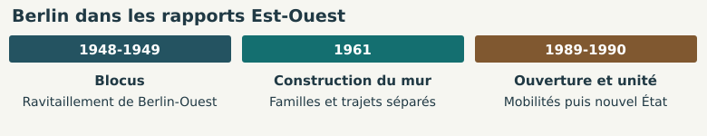

# Histoire contemporaine — Oral du 18 juin 2024 — Corrigé

*Corrigé rédigé par IA, non officiel. Signalez toute erreur.*

**Rédaction** · GPT-6.2 Astra Ultra · vitesse non renseignée · 26 novembre 2026

Le rapport prévoit 1 h 30 de préparation, vingt minutes d’exposé sur un seul des deux sujets, puis dix minutes d’entretien. Les chronologies et l’atlas autorisés permettent de situer les cas étudiés. Chaque proposition reçoit ici sa propre réponse. Le gras signalé pour chaque billet est celui du feuillet officiel.

## Billet 1

**Intitulé en gras sur le feuillet** · Être résistant en France 1940-1945

### Être résistant en France 1940-1945

À partir de 1940, entrer en résistance signifie refuser une autorité jugée illégitime, mais cette définition doit s’incarner dans des pratiques civiles et des trajectoires diverses. Une institutrice qui fait circuler un journal, une employée qui protège des personnes persécutées, un syndicaliste ou un ancien militaire n’entrent pas nécessairement au même moment ni pour les mêmes raisons. Certaines personnes rejoignent Londres, d’autres s’organisent en métropole ou dans l’Empire. Refus national de l’occupation, défense de valeurs républicaines et solidarités religieuses ou politiques peuvent se conjuguer.

Pour dépasser la figure du héros solitaire, il faut suivre la formation des mouvements, leurs publications, leurs désaccords et les liens avec la France libre. L’entrée en guerre de l’URSS en 1941 modifie l’engagement communiste organisé. L’instauration du STO en 1943 transforme les conditions de la clandestinité sans faire de chaque réfractaire un résistant. La création du Conseil national de la Résistance en mai 1943, sous l’impulsion de Jean Moulin, associe mouvements, partis et syndicats sans effacer leur diversité. L’ampleur de la répression pèse sur les familles autant que sur les militants. À la Libération, reconnaissance militaire, décorations et récits publics ont souvent minoré des fonctions féminines essentielles ou l’engagement d’étrangers. L’entrée de résistantes au Panthéon dans des décennies ultérieures rappelle la construction tardive de certaines reconnaissances. Comprendre la Résistance oblige donc à distinguer engagement effectif, unification politique et mémoire nationale.

La diversité des actes oblige à varier les sources. Un dossier administratif établi pour reconnaître après-guerre un statut de résistant renseigne sur des critères institutionnels et sur les témoignages disponibles. Des femmes chargées d’héberger ou de nourrir des personnes menacées ont parfois laissé moins de traces que les dirigeants d’un mouvement. La participation peut être réelle malgré une reconnaissance tardive ou absente. En 1945, la réintégration à la vie civile ne clôt pas cette question.

### Les "Pères de l'Europe"

Que recouvre l’expression « Pères de l’Europe », courante dans les commémorations ? Elle désigne des acteurs dont la coopération a donné forme à certaines institutions après 1945 et privilégie rétrospectivement quelques personnalités masculines.

Schuman, ministre français des Affaires étrangères, assume le 9 mai 1950 l’initiative d’une mise en commun du charbon et de l’acier, conçue avec Monnet et son équipe. Le chancelier Adenauer y voit un moyen d’ancrer la RFA à l’Ouest et de retrouver une égalité de statut. L’Italien De Gasperi soutient l’inclusion européenne de son pays. Leurs priorités nationales permettent la convergence sans se confondre.

Le traité de Paris de 1951 crée la CECA. Son autorité commune propose une réponse concrète à la rivalité franco-allemande, mais les parlements et les gouvernements gardent un pouvoir décisif. Le rejet de la Communauté européenne de défense en France en 1954 le démontre. Le Belge Spaak joue ensuite un rôle moteur dans les négociations qui mènent aux traités de Rome de 1957.

Mettre des visages sur ces choix aide à comprendre des stratégies, mais réduit la portée des diplomates, électeurs, travailleuses et travailleurs, syndicats et opposants qui en déterminent la réception. L’Europe communautaire est une construction disputée dont aucun fondateur ne pouvait écrire seul l’avenir.

## Billet 2

**Intitulé en gras sur le feuillet** · Les paysannes en France de 1870 aux années 1960

### Les paysannes en France de 1870 aux années 1960

Une paysanne peut être journalière, fille de propriétaire, fermière ou épouse travaillant sur l’exploitation sans rémunération propre. Pourquoi son rôle économique est-il souvent plus important que ne l’indiquent les catégories de recensement ?

Vers 1870, les cultures, les marchés et les structures foncières distribuent diversement les tâches. Soigner les animaux, vendre lait et œufs, tenir les comptes, participer aux récoltes et assurer le linge de la famille forment un continuum. Le paiement en espèces n’enregistre qu’une partie du travail. Le service domestique ou une activité textile peuvent aussi fournir un revenu saisonnier.

La mobilisation de 1914 oblige de nombreuses femmes à assurer les travaux agricoles en l’absence des hommes. La mise en scène patriotique de leur effort ne fait pas disparaître le manque de main-d’œuvre, les limites du crédit ou les difficultés de décision dans une exploitation familiale. Après le retour des soldats, certaines responsabilités acquises sont de nouveau peu visibles.

Dans les années 1950-1960, traite mécanisée, électrification, eau courante et nouvelles formes de commercialisation changent les horaires. Le tracteur et les fonctions reconnues de chef d’exploitation restent souvent identifiés aux hommes. Des jeunes femmes quittent la campagne, d’autres cherchent formation, reconnaissance professionnelle ou transformation du foyer. Moderniser n’a donc ni le même sens ni le même coût pour toutes.

### L'Amérique latine entre dictatures et démocratie de 1918 aux années 1990

Les trajectoires politiques de l’Amérique latine ne suivent pas une alternance régionale unique. Pourquoi le suffrage et la mobilisation populaire peuvent-ils coexister avec de fortes exclusions ou avec le pouvoir de l’armée ?

Dans l’entre-deux-guerres, crise des économies exportatrices et urbanisation renforcent la question sociale. Au Brésil, Vargas installe l’Estado Novo en 1937 et combine organisation des relations de travail, contrôle des oppositions et projet national. En Argentine, le péronisme accède au pouvoir par les urnes en 1946, affirme des droits sociaux et s’appuie sur le mouvement syndical tout en entrant en conflit avec ses adversaires.

Après la révolution cubaine et dans le contexte de guerre froide, plusieurs armées se présentent comme gardiennes de l’ordre. Le coup d’État brésilien de 1964, celui du Chili en 1973 et celui d’Argentine en 1976 inaugurent des régimes différents dans leur composition, leur politique économique et leur durée. Familles de disparus, syndicats, Églises ou partis entretiennent des oppositions distinctes.

Le retour à la présidence civile en Argentine en 1983 et au Brésil en 1985, puis l’échec de Pinochet au plébiscite de 1988 et la passation de pouvoir chilienne de 1990 montrent que la transition peut procéder d’une défaite, d’une négociation ou d’une consultation. Justice après la répression, crise de la dette et inégalités sociales pèsent encore sur la consolidation démocratique.

## Billet 3

**Intitulé en gras sur le feuillet** · Être étudiant en France

### Être étudiant en France

Sous la IIIe République, être étudiant signifie généralement appartenir à une minorité masculine urbaine, même lorsque l’on prépare une profession socialement ouverte. Comment la croissance des effectifs transforme-t-elle les études, les sociabilités et la capacité politique des étudiants ?

Les facultés de droit, de médecine et de lettres n’offrent pas les mêmes débouchés. Famille, bourse et éloignement déterminent les ressources disponibles. Les femmes gagnent des places à l’université avant de disposer des mêmes possibilités professionnelles. Des étudiants étrangers font également des facultés françaises des espaces d’échange politique et culturel.

Après 1945, baby-boom, baccalauréat plus largement accessible et besoins de qualification provoquent une croissance rapide. Restaurations universitaires, résidences et nouveaux campus matérialisent une politique qui doit répondre à des besoins de masse. La situation d’un étudiant salarié et celle d’un élève de grande école rémunéré peuvent pourtant demeurer très éloignées.

Le mouvement de mai 1968 naît notamment de contestations des règles universitaires et rejoint une crise sociale plus large. La loi Faure de 1968 réorganise les universités et la participation. En 1986, des étudiants se mobilisent contre le projet Devaquet. L’expérience étudiante est ainsi à la fois un âge de vie plus largement partagé et un ensemble de parcours toujours sélectionnés.

### Berlin au 20e s.

Capitale impériale puis républicaine, Berlin traverse le XXe siècle comme lieu de gouvernement, de créativité, de persécutions et de divisions internationales. En 1918–1919, chute de la monarchie et conflits révolutionnaires en font un centre de l’affrontement sur la nouvelle Allemagne. Dans les années 1920, l’extension du Grand Berlin et la culture métropolitaine rendent visibles modernité, pauvreté et polarisation. Sous le nazisme, la capitale accueille les Jeux de 1936 et sert la mise en scène du régime. Les Berlinois juifs subissent exclusion, spoliations et déportations. Les bombardements et la chute de la ville en 1945 laissent destructions et populations déplacées.

La ville est divisée en quatre secteurs, et Berlin-Ouest se trouve enclavé dans la zone soviétique puis en RDA. Le blocus de 1948–1949 transforme le ravitaillement de ses habitants en enjeu international. La construction du mur en août 1961 cherche à fermer la voie de départ vers l’Ouest et sépare des familles, des quartiers et des marchés du travail. L’espace urbain devient un symbole de guerre froide sans cesser d’être un lieu habité. Le 9 novembre 1989, l’ouverture des points de passage résulte d’une crise politique est-allemande et d’une mobilisation populaire dans un environnement soviétique transformé. La réunification de 1990 réunit politiquement la ville, sans effacer immédiatement les écarts de logements, d’emplois ou de mémoires.

L’espace vécu donne une autre périodisation que les seules crises diplomatiques. Avant le mur, des habitants peuvent habiter dans un secteur et travailler dans un autre. Après août 1961, une autorisation de visite ou une correspondance familiale devient un enjeu politique. En novembre 1989, la réouverture des passages précède la réunification juridique de l’Allemagne en octobre 1990. Le changement de frontière et celui d’État ne tombent pas le même jour.

## Billet 4

**Intitulé en gras sur le feuillet** · Le non-alignement

### Le chômage en France des années 1880 aux années 1980

On peut manquer de travail sans être enregistré comme chômeur. Comment une expérience ancienne d’irrégularité du revenu devient-elle une catégorie comptée, indemnisée et politiquement débattue ?

Dans les années 1880, l’absence d’ouvrage est fréquente parmi saisonniers, ouvriers du bâtiment ou travailleurs à domicile. Bourses du travail, syndicats et municipalités identifient les sans-travail et proposent secours ou placement. Le chômage se définit plus nettement avec l’extension du salariat régulier. La crise des années 1930 aggrave les pertes d’emploi mais les chiffres sous-estiment notamment les femmes qui cessent temporairement de se déclarer actives et les étrangers repartis.

Après 1945, la croissance favorise le plein emploi sans garantir un poste stable à tous. L’assurance chômage interprofessionnelle mise en place en 1958 repose sur des cotisations et une gestion par les partenaires sociaux. L’ANPE fondée en 1967 organise le placement. Être inscrit et avoir droit à une indemnité restent deux situations distinctes.

Après les années 1970, désindustrialisation, arrivée de jeunes actifs et ralentissement de l’embauche transforment le chômage de longue durée. Jeunes, salariés âgés, immigrés et femmes n’y entrent ni n’en sortent dans les mêmes conditions. L’histoire du chômage est ainsi celle de la demande de travail et celle des institutions qui rendent les chômeurs visibles.

### Le non-alignement

Le non-alignement désigne l’effort de certains États pour choisir leurs relations internationales au moment où les deux principaux blocs cherchent des alliés. L’expérience coloniale et les indépendances nouvelles rendent urgente la souveraineté réelle sur le développement, la sécurité et la politique étrangère. Bandung, en 1955, rassemble des pays d’Asie et d’Afrique aux orientations diverses. La réunion n’est pas encore la fondation officielle du mouvement. La conférence de Belgrade en 1961 donne un cadre plus durable aux non-alignés, autour notamment de Tito, Nasser et Nehru.

L’autonomie recherchée peut passer par des accords économiques ou militaires avec l’une des puissances, par la médiation ou par un vote commun à l’ONU. Le cas de la Yougoslavie, socialiste et indépendante de Moscou, interdit d’assimiler non-alignement et appartenance à un continent. Le canal de Suez offre à l’Égypte un terrain où souveraineté politique et ressources économiques s’articulent. Dans les années 1970, la revendication d’un nouvel ordre économique international déplace une partie du débat vers les prix des matières premières, le commerce et les transferts de ressources. Intérêts divergents des exportateurs et des importateurs de pétrole, conflits régionaux et rapprochement de certains membres avec une grande puissance limitent cependant la cohésion. Le non-alignement est donc une pratique variable d’indépendance et de négociation autant qu’une revendication collective.

Comparer l’Inde et la Yougoslavie éclaire la diversité de ce mouvement. La première est une ancienne colonie britannique ; la seconde est un État socialiste européen en rupture avec Staline en 1948. Nehru et Tito peuvent chercher des marges de décision communes sans aligner leurs institutions ou leurs économies. La conférence de Belgrade en 1961 donne une visibilité diplomatique à cette convergence.

## Billet 5

**Intitulé en gras sur le feuillet** · L’arme nucléaire dans les relations internationales de 1945 aux années 1980

### Naître, vivre et mourir en France de la fin du XIXe siècle aux années 1980

Naître, vivre et mourir renseigne sur les conditions réelles d’une existence autant que sur les courbes démographiques. À la fin du XIXe siècle, la France est déjà engagée de longue date dans la limitation des naissances, mais l’accouchement, la mortalité infantile et les risques professionnels demeurent socialement et régionalement inégaux. Enregistrement à l’état civil, cérémonies religieuses, mariages et funérailles font apparaître des institutions qui encadrent les seuils de la vie. L’école, la conscription et l’entrée précoce au travail organisent des âges sociaux distincts selon le sexe et le milieu.

Les morts de la Grande Guerre et le déficit de naissances laissent une empreinte durable dans les familles et la pyramide des âges. Les politiques natalistes et familiales répondent à des inquiétudes militaires, économiques et morales. Après 1945, le baby-boom, le développement des maternités, les progrès sanitaires et la Sécurité sociale changent les conditions des premières années. L’allongement des études et de la vie moyenne déplace l’entrée au travail et multiplie les années de retraite. Légalisation de la contraception en 1967 puis de l’IVG en 1975 accroît la maîtrise des calendriers familiaux sans supprimer les inégalités d’accès. L’hospitalisation plus fréquente en fin de vie modifie aussi le lieu du décès et le rôle des proches. À l’horizon de 1990, la succession biologique reste identique tandis que les institutions, lieux et durées d’une vie ordinaire se sont profondément déplacés.

Pour comparer deux générations, il faut aussi suivre qui reçoit l’enfantement et qui accompagne les derniers jours. La naissance en maternité devient ordinaire au cours du XXe siècle, tandis que les progrès de l’hygiène, des soins et de l’alimentation réduisent la mortalité infantile. Le recul de la mort précoce modifie la composition des familles avant même que la longévité aux âges élevés n’augmente fortement. Les écarts d’espérance de vie entre métiers nuancent toute histoire uniforme du progrès.

### L’arme nucléaire dans les relations internationales de 1945 aux années 1980

En août 1945, Hiroshima et Nagasaki font l’expérience d’une destruction dont les survivants subissent aussi des effets sanitaires à long terme. À la fin du siècle, des gouvernements fondent une part de leur sécurité sur la possession d’armes dont ils disent vouloir prévenir l’usage. Comment cette contradiction transforme-t-elle les relations internationales et les sociétés ?

**De la Seconde Guerre mondiale à la bipolarisation.** Le programme américain s’inscrit dans une mobilisation scientifique, industrielle et militaire exceptionnelle. Les bombardements d’août 1945, l’entrée en guerre de l’URSS contre le Japon et la capitulation japonaise mettent fin à la guerre du Pacifique. L’étude des décisions demeure débattue par les historiens, et la parole des hibakusha rappelle la centralité des conséquences humaines. L’essai soviétique de 1949 met fin au monopole américain. Le Royaume-Uni, la France et la Chine rejoignent ensuite le cercle des puissances déclarées, dans des contextes d’alliance et d’affirmation nationale différents.

**La dissuasion se double d’une inquiétude publique durable.** Les dirigeants invoquent le coût humain inacceptable d’un affrontement pour expliquer la retenue réciproque. Cette construction politique repose sur des anticipations et sur la crainte des erreurs de décision. La crise de Cuba en 1962 rend perceptible la proximité d’une catastrophe et favorise ensuite certains efforts de communication et de limitation. Les mobilisations pacifistes et les témoignages issus des territoires d’essais mettent en avant santé, environnement et inégalités de pouvoir entre métropoles et populations concernées.

**Maîtriser la prolifération et la course aux armements devient un enjeu international.** Le traité de non-prolifération ouvert à la signature en 1968 combine des engagements de non-prolifération, un objectif de désarmement et l’usage pacifique de l’énergie sous garanties. Son caractère asymétrique fait débat entre États reconnus comme dotés et autres États. Les accords américano-soviétiques, dont le traité de 1987 sur les forces nucléaires intermédiaires, montrent que la compétition peut s’accompagner d’accords vérifiables. La fin de la guerre froide réduit certaines tensions sans faire disparaître la question des arsenaux ni celle de leur légitimité. L’histoire nucléaire est donc autant une histoire de victimes, de normes et de mobilisations qu’une histoire d’États.

Comparer le TNP de 1968 et le traité FNI de 1987 permet de distinguer deux formes de contrôle diplomatique. Le premier établit des obligations différentes selon le statut des États ainsi que des engagements portant sur le désarmement et les usages civils. Le second supprime une catégorie d’armes américaines et soviétiques. Les mobilisations japonaises de survivants rappellent que cette histoire de traités est aussi celle des effets humains durables de 1945.

## Billet 6

**Intitulé en gras sur le feuillet** · L'extrême gauche en France de 1945 aux années 1990

### L'extrême gauche en France de 1945 aux années 1990

L’extrême gauche d’après 1945 se définit en partie par son rapport critique au PCF et aux institutions de la démocratie parlementaire. Cette position rassemble-t-elle une famille politique ou des projets irréductibles ?

Les trotskistes dénoncent la bureaucratie soviétique et revendiquent l’internationalisme. Des libertaires privilégient l’autonomie syndicale ou l’action collective hors des partis. Les guerres coloniales suscitent des engagements où ces courants rencontrent intellectuels, syndicalistes et militants de gauche non révolutionnaires. Après la rupture sino-soviétique, des groupes maoïstes se réclament d’un autre modèle communiste.

En mai 1968, organisations étudiantes et petits groupes acquièrent une visibilité nationale, sans être les seuls acteurs d’une grève de masse. Assemblées, journaux et controverses portent sur le pouvoir dans l’université et l’usine. Dans les années suivantes, des militants s’investissent dans les luttes féministes, antiracistes ou pour les droits des travailleurs immigrés, parfois contre les hiérarchies de leurs propres organisations.

L’entrée de certains courants dans la compétition électorale, les autodissolutions et les reconversions professionnelles rendent les itinéraires hétérogènes. Jusqu’aux années 1990, l’influence culturelle ou syndicale de l’extrême gauche reste souvent supérieure à son poids électoral national. Compter les voix éclaire donc mal, à soi seul, l’histoire de cette nébuleuse.

### L'ONU 1945-1990

Que peut faire l’ONU dans un ordre international où les États conservent leur souveraineté ? La Charte de 1945 institue une Assemblée générale et un Conseil de sécurité disposant de responsabilités particulières. Le droit de veto des cinq permanents protège leur participation tout en limitant la capacité d’action quand leurs intérêts divergent. La Déclaration universelle des droits de l’homme de 1948 établit une référence normative dont l’application dépend de processus juridiques et politiques ultérieurs.

Durant la guerre froide, les blocages n’empêchent pas toute intervention. En Corée en 1950, l’absence temporaire du représentant soviétique au Conseil permet l’adoption de résolutions. Après Suez en 1956, une force d’urgence illustre le maintien de la paix. La crise congolaise des années 1960 montre les risques d’opérations dans une décolonisation violente. L’arrivée de nouveaux membres donne à l’Assemblée une voix anticoloniale, notamment avec la résolution de 1960 sur l’indépendance des peuples coloniaux. En 1990–1991, les décisions du Conseil après l’invasion du Koweït signalent une coopération nouvelle mais conditionnelle entre grandes puissances. Institutions spécialisées, médiations et forums comptent aussi dans l’action internationale de l’organisation.

L’Assemblée générale, élargie par les indépendances, fournit aux États récemment souverains une tribune, notamment lors de la déclaration de 1960 sur l’octroi de l’indépendance aux peuples coloniaux. Le Conseil de sécurité demeure structuré par le veto. En 1990, la condamnation de l’invasion du Koweït par l’Irak montre que la possibilité d’une action collective dépend de l’accord des grandes puissances et du cas considéré.

## Billet 7

**Intitulé en gras sur le feuillet** · Les guerres de décolonisation dans le monde 1945-1975

### Les mutations du protestantisme en France 1870-1990

Au lendemain de 1870, les protestants français forment une minorité diverse de réformés et de luthériens, enracinée notamment dans les Cévennes, l’Est et plusieurs villes. Comment maintenir des institutions distinctes lorsqu’une partie de cette minorité s’identifie fortement au projet républicain ?

Des protestants participent activement aux milieux scolaires, philanthropiques et républicains de la IIIe République. Cette visibilité élitaire ne résume pas les ouvriers, paysans et communautés rurales. La séparation de 1905 favorise la réorganisation des Églises dans le cadre associatif. En Alsace-Moselle, la situation confessionnelle reste particulière après 1918.

La création de la Fédération protestante de France en 1905 puis la constitution de l’Église réformée de France en 1938 donnent des cadres de coordination tout en laissant subsister une pluralité théologique. Sous Vichy, des pasteurs et fidèles s’opposent aux persécutions, notamment au Chambon-sur-Lignon. Un village de refuge ne suffit pas à attribuer une conduite unique à tous les protestants.

Après 1945, engagement œcuménique, action sociale de la Cimade et croissance de certains courants évangéliques modifient la physionomie de l’ensemble. La sécularisation touche également la pratique. Les transformations du protestantisme résultent ainsi des mobilités et recompositions internes autant que de son rapport au catholicisme majoritaire.

### Les guerres de décolonisation dans le monde 1945-1975

À partir de 1945, l’affaiblissement des métropoles ouvre des occasions aux mouvements nationaux. Pourquoi certaines indépendances donnent-elles lieu à des guerres prolongées alors que d’autres procèdent d’une négociation relativement brève ?

En Indonésie, la proclamation d’indépendance en 1945 est suivie d’un conflit avec les Pays-Bas avant la reconnaissance de souveraineté en 1949. En Indochine, la guerre entre la France et le Viet Minh débouche sur les accords de Genève de 1954. Les acteurs locaux cherchent des appuis internationaux tandis que la guerre froide modifie financements et reconnaissance diplomatique.

L’Algérie se distingue par son statut et l’importance de sa population européenne. Le conflit ouvert en 1954 touche civils, appelés, populations déplacées et migrants en métropole ; les accords d’Évian et l’indépendance de 1962 entraînent de nouveaux départs. Au Kenya, la répression de l’insurrection Mau Mau et les politiques foncières laissent des fractures qui dépassent la date de 1963.

Les guerres portugaises en Angola, Guinée-Bissau et Mozambique contribuent à la crise de la dictature portugaise, renversée en 1974. En 1975, des indépendances ne mettent pas fin à toutes les guerres civiles. Une souveraineté internationale peut donc être reconnue sans que les ressources, les frontières ou les mémoires soient stabilisées.

## Billet 8

**Intitulé en gras sur le feuillet** · L’Europe et ses frontières 1918-1990

### Syndicats et syndicalisme en France des années 1880 aux années 1980

La loi de 1884 légalise les syndicats professionnels. Comment passe-t-on d’une liberté d’association à un pouvoir de négocier dans l’entreprise et à l’échelle nationale ? Les structures, les effectifs et les orientations ne progressent pas d’un même mouvement.

Les bourses du travail associent placement, entraide et formation. La CGT fondée en 1895 défend dans la charte d’Amiens en 1906 l’autonomie syndicale à l’égard des partis. L’entre-deux-guerres voit scission et réunification, tandis que le syndicalisme chrétien organisé autour de la CFTC propose une autre tradition. Juin 1936 fait de l’adhésion et de la représentation des salariés des enjeux de masse.

Sous Vichy, la liberté syndicale est attaquée. À la Libération, la représentation des salariés et la gestion des nouvelles institutions sociales donnent aux confédérations des responsabilités supplémentaires. La scission de Force ouvrière en 1947-1948 traduit des désaccords syndicaux et politiques. En 1964, la majorité de la CFTC crée la CFDT déconfessionnalisée.

Après mai 1968, la section syndicale d’entreprise obtient un cadre légal. Le chômage et la restructuration des bastions industriels fragilisent ensuite les adhésions. Une faible densité syndicale n’exclut pas une large couverture des conventions collectives. Le syndicalisme français associe donc mobilisation, négociation et gestion de droits.

### L’Europe et ses frontières 1918-1990

En 1918, des empires disparaissent et de nouveaux États revendiquent la souveraineté nationale. Pourtant les populations demeurent mêlées autour des frontières polonaises, tchécoslovaques ou yougoslaves. Une frontière peut désormais séparer des voisins sans faire disparaître la circulation, les minorités et les litiges.

L’expansion allemande puis la Seconde Guerre mondiale déplacent de nouveau lignes et habitants. Après 1945, le déplacement de la Pologne vers l’ouest, les expulsions et la fixation de la ligne Oder-Neisse changent l’articulation entre territoire et peuplement. Une limite sur une carte n’explique pas le coût humain de son établissement. L’Allemagne et Berlin divisées ajoutent une coupure idéologique à la frontière étatique.

À l’Ouest, la construction communautaire réduit graduellement certains obstacles au commerce et à la mobilité. Le rideau de fer, en revanche, bride les circulations à des degrés différents selon les régions et les périodes. L’Acte final d’Helsinki en 1975 articule inviolabilité des frontières et engagement sur les droits et les contacts humains.

L’ouverture du mur en 1989 et la réunification allemande en 1990 effacent certaines limites, tandis que d’autres frontières restent reconnues. L’histoire des frontières européennes doit donc rendre compte des changements de souveraineté autant que des expériences quotidiennes du passage.
