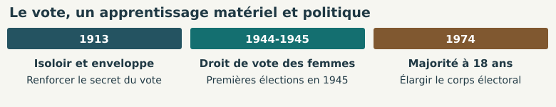
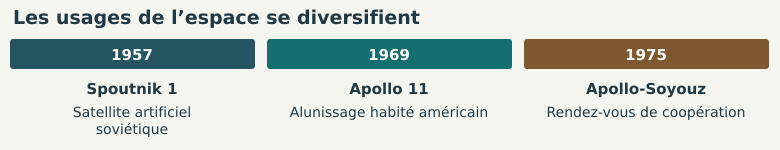

# Histoire contemporaine — Oral du 19 juin 2024 — Corrigé guidé

*Corrigé rédigé par IA, non officiel. Signalez toute erreur.*

**Rédaction** · GPT-6.2 Astra Ultra · vitesse non renseignée · 26 novembre 2026

Le rapport prévoit 1 h 30 de préparation, vingt minutes d’exposé sur un seul des deux sujets, puis dix minutes d’entretien. Les chronologies et l’atlas autorisés permettent de situer les cas étudiés. Chaque proposition reçoit ici sa propre réponse. Le gras signalé pour chaque billet est celui du feuillet officiel.

## Billet 1

**Intitulé en gras sur le feuillet** · Les paysans et le politique

### Les paysans et le politique

**Question de préparation.** Peut-on tirer un vote individuel d’une carte de départements ruraux ?

Le propriétaire d’une petite vigne, le métayer et le salarié agricole ne disposent pas des mêmes ressources pour agir. Entre 1870 et les années 1990, comment les paysans participent-ils à la politique au lieu d’en être de simples destinataires ?

L’adoption du suffrage masculin et la consolidation de la IIIe République font des campagnes des lieux décisifs d’élection. Maire, instituteur, curé, journaux et marchés transmettent des informations et des solidarités concurrentes. En 1907, petits propriétaires et ouvriers viticoles du Midi manifestent contre la crise du vin. Une coalition autour d’un prix n’implique pas une même opinion sur les salaires ou la propriété.

Dans l’entre-deux-guerres, syndicats agricoles, coopératives et organisations partisanes offrent des relais distincts, des communistes aux mouvements agrariens conservateurs. Vichy glorifie la terre et met sur pied la Corporation paysanne. La réalité de la collecte, des prix et du ravitaillement divise les campagnes.

Après 1945, la FNSEA puis le CNJA deviennent des partenaires importants des politiques de modernisation. La PAC créée dans les années 1960 déplace une part des décisions à l’échelle européenne. D’autres mouvements, dont la Confédération paysanne née en 1987, contestent les effets de la concentration. Le politique se mesure alors aussi dans les négociations professionnelles et les choix d’aménagement.

**Réponse pour l’entretien.** Une circonscription contient plusieurs groupes, statuts fonciers et bourgs. Il faut comparer résultats locaux et sources sur les pratiques militantes.

### Course aux armements et désarmement dans le monde de 1945 aux années 1980

**Question de préparation.** Une limitation d’armement est-elle toujours une réduction ?

En 1945, les destructions de la guerre conduisent à réclamer à la fois sécurité et maîtrise des armements. Pourquoi les mêmes États peuvent-ils alimenter une course aux armes et négocier des limitations ? Le prestige, la crainte d’une surprise adverse et la défense des alliances produisent une insécurité réciproque.

La fin du monopole atomique américain en 1949 renforce la rivalité soviéto-américaine. Les ressources engagées pèsent sur budgets et priorités civiles, tandis que les essais suscitent des inquiétudes sanitaires et environnementales. La Grande-Bretagne, la France et la Chine entrent à leur tour dans le cercle des puissances dotées. Les arsenaux conventionnels et les ventes d’armes comptent également dans les conflits régionaux.

La crise de Cuba en 1962 accélère la recherche de canaux de communication. Le traité d’interdiction partielle des essais de 1963 et le TNP ouvert à la signature en 1968 répondent à des risques différents. Les accords SALT I de 1972 visent la limitation de certaines capacités stratégiques et la stabilisation d’une relation, sans abolir les stocks.

Les mobilisations contre les euromissiles et la reprise des tensions dans les années 1980 rappellent le caractère réversible de la détente. Le traité FNI de 1987 prévoit l’élimination vérifiée d’une catégorie d’armes américaines et soviétiques. La fin de la bipolarité n’équivaut donc pas au désarmement général.

**Réponse pour l’entretien.** Un plafond ou une règle de vérification peut stabiliser des capacités sans les diminuer. Un accord d’élimination a une portée différente.

## Billet 2

**Intitulé en gras sur le feuillet** · Les Français et l'Allemagne de 1870 aux années 1980

### Les Français et l'Allemagne de 1870 aux années 1980

**Question de préparation.** Pourquoi dire « les Allemagnes » pour une partie de la période ?

La défaite de 1870 et l’annexion de l’Alsace et d’une partie de la Lorraine installent une frontière nouvelle dans les mémoires et les mobilités. La revanche, enseignée ou célébrée par certains, ne résume pourtant pas tous les rapports des Français à l’Allemagne. Commerce, lectures savantes, migrations et parentés demeurent.

La Grande Guerre produit invasion, occupation et deuils, puis la victoire ramène l’Alsace-Moselle à la France. Dans l’entre-deux-guerres, l’occupation française de la Ruhr en 1923 et le rapprochement Briand-Stresemann au temps de Locarno donnent deux visages d’une même préoccupation de sécurité. Le nazisme puis l’Occupation font à nouveau de l’Allemagne une puissance ennemie, mais les attitudes françaises vont de la collaboration à la Résistance ; des réfugiés allemands sont eux-mêmes persécutés.

**La réconciliation devient une politique, jamais automatique.** Le traité de l’Élysée de 1963 entre de Gaulle et Adenauer organise des consultations régulières et favorise les échanges de jeunes. Les désaccords sur l’Alliance atlantique et les politiques économiques persistent. Giscard d’Estaing et Schmidt soutiennent la coopération monétaire ; Mitterrand et Kohl associent la mémoire de Verdun à la construction européenne. Dans les années 1980, la coopération repose donc à la fois sur des institutions, des intérêts renouvelés et un travail public de mémoire. Elle ne remplace pas la négociation entre États aux priorités parfois divergentes.

Après 1945, rencontrer un correspondant scolaire, participer au jumelage d’une ville ou travailler dans une région frontalière donne un contenu social au rapprochement avec la RFA. La RDA appartient à une autre configuration diplomatique. Le geste de Mitterrand et Kohl à Verdun en 1984 inscrit l’entente dans un lieu de deuil. Transformer un ancien ennemi en partenaire est une œuvre politique et vécue dont les mémoires ne se superposent pas entièrement.

**Réponse pour l’entretien.** De 1949 à 1990 la RFA et la RDA constituent deux États, tandis que Berlin relève d’un statut particulier. La plupart des institutions de rapprochement français se construisent avec la RFA.

### Les crises du Proche-Orient de 1947 au début des années 1990

**Question de préparation.** La crise de Suez porte-t-elle seulement sur Israël ?

Le vote du plan de partage de la Palestine par l’ONU en 1947 ouvre une séquence où souveraineté, sécurité, ressources et déplacements de population se superposent. Comment des crises nées d’objets différents s’enchevêtrent-elles sans se réduire à la confrontation entre Israël et ses voisins ?

La proclamation d’Israël en 1948, la guerre et l’exode des Palestiniens produisent de nouveaux rapports territoriaux et des populations réfugiées. En 1956, la nationalisation du canal de Suez par Nasser puis l’intervention israélo-franco-britannique engagent aussi le nationalisme arabe, les routes du commerce et la place des anciennes puissances impériales.

La guerre de 1967 place notamment la Cisjordanie, Jérusalem-Est et Gaza sous occupation israélienne. La guerre d’octobre 1973 remet en jeu négociation et alliances, tandis que le pétrole devient un levier diplomatique. Les accords de Camp David de 1978, suivis du traité israélo-égyptien en 1979, dissocient la relation avec l’Égypte du sort des Palestiniens.

La guerre civile au Liban à partir de 1975 fait intervenir acteurs locaux, organisations palestiniennes et puissances voisines. La première Intifada à partir de 1987, puis la guerre du Golfe en 1990-1991 élargissent encore les cadres d’analyse. La conférence de Madrid de 1991 ouvre des négociations sans régler toutes ces crises. La chronologie doit toujours être reliée à une carte et à l’expérience des populations.

**Réponse pour l’entretien.** Elle engage la souveraineté égyptienne sur le canal, les intérêts franco-britanniques, Israël et les pressions américaines et soviétiques.

## Billet 3

**Intitulé en gras sur le feuillet** · Les années 68 en France

### Les années 68 en France

**Question de préparation.** Pourquoi la reprise du travail est-elle une mauvaise date unique de fin ?

Les « années 68 » invitent à regarder avant et après mai 1968. Comment des contestations d’université, d’usine et de la vie privée se rejoignent-elles brièvement puis suivent-elles des trajectoires distinctes ?

La massification universitaire, la persistance de hiérarchies professionnelles et les séquelles de la guerre d’Algérie nourrissent plusieurs formes de critique. Les oppositions à la guerre du Vietnam créent des réseaux transnationaux. Les mobilisations ouvrières des années 1960 et les tensions sur les campus précèdent les journées de mai.

À Nanterre puis à Paris, la crise universitaire s’élargit. Les grèves et occupations de lieux de travail touchent ensuite de très nombreux salariés. La négociation de Grenelle apporte notamment une forte revalorisation du salaire minimum, sans entraîner une reprise immédiate partout. La dissolution et les élections de juin donnent une majorité au pouvoir gaulliste. Succès électoral et portée de la contestation ne se mesurent pas au même moment.

Après 1968, luttes féministes, mobilisations de travailleurs immigrés, mouvements régionaux et revendications d’autogestion déplacent les priorités. Ces prolongements rencontrent des résistances et la crise économique change l’enjeu du travail. Les « années » désignent donc la transformation durable des rapports à l’autorité et au quotidien, autant qu’un épisode politique précis.

**Réponse pour l’entretien.** Les usines reprennent à des moments différents. Des réformes de l’université et des mobilisations sociales se développent après l’été.

### Les "années folles" en Europe et aux Etats-Unis

**Question de préparation.** Le jazz fait-il seulement circuler un produit américain ?

Une danse dans un cabaret berlinois, un disque de jazz à Paris et une voiture produite en série à Detroit servent souvent d’images aux « années folles ». De quoi la formule est-elle le nom dans des sociétés encore marquées par la guerre ?

Aux États-Unis, la production automobile, la publicité, le cinéma et le crédit à la consommation élargissent les marchés. À Harlem, des écrivains et musiciens noirs construisent une scène reconnue tandis que ségrégation, violences raciales et restrictions migratoires persistent. La prohibition suscite des débats sur les mœurs et le rôle de la loi.

À Paris et Berlin, les avant-gardes, les cabarets, la mode et le sport donnent une visibilité nouvelle à l’expérimentation artistique ou sexuelle. La diffusion de ces pratiques dépend pourtant de l’argent, de la ville et des normes de genre. Pour des familles endeuillées, invalides de guerre et régions dévastées, la décennie est aussi celle de la reconstruction. En Allemagne, l’hyperinflation de 1923 précède une stabilisation fragile.

La crise de 1929 met en cause la prospérité américaine et les liens financiers qui la reliaient à l’Europe. Le bilan n’oppose donc pas simplement la fête au krach : la modernité culturelle et les fragilités du crédit, les libertés urbaines et les exclusions sociales se construisent simultanément.

**Réponse pour l’entretien.** Son appropriation par des publics et artistes européens change les styles et les usages ; sa réception peut aussi reproduire des stéréotypes raciaux.

## Billet 4

**Intitulé en gras sur le feuillet** · Les occupations étrangères en France 1870-1945

### Les occupations étrangères en France 1870-1945

**Question de préparation.** Pourquoi distinguer Nord occupé et Alsace-Moselle après 1871 ?

L’occupation étrangère suspend ou partage le contrôle d’un territoire sans correspondre nécessairement à une annexion définitive. Pourquoi la France en a-t-elle connu des expériences si différentes de 1870 à 1945 ?

Après la guerre de 1870-1871, des troupes allemandes demeurent dans plusieurs départements jusqu’au règlement de l’indemnité, achevé en 1873. L’Alsace et une partie de la Lorraine relèvent au contraire de l’annexion. Dans une même famille, le choix de conserver la nationalité française et de partir ne se confond donc pas avec le fait de vivre sous occupation temporaire.

Entre 1914 et 1918, le nord et l’est de la France connaissent réquisitions, restrictions de correspondance et séparation de communautés situées près du front. Agriculture, industrie et ravitaillement s’organisent sous un pouvoir militaire étranger. La mémoire nationale du front ne doit pas masquer cette expérience civile régionale.

De 1940 à 1944-1945, les lignes de démarcation, l’occupation italienne dans le Sud-Est et l’extension allemande de novembre 1942 dessinent une carte changeante. Vichy collabore et engage sa propre responsabilité dans les persécutions. Ravitaillement, logement, travail et choix de résistance prennent un sens différent selon le lieu et le moment. Les libérations locales ne surviennent pas toutes en août 1944 ; certaines poches atlantiques subsistent en 1945.

**Réponse pour l’entretien.** L’occupation militaire temporaire prend fin avec l’évacuation. L’annexion modifie la souveraineté et le statut des habitants.

### Libéralisme et néo-libéralisme dans le monde 1919-1990

**Question de préparation.** La privatisation supprime-t-elle tout besoin de réglementation ?

Le libéralisme peut désigner des libertés politiques, la limitation du gouvernement ou une théorie de l’économie marchande. Comment des doctrines économiques dites néolibérales ont-elles acquis une influence mondiale au terme d’un siècle fortement marqué par l’intervention publique ?

Après 1919, retour à l’étalon-or et rétablissement des échanges sont associés à un ordre libéral dont la restauration exige pourtant des décisions étatiques. La dépression des années 1930 discrédite l’autorégulation intégrale. New Deal et propositions keynésiennes cherchent à restaurer activité et emploi par l’action publique. Au colloque Walter Lippmann de 1938, des penseurs libéraux débattent déjà du cadre institutionnel nécessaire au marché.

Après 1945, les économies occidentales combinent libre-échange partiel, protection sociale, politiques de plein emploi et parfois nationalisations. L’ordolibéralisme en RFA confie à l’État le maintien d’un ordre concurrentiel. La société du Mont-Pèlerin fondée en 1947 organise un réseau intellectuel dont les membres divergent sur le rôle concret de l’État.

Dans les années 1970-1980, inflation, endettement et critiques de l’État producteur ouvrent un espace à privatisations et déréglementations. Les expériences chilienne, britannique et américaine s’inscrivent dans des régimes politiques distincts. Libéralisation économique n’équivaut pas nécessairement à démocratisation. L’État change ses instruments et peut rester un acteur décisif de la mise en concurrence.

**Réponse pour l’entretien.** Un réseau privatisé peut conserver un monopole ou une position dominante. Définition des tarifs, accès et concurrence font alors l’objet de nouvelles règles.

## Billet 5

**Intitulé en gras sur le feuillet** · Ecole publique/école privée en France 1870-1990

### Ecole publique/école privée en France 1870-1990

**Question de préparation.** L’école obligatoire et l’école publique obligatoire sont-elles équivalentes ?

Deux familles habitant la même commune peuvent choisir des écoles différentes pour des raisons religieuses, sociales ou de distance. Comment la concurrence scolaire devient-elle une question de financement et de liberté dans une République qui organise son propre enseignement ?

Les lois de 1881-1882 établissent gratuité du primaire public, obligation d’instruction et laïcité des enseignements. L’instruction obligatoire peut aussi s’accomplir dans une école privée. La loi Goblet de 1886 laïcise le personnel de l’école publique. Le conflit avec les congrégations s’intensifie au début du XXe siècle, sans abolir la possibilité d’un enseignement privé.

La sociologie des implantations compte. Dans l’Ouest, des réseaux confessionnels disposent de nombreux établissements et de soutiens locaux. L’école publique s’appuie sur instituteurs et municipalités sans être partout le choix majoritaire. Une lecture nationale doit donc être éprouvée sur les cartes communales et les trajectoires familiales.

La loi Debré de 1959 permet aux établissements privés sous contrat de recevoir des financements publics en échange d’engagements portant notamment sur l’enseignement. En 1984, l’opposition au projet Savary en faveur d’un grand service public unifié entraîne son retrait. En 1990, deux réseaux demeurent, avec des relations de financement et de contrôle bien différentes de celles de 1870.

**Réponse pour l’entretien.** L’obligation porte sur l’instruction. Le choix d’une école privée reste possible dans les conditions prévues par la loi.

### Les populations déplacées dans le monde 1919-1990

**Question de préparation.** Toute personne déplacée franchit-elle une frontière internationale ?

Une personne contrainte de quitter sa maison peut se retrouver de l’autre côté d’une frontière, ou dans une autre région du même État. Elle peut être secourue sans recevoir un statut de réfugié. Comment les déplacements forcés deviennent-ils au XXe siècle un problème international, alors que le pouvoir d’accueillir et de protéger reste très largement exercé par les États ?

**Un monde d’empires en crise crée des populations sans protection.** La Grande Guerre, les persécutions et le démembrement des empires déplacent notamment des Arméniens et des Russes. Le passeport Nansen, mis en place à partir de 1922 sous l’égide de la Société des Nations, fournit à certains réfugiés un document d’identité reconnu par des États. Il répond à l’absence de papiers nationaux sans conférer une nationalité. Dans les années 1930, les Juifs qui cherchent à quitter l’Allemagne nazie ou les républicains espagnols fuyant en 1939 rencontrent des politiques d’accueil restrictives. La possibilité de trouver refuge dépend donc aussi des pays de destination.

**La guerre mondiale transforme les échelles et le droit.** Occupations, génocide et déplacements de frontières laissent après 1945 des millions de personnes loin de chez elles. Pour les personnes déplacées en Europe, rapatriement et réinstallation constituent deux issues possibles, parfois conflictuelles. La partition de l’Inde britannique en 1947 provoque parallèlement des migrations massives entre l’Inde et le Pakistan. L’exode palestinien de 1948 conduit à la création d’une agence onusienne particulière, l’UNRWA. Ces situations invitent à décentrer une chronologie longtemps racontée depuis la seule Europe.

**Une protection internationale s’élargit de façon inégale.** Le Haut-Commissariat des Nations unies pour les réfugiés entre en fonctions en 1951. La convention de Genève de la même année définit le réfugié autour d’une crainte fondée de persécution hors du pays dont il a la nationalité. Le protocole de 1967 lève la restriction temporelle initiale. Les guerres en Afrique, en Indochine puis en Afghanistan mettent en évidence l’importance de l’accueil par les pays voisins. Les déplacés intérieurs demeurent sous la juridiction de leur État et hors de cette définition précise. Le siècle voit donc progresser des garanties juridiques alors que l’accès effectif à la sécurité reste fortement tributaire du lieu, de la date et des ressources disponibles.

Les indépendances élargissent la comparaison. En 1947, la partition du sous-continent indien entraîne des déplacements croisés de musulmans, d’hindous et de sikhs. De nombreux départs s’effectuent dans l’urgence, mais les politiques de réinstallation engagent ensuite logement, terres et citoyenneté sur des décennies. Une carte des flux doit donc être complétée par l’étude des biens laissés, des familles séparées et des formes d’accueil.

**Réponse pour l’entretien.** Une guerre ou une politique de relogement peut obliger à quitter son domicile sans sortir de l’État. Le statut international de réfugié couvre un champ plus précis.

## Billet 6

**Intitulé en gras sur le feuillet** · Voter en France des années 1880 aux années 1980

### Voter en France des années 1880 aux années 1980

**Question de préparation.** La participation et la liberté du vote se mesurent-elles par le même indicateur ?

**Un apprentissage républicain.** Les scrutins des années 1870, notamment la crise de 1877, contribuent à décider si le régime sera durablement parlementaire et républicain. Dans les communes, réunions, journaux, professions de foi et sociabilités locales donnent des significations concrètes aux candidatures. La pratique ne se résume pas à un choix individuel déjà constitué. Des réseaux de notables, des familles politiques puis des partis organisés concourent à former les préférences. En 1913, l’usage de l’isoloir et de l’enveloppe protège mieux le secret matériel du vote. Les électeurs peuvent plus facilement se soustraire au regard de leur employeur ou des autres membres de la commune.

**Le corps politique est progressivement redéfini.** Longtemps les femmes demeurent exclues, malgré les mobilisations suffragistes et plusieurs votes favorables de la Chambre. L’ordonnance d’avril 1944 reconnaît leur droit de vote et d’éligibilité. Elles l’exercent pour la première fois aux municipales d’avril 1945. Dans l’empire et particulièrement en Algérie, les statuts et les collèges électoraux maintiennent des inégalités politiques. La République proclamant l’universalité du suffrage a donc longtemps attribué des poids et des possibilités d’accès différents. Le régime de Vichy rompt par ailleurs avec le fonctionnement électoral de la République.

**La Ve République modifie les enjeux du scrutin.** Le référendum de 1962 établit l’élection présidentielle au suffrage universel direct, appliquée en 1965. La télévision, les sondages et la personnalisation des candidatures donnent à ce vote une place particulière, aux côtés des législatives et des élections locales. La majorité électorale abaissée à 18 ans en 1974 fait entrer de nouveaux électeurs. L’alternance de 1981 donne à voir la portée d’un changement de majorité, tandis que l’abstention variable selon les scrutins rappelle que le droit ne produit pas mécaniquement la participation. Voter est à la fois une règle de désignation et une pratique sociale historiquement construite.

Le bureau de vote donne une unité de lieu à cette histoire. La mise en place de l’isoloir et de l’enveloppe en 1913 change la confidentialité du geste. La présence de femmes électrices en 1945 transforme les files d’attente et les stratégies des partis. L’abaissement de la majorité à dix-huit ans en 1974 fait entrer des jeunes électeurs dont l’apprentissage politique ne se réduit plus aux mêmes institutions. Voter conjugue ainsi une règle, un geste protégé et un choix socialement formé.

**Réponse pour l’entretien.** Le taux de participation donne une proportion des inscrits. Secret, pluralité des candidatures et égalité de l’accès aux urnes exigent d’autres preuves.

### La conquête spatiale depuis 1945

**Question de préparation.** Pourquoi rapprocher Apollo 11 et un satellite météo ?

L’expression « conquête spatiale » invite à regarder les drapeaux et les premières mondiales. Mais qui met l’espace en usage et qui en tire un bénéfice ? La période du programme conduit de l’après-1945 aux années 1980 et au début des années 1990.

La compétition de guerre froide confère un prestige considérable au lancement de Spoutnik en 1957, au vol de Gagarine en 1961 puis au premier alunissage habité américain en 1969. Les investissements publics, les centres de recherche et les retransmissions font de ces événements des réalisations nationales et des spectacles mondiaux. Les choix budgétaires soulèvent en même temps des critiques sur les priorités sociales.

Les satellites météorologiques, de télécommunications et d’observation transforment ensuite la vie courante. La transmission de programmes et la prévision des cyclones concernent des publics qui ne suivent pas les missions habitées. Le traité de l’espace de 1967 et le rapprochement Apollo-Soyouz en 1975 signalent que compétition et coopération peuvent coexister.

Les Européens organisent une capacité commune avec l’Agence spatiale européenne et le programme Ariane. D’autres États entrent dans le domaine. L’espace ne se convertit donc pas en territoire possédé de façon ordinaire : infrastructures terrestres, droit et services donnent à la puissance spatiale des dimensions interdépendantes.

**Réponse pour l’entretien.** L’un concentre le prestige d’une mission habitée, l’autre illustre des services répétés. Ensemble ils distinguent l’événement spectaculaire de l’usage durable.

## Billet 7

**Intitulé en gras sur le feuillet** · L’impôt en France

### L’impôt en France

**Question de préparation.** Un impôt proportionnel sur la consommation est-il nécessairement neutre socialement ?

Qui paie un impôt, sur quelle assiette et au profit de quelle collectivité ? À partir de 1870, le système français repose largement sur des contributions anciennes et sur la fiscalité indirecte, dont la charge est peu visible au moment de l’achat. L’égalité devant l’impôt ne détermine pas d’avance comment répartir cette charge.

Le débat sur l’impôt progressif sur le revenu divise défenseurs de la propriété, réformateurs sociaux et partisans d’un financement plus équitable. Son adoption en 1914 crée un principe dont la mise en œuvre s’étend pendant la guerre. Financer soldats, dette et reconstruction change le poids budgétaire de l’État. Les prélèvements sociaux financés par cotisations doivent être distingués de l’impôt même lorsqu’ils pèsent sur le revenu disponible.

Après 1945, reconstruction, services publics et protection sociale augmentent les besoins collectifs. Créée en 1954, la TVA se diffuse progressivement ; chaque entreprise reverse la taxe sur ses ventes après déduction de celle payée sur ses achats. Le consommateur final en supporte normalement la charge. Le mouvement poujadiste des années 1950 révèle une contestation de l’administration fiscale par des indépendants.

Dans les années 1980, les débats sur l’imposition des grandes fortunes donnent une nouvelle visibilité au patrimoine. L’histoire de l’impôt associe ainsi ressources de l’État, redistribution et définition politique de la justice.

**Réponse pour l’entretien.** Les ménages modestes consacrent en général une plus grande part de leur revenu à la consommation. Taux identique et effort relatif identique sont deux choses différentes.

### L'ordre international de 1919 à 1991

**Question de préparation.** Pourquoi faire commencer le sujet par 1919 plutôt que par 1945 ?

En 1918, la question n’est plus seulement de conclure la paix. Il faut organiser durablement le règlement des différends entre États. Le pacte de la Société des Nations accompagne les traités de 1919. Ses procédures de discussion et ses activités techniques obtiennent des résultats dans certains conflits ou dossiers sanitaires. Mais l’absence des États-Unis et la réticence des grandes puissances à assumer le coût de sanctions réduisent sa capacité d’action face aux agressions des années 1930. L’ordre pensé sur le papier dépend du consentement des États qui doivent l’appliquer.

En 1945, la Charte des Nations unies institue un Conseil de sécurité où les cinq membres permanents disposent du veto. Cette inégalité organisée doit garder les grandes puissances dans l’institution, tout en permettant leur blocage réciproque. L’Assemblée générale offre cependant une tribune croissante aux nouveaux pays indépendants. La crise de Suez en 1956 voit se développer le maintien de la paix par une force des Nations unies, avec des conditions politiques propres. Bretton Woods et les accords commerciaux ajoutent un volet économique à l’ordre international d’après-guerre. Cela n’empêche ni les guerres civiles ni les conflits de décolonisation. En 1990–1991, la condamnation de l’invasion du Koweït par l’Irak puis l’autorisation donnée par le Conseil illustrent une conjonction inhabituelle entre grandes puissances. L’ordre mondial apparaît ainsi comme une combinaison précaire de normes, d’organisations et de rapports de force.

L’ordre international se voit aussi depuis les États récemment décolonisés. Leur entrée massive à l’ONU change les majorités de l’Assemblée générale, sans changer la distribution des sièges permanents au Conseil de sécurité. À l’autre borne, la guerre du Golfe de 1990-1991 révèle une possibilité d’accord des grandes puissances sans garantir une capacité de réponse identique à toutes les crises. Un ordre est à la fois un système de règles et une distribution inégale des moyens de les appliquer.

**Réponse pour l’entretien.** La SDN, les mandats et les traités de paix expérimentent déjà des instruments collectifs. Les comparer à l’ONU éclaire les continuités et les corrections apportées.
