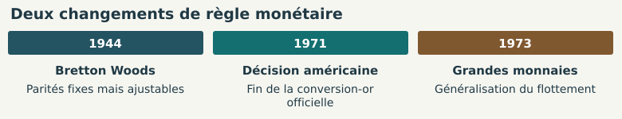
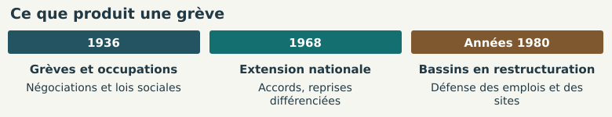

# Histoire contemporaine — Oral du 20 juin 2024 — Corrigé

*Corrigé rédigé par IA, non officiel. Signalez toute erreur.*

**Rédaction** · GPT-6.2 Astra Ultra · vitesse non renseignée · 26 novembre 2026

Le rapport prévoit 1 h 30 de préparation, vingt minutes d’exposé sur un seul des deux sujets, puis dix minutes d’entretien. Les chronologies et l’atlas autorisés permettent de situer les cas étudiés. Chaque proposition reçoit ici sa propre réponse. Le gras signalé pour chaque billet est celui du feuillet officiel.

## Billet 1

**Intitulé en gras sur le feuillet** · Les gauches en France

### Les gauches en France

Un radical républicain, un socialiste et un communiste peuvent partager une manifestation puis s’opposer à propos de la propriété ou de la stratégie électorale. Qu’est-ce qui fait et défait l’unité des gauches en France de 1870 au début des années 1990 ?

La République, la laïcité et l’affaire Dreyfus rapprochent des forces hostiles à la réaction monarchiste ou cléricale. Mais la question ouvrière distingue ceux qui souhaitent réformer l’économie de marché et ceux qui veulent transformer la propriété. La SFIO se constitue en 1905. Le congrès de Tours en 1920 partage socialistes et communistes sur l’affiliation internationale et l’organisation du parti.

Face aux ligues et à la crise, le Front populaire de 1936 réunit radicaux, socialistes et communistes sur un programme commun, sans que le PCF entre au gouvernement Blum. À la Libération, socialistes et communistes gouvernent temporairement avec les démocrates-chrétiens. La guerre froide et les guerres coloniales divisent durablement ces familles.

La reconstruction socialiste autour du congrès d’Épinay en 1971 et le programme commun de 1972 préparent une autre union. En 1981, Mitterrand accède à l’Élysée puis les gauches se divisent sur la conduite économique. Radicalisme, réformisme et communisme ont donc fait alliance autour de priorités précises, sans constituer une gauche intemporelle.

### Les ressources naturelles dans les relations internationales

Le charbon, le pétrole, l’eau et les minerais deviennent des enjeux internationaux quand un gisement, une route d’approvisionnement et un besoin industriel se trouvent sous des souverainetés différentes. La répartition physique d’une ressource ne suffit pas à déterminer son pouvoir politique.

Comment la maîtrise des ressources a-t-elle redistribué richesse et pouvoir depuis la Première Guerre mondiale ? Les économies industrielles dépendent de ressources dont la production est concentrée géographiquement, avec des conditions très différentes pour le charbon, le pétrole, le caoutchouc ou les métaux. Dans l’entre-deux-guerres, empires coloniaux, concessions privées et marchés mondiaux organisent extraction et transport. La chute des cours après 1929 fragilise des régions exportatrices dont les recettes reposent sur quelques produits, tandis que leurs travailleurs supportent une part importante des ajustements.

Après 1945, la croissance, la motorisation et la pétrochimie augmentent la place du pétrole. La décolonisation permet à des gouvernements de revendiquer une souveraineté accrue sur les ressources. La création de l’OPEP en 1960 puis le choc de 1973 illustrent un changement du partage des revenus, sans donner aux exportateurs de toutes les matières premières un pouvoir comparable. La volatilité des années 1980 et le contre-choc pétrolier de 1986 révèlent les limites de ces gains. L’histoire doit relier producteurs, travailleurs, entreprises et consommateurs, y compris les conséquences écologiques locales qui échappent au seul prix mondial.

Dans le bassin du Nil, construire un barrage, produire de l’électricité ou irriguer en amont transforme aussi les usages possibles en aval. Dans la Ruhr, placer charbon et acier sous une autorité commune après 1945 cherche à traiter une interdépendance par des institutions. La comparaison montre qu’une même dépendance peut susciter coercition, négociation de prix, droit d’accès ou coopération entre États.

## Billet 2

**Intitulé en gras sur le feuillet** · Gaullisme et gaullistes en France

### Gaullisme et gaullistes en France

Le gaullisme naît d’un refus en juin 1940 et devient à la fois un projet institutionnel, une politique d’indépendance et une famille partisane. Comment ce mouvement survit-il à l’homme dont il tire son nom ?

De Gaulle construit pendant la guerre une légitimité qui concurrence Vichy et associe territoires ralliés, forces françaises libres et Résistance intérieure. Après la Libération, il quitte le gouvernement en 1946 et critique un régime où il juge l’exécutif trop dépendant des partis. Le RPF fondé en 1947 mobilise autour de sa personne sans transformer immédiatement la Constitution.

Son retour en 1958 se déroule en pleine guerre d’Algérie. La nouvelle Constitution, puis le suffrage direct pour l’élection présidentielle, traduisent un projet d’autorité arbitrale. L’indépendance algérienne divise cependant les gaullistes. La politique étrangère, dont le retrait du commandement militaire intégré de l’OTAN en 1966, affirme une autonomie compatible avec l’alliance occidentale.

Après le départ de De Gaulle en 1969, Pompidou puis les partis héritiers maintiennent des électorats et des réseaux tout en infléchissant les politiques. Le RPR fondé par Chirac en 1976 transforme un héritage de dépassement des partis en organisation de compétition électorale. Référence au chef, pratique des institutions et doctrine ne coïncident donc pas toujours.

### Le système monétaire international

À quoi vaut une promesse de paiement entre pays lorsque leurs monnaies diffèrent ? Un système monétaire international organise les taux de change, les réserves et les ajustements des déséquilibres extérieurs. Le XXe siècle voit alterner recherche de stabilité et préservation de la liberté des politiques nationales.

**L’étalon-or est fragilisé par la guerre et la dépression.** À la veille de 1914, de nombreuses monnaies ont une parité fixe liée à l’or. La confiance repose aussi sur les banques centrales et sur la place financière de Londres. La guerre suspend la convertibilité dans plusieurs pays et laisse des situations d’endettement et d’inflation inégales. Le Royaume-Uni revient à l’or en 1925 à sa parité d’avant-guerre au prix de fortes contraintes internes. Face à la dépression, il abandonne la convertibilité en 1931. Dévaluations et zones monétaires concurrentes manifestent l’échec d’une restauration à l’identique.

**Bretton Woods construit un compromis.** En 1944, les négociateurs organisent des parités fixes mais ajustables autour du dollar, lui-même convertible en or pour les autorités monétaires étrangères. Le FMI doit accompagner certains ajustements. Les restrictions aux mouvements de capitaux laissent davantage de place aux politiques d’emploi. Les dollars fournis par les États-Unis facilitent le commerce et la reconstruction. Mais l’accumulation de créances en dollars à l’étranger érode la confiance dans la possibilité de toutes les convertir en or. La monnaie de réserve est à la fois monnaie nationale et instrument collectif.

**La fin des parités fixes ouvre une pluralité de régimes.** Nixon suspend la convertibilité-or du dollar en 1971, et les principales monnaies flottent à partir de 1973. Les accords de la Jamaïque en 1976 entérinent le nouvel ordre. Les chocs de taux de change et de taux d’intérêt compliquent la gestion des dettes, notamment en Amérique latine dans les années 1980. Certains pays cherchent une stabilité régionale, comme les membres du Système monétaire européen créé en 1979. Le dollar conserve une fonction centrale malgré le flottement. Le système du siècle se caractérise ainsi par le déplacement des institutions de confiance et des coûts de l’ajustement.

Le choix de la monnaie de réserve est aussi politique. Une banque centrale peut souhaiter détenir des dollars parce qu’ils sont acceptés partout, puis redouter leur dépréciation. Les pays emprunteurs dont les recettes sont en monnaie nationale risquent en outre de voir leur charge réelle augmenter en cas de baisse de leur change. La stabilité du système et la protection de chaque économie nationale ne sont donc pas automatiquement compatibles.

## Billet 3

**Intitulé en gras sur le feuillet** · Les Européens et leurs colonies de 1918 aux années 1960

### Le vote ouvrier en France de la fin du 19e s. aux années 1980

Le bureau de vote d’une banlieue industrielle peut donner une majorité à la gauche sans que tous ses ouvriers aient voté pour elle. Comment identifier des comportements ouvriers sans déduire le bulletin d’un individu de son métier ?

À la fin du XIXe siècle, organisations socialistes et syndicats se développent dans les bassins miniers, les ports et les quartiers d’usine. Les ouvriers pratiquants des régions catholiques, les artisans proches par le travail et les habitants d’une commune de petite industrie n’ont pas les mêmes sociabilités. L’unité socialiste de 1905 puis la scission de Tours offrent plusieurs choix à gauche.

Le Front populaire et, après 1945, les réseaux municipaux du PCF renforcent des identifications ouvrières. Presse, associations de quartier, coopératives et élus relient les foyers à un univers politique. Les immigrés sans droit de vote participent pourtant aux mêmes ateliers ; les femmes n’accèdent aux urnes qu’en 1945. Le groupe professionnel ne correspond donc jamais exactement au corps électoral.

La désindustrialisation, les mobilités résidentielles et la différenciation des qualifications recomposent ensuite les fidélités. Abstention, vote socialiste, communiste, gaulliste ou, dans les années 1980, frontiste, exigent des enquêtes appropriées. L’histoire du vote ouvrier étudie des probabilités et leurs conditions sociales plutôt qu’un bulletin unique.

### Les Européens et leurs colonies de 1918 aux années 1960

Après la victoire de 1918, les empires européens s’agrandissent par certains mandats tout en étant contestés au nom des nationalités. Qui sont « les Européens » au contact des colonies ? Des colons, administrateurs, soldats, missionnaires, électeurs et consommateurs ne vivent pas la même relation impériale.

**La domination se réorganise après 1918.** Les vainqueurs récupèrent sous mandat des territoires de l’ancien Empire allemand et de l’Empire ottoman. Écoles, presse, publicité et manifestations comme l’exposition coloniale parisienne de 1931 diffusent une vision hiérarchisée des peuples. Les bénéfices et les engagements impériaux sont pourtant inégalement partagés entre investisseurs, administrations, colons de peuplement et populations de métropole. Les violences de la conquête, la contrainte au travail et les inégalités de droit provoquent des résistances dans les colonies et des critiques politiques en Europe.

**La Seconde Guerre mondiale fragilise la légitimité impériale.** Des populations colonisées participent à la guerre et attendent des droits en retour. Les métropoles dépendent de ressources impériales alors même que leur puissance militaire et financière est ébranlée. En Asie, les défaites face au Japon altèrent le prestige des autorités européennes. Les indépendances de l’Inde et du Pakistan en 1947, puis le conflit d’Indochine et l’indépendance indonésienne reconnue en 1949 montrent des voies différentes. Partis, syndicats et mobilisations nationales des colonisés sont des acteurs centraux de ces transformations.

Pendant la Seconde Guerre mondiale, soldats, finances et territoires impériaux participent à l’effort allié, tandis que les conquêtes japonaises ébranlent l’invulnérabilité européenne en Asie. Après l’indépendance de l’Inde en 1947 et celle de l’Indonésie reconnue en 1949, la France combat en Indochine puis en Algérie. Autour de 1960, d’autres souverainetés se négocient. Les départs de colons, migrations de travail et mémoires de guerre prolongent la relation en Europe. À la fin des années 1960, des empires subsistent encore, notamment le portugais.

## Billet 4

**Intitulé en gras sur le feuillet** · Sport et société en Europe occidentale 1945-1990

### Clemenceau

Médecin de formation, républicain opposé à l’Empire, Clemenceau est élu en 1871. Sa trajectoire apparemment contradictoire, de figure radicale de l’opposition à président du Conseil en temps de guerre, apporte un fil directeur : comment transforme-t-il une conception exigeante de la République en pratique de gouvernement, et quels conflits cette transformation fait-elle apparaître ?

Maire de Montmartre en 1870 puis député, il connaît la rupture de la Commune et défend ensuite l’amnistie des communards. Sous la République parlementaire, il attaque les républicains modérés, notamment la politique coloniale de Jules Ferry, en contestant la hiérarchie des prétendues « races » et l’usage des ressources de l’État. Sa réputation de « tombeur de ministères » et son activité journalistique montrent un parcours inscrit dans la culture parlementaire et la presse. Affaibli par le scandale de Panama et battu en 1893, il retrouve une position centrale dans le combat dreyfusard. *L’Aurore*, dont il est l’un des animateurs, publie en janvier 1898 la lettre ouverte de Zola.

Ministre de l’Intérieur puis président du Conseil en 1906, il assume le maintien de l’ordre lors de conflits sociaux. Son action fait apparaître l’écart entre solidarité républicaine et mouvement ouvrier. Rappelé à la présidence du Conseil en novembre 1917, après une crise de confiance marquée par la durée du conflit, il défend la poursuite de la guerre, affirme l’autorité civile et visite le front. La victoire de 1918 construit le personnage du « Père la Victoire ».

À la conférence de paix, il recherche la sécurité de la France face à l’Allemagne et doit composer avec les exigences américaines et britanniques. Le traité de Versailles est un compromis dont la mise en œuvre dépend d’alliés. L’échec de sa candidature à la présidence de la République en 1920 montre que le prestige de guerre ne supprime pas les oppositions parlementaires. Sa postérité a privilégié le chef de guerre, alors que la défense des libertés et les tensions de l’ordre social donnent leur profondeur aux autres phases de sa vie.

La diversité des surnoms donnés à Clemenceau, du « premier flic de France » au « Père la Victoire », révèle des mémoires sociales opposées. Des ouvriers se rappellent les conflits du travail réprimés par son gouvernement, tandis que les célébrations nationales privilégient la conduite de guerre. Une biographie historique peut expliquer ces images à partir de ses responsabilités successives plutôt que choisir entre elles.

### Sport et société en Europe occidentale 1945-1990

Le stade est à la fois une infrastructure municipale, un lieu de sociabilité et un spectacle diffusé à distance. Pourquoi l’extension de la pratique sportive après 1945 ne produit-elle pas partout les mêmes habitudes ?

Reconstruction, réduction du temps de travail et urbanisation suscitent équipements scolaires, clubs et gymnases de quartier. Municipalités et associations ouvrières, confessionnelles ou professionnelles organisent des pratiques à faible coût. Le ski, le tennis ou l’équitation restent inégalement accessibles. Le développement de la pratique féminine se heurte à des normes de respectabilité et à des fédérations longtemps organisées pour les hommes.

Football, cyclisme et compétitions internationales alimentent des appartenances locales et nationales. Le Tour de France et les matchs européens doivent leur changement d’échelle à la télévision et aux sponsors. Le supporter et le pratiquant peuvent être la même personne, mais le sport-spectacle a ses propres calendriers, revenus et acteurs.

Dans les années 1970 et 1980, jogging, équipements individuels et activités de plein air diffusent de nouvelles normes du corps. Les problèmes de violence dans certains stades, ainsi que les mobilisations antiracistes, révèlent les tensions sociales que le spectacle concentre. Le sport offre un langage commun dont les bénéfices, les risques et les significations restent inégalement partagés.

## Billet 5

**Intitulé en gras sur le feuillet** · Travailler à la campagne en France 1870-années 1990

### Travailler à la campagne en France 1870-années 1990

Un journalier, une exploitante, un ouvrier d’une petite usine et une institutrice travaillent tous à la campagne dans des situations très différentes. Comment le travail rural passe-t-il d’activités souvent imbriquées et familiales à des métiers plus spécialisés, sans que la campagne cesse d’être un espace de production ?

**À la fin du XIXe siècle, la pluriactivité est fréquente.** Propriétaires exploitants, fermiers, métayers, journaliers et domestiques agricoles occupent des positions inégales. Une même famille peut combiner culture, travail artisanal à domicile et migration saisonnière. Le travail des femmes et des enfants entre souvent dans le revenu ou l’autoconsommation familiale sans contrat distinct. Le chemin de fer ouvre des débouchés et renforce les spécialisations régionales. La concurrence des produits importés et les crises comme le phylloxéra bouleversent les revenus locaux.

**Les guerres et la lente mécanisation recomposent les besoins de main-d’œuvre.** Pendant la Grande Guerre, les départs au front accroissent les responsabilités des femmes et des plus âgés. Après les pertes, certains territoires font davantage appel à l’immigration ou à la mécanisation. Coopératives et syndicats prolongent l’action économique individuelle. Les campagnes abritent aussi des mines, des ateliers, des services et des petites entreprises industrielles. L’exode rural concerne donc des populations aux situations diverses et peut coexister avec la circulation saisonnière et les retours.

**Après 1945, produire davantage requiert moins d’actifs agricoles.** Tracteurs, engrais, remembrements, formation et crédit transforment les exploitations. Les lois d’orientation agricole du début des années 1960 et la politique agricole commune soutiennent modernisation et spécialisation. Certains exploitants s’agrandissent, d’autres quittent le métier ou se salarient. L’amélioration de la productivité peut s’accompagner d’endettement et d’une plus grande dépendance envers fournisseurs et industries agroalimentaires. Dans les années 1980, emplois de services, tourisme et navettes vers les villes diversifient le travail rural. La diminution des agriculteurs révèle ainsi une transformation du territoire et des rapports de travail autant qu’un déplacement de population.

La borne des années 1990 permet d’observer ce qu’est devenue une politique de productivité. Une exploitation agrandie peut produire davantage avec moins de travailleurs. Des habitants ruraux occupent désormais des emplois industriels, artisanaux ou de services, dans le bourg ou dans une agglomération par navette. Distinguer lieu de résidence, lieu de travail et secteur d’activité évite alors de conclure à la disparition générale du travail à la campagne.

### Pèlerins et pèlerinages dans le monde 1918-1990

Le pèlerinage est un déplacement vers un lieu investi d’une valeur religieuse, avec des rites et une communauté de pratique. Le sujet oblige à suivre les pèlerins eux-mêmes, les réseaux de transport et les autorités qui règlent l’accès aux lieux saints.

Après 1918, Afrique, Europe et Asie sont reliées à La Mecque par des routes maritimes et terrestres. Les États et les administrations coloniales surveillent les circulations, les risques sanitaires et les ressources des voyageurs. L’essor de l’avion après 1945 change les durées et les voies d’accès au hajj ; organisation par quotas, coût du voyage et hébergement restent des contraintes.

À Lourdes, trains spéciaux, hôpitaux, brancardiers et associations organisent une expérience catholique collective où maladie et espoir se rencontrent. Le site vit aussi d’un commerce et d’une politique urbaine. À Jérusalem, les changements de frontières, la guerre de 1948 puis celle de 1967 transforment l’accès à des lieux saints revendiqués par plusieurs traditions. En Inde, les rassemblements du Kumbh Mela mobilisent transports, hébergement temporaire et autorités publiques à une très grande échelle.

Un pèlerinage possède ainsi des ressorts religieux propres, mais sa possibilité dépend toujours d’une géographie des permis, des transports et de l’accueil. La modernité technique peut l’amplifier autant que le transformer.

## Billet 6

**Intitulé en gras sur le feuillet** · Faire grève en France 1936-1990

### Faire grève en France 1936-1990

Au printemps 1936, des occupations d’usines rendent visible sur le lieu même du travail une revendication de dignité et de droits. Dans une grève, qu’est-ce qui transforme un arrêt de production en pouvoir de négociation ?

En mai–juin 1936, les grèves avec occupation suivent la victoire électorale du Front populaire. Les accords de Matignon, puis les lois sociales, articulent mouvement de salariés, négociation patronale et décision parlementaire. Le préambule de la Constitution de 1946 reconnaît que le droit de grève s’exerce dans le cadre des lois qui le réglementent. Les grandes grèves de 1947–1948 montrent que cette reconnaissance coexiste avec des affrontements sociaux et politiques.

Au-delà des grèves nationales, les conflits des ouvrières de Chantelle ou des salariés de Lip donnent une visibilité à la qualification, au salaire et au contrôle de l’outil de travail. En 1973, la mobilisation de Lip à Besançon intervient lors d’une menace de fermeture. Les familles, la diffusion d’informations et les solidarités extérieures comptent autant que le nombre quotidien de grévistes.

Dans les années 1980, les restructurations industrielles donnent une place croissante à la défense des emplois et des sites. La grève ne peut plus toujours faire céder un employeur en interrompant une production dont il envisage la disparition. Une histoire des succès doit donc considérer les indemnités, reclassements, droits syndicaux et mémoires locales autant que la reprise immédiate du travail.

### Le panarabisme 1919-1990

Le panarabisme entend donner une expression politique à une communauté arabe définie notamment par la langue et l’histoire. Comment cet idéal a-t-il pu mobiliser de Bagdad au Caire sans supprimer les souverainetés d’État ?

Après 1918, l’éclatement de l’Empire ottoman et les mandats français ou britanniques divisent le Proche-Orient. Intellectuels, enseignants, partis et officiers font circuler des projets d’unité qui ne se réduisent ni à une seule religion ni à une seule dynastie. La Ligue arabe fondée en 1945 institue une coopération d’États souverains.

Nasser donne au panarabisme une audience exceptionnelle après la nationalisation du canal de Suez en 1956. La radio diffuse ses discours au-delà des frontières. La République arabe unie, conclue entre l’Égypte et la Syrie en 1958, se défait dès 1961 lorsque les désaccords sur la centralisation et le partage du pouvoir deviennent trop forts. Les partis Baas en Syrie et en Irak eux-mêmes se divisent.

La défaite de 1967 affaiblit certaines promesses du nationalisme arabe. La cause palestinienne conserve un pouvoir de mobilisation tandis que pétromonarchies, républiques et mouvements islamistes occupent des positions concurrentes. L’invasion du Koweït par l’Irak en 1990 révèle encore la contradiction entre un langage d’unité et les intérêts étatiques.

## Billet 7

**Intitulé en gras sur le feuillet** · L’Europe et l’American way of life

### Banlieues rouges et terres communistes en France au 20e s.

L’expression « banlieue rouge » évoque les municipalités communistes de la couronne parisienne, mais le vote communiste s’est aussi durablement implanté dans des villes minières et certains espaces ruraux. Comment une organisation nationale construit-elle des fidélités territoriales qui ne se déduisent pas automatiquement du métier ou de l’adresse ?

**L’implantation s’appuie sur des sociabilités et des héritages locaux.** Le Parti communiste français naît de la scission du congrès de Tours en 1920. Dans des territoires d’industrie concentrée, usines, quartiers et organisations syndicales rendent possible la rencontre régulière des militants. Des traditions anticléricales, de petite propriété ou de défense des ouvriers agricoles facilitent aussi des implantations rurales, notamment dans certains territoires du Limousin. Il existe pourtant des cités ouvrières d’autres orientations. Les réseaux, les élus et l’histoire des conflits comptent autant que la composition socioprofessionnelle.

**Le communisme municipal donne une forme concrète à l’appartenance.** Écoles, dispensaires, logements, colonies de vacances et équipements sportifs associent une action municipale à une promesse de dignité populaire. À Ivry-sur-Seine, par exemple, la longue durée du gouvernement communiste rend possibles des institutions et des mémoires locales. Les fêtes, journaux, syndicats et associations prolongent l’influence électorale. La Résistance et la forte audience nationale du PCF à la Libération renforcent certaines positions, sans effacer les tensions de la guerre froide et les désaccords sur la ligne du parti.

**La crise industrielle recompose les bastions.** À partir des années 1970, fermetures d’usines, mutations des emplois, mobilités résidentielles et concurrence de la gauche socialiste fragilisent la correspondance entre monde ouvrier organisé et électorat communiste. Les générations nouvelles n’héritent pas systématiquement des mêmes engagements. Cependant, l’action municipale et l’attachement à des services locaux peuvent survivre au recul du parti aux scrutins nationaux. Une « terre communiste » est donc une construction historique combinant organisation, institutions, réseaux et mémoire, susceptible de durer ou de se défaire.

L’expression « terres communistes » étend la comparaison au-delà de la banlieue parisienne. Dans l’Allier, une implantation rurale autour d’élus, de métiers agricoles et de sociabilités locales ne reproduit pas exactement le modèle de la grande usine. La cohérence d’un territoire communiste se construit par des organisations, des services visibles et une mémoire politique. Une carte nationale des suffrages doit ainsi être confrontée à des histoires municipales.

### L’Europe et l’American way of life

Les Européens ont pu voir aux États-Unis un modèle de confort domestique et une puissance qui impose ses marchandises. Comment repérer les emprunts réels derrière l’expression « American way of life » ?

Dès les années 1920, cinéma hollywoodien, jazz et production automobile diffusent des images d’abondance et de mobilité, sans rendre les revenus européens comparables aux revenus américains. Dans les années 1930, la crise et les critiques du capitalisme compliquent ce récit.

Après 1945, aide Marshall, missions de productivité et publicité donnent de nouveaux relais aux modèles de consommation. Supermarché, réfrigérateur et automobile transforment des gestes ordinaires, mais leur adoption dépend de la taille des logements, des revenus et du commerce existant. Les films sont doublés, les musiques adaptées, les produits fabriqués par des entreprises locales. À l’Est, certains biens américains sont recherchés alors même que les autorités dénoncent l’impérialisme culturel.

Les critiques françaises de la « coca-colonisation » et les protestations contre la guerre du Vietnam montrent que consommation et adhésion diplomatique ne vont pas ensemble. Des Européens peuvent apprécier un disque américain tout en contestant Washington. L’américanisation est donc une circulation sélective où imitation, négociation commerciale et critique politique coexistent.

## Billet 8

**Intitulé en gras sur le feuillet** · L’Eglise catholique et la République en France 1870-1990

### L’Eglise catholique et la République en France 1870-1990

Entre 1870 et les années 1980, les rapports entre l’Église catholique et la République française passent par des conflits institutionnels, des accommodements et des engagements politiques divergents. Dans les premières décennies républicaines, l’influence du clergé sur l’enseignement et les attaches monarchistes de certains catholiques suscitent un anticléricalisme républicain. Les lois scolaires de 1881–1882 retirent l’instruction religieuse des programmes de l’école publique. Les catholiques ne rejettent pourtant pas tous les institutions républicaines. L’appel au ralliement de Léon XIII en 1892 cherche à rendre possible l’adhésion politique sans renoncer aux convictions religieuses.

La loi de 1905 sépare les Églises et l’État, garantit la liberté de conscience et modifie la prise en charge publique des cultes. Les résistances aux inventaires puis les arrangements pratiques montrent la durée de la transformation. L’Union sacrée de 1914, la présence d’aumôniers et le deuil partagé atténuent certaines oppositions. Face à Vichy et à l’Occupation, les positions de catholiques et d’évêques évoluent et divergent, entre soutien initial, protestations publiques et engagements de résistance. Après 1945, démocratie chrétienne, action catholique et syndicalisme illustrent plusieurs modes de présence dans la République. La loi Debré de 1959 organise des contrats entre l’État et des établissements privés, notamment catholiques. En 1984, la mobilisation pour l’enseignement privé révèle la capacité politique conservée par cette question malgré le recul de la pratique religieuse. Le rapport entre République et catholiques ne saurait donc être réduit à un conflit achevé en 1905.

Au niveau communal, l’instituteur, le curé, les écoles et les cérémonies rendent visibles des conflits que les textes nationaux ne règlent pas instantanément. La loi Debré de 1959 admet une prise en charge publique de l’enseignement privé sous contrat ; l’ampleur des manifestations de 1984 en faveur de l’école libre montre combien cette articulation entre liberté et financement reste disputée. En 1990, les rapports entre Église et République dépendent davantage de négociations sectorielles que d’un affrontement pour l’existence du régime.

### Consommer en Europe au 20e siècle

Acheter du pain avec un ticket de rationnement, choisir un réfrigérateur à crédit ou faire la queue pour un produit rare sont trois expériences européennes de la consommation. Comment la progression de l’offre s’articule-t-elle aux droits, aux prix et aux différenciations sociales ?

Dans l’entre-deux-guerres, grands magasins, publicité, radio et cinéma mettent en circulation de nouveaux désirs. Pouvoir d’achat, milieu rural ou urbain et crise des années 1930 limitent l’accès. La guerre puis la reconstruction placent rationnement, marché noir et pénuries au cœur de la vie domestique. Ces pratiques concernent aussi les femmes chargées de l’approvisionnement quotidien.

Après 1945, les économies occidentales voient se diffuser électroménager, automobile, supermarchés et paiements à crédit. Le logement équipé transforme la séparation des tâches sans forcément mieux les partager. Dans les États socialistes, prix administrés, logements subventionnés, files d’attente et réseaux d’entraide organisent une consommation différente, variable selon les pays et les périodes.

Les chocs pétroliers et les crises industrielles modifient les budgets ; les organisations de consommateurs et les critiques écologistes contestent le gaspillage. L’augmentation des équipements ne supprime pas les différences de qualité, de temps disponible ou d’accès à certains tissus commerciaux. Consommer est un acte de la vie sociale avant d’être seulement un agrégat de comptabilité nationale.
