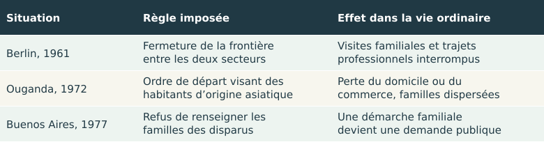
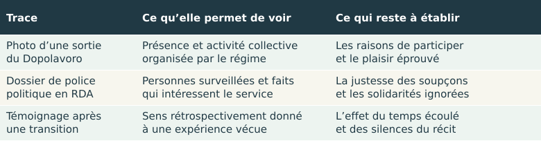

# Vivre en dictature dans le monde 1919-1990 — Corrigé guidé

*Corrigé rédigé par IA, non officiel. Signalez toute erreur.*

**Rédaction** · GPT-6.2 Astra Ultra · vitesse non renseignée · 26 novembre 2026

## Introduction

**Indication.** À partir du mot « vivre », choisir trois gestes que deux personnes ne peuvent pas accomplir aux mêmes conditions. Fixer les bornes à l’échelle du monde, en gardant en vue les ouvertures de 1989-1990.

En 1977, des femmes se donnent rendez-vous sur la place de Mai à Buenos Aires. Elles demandent au pouvoir militaire ce qu’il est advenu de leurs enfants disparus. Ce geste tient à une expérience familiale très précise. Il devient une affaire d’État parce que l’autorité qui devrait renseigner les mères organise la disparition et tient les questions pour suspectes. Une dictature se reconnaît jusque dans cette impossibilité d’obtenir une réponse à une démarche ordinaire.

De 1919 à 1990, des centaines de millions de personnes ont vécu sous un pouvoir qui soustrait les gouvernants à une compétition politique libre, réprime leurs opposants et limite fortement les recours contre l’arbitraire. La seule Chine compte plus d’un demi-milliard d’habitants lorsque les communistes accèdent au pouvoir en 1949. Dans l’Europe issue de la Grande Guerre, des régimes de parti unique veulent fabriquer une société nouvelle. Plus tard, des gouvernements militaires latino-américains prétendent rétablir l’ordre en renvoyant chacun à ses activités privées. Entre ces ambitions différentes, quelle prise les dictatures ont-elles effectivement sur la manière de travailler, d’aimer, de croire, de se déplacer ou de perdre un proche ? Suivre quelques gestes communs rend visibles les différences entre les personnes que le pouvoir recrute, celles avec lesquelles il compose et celles qu’il désigne pour cibles.

## Apprendre à tenir sa place

**Indication.** Comparer les parcours de deux enfants en Allemagne à travers des actes datés. Séparer le projet éducatif, l’institution qui le relaie et la conséquence pour chacun. Demander ensuite ce qu’une photographie de sortie permet réellement de conclure.

Dans l’Italie fasciste, l’enfant trouve le régime sur son chemin bien avant de voter. L’Opera nazionale Balilla, fondée en 1926, lui propose des exercices sportifs et des cérémonies. L’uniforme distingue une classe d’âge, installe le chef dans l’horizon de la fête et assigne aux garçons et aux filles des devenirs distincts. Pour les adultes, le Dopolavoro, créé en 1925, organise excursions, spectacles ou sport après le travail. Pour un ouvrier qui découvre un lieu de vacances avec ses camarades, le plaisir peut être réel. Une photographie de groupe établit la participation, elle laisse ouverte la question de la conviction. L’histoire du quotidien, telle que l’a pratiquée Alf Lüdtke, oblige à prendre au sérieux cette appropriation d’une offre conçue pour encadrer.

Le régime ne demande d’ailleurs pas les mêmes preuves à chacun. En Allemagne, la loi de 1936 sur les Jeunesses hitlériennes, puis l’obligation de service instituée en 1939, resserrent l’emprise sur les adolescents admis dans la communauté raciale nazie. Les enfants juifs sont au contraire progressivement chassés de l’école publique, dont ils sont exclus en novembre 1938. Auparavant, les lois de Nuremberg de 1935 avaient déjà porté la classification raciale jusque dans la possibilité légale de se marier. Ce qui est pour les uns une sortie en uniforme est, pour leurs anciens camarades, le début d’un isolement et d’une dépossession. En temps de guerre, les déportations et le génocide des Juifs d’Europe font de ces exclusions un seuil vers l’anéantissement. Les pays, les dates et les chances d’échapper aux persécutions diffèrent profondément.

Ailleurs, le pouvoir délègue une part de la discipline. Dans l’Espagne de Franco, la famille, l’Église catholique et l’école enseignent un ordre des sexes qui assure une continuité entre le foyer et les institutions. L’autorisation maritale, qui limite l’autonomie professionnelle et civile d’une épouse, ne disparaît qu’en 1975. Parler catalan entre proches a pu préserver une transmission que la politique linguistique franquiste avait expulsée de bien des usages publics, surtout après la guerre civile. Entre une salle de classe, un guichet et une table familiale, la même personne n’a donc ni la même liberté ni les mêmes raisons de se taire. La contrainte s’apprend aussi dans les trajets et les choix de travail qui relient ces lieux.

## Manger, travailler et circuler

**Indication.** Suivre le trajet du grain depuis la récolte jusqu’au repas. Reprendre la démarche pour le trajet d’un habitant expulsé ou retenu. Nommer dans chaque cas la décision qui relie le geste quotidien au pouvoir.

Pour un paysan soviétique au tournant des années 1930, la collectivisation est d’abord la perte de la maîtrise du grain, du bétail et du temps agricole. Les prélèvements et la répression aggravent la crise alimentaire. En 1932-1933, la famine est particulièrement meurtrière en Ukraine, tandis que le Kazakhstan connaît une catastrophe liée aussi à la sédentarisation forcée. Se rendre en ville pour chercher du pain est à son tour entravé. Au même moment, l’industrialisation offre à certains jeunes ouvriers une formation, un emploi technique et un espoir d’ascension. Disposer d’une carte, d’une place en foyer ou d’une recommandation prend une importance nouvelle. L’expérience de la promotion fait partie de cette histoire au même titre que les privations, mais elle appartient rarement aux mêmes foyers.

Sous Mao, la mise en communes et les cantines collectives pendant le Grand Bond en avant lancé en 1958 déplacent jusqu’aux lieux où l’on prépare son repas. La surenchère des cadres sur les récoltes contribue à des prélèvements déconnectés des ressources disponibles. Les citadins approvisionnés par l’État et les villages soumis aux livraisons affrontent la pénurie dans des conditions très inégales. La famine de 1959-1961 montre ce que coûte un système dans lequel signaler une mauvaise récolte expose celui qui la signale. Au Cambodge en avril 1975, les Khmers rouges font évacuer Phnom Penh. Pour les citadins déplacés, marcher, habiter, cultiver et prendre son repas deviennent en quelques jours des obligations collectives. La distinction entre populations dites anciennes et nouvelles pèse jusque sur les chances de survie. Ces deux histoires font saisir des mécanismes comparables de dépendance, à des rythmes et dans des sociétés distincts.

Les qualifications et les protections d’hier peuvent également cesser de compter d’un seul coup. En Ouganda en 1972, Idi Amin ordonne le départ en quatre-vingt-dix jours d’une grande partie de la population d’origine sud-asiatique. Pour les familles visées, conserver son commerce, rejoindre des parents ou faire reconnaître son droit au séjour deviennent des urgences simultanées. Des proches du régime bénéficient de biens redistribués. En sens inverse, en RDA, le mur érigé en août 1961 ferme brutalement les trajets ordinaires entre Berlin-Est et Berlin-Ouest. Il sépare des parentés, interdit certains déplacements professionnels et donne une valeur considérable aux autorisations de visite. Expulsion ou assignation à résidence produisent un fait social commun. Le pouvoir peut décider de l’endroit où une vie ordinaire reste possible.

## Faire avec le régime, agir sur lui

**Indication.** Comparer un document de surveillance avec une parole recueillie après la transition. Distinguer ce que l’auteur a pu voir, ce qu’il avait intérêt à enregistrer et ce qui a pu lui échapper.

Une dictature dure aussi par les services rendus et les accommodements quotidiens. La RDA élargit l’emploi féminin et offre des structures de garde. Leur disponibilité donne à des femmes une indépendance salariale réelle, alors même que les tâches domestiques leur incombent encore largement. Les liens de travail et d’amitié peuvent être précieux dans une société où un collègue est susceptible de renseigner la police politique. La déchéance de nationalité du chanteur Wolf Biermann en 1976, pendant une tournée à l’Ouest, matérialise le coût possible d’une parole critique. D’autres artistes protestent ou se taisent. De ces conduites visibles, on ne peut déduire sans précaution le for intérieur. Une archive de police apprend ce qui intéressait le service qui l’a constituée. Un témoignage rétrospectif permet de restituer des attachements qui lui échappaient, tout en portant la marque du temps écoulé.

Cette pluralité traverse parfois le même événement. En Argentine, les matchs de la Coupe du monde de 1978 sont suivis jusque dans le lieu de détention de l’École de mécanique de la marine à Buenos Aires. L’équipe peut passionner aussi bien des prisonniers que des gardiens. Leur joie sportive n’efface pas la dissymétrie absolue des situations. La junte tire parti de la fête, mais son appropriation officielle ne suffit pas à expliquer ce que chacun y éprouve. Les mères de la place de Mai, de leur côté, emploient la visibilité que la dictature accorde au rôle maternel pour réclamer publiquement des comptes. Leur mobilisation transforme une conduite jugée convenable, chercher son enfant, en mise en cause de la puissance militaire. Aucune de ces femmes ne disposait au départ de la protection institutionnelle d’une opposition libre.

Lorsque les dictatures reculent, ce sont souvent ces liens ordinaires qui donnent consistance au changement. En Pologne en 1980, des revendications de salariés des chantiers navals de Gdańsk débouchent sur la reconnaissance de Solidarność. La loi martiale de décembre 1981 traduit le risque pris par les militants. Le soutien de milieux catholiques, d’intellectuels et de familles contribue à la continuité de réseaux dont les négociations de 1989 rendent l’action à nouveau publique. En RDA, sortir manifester à Leipzig à l’automne 1989 modifie à son tour le sens d’une rue familière. La chute du mur permet de retrouver des parents, puis la réunification de 1990 change le cadre du travail et des protections. La même année, la passation de pouvoir au Chili ouvre une transition politique tout en laissant entière pour bien des familles la question des disparus.

## Conclusion

**Indication.** Revenir à une relation de parenté évoquée au début. Montrer concrètement ce que le changement de régime rend possible et quelles conséquences demeurent.

Vivre en dictature, c’est apprendre quelle autorité peut intervenir dans un geste ordinaire, avec quels relais et avec quelles conséquences pour soi ou pour autrui. Ni l’intensité de cette prise ni sa répartition ne restent constantes entre 1919 et 1990. Une organisation de loisirs peut donner accès à une sociabilité appréciée, une assignation raciale retirer jusqu’au droit d’exister, une relation de parenté soutenir une revendication publique. L’histoire de ces régimes se joue dans les écarts entre ce qu’ils exigent, ce que les individus peuvent faire et ce dont leurs voisins sont privés. La sortie d’une dictature élargit ces possibles sans rendre à chacun les années, les lieux ou les personnes perdus.
