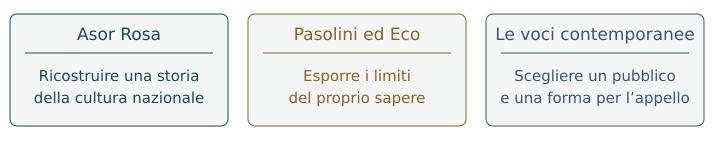

# BEL B/L — Italien 2024 · Corrigé brut

*Corrigé rédigé par IA, non officiel. Signalez toute erreur.*

**Rédaction** · GPT-6.2 Astra Ultra · vitesse non renseignée · 26 novembre 2026

## Chi ha titolo per prendere la parola?

Il fascicolo richiede un commento unitario in italiano. Vi si incontrano un’intervista, una tavola a fumetti, interventi saggistici e giornalistici e la trascrizione di un video. Le date di prima pubblicazione e quelle delle successive riprese aiutano a ricostruire a quale pubblico si rivolge ciascuna voce.

## Analisi e commento

### Il costo di una parola pubblica

Nel luglio 2018 Roberto Saviano domanda a scrittori, attori, cuochi e youtuber dove si siano nascosti. Nel 1997 Umberto Eco suggeriva invece agli intellettuali di tacere quando il loro intervento non serve. Come possono due scrittori impegnati trarre dal senso di responsabilità conclusioni tanto diverse? Il fascicolo permette di mettere alla prova l’idea di una vocazione politica permanente dell’intellettuale italiano. Nell’intervista di Alberto Asor Rosa quella vocazione ha una storia precisa. Negli interventi di Eco e di Pier Paolo Pasolini dipende da ciò che si può sapere o dimostrare. Con Saviano, Zerocalcare e Michela Murgia diventa decisivo il rapporto con chi ascolta. La questione riguarda dunque insieme l’origine dell’autorità di chi parla, il momento in cui la usa e lo spazio che la sua parola apre ad altri.

### Costruire una nazione, formare un giudizio

Interrogato da Simonetta Fiori nel 2009, Asor Rosa colloca le radici dell’impegno prima ancora dell’unità politica. La frammentazione della penisola e la lunga egemonia cattolica avevano lasciato aperto il problema di una cultura comune. Dal Settecento, poi durante il Risorgimento, alcuni intellettuali si assunsero il compito di costruire ciò di cui il paese era ancora privo. Francesco De Sanctis riunisce nella stessa persona il patriota, il ministro dell’Istruzione e il critico. Nella sua *Storia della letteratura italiana* del 1870–1871 la successione degli autori diventa la storia civile di un popolo. Mettere in rapporto quel libro con la scuola e l’alfabetizzazione significa dare alla nozione di impegno un contenuto concreto. Raggiunge la vita pubblica anche chi decide che cosa una generazione saprà leggere.

La forma dell’intervista conta. La seconda domanda rilancia una spiegazione fondata sul ritardo dell’unificazione italiana. Asor Rosa l’accetta senza fare dell’Italia un caso isolato. Cita il peso europeo dell’affare Dreyfus e dell’intervento di Zola. Proprio Zola ricompare in Eco, con una diversa funzione. Per il primo autore attesta la portata politica della cultura europea. Per il secondo mostra la circostanza in cui la notorietà di uno scrittore può rendere un allarme più udibile. L’eredità del Risorgimento offre così un termine di confronto, senza trasformarsi in un mandato valido per qualunque causa e qualunque tempo. Lo stesso Asor Rosa colloca negli anni Settanta e Ottanta la crisi del modello che ha ricostruito.

### La distanza dalle prove e il tempo dell’allarme

Sul *Corriere della Sera* del 14 novembre 1974, Pasolini ripete «Io so» a proposito delle stragi e delle protezioni politiche che ritiene le colleghino. Il lettore si aspetta una rivelazione dei nomi. Arriva invece una cesura: allo scrittore mancano prove e perfino indizi. Questa svolta obbliga a rileggere l’anafora iniziale. Il suo sapere consiste nel seguire ciò che succede, leggere quanto se ne scrive e coordinare frammenti lontani in un’interpretazione. L’autore attribuisce a giornalisti e politici un possibile accesso a elementi che a lui sono preclusi, ma constata che i nomi non vengono fatti. La distanza dal potere gli permette di formulare l’accusa e nello stesso tempo limita ciò che può provare. Il lettore può valutare questo paradosso senza trattare la certezza rivendicata dall’io come una sentenza. La successiva intitolazione *Il romanzo delle stragi* rende particolarmente visibile il problema di come dare forma a fatti dispersi.

Per Eco, intervenire criticamente significa anzitutto incrinare una spiegazione che sembrava ovvia. La battuta con cui ricorda il congresso convocato da Jacques Attali capovolge la domanda di soluzioni immediate: agli intellettuali attribuisce il mestiere di creare crisi. L’elenco che va dai filosofi agli scienziati e agli scrittori sposta l’accento dal prestigio personale al cambiamento durevole nel modo di capire. In un’emergenza già nota, ripetere ciò che tutti sanno può occupare lo spazio necessario a notizie urgenti. Rimangono il dovere comune di cittadinanza e l’eccezione dell’allarme trascurato. Persino un idraulico, osserva Eco, potrebbe esercitare in quel caso una funzione intellettuale. Pasolini ed Eco si incontrano dunque nel rifiuto della competenza universale conferita dalla celebrità. Divergono nel rischio che assumono davanti a un pubblico che conosce già gli eventi ma può ancora ignorare il rapporto fra essi.

### Cambiare interlocutore · Il quotidiano, la tavola e il video

Nell’appello pubblicato da *la Repubblica* nel 2018 Saviano allarga l’elenco dei destinatari fino a comprendere chiunque possa parlare a una comunità. Le domande in seconda persona mettono il lettore nella posizione di chi è già coinvolto. La polemica con Matteo Salvini, richiamata nella nota, costituisce l’occasione dell’articolo, ma Saviano chiede ai lettori di rivolgersi al proprio pubblico, anziché di difendere l’autore. Cita le seicentomila persone immigrate da regolarizzare secondo la sua stima, difende le ONG che operano in mare e lega questi temi alla libertà di espressione. Il passaggio dall’io al voi, e infine al noi, sostiene la tesi che il silenzio permetta di presentare i diritti come un privilegio. A differenza della situazione ipotizzata da Eco, il problema qui è già in prima pagina. Per Saviano è però il modo in cui viene raccontato a richiedere una risposta.

Nel fumetto di Zerocalcare cambia perfino la lingua in cui si formula il problema. Il post del 21 ottobre 2022 riprende pagine del 2019 dedicate allo sgombero dell’ex fabbrica Penicillina a Roma, dopo un altro sgombero in via del Frantoio. Il titolo *Il loop infinito* acquista così un significato anche editoriale: il disegno si può riusare proprio perché la situazione si ripete. L’enumerazione delle tre possibilità sembra all’inizio un ragionamento ordinato. A chi propone un alloggio viene assegnata una caricatura da santo; la seconda ipotesi porta all’assurdo la disumanità delle voci in scena; la terza, lo sgombero, lascia intatto il problema. Nel riquadro quasi vuoto si scopre anzi che gli abitanti erano già andati via. Il romanesco, il dialogo con il lettore e la battuta sulla conservazione della materia rendono evidente un fatto ordinario: chi scompare da un luogo dovrà pur abitare altrove. L’ironia contrasta la tentazione di intendere come soluzione l’immagine di un edificio svuotato.

Anche il video Instagram di Murgia del 7 luglio 2023 si rivolge a persone già vicine alla causa di cui parla. Il passaggio dalla prima persona al «non tutte possiamo studiare tutto» dà alla limitazione delle competenze un valore collettivo. La teoria intersezionale compare attraverso esempi di esperienze e saperi diversi, dal rapporto fra sessismo e razzializzazione a quello fra oppressione e capitalismo. L’immagine del coro consente alle voci di restare distinguibili. Dare o negare una «patente» di femminismo consumerebbe invece le energie delle partecipanti in una controversia sulla loro legittimità. Rispetto a Saviano, Murgia chiede qualcosa di più preciso del prendere la parola. Chiede anche di riconoscere il lavoro di chi usa altri strumenti o non condivide tutti i propri presupposti. Essendo una trascrizione, il documento conserva le ripetizioni e l’apostrofe finali, mentre non permette da solo di ricostruire la gestualità del video.

### Una responsabilità da motivare

Dalla storia letteraria di De Sanctis alla tavola ripubblicata su Instagram cambia chi può parlare a molti, ma rimane da giustificare perché gli altri dovrebbero ascoltare. Pasolini espone il limite documentario della sua interpretazione. Eco domanda se un’altra voce offra davvero qualcosa alla discussione. Saviano, Zerocalcare e Murgia mostrano come la scelta dell’interlocutore e del linguaggio possa rimettere in discussione un racconto già dominante. Il contributo intellettuale si misura allora anche da ciò che consente al lettore di fare: verificare una distinzione, accorgersi di un’assenza, riconoscere ad altri la possibilità di giudicare e di parlare.

## Percorsi di lettura

### Il costo di una parola pubblica

Le date indicano occasioni di intervento diverse. Il breve saggio di Eco è del 1997 e viene raccolto in volume nel 2000. Saviano si rivolge ai concittadini nel 2018, in una controversia sulla politica migratoria e sui diritti. Nel primo caso il lettore incontra una distinzione di funzioni, nell’altro viene chiamato in causa come destinatario.

### Costruire una nazione, formare un giudizio

Nell’intervista, il pronome *noi* è legato a una vicenda nazionale, mentre i riferimenti a Thomas Mann e a Zola allargano il confronto. L’accenno agli studiosi gesuiti illuminati complica la contrapposizione sommaria fra Chiesa e intellettuali. La periodizzazione esposta è la tesi dell’intervistato.

### La distanza dalle prove e il tempo dell’allarme

L’articolo di Pasolini è del 1974. Nel 1975 entra negli *Scritti corsari* con un altro titolo. Nel testo di Eco l’allusione a Julien Benda segnala il luogo comune del «tradimento» degli intellettuali, che l’autore prende di mira. Nessuno dei due testi autorizza a trasformare una lettura politica delle stragi in identificazione giudiziaria dei responsabili.

### Cambiare interlocutore · Il quotidiano, la tavola e il video

I documenti 2, 5 e 6 non coincidono con tre forme equivalenti di denuncia. Nella tavola contano i riquadri, i corpi disegnati e il romanesco. Nell’articolo contano le domande a chi dispone di un pubblico. Nella trascrizione del video il contrasto fra la patente e il coro fa emergere una critica interna al femminismo. La nota su Salvini colloca la controversia con Saviano nel 2018 e dà notizie del procedimento alla data di dicembre 2023.

### Una responsabilità da motivare

Accostare l’intervista storica alle forme più recenti di intervento non obbliga a proclamare la fine dell’intellettuale. Si possono distinguere la disponibilità di un canale, la qualità di un’argomentazione e la responsabilità per gli effetti di un appello.

Due riprese editoriali aiutano a leggere il fascicolo. L’articolo di Pasolini precede la raccolta del 1975. Nel 2022 Zerocalcare riutilizza una tavola anteriore, riferita nel fumetto stesso a un’altra vicenda. La distanza fra le date appartiene all’argomento delle due letture.

## Fonti

[Fascicolo della prova](https://www.ens.psl.eu/sites/default/files/2024_blses_sujet_analyse_commentaire_italien.pdf) · [Relazione della commissione](https://www.ens.psl.eu/sites/default/files/2024_bl_rapport_ecrit_italien.pdf)
