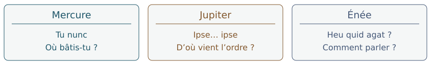
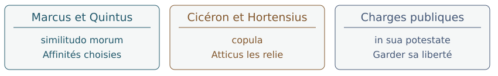
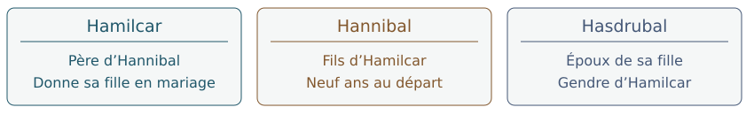

# BEL B/L — Latin oral du 10 juin 2024 · Corrigé guidé

*Corrigé rédigé par IA, non officiel. Signalez toute erreur.*

**Rédaction** · GPT-6.2 Astra Ultra · vitesse non renseignée · 26 novembre 2026

## Déroulement de l’oral en 2024

Le candidat dispose de 1 h 30 pour préparer le texte tiré après choix entre deux sujets cachés. Il dispose ensuite de 20 minutes pour présenter, lire, traduire et commenter le texte, suivies de 10 minutes de questions. Aucun ouvrage n’est autorisé. La reprise de la traduction peut avoir lieu dès la fin de celle-ci ou après le commentaire. Elle est décomptée du temps des questions.

## Énée doit partir

Virgile, Énéide IV, 265–284 · fascicule p. 1–2

À Carthage, Énée travaille à la ville de Didon. Jupiter a envoyé Mercure rappeler au Troyen le royaume promis à son fils en Italie. Sur la page, la construction d’une ville déjà là et la parole qu’il faudra adresser à la reine encadrent une mission encore à venir.

[Texte latin et notes du sujet, p. 1](https://www.ens.psl.eu/sites/default/files/bl_sujets_oraux_latin_10062024.pdf#page=1)

### Lecture à voix haute

Détacher le bref *Continuo inuadit*, puis faire peser la question sur *Tu nunc*. Garder ensemble *Karthaginis altae / fundamenta* et, plus loin, *claro… Olympo*. Distinguer la voix accusatrice, la voix du récit à *Tali Cyllenius* et les interrogations inquiètes introduites par le second *Heu*.

### Avant de traduire

Relevez les deux *ipse*. Qui commande, qui parle et qui devra agir ? Construisez *respice* avec deux accusatifs avant de chercher à qui renvoie *cui*. Dans le dernier vers, rapprochez *quo* de *adfatu*.

### Traduction suivie

**V. 265–267.** *Continuo inuadit* — Sur-le-champ, Mercure l’apostrophe. « Toi, maintenant, tu poses les fondations de la haute Carthage et, tout à ton épouse, tu lui bâtis une belle ville ? Hélas, oublieux de ton royaume et de tes propres affaires !

**V. 268–271.** *Ipse deum… regnator* — C’est le souverain des dieux en personne, lui qui par sa puissance fait tourner le ciel et la terre, qui m’envoie vers toi du lumineux Olympe. *Ipse haec ferre iubet* — C’est lui qui m’ordonne de porter ces instructions à travers les vents rapides. Que bâtis-tu ? Dans quel espoir uses-tu tes journées à ne rien faire en terre libyenne ?

**V. 272, 274–276.** *Si te nulla mouet…* — Si la gloire de si hauts faits ne te touche en rien, regarde du moins Ascagne qui grandit, songe aux espoirs de ton héritier Iule, à qui sont dus le royaume d’Italie et la terre romaine. »

**V. 276–278.** *Tali Cyllenius ore locutus* — Après avoir ainsi parlé, le dieu du Cyllène se déroba en pleine conversation aux regards des mortels et, au loin, disparut à leurs yeux dans l’air subtil.

**V. 279–282.** *At uero Aeneas* — Énée, lui, bouleversé par cette apparition, resta muet. Ses cheveux se dressèrent d’effroi et sa voix demeura prise dans sa gorge. Il brûle de s’enfuir et de quitter ces terres qui lui sont douces, frappé de stupeur par un si terrible avertissement et par l’ordre des dieux.

**V. 283–284.** *Heu quid agat ?* — Hélas ! Que faire ? Par quelles paroles oserait-il maintenant aborder la reine en fureur ? Par quels mots commencer ?

### Commentaire

Comment un ordre qui lève tout doute sur la destination laisse-t-il son destinataire sans parole ? Les v. 265–276 imposent un avenir à Énée, les v. 276–282 font sentir l’effet physique de l’apparition, les v. 283–284 rendent audibles les questions que le héros se pose.

Le *Tu* initial montre Énée à l’ouvrage, et le rejet de *fundamenta* laisse d’abord résonner le nom de Carthage au terme de l’hexamètre. Mercure voit bien un bâtisseur. Sa critique tient à la ville choisie et à la place assignée au héros par *uxorius*. À *exstruis ?* répond *quid struis ?* ; ce qui était construction devient, considéré du point de vue de Jupiter, temps perdu, *teris otia*. L’anaphore de *ipse* garantit la provenance de l’ordre et relègue Mercure au rôle d’émissaire. *Ascanium* et *Iuli* nomment un seul enfant. On passe de sa croissance visible, *surgentem*, à une promesse qui dépasse une vie humaine, *Romana… tellus*. Le présent *debentur* fait déjà de cet avenir un dû.

La limite entre deux régimes de parole coupe le v. 276 après *debentur*. *Per auras* puis *in… auram* dessinent l’arrivée du message et l’effacement du messager dans le même élément. L’homme, au contraire, devient matériellement immobile. L’horreur se lit des cheveux à la gorge. *Ardet*, brusque présent, lui rend un désir de mouvement, tandis que *dulcis* conserve la valeur de ce qu’il quitte. Le premier *heu* portait la réprimande. Le second ouvre, sans verbe introducteur, une délibération au subjonctif (*agat, audeat, sumat*). La destination peut être fixée par les dieux. L’art de trouver un commencement de discours, *exordia*, incombe encore à celui qui vient de perdre sa voix.

### Pour l’entretien

**Pourquoi traduire « les regards des mortels » ?** *Mortalis* vaut *mortales*, accusatif pluriel accordé avec *uisus*, complément de *reliquit*. **Pourquoi *Aeneas* est-il sujet ?** Le feuillet rappelle le nominatif grec en *-as*. **Quelles autres formes le feuillet explique-t-il ?** Mercure est le sujet de *inuadit*. *Deum* vaut *deorum*, *celeris* vaut *celeres* et Iule est Ascagne. *Dulcis* qualifie aussi un accusatif pluriel, *terras*. Dans la clausule du v. 284, les syllabes *or-di-a* forment le cinquième pied dactylique et *su-mat* le dernier pied. La question tient ainsi jusqu’à la fin du vers. La lecture suit la leçon *debentur* du sujet. Entre les v. 272 et 274, le feuillet enchaîne directement avec *Ascanium*. Les dix-neuf vers effectivement imprimés composent le tirage.

### Vocabulaire du feuillet

*adfatus* — parole adressée, manière d’aborder quelqu’un · *adrigo (arrigo)* — dresser, d’où les cheveux hérissés · *adtonitus (attonitus)* — frappé de stupeur.

*ambio* — aller solliciter, aborder · *amens* — hors de soi · *ardeo* — brûler de désir (+ infinitif).

*audeo* — oser · *aura* — souffle, air · *Carthago (Karthago)* — Carthage.

*coma* — chevelure · *continuo* — sur-le-champ · *Cyllenius* — le dieu du mont Cyllène, Mercure.

*demitto* — envoyer d’en haut · *euanesco* — s’évanouir, disparaître · *exordium* — premiers mots, exorde.

*exstruo* — édifier · *fauces* — gorge · *furo* — être en fureur.

*haereo* — rester arrêté, ici dans la gorge · *heres* — héritier · *horror* — frisson d’effroi.

*inuado* — s’en prendre à quelqu’un, l’apostropher · *Libycus* — de Libye · *loco* — mettre en place, poser.

*mandatum* — ordre confié · *monitus* — avertissement · *numen* — puissance ou volonté divine.

*oblitus* — qui oublie (+ génitif) · *obmutesco* — devenir muet · *os, oris* — bouche, d’où la parole.

*procul* — au loin · *pulcher* — beau · *regnator* — souverain.

*relinquo* — quitter, abandonner · *respicio* — tourner son regard vers · *sumo* — prendre, choisir.

*surgo* — se lever, ici grandir · *tenuis* — ténu, subtil · *tero* — user, consumer son temps.

*torqueo* — faire tourner · *uisus* — regard · *uxorius* — tout entier soumis à son épouse, selon Mercure.

## Nouveau songe prophétique d’Énée

Virgile, Énéide VIII, 55–73 · fascicule p. 3–4

Énée est à présent en Italie. Le Tibre lui apparaît en songe. À la fin de leurs échanges, le fleuve indique une alliance possible et la conduite à tenir envers Junon. Le récit suit le héros jusqu’au premier geste de son réveil.

[Texte latin et notes du sujet, p. 3](https://www.ens.psl.eu/sites/default/files/bl_sujets_oraux_latin_10062024.pdf#page=3)

### Lecture à voix haute

Dans *Ipse ego… ducam*, donner au futur son assurance. À *aduersum… ut amnem*, tenir jusqu’au dernier nom le groupe séparé par le vers. Marquer la clôture du discours après *exit*, puis, dans la prière, faire entendre le redoublement *Nymphae, Laurentes Nymphae* et attendre *accipite* pour achever l’appel.

### Avant de traduire

Distinguez les deux sens de *superare* selon son complément. Suivez *surge* puis *surgit*. Reconstituez *ut… superes* et *unde est genus amnibus*. À qui le héros parle-t-il effectivement dans les derniers vers ?

### Traduction suivie

**V. 55–58.** « *Hi bellum adsidue ducunt* — Ces hommes font sans relâche la guerre au peuple latin. Accueille-les dans ton camp comme alliés et conclus des traités. *Ipse ego te… ducam* — Moi-même je te guiderai le long de mes rives et tout droit par mon cours, afin que, porté par tes rames, tu puisses remonter le fleuve à contre-courant.

**V. 59–62.** *Surge age, nate dea* — Allons, lève-toi, fils d’une déesse. Dès que les astres commencent à décliner, adresse à Junon les prières rituelles et, par tes vœux suppliants, triomphe de sa colère et de ses menaces. À moi, quand tu seras vainqueur, tu rendras l’hommage qui m’est dû.

**V. 62–65.** *Ego sum… caeruleus Thybris* — Je suis, moi que tu vois de mes eaux abondantes effleurer les rives et traverser les riches cultures, le Tibre azuré, le fleuve si cher au ciel. Ici est ma grande demeure, ma source jaillit parmi de hautes cités. »

**V. 66–70.** *Dixit* — Il dit et, gagnant les profondeurs, le fleuve se déroba dans son gouffre profond. La nuit et le sommeil quittèrent Énée. *Surgit* — Il se lève et, les yeux tournés vers les premières lueurs du soleil qui monte au ciel, il soulève rituellement, au creux des mains, de l’eau puisée au fleuve et répand vers l’éther ces paroles.

**V. 71–73.** *Nymphae, Laurentes Nymphae* — « Nymphes, nymphes de Laurentum, de qui les fleuves tiennent leur origine, et toi, père Tibre, avec ton cours sacré, accueillez Énée et préservez-le enfin des dangers. »

### Commentaire

Comment un rêve passe-t-il dans les gestes du jour ? Les v. 55–65 donnent successivement une direction, un rite et un nom, les v. 66–70 font du réveil un moment de continuité, les v. 71–73 confient au héros sa propre prière.

*Hi… hos* reprend les Arcadiens d’Évandre mentionnés avant le passage. Montrer des hommes, puis les désigner comme *socios* donne une traduction politique du paysage. Le fleuve promet de conduire le voyageur sur lui-même. L’inversion *aduersum… amnem* fait entendre la difficulté qu’*ipse ego* promet de surmonter. Du v. 58 au v. 61, *superes* puis *supera* passent de l’obstacle physique à la colère de Junon. Cette répétition fait tenir ensemble navigation et piété. La promesse *mihi uictor honorem / persolues* place l’hommage dans l’après-victoire et rejette au vers suivant le verbe qui engage Énée. L’identité annoncée par *ego sum* attend elle aussi, jusqu’à *caeruleus Thybris*, son nom propre. Entre les deux se déploie le cours du fleuve, perceptible par ses berges et la fertilité des terres. La traduction retient pour *caput* le sens de « source ».

*Dixit* referme le discours. Le dieu descend (*ima petens*) pendant que le soleil se lève et qu’Énée dirige ses paroles vers le ciel. Le retour de *rite* et la réponse presque littérale *surge / surgit* mesurent l’obéissance du héros. La scène garde pourtant une part d’initiative. Ici, il invoque les puissances de l’eau dont il vient de recevoir l’hospitalité. La prière à Junon demeure prescrite. Les paumes empruntent au fleuve de quoi prier, et le verbe *effundit*, « répand », prend pour complément *uoces*. Un verbe de liquide dit le mouvement de la voix. L’invocation finit sur deux impératifs pluriels demandant accueil et protection. Au *te* que guidait le dieu répond le nom propre *Aenean* que le héros confie aux divinités.

### Pour l’entretien

**Comment construire la fin du portrait ?** *Quem* reprend le locuteur et dépend de *cernis*. *Stringentem* et *secantem* s’accordent avec cet accusatif. **Qu’indiquent les notes ?** *Hi* renvoie aux Arcadiens, *Thybris* est un nominatif pour *Tiberis*, *Aenean* un accusatif singulier. *Talis* vaut *tales*, *aethera* est un accusatif grec et *undest* contracte *unde est*. **Que rend la lecture métrique ?** Au v. 55, la fin du vers *gente Latina* fait entendre un dactyle (*gen-te-La*) puis le pied final (*ti-na*). La limite de pied traverse le nom de peuple. Au v. 71, la contraction finale *undest* accompagne la clôture de l’hexamètre. Au v. 62, l’arrêt après *persolues* sépare la promesse de la révélation d’identité à l’intérieur du même vers.

### Vocabulaire du feuillet

*adhibeo* — prendre à son service, s’adjoindre · *aduersus* — qui vient en sens inverse · *aether* — éther, ciel.

*altus* — profond ici · *amnis* — cours d’eau, fleuve · *arceo* — tenir quelqu’un à l’écart de (+ ablatif).

*cado* — tomber, ici décliner · *caeruleus* — bleu, azuré · *castra* — camp (pluriel latin).

*cauus* — creux · *celsus* — haut, élevé · *cerno* — distinguer, voir.

*condo* — cacher, enfouir · *culta* — terres mises en culture · *duco* — mener.

*effundo* — verser, répandre · *flumen* — cours d’eau, courant · *foedus* — traité, pacte.

*gratus* — agréable, cher à (+ datif) · *imus* — le plus bas, le fond · *iungo* — joindre, nouer.

*Laurens* — de Laurentum · *lumen* — lumière, lueur · *minae* — menaces.

*palma* — paume · *peric(u)lum* — danger · *persoluo* — acquitter entièrement.

*peto* — gagner, se diriger vers · *pinguis* — fertile · *preces* — prières.

*relinquo* — quitter · *remus* — rame · *ripa* — rive.

*rite* — selon les rites · *seco* — couper, traverser · *stringo* — effleurer.

*subueho* — transporter en remontant · *supero* — franchir, surmonter · *supplex* — suppliant.

*surgo* — se lever · *sustineo* — tenir soulevé · *uotum* — vœu religieux.

*uox* — voix, au pluriel paroles.

## Position sociale et politique d’Atticus

Cornélius Népos, Vie d’Atticus V, 3 – VI, 2 · fascicule p. 5–6

Atticus, chevalier romain et ami de Cicéron, avait choisi de séjourner à Athènes pendant les luttes civiles. En revenant aux relations qu’il entretenait à Rome, son biographe explique comment un homme disposant de tous les accès au pouvoir a choisi de se tenir à distance des magistratures.

[Texte latin et notes du sujet, p. 5](https://www.ens.psl.eu/sites/default/files/bl_sujets_oraux_latin_10062024.pdf#page=5)

### Lecture à voix haute

Poser séparément *Q. Tullio Ciceroni* (Quintus) et *M. Cicero* (Marcus), puis prononcer l’alternative *Cicero an Hortensius* comme une question ouverte. À la fin, reprendre trois impulsions successives, *neque peti*, *neque capi*, *neque geri*.

### Avant de traduire

Rattachez *cum quo* au consul et orateur Marcus. Quel est le sujet de *diligeret* ? Essayez de faire apparaître le nom sous-entendu après *maritimis*. Enfin, conservez trois verbes français distincts pour les trois infinitifs passifs.

### Traduction suivie

**L. 1–5.** *Erat nupta soror Attici…* — La sœur d’Atticus était mariée à Quintus Tullius Cicéron. C’est Marcus Cicéron qui avait arrangé ce mariage. Atticus vivait depuis leurs années d’école dans la plus étroite intimité avec lui, en amis bien plus proches encore qu’il ne l’était avec Quintus. *Ut iudicari possit* — On peut donc en conclure qu’en amitié la ressemblance des caractères a plus de force que la parenté par alliance.

**L. 5–10.** *Vtebatur autem intime…* — Il fréquentait aussi intimement Quintus Hortensius, qui occupait alors le premier rang dans l’éloquence, au point qu’on n’aurait pu discerner lequel des deux aimait davantage Atticus, Cicéron ou Hortensius. Et, chose extrêmement difficile, il obtenait qu’entre deux hommes rivaux pour une si grande gloire il ne se glissât aucun dénigrement. Lui-même servait de lien entre de tels hommes.

**L. 10–14.** *In re publica ita est uersatus* — Dans les affaires publiques, il se conduisit de telle façon qu’il fut toujours du parti des « meilleurs » et passa toujours pour en être, sans cependant se livrer aux flots des luttes civiles. En effet, il estimait que ceux qui s’y étaient abandonnés n’étaient pas plus maîtres d’eux-mêmes que ceux que ballottent les flots de la mer.

**L. 14–18.** *Honores non petiit* — Il ne brigua aucune magistrature, bien qu’elles lui fussent ouvertes tant par son crédit que par son rang. Au milieu des largesses d’une brigue si effrénée, on ne pouvait, jugeait-il, ni les solliciter selon la coutume des ancêtres, ni les obtenir en respectant les lois. Et, vu la corruption des mœurs de la cité, on ne pouvait les exercer dans l’intérêt de l’État sans courir de danger.

### Commentaire

Comment Népos rend-il honorable une conduite qui pourrait passer pour un refus de servir ? La comparaison familiale et l’amitié à trois (l. 1–10) mettent à l’épreuve le pouvoir de conciliation d’Atticus. L’image des flots (l. 10–14) déplace la question vers la liberté de jugement. Les magistratures refusées (l. 14–18) conduisent enfin à juger l’état de la cité.

Le premier sujet grammatical est *soror*, bientôt relayé par *M. Cicero* ; Atticus se découvre d’abord à travers les décisions d’autrui. Le comparatif *multo etiam familiarius* établit une préférence surprenante pour le frère de son beau-frère. Le premier *ut* consécutif invite le lecteur à tirer lui-même une maxime de ce cas singulier. La seconde comparaison, *uter… plus*, débouche exactement sur l’impossibilité de trancher. Égaux dans leur affection, les orateurs se disputent la même gloire. Entre *aemulatio* (émulation ou rivalité) et *obtrectatio* (dénigrement), Népos fait une différence morale. *Copula*, mot concret, donne à Atticus une fonction active précieuse.

Le récit passe ensuite du lien que l’on peut former entre deux individus aux flots auxquels on risque de s’abandonner. *Et esset et existimaretur* associe conviction et réputation. *Optimarum partium* exprime le parti pris social et politique du personnage dans le langage laudatif du portrait. Le lecteur a déjà vu chez lui une capacité de conserver des fidélités sans partager les rivalités. L’image des *fluctibus* rend sensible ce qu’il perdrait à se laisser entraîner. *In sua potestate* est le centre de la comparaison, dont *maritimis* n’explicite le versant propre qu’à la fin.

La dernière phrase dissocie point par point l’influence et la carrière. La concession *cum ei paterent* prévient une objection du lecteur : prestige et soutiens lui donnaient accès aux charges. Les trois infinitifs passifs suivent la vie d’une magistrature, de la candidature à l’exercice. À chacun répond une mesure de légitimité, coutume ancestrale, droit puis intérêt public. Les deux ablatifs absolus *conseruatis legibus* et *corruptis… moribus* relient le geste du candidat à la situation collective. Le retrait acquiert ainsi sa valeur à l’intérieur du portrait d’un homme capable de servir de lien, dans une cité que le biographe présente comme divisée.

### Pour l’entretien

**Qui aime qui ?** *Uter* est le sujet de *diligeret*, *eum* représente Atticus. **Que disent les trois notes du sujet ?** Quintus est le frère de Marcus. Le premier *ut* a une valeur de conséquence même sans corrélatif. Quintus Hortensius est le rival de l’orateur Marcus Cicéron. **Pourquoi « brigua » puis « obtenir » ?** *Petere* désigne la candidature, *capere* l’obtention et *gerere* l’exercice de l’office. *Periculo* conserve une part d’indétermination sur le danger encouru.

### Vocabulaire du feuillet

**Lignes 1–5.**

*nubo* — épouser, avec le conjoint au datif · *concilio* — ménager, arranger ; *conciliarat* abrège *conciliauerat* · *condiscipulatus* — camaraderie d’école.

*coniuncte* — dans l’intimité · *familiariter* — en ami intime ; *familiarius* est comparatif · *iudico* — juger.

*ualeo* — avoir de la force ou du poids · *mos* — coutume, au pluriel mœurs ou caractère · *affinitas* — parenté par alliance.

*utor* — avoir commerce avec (+ ablatif).

**Lignes 6–10.**

*principatus* — premier rang · *uter* — lequel des deux · *diligo* — aimer, tenir à.

*efficio* — faire en sorte que (+ *ut*) · *laus* — gloire, distinction · *aemulatio* — rivalité, émulation.

*intercedo* — s’interposer, survenir · *obtrectatio* — dénigrement · *copula* — lien.

*uersor* — prendre part à, se conduire dans.

**Lignes 11–15.**

*pars* — parti, camp, surtout au pluriel · *fluctus* — flot · *committo* — confier, livrer.

*iacto* — ballotter · *pateo* — être accessible à (+ datif) · *gratia* — crédit, faveur.

*dignitas* — rang, prestige.

**Lignes 16–18.**

*conseruo* — préserver, respecter · *effusus* — sans mesure · *ambitus* — brigue électorale.

*largitio* — largesse, distribution · *gero* — exercer une magistrature · *e re publica* — dans l’intérêt de l’État.

## Entre-deux-guerres

Cornélius Népos, Vie d’Hamilcar II, 4 – III, 2 · fascicule p. 7–8

Après la première guerre punique, une révolte des anciens mercenaires et de villes africaines met Carthage en péril. Cornélius Népos raconte comment Hamilcar rétablit la situation, puis oriente son avenir et celui de ses proches vers l’Espagne. Le biographe romain invite à mesurer la valeur d’un adversaire de Rome.

[Texte latin et notes du sujet, p. 7](https://www.ens.psl.eu/sites/default/files/bl_sujets_oraux_latin_10062024.pdf#page=7)

### Lecture à voix haute

Faire porter le balancement initial *non solum… sed etiam* sur les deux verbes à l’indicatif. À *quem nonnulli… loquebantur*, réserver l’assertion à ceux qui parlent, puis marquer la reprise du narrateur dans *non enim*. Distinguer les trois noms propres en fin de passage.

### Avant de traduire

Attribuez chaque action à son sujet. *Is*, *ille*, *Huic* et le *eo* de *cum eo* ne sont pas interchangeables. Après *uideretur*, relevez l’infinitif parfait ; après *loquebantur*, cherchez l’infinitif présent passif et son agent.

### Traduction suivie

**L. 1–5.** *Is non solum hostes… remouit* — Hamilcar éloigna les ennemis des murs de Carthage, alors qu’ils étaient devenus plus de cent mille hommes en armes. Bien plus, il les réduisit à une telle extrémité que, enfermés dans un étroit défilé, ils moururent en plus grand nombre de faim que par le fer. *Omnia oppida abalienata* — Toutes les villes qui avaient fait défection, dont Utique et Hippone, les plus puissantes de toute l’Afrique, il les rendit à sa patrie.

**L. 6–8.** *Neque eo fuit contentus* — Il ne s’en contenta pas. Il étendit aussi les frontières du territoire soumis à Carthage et ramena dans toute l’Afrique une tranquillité telle qu’on eût dit qu’il n’y avait pas eu de guerre depuis bien des années.

**L. 8–12.** *Rebus his ex sententia peractis* — Ces affaires achevées selon ses vœux, plein d’assurance et animé d’hostilité envers les Romains, il obtint, afin de trouver plus facilement un motif de leur faire la guerre, d’être envoyé en Espagne à la tête d’une armée. Il y emmena son fils Hannibal, âgé de neuf ans.

**L. 12–15.** *Erat praeterea cum eo… Hasdrubal* — Il avait aussi avec lui un jeune homme de haute naissance et d’une grande beauté, Hasdrubal. Certains disaient qu’Hamilcar lui portait une affection plus inconvenante qu’il ne sied. Un homme de cette importance ne pouvait en effet manquer de détracteurs.

**L. 15–18.** *Quo factum est ut…* — C’est ainsi que le magistrat chargé des mœurs interdit à Hasdrubal de fréquenter Hamilcar. Celui-ci lui donna sa fille en mariage, car, selon leurs coutumes, on ne pouvait interdire à un beau-père et à son gendre de se fréquenter.

### Commentaire

Comment passe-t-on d’un éloge public à une anecdote familiale sans perdre de vue la position du biographe romain ? Le premier mouvement grandit le libérateur de Carthage (l. 1–8), le second présente les ressorts d’un nouveau départ (l. 8–12), le dernier distingue la rumeur du jugement porté par le narrateur (l. 12–18).

La première période fait deux fois monter les conséquences par *non solum… sed etiam*, puis *eo… ut*. Le nombre annoncé, *amplius centum milia*, et la gradation des lieux, murs de Carthage, cités recouvrées, Afrique entière, donnent sa dimension au personnage. La formule ramassée *fame quam ferro* laisse entendre le coût humain au sein de l’éloge. Avec *tantum otium… ut… uideretur*, le dernier degré de réussite est mis à distance par la perception : la paix donne l’impression que la guerre est déjà ancienne, alors qu’on vient de lire ses effets.

L’ablatif absolu *rebus his… peractis* semblerait conclure. En réalité, *infesto Romanis* annonce en deux mots pour quel lecteur le répit est provisoire. Le futur adversaire de Rome se dessine au milieu de la réussite carthaginoise. *Causam* porte sur le motif de guerre à trouver, ce qui laisse déjà apparaître l’intention ; *effecit ut… mitteretur* rapproche une initiative active et une nomination reçue au passif. Le nom *Hannibalem*, suivi de l’âge de l’enfant, ajoute une seconde échelle de temps. Le lecteur romain sait ce que ce fils représentera pour Rome. L’enfant de neuf ans reste ici un compagnon de voyage.

L’arrivée d’Hasdrubal fait entrer la réputation dans la narration. *Nonnulli* maintient anonyme l’origine des propos ; le passif *diligi* et l’agent *ab Hamilcare* en donnent exactement la teneur. Puis *maledici* et *tanto uiro* montrent le narrateur prenant position sur les médisants et la stature de leur cible. Il rapporte aussi un effet institutionnel de la rumeur. À l’interdit du magistrat répond l’alliance matrimoniale, reconnue par les *mores* de Carthage. L’écho *praefecto morum / moribus eorum* fait passer des normes surveillées aux coutumes qui permettent de continuer la relation. Népos montre intelligence et autorité chez un ennemi de Rome. Le crédit accordé à Hamilcar rend plus sérieux l’adversaire dont le lecteur romain connaît l’histoire.

### Pour l’entretien

**Que signifie *eo* ?** *Eo compulit ut* marque le degré atteint ; *eo fuit contentus* dépend de *contentus* ; *eoque secum duxit* signifie « et il y emmena », en Espagne. **Pourquoi distinguer deux passifs ?** *Diligi* dépend du discours des « certains », tandis que *uetaretur* est la conséquence que le narrateur assume. **À qui se rapportent les notes ?** Le lieu est le défilé de la Hache. Utique et Hippone sont les deux cités mentionnées. Les appels 3 et 4 sont intervertis sur la page : Hasdrubal est le futur gendre d’Hamilcar, le *praefectus morum* est le magistrat surveillant les mœurs. Après Hamilcar en Espagne viennent Hasdrubal, puis Hannibal. La fille d’Hamilcar épouse Hasdrubal.

### Vocabulaire du feuillet

**Lignes 1–5.**

*Carthago* — Carthage · *remoueo* — éloigner · *amplius* — plus de.

*mille* — mille ; *milia* pour des milliers, avec génitif · *fio* — devenir, se faire ; *fit ut*, il arrive que · *compello* — pousser, contraindre.

*angustiae* — espace resserré, défilé · *claudo* — enfermer · *fames* — faim.

*intereo* — périr · *abalieno* — détacher, rendre hostile.

**Lignes 6–10.**

*ualens* — puissant · *contentus* — satisfait de (+ ablatif) · *finis* — limite, au pluriel frontières ou territoire.

*propago* — étendre, agrandir · *reddo* — rendre, rétablir · *sententia* — avis ; *ex sententia*, selon ses vœux.

*perago* — mener à terme · *fidens* — confiant · *infestus* — hostile à (+ datif).

*quo + comparatif et subjonctif* — pour que… plus facilement · *bello* — faire la guerre · *reperio* — trouver.

*efficio* — obtenir que, faire en sorte que.

**Lignes 11–15.**

*nouem* — neuf · *praeterea* — en outre · *formosus* — beau.

*nonnulli* — certains · *diligo* — aimer, tenir à · *turpe* — honteusement, au comparatif *turpius*.

*par est* — il convient · *maledicus* — médisant, détracteur.

**Lignes 16–18.**

*ueto* — interdire · *mos* — coutume, usage · *interdico* — interdire quelque chose à quelqu’un.

*socer* — beau-père · *gener* — gendre.

## Sources

[Calendrier et feuillet du 10 juin](https://www.ens.psl.eu/sujets-des-epreuves-orales-du-concours-bl-session-2024) · [Fascicule complet, huit pages](https://www.ens.psl.eu/sites/default/files/bl_sujets_oraux_latin_10062024.pdf) · [Rapport de Pedro Duarte et Marion Faure, modalités p. 1–3 et passages p. 7](https://www.ens.psl.eu/sites/default/files/2024_bl_rapport_oral_latin.pdf) · [Édition de comparaison du chant IV, v. 273](https://thelatinlibrary.com/vergil/aen4.shtml)
