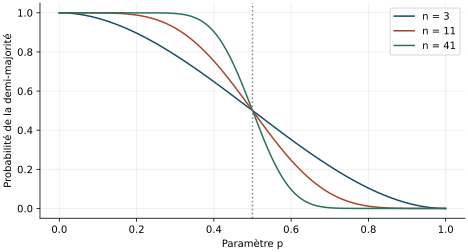

# B/L · Mathématiques · 12 juin 2024 · Corrigé guidé

*Corrigé rédigé par IA, non officiel. Signalez toute erreur.*

**Rédaction** · GPT-6.2 Astra Ultra · vitesse non renseignée

**Un seuil binomial et deux changements de base**

## Préparation à l’oral

Commencer par écrire l’événement binomial et la distance de p au seuil 1/2. Réserver la seconde moitié de la présentation au vecteur de masse un et à la permutation des coordonnées de la dernière matrice.

La préparation dure 90 minutes, sans calculatrice. Le passage dure 30 minutes, dont au plus 15 minutes de présentation. Le rapport recommande de viser 10 à 13 minutes pour garder du temps de discussion.

## Exercice 1 · Succès sous un seuil

Les variables $X_i$ sont indépendantes de loi de Bernoulli de paramètre $p$. On note $S_n=\sum_{i=1}^nX_i$ et $f_n(p)=P(S_n\le n/2)$.

### Question 1.1

> [!INDICATION]
> Lister les entiers admissibles dans chacun des quatre cas.

#### Solution

Posons $q=1-p$. Les $n$ choix de succès indépendants donnent $P(S_n=k)=\binom nk p^kq^{n-k}$. Les quatre expressions sont $f_1=q$, $f_2=q^2+2pq$, $f_3=q^3+3pq^2$ et $f_4=q^4+4pq^3+6p^2q^2$. Le terme central intervient pour les effectifs pairs car l’inégalité est large.

### Question 1.2

> [!INDICATION]
> Le seuil réel peut être remplacé par sa partie entière.

#### Solution

La formule $f_n(p)=\sum_{k=0}^{\lfloor n/2\rfloor}\binom nk p^k(1-p)^{n-k}$ est une somme finie. Chaque terme est un produit de polynômes de degré total au plus $n$. Leur somme a donc degré au plus $n$, et la formule inclut les lois dégénérées $p=0,1$.

### Question 1.3

> [!INDICATION]
> Pour un paramètre strictement d’un côté du seuil, traduire le franchissement du seuil en un écart à la moyenne.

#### Solution

Si $p<1/2$, posons $d=1/2-p>0$. L’événement $S_n/n>1/2$ implique $|S_n/n-p|\ge d$. Sa probabilité est au plus $p(1-p)/(nd^2)$ par Bienaymé–Tchebycheff, puisque l’indépendance donne $V(S_n/n)=p(1-p)/n$. Ainsi $f_n(p)\to1$. Si $p>1/2$, prendre $d=p-1/2$. Cette fois $S_n/n\le1/2$ implique $|S_n/n-p|\ge d$, et la même borne donne $f_n(p)\to0$.

## Exercice 2 · Vecteurs propres et masse

Le modèle de l’énoncé est une multiplication par une matrice $A$ à quatre lignes et colonnes, à coefficients positifs ou nuls. Les trois vecteurs non nuls satisfont $Au=2u$, $Av=3v$, $Aw=w/2$.

### Question 2.1

> [!INDICATION]
> Comparer le nombre de vecteurs à la dimension, puis regarder les valeurs propres.

#### Solution

Trois vecteurs engendrent un sous-espace de dimension au plus 3 dans $\mathbb R^4$. Ils sont libres car ils appartiennent à des espaces propres distincts. Plus explicitement, dans une relation $su+tv+rw=0$, appliquer $(A-3I)(A-I/2)$ annule $v,w$ et donne $-3su/2=0$, donc $s=0$. Appliquer alors $A-I/2$ donne $5tv/2=0$, puis $r=0$. Cette famille libre n’est pas une base de $\mathbb R^4$.

### Question 2.2

> [!INDICATION]
> Choisir les directions propres parmi les vecteurs de la base canonique.

#### Solution

Prendre $A=\operatorname{diag}(2,3,1/2,1)$ et $(u,v,w)=(e_1,e_2,e_3)$. Ces vecteurs ont des coordonnées positives ou nulles, et leurs images sont bien $2e_1,3e_2,e_3/2$.

### Question 2.3

> [!INDICATION]
> Comparer les masses de u et de v avant et après une itération. Une différence de ces vecteurs peut avoir des coordonnées toutes positives ou nulles.

#### Solution

Ici $u=(1,0,0,2)$ et $v=(2,1,1,2)$. Alors $x=(v-u)/3=(1,1,1,0)/3$ est positif ou nul coordonnée par coordonnée et de masse 1. Son image est $(3v-2u)/3=(4,3,3,2)/3$, de masse $12/3=4$ grammes.

### Question 2.4a

> [!INDICATION]
> Chercher deux directions propres pour chacun des deux blocs de taille deux.

#### Solution

Pour $B=\left(\begin{smallmatrix}3&1\\2&4\end{smallmatrix}\right)$, le polynôme caractéristique est $(t-3)(t-4)-2=(t-2)(t-5)$. Les colonnes $(1,-1)$ et $(1,2)$ vérifient respectivement $Bv=2v$ et $Bv=5v$. Pour $C=\left(\begin{smallmatrix}1/2&0\\7/2&4\end{smallmatrix}\right)$, triangulaire, $(1,-1)$ et $(0,1)$ ont pour valeurs propres $1/2$ et $4$. Dans chacun des deux cas les colonnes forment une base. En les réunissant dans $P_B$ et $P_C$, on obtient $P_B^{-1}BP_B=\operatorname{diag}(2,5)$ et $P_C^{-1}CP_C=\operatorname{diag}(1/2,4)$.

### Question 2.4b

> [!INDICATION]
> Pour la seconde matrice, chercher quels couples de coordonnées restent ensemble.

#### Solution

Pour $A=\operatorname{diag}(B,C)$, on prolonge les vecteurs précédents par deux zéros. Dans l’ordre des valeurs propres $2,5,1/2,4$, une base est $(1,-1,0,0)$, $(1,2,0,0)$, $(0,0,1,-1)$, $(0,0,0,1)$. La matrice $A'$ agit par $B$ sur les coordonnées 1 et 3, par $C$ sur les coordonnées 2 et 4. L’échange des coordonnées 2 et 3 dans la base précédente donne $(1,0,-1,0)$, $(1,0,2,0)$, $(0,1,0,-1)$ et $(0,0,0,1)$, avec les mêmes valeurs propres. Une permutation de coordonnées est inversible, donc ces vecteurs forment bien une base.

## Reprise avec le jury

Pourquoi exclure le paramètre 1/2 dans la preuve par concentration ? La distance utilisée devient nulle. Par symétrie de la loi binomiale, pour un nombre impair d’essais la probabilité du côté inférieur vaut exactement 1/2. Pour un nombre pair il faut ajouter la moitié de la probabilité de l’égalité au seuil.
