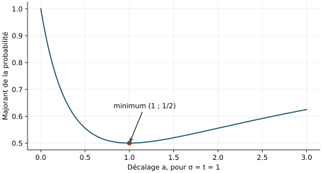

# B/L · Mathématiques · 13 juin 2024 · Planche 1 · Corrigé guidé

*Corrigé rédigé par IA, non officiel. Signalez toute erreur.*

**Rédaction** · GPT-6.2 Astra Ultra · vitesse non renseignée

**Une borne unilatérale et une application multiplicative**

## Préparation à l’oral

Au tableau, consacrer une colonne à l’inclusion d’événements et au choix du décalage. Pour l’algèbre, garder visible la différence entre deux matrices équivalentes et deux matrices semblables. Conclure avec un exemple nilpotent de rang maximal parmi les matrices singulières.

La préparation dure 90 minutes, sans calculatrice. Le passage dure 30 minutes, dont au plus 15 minutes de présentation. Le rapport recommande de viser 10 à 13 minutes pour garder du temps de discussion.

## Exercice 1 · Inégalité unilatérale

La variable réelle $X$ a moyenne $\mu$ et variance $\sigma^2>0$. On pose $Z=X-\mu$.

### Question 1.1

> [!INDICATION]
> Sur l’événement étudié, le terme auquel on applique le carré est positif.

#### Solution

Pour $t>0$ et $a\ge0$, si $Z\ge t$, alors $(Z+a)^2\ge(t+a)^2$. Par l’inégalité de Markov appliquée à la variable positive $(Z+a)^2$, $P(Z\ge t)\le E[(Z+a)^2]/(t+a)^2$. L’espérance vaut $E[Z^2]+2aE[Z]+a^2=\sigma^2+a^2$.

### Question 1.2

> [!INDICATION]
> Le paramètre a est libre. Étudier la fonction qui donne le majorant.

#### Solution

Pour $h(a)=(\sigma^2+a^2)/(t+a)^2$, la dérivée est $h'(a)=2(at-\sigma^2)/(t+a)^3$. La fonction décroît puis croît sur $[0,+\infty[$. Son minimum est atteint en $a=\sigma^2/t$, où la substitution donne $P(Z\ge t)\le\sigma^2/(\sigma^2+t^2)$.

### Question 1.3

> [!INDICATION]
> Appliquer la même inégalité à l’opposé de la variable centrée.

#### Solution

Le choix $t=\sigma$ donne $P(X\ge\mu+\sigma)\le1/2$. La variable $-X$ a moyenne $-\mu$ et même variance. La borne appliquée à $-X$ donne $P(-X+\mu\ge\sigma)=P(X\le\mu-\sigma)\le1/2$.

### Question 1.4

> [!INDICATION]
> Choisir la distance à la médiane elle-même comme seuil, pour obtenir une contradiction stricte.

#### Solution

Une médiane $m$ vérifie $P(X\ge m)\ge1/2$ et $P(X\le m)\ge1/2$. Si $m>\mu+\sigma$, le seuil $t=m-\mu>\sigma$ donnerait $P(X\ge m)\le\sigma^2/(\sigma^2+t^2)<1/2$. Si $m<\mu-\sigma$, appliquer la même preuve à $-X$ et à sa médiane $-m$. Ainsi $|m-\mu|\le\sigma$, égalité admise.

## Exercice 2 · Valeurs nulles d’une application multiplicative

L’application non constante $\varphi:M_n(\mathbb R)\to\mathbb R$ vérifie $\varphi(AB)=\varphi(A)\varphi(B)$. Seule cette identité est disponible.

### Question 2.1a

> [!INDICATION]
> Multiplier la matrice nulle par une matrice quelconque.

#### Solution

Pour tout $A$, $\varphi(0)=\varphi(0)\varphi(A)$. Si $\varphi(0)\ne0$, on pourrait diviser et conclure que toutes les valeurs sont 1, en contradiction avec la non-constance. Donc $\varphi(0)=0$.

### Question 2.1b

> [!INDICATION]
> La non-constance garantit l’existence d’une image non nulle.

#### Solution

Choisissons $A$ tel que $\varphi(A)\ne0$. L’identité $A=IA$ donne $\varphi(A)=\varphi(I)\varphi(A)$ et donc $\varphi(I)=1$.

### Question 2.2

> [!INDICATION]
> Utiliser l’inverse dans un produit.

#### Solution

Si $A$ est inversible, $1=\varphi(I)=\varphi(A)\varphi(A^{-1})$. Les deux facteurs sont non nuls.

### Question 2.3a

> [!INDICATION]
> Passer d’une matrice à l’autre par des changements de bases au départ et à l’arrivée.

#### Solution

Deux matrices de même rang $r$ sont équivalentes. En choisissant dans le départ une base adaptée au noyau et dans l’arrivée une base prolongeant les images de $r$ vecteurs indépendants modulo le noyau, on obtient dans les deux cas la matrice $\operatorname{diag}(I_r,0)$. Ainsi $B=PAQ$ avec $P,Q$ inversibles. Les facteurs $\varphi(P),\varphi(Q)$ sont non nuls, et $\varphi(B)\ne0$ équivaut à $\varphi(A)\ne0$.

### Question 2.3b

> [!INDICATION]
> Calculer l’image d’une puissance.

#### Solution

Si $A^m=0$, alors $m\ge1$ et $\varphi(A)^m=\varphi(A^m)=0$, ce qui impose $\varphi(A)=0$.

### Question 2.3c

> [!INDICATION]
> Construire pour chaque rang strictement inférieur à n une matrice nilpotente de ce rang.

#### Solution

Pour $0\le r<n$, prendre $N$ qui envoie $e_j$ sur $e_{j-1}$ pour $2\le j\le r+1$, et les autres vecteurs de base sur zéro. Son image a pour base $e_1,\ldots,e_r$ et $N^{r+1}=0$. Toute matrice singulière de rang $r$ a donc la même propriété d’annulation de son image que $N$, par 2.3a et 2.3b. Par contraposition, $\varphi(A)\ne0$ impose l’inversibilité. Avec 2.2, on a l’équivalence.

## Reprise avec le jury

Le jury souligne la difficulté de passer du premier majorant au majorant optimal. Pour vérifier le choix du décalage sans dériver, développer la différence entre les deux fractions après réduction au même dénominateur. Son numérateur est un carré. En algèbre, un argument sur le déterminant seul laisserait entière la question de la valeur de l’application.
