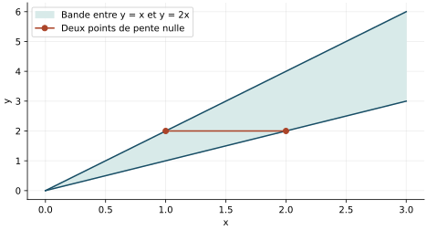

# B/L · Mathématiques · 13 juin 2024 · Planche 2 · Corrigé brut

*Corrigé rédigé par IA, non officiel. Signalez toute erreur.*

**Rédaction** · GPT-6.2 Astra Ultra · vitesse non renseignée

**Loi exponentielle et pente de régression**

## Préparation à l’oral

Présenter d’abord les événements de la loi exponentielle, en écrivant le sens de la condition. Au second exercice, contraster le calcul de la pente sous centrage, le contre-exemple à deux points et l’annulation par symétrie sur le cercle.

La préparation dure 90 minutes, sans calculatrice. Le passage dure 30 minutes, dont au plus 15 minutes de présentation. Le rapport recommande de viser 10 à 13 minutes pour garder du temps de discussion.

## Exercice 1 · Une variable exponentielle

Pour $\lambda>0$, $X$ a densité $\lambda e^{-\lambda x}$ sur $[0,+\infty[$ et fonction de survie $P(X>x)=e^{-\lambda x}$ pour $x\ge0$.

### Question 1.1

La probabilité conditionnelle vaut $(e^{-5\lambda}-e^{-7\lambda})/e^{-\lambda}=e^{-4\lambda}-e^{-6\lambda}=P(4<X\le6)$. Le dénominateur est strictement positif et la loi est continue.

### Question 1.2

Il faut $x\ge0$ et $1-e^{-\lambda x}=1/3$. On obtient $x=\ln(3/2)/\lambda$. La fonction de répartition est strictement croissante sur cette demi-droite, d’où l’unicité. Il s’agit du quantile d’ordre $1/3$, ou premier tercile.

### Question 1.3

On a $E[X]=1$ et $V(X)=1$. Pour $x>0$, $\{X\ge1+x\}\subset\{|X-1|\ge x\}$. Bienaymé–Tchebycheff majore la probabilité de ce second événement par $1/x^2$ pour tout $x>0$, sans évaluer la probabilité de queue.

### Question 1.4

Posons $T=X^2+X^4$. Pour $t<0$, $F_T(t)=0$. Pour $t\ge0$, la fonction $u\mapsto u+u^2$ est strictement croissante sur $[0,+\infty[$, et $u+u^2=t$ y a pour solution $u=(\sqrt{1+4t}-1)/2$. Comme $X\ge0$, on obtient
$$F_T(t)=1-\exp\!\left(-\lambda\sqrt{\frac{\sqrt{1+4t}-1}{2}}\right).$$
Cette expression vaut zéro au raccord $t=0$.

## Exercice 2 · Pente des moindres carrés

Les $n\ge2$ abscisses ne sont pas toutes égales. La pente vaut $a=\sum(x_i-\bar x)(y_i-\bar y)/\sum(x_i-\bar x)^2$. Le dénominateur est strictement positif.

### Question 2.1a

On suppose les ordonnées comprises entre $x_i$ et $2x_i$, quel que soit l’ordre. En multipliant les bornes par $x_i$, et en inversant les inégalités s’il est négatif, on trouve dans les deux cas $x_i^2\le x_i y_i\le2x_i^2$. Si $\bar x=0$, alors $a=\sum x_i y_i/\sum x_i^2$. Sommer et diviser prouve $1\le a\le2$.

### Question 2.1b

Prendre $(x_1,y_1)=(1,2)$ et $(x_2,y_2)=(2,2)$. Les deux points satisfont les bornes, les abscisses diffèrent et la somme des abscisses est 3. Avec une ordonnée constante, le numérateur de la pente centrée est nul. On obtient $a=0$, extérieur à $[1,2]$.

### Question 2.2a

Pour $z\ne1$, $(z-1)\sum_{k=1}^n z^k=\sum_{k=1}^n(z^{k+1}-z^k)=z^{n+1}-z$. La division par $z-1$ fournit la formule.

### Question 2.2b

Posons $z=e^{2\pi i/n}\ne1$. Comme $z^n=1$, $\sum_{k=1}^n z^k=0$. En prenant les parties réelles, $\sum_{k=1}^n\cos(2k\pi/n)=0$.

### Question 2.2c

Le terme $x_ky_k$ s’annule avec celui du point conjugué, car le cosinus est pair et le sinus impair. Les points de l’axe réel ont $y_k=0$ et contribuent zéro. Ainsi $\sum x_ky_k=0$. Par 2.2b, $\bar x=0$, et $\sum x_k^2>0$ puisque $x_n=1$. On obtient $a=0$, y compris pour $n=2$.

## Reprise avec le jury

Pourquoi la formule géométrique ne s’applique-t-elle pas toujours à la somme des sinus des angles doublés ? Pour deux points, la racine de l’unité au carré vaut 1. On peut traiter ce cas séparément ou regrouper dès le départ les points du cercle par conjugaison.
