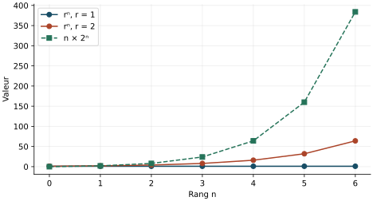

# B/L · Mathématiques · 15 juin 2024 · Planche 1 · Corrigé brut

*Corrigé rédigé par IA, non officiel. Signalez toute erreur.*

**Rédaction** · GPT-6.2 Astra Ultra · vitesse non renseignée

**Probabilité de coïncidence et récurrence d’ordre deux**

## Préparation à l’oral

Séparer le passage aux probabilités limites de l’inégalité de Cauchy–Schwarz à rang fini. Pour la récurrence, inscrire les deux valeurs initiales sous chaque solution candidate. Ce test permet de repérer immédiatement le cas de la racine double nulle.

La préparation dure 90 minutes, sans calculatrice. Le passage dure 30 minutes, dont au plus 15 minutes de présentation. Le rapport recommande de viser 10 à 13 minutes pour garder du temps de discussion.

## Exercice 1 · Deux lois discrètes

Les variables indépendantes $X,Y$ prennent leurs valeurs dans $\mathbb N$. Écrivons $p_X(i)=P(X=i)$ et de même pour $Y$.

### Question 1.1

Les événements $\{X=i\}$ sont disjoints et leur union pour $i\ge0$ est l’univers. Par additivité dénombrable, $\sum_{i=0}^{\infty}p_X(i)=1$.

### Question 1.2

Une suite réelle croissante et majorée converge vers sa borne supérieure $a$. Les événements $D_n=\{X=Y,\ X\le n\}$ croissent vers $\{X=Y\}$ car les valeurs de $X$ sont entières finies. La continuité croissante donne $P(X=Y)=\lim P(D_n)\le\lim a_n=a$.

### Question 1.3

Les événements $\{X=i,Y=i\}$ sont disjoints. L’indépendance donne $P(D_n)=\sum_{i=0}^n p_X(i)p_Y(i)$. Par Cauchy–Schwarz appliquée aux deux vecteurs de $\mathbb R^{n+1}$, ce produit scalaire est majoré par $\sqrt{\sum_{i=0}^n p_X(i)^2}\sqrt{\sum_{i=0}^n p_Y(i)^2}$.

### Question 1.4

Chaque probabilité est entre 0 et 1, donc $p_X(i)^2\le p_X(i)$. Les sommes partielles des carrés croissent et sont majorées par 1, de même pour $Y$. Leur produit et sa racine convergent par continuité. La limite de 1.3 donne $P(X=Y)\le\sqrt{\sum_{i\ge0}p_X(i)^2\sum_{j\ge0}p_Y(j)^2}$.

## Exercice 2 · Suites de longueur finie

Dans $\mathbb R^{N+1}$, avec $N\ge2$, on impose $u_{n+2}=a u_{n+1}+bu_n$ pour $0\le n\le N-2$. On note $E$ l’ensemble des solutions.

### Question 2.1

Pour chaque $n$, $L_n(u)=u_{n+2}-au_{n+1}-bu_n$ est linéaire. Comme $E=\bigcap_{n=0}^{N-2}\ker L_n$, c’est un sous-espace.

### Question 2.2

L’application $u\mapsto(u_0,u_1)$ est linéaire. Son noyau est nul car deux premiers termes nuls entraînent par récurrence la nullité de tous les suivants. Pour toute paire $(s,t)$, poser $u_0=s,u_1=t$ puis appliquer la relation pas à pas construit une préimage. C’est un isomorphisme, donc $\dim E=2$.

### Question 2.3

La suite géométrique $(1,r,\ldots,r^N)$ doit vérifier $r^2=ar+b$. Réciproquement cette identité multipliée par $r^n$ donne la relation à tout rang. Les paramètres convenables sont exactement les racines réelles de $p(r)=r^2-ar-b$.

### Question 2.4a

Pour des racines distinctes $r,s$, les solutions $v_r,v_s$ ont pour couples initiaux $(1,r),(1,s)$, de déterminant $s-r\ne0$. Dans l’espace de dimension deux elles forment une base. Ainsi $u_n=A r^n+B s^n$ pour deux constantes uniques déterminées par $u_0,u_1$, avec une valeur initiale 1 pour chaque puissance de rang zéro.

### Question 2.4b

Une racine double $r$ donne $a=2r$, $b=-r^2$. Si $r\ne0$, $w_n=nr^n$ vérifie $2r w_{n+1}-r^2 w_n=(2n+2-n)r^{n+2}=w_{n+2}$. Ses premiers termes $(0,r)$ sont indépendants de $(1,r)$. Une base est $(v_r,w)$ et $u_n=(A+Bn)r^n$. Si $r=0$, alors $a=b=0$, donc $u_2=\cdots=u_N=0$. Une base explicite est $(1,0,0,\ldots)$, $(0,1,0,\ldots)$, et la solution générale est $(u_0,u_1,0,\ldots,0)$.

### Question 2.5a

Les racines de $t^2+2t-3$ sont $1$ et $-3$. On a $u_n=A+B(-3)^n$, avec $A+B=0$ et $A-3B=1$. D’où $u_n=(1-(-3)^n)/4$ pour $0\le n\le N$.

### Question 2.5b

Le polynôme $t^2-4t+4=(t-2)^2$ donne $u_n=(A+Bn)2^n$. Les conditions initiales imposent $A=0$ et $2B=1$. Ainsi $u_n=n2^{n-1}$, y compris $u_0=0$.

## Reprise avec le jury

Pourquoi la deuxième famille suggérée par le sujet devient-elle inutilisable si la racine double est nulle ? Le vecteur de terme général $nr^n$ est alors nul. La récurrence impose seulement que les termes de rang au moins deux soient nuls. On conserve donc deux degrés de liberté, qui correspondent aux deux premiers vecteurs canoniques.
