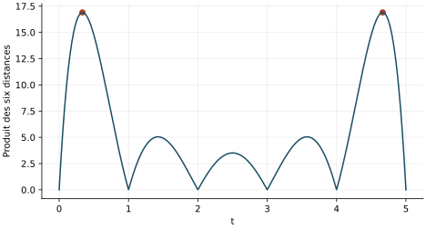

# B/L · Mathématiques · 15 juin 2024 · Planche 2 · Corrigé brut

*Corrigé rédigé par IA, non officiel. Signalez toute erreur.*

**Rédaction** · GPT-6.2 Astra Ultra · vitesse non renseignée

**Cent événements de même probabilité et maximum d’un produit**

## Préparation à l’oral

Faire varier la dépendance des indicatrices avant de calculer ce qui reste fixé, leur espérance totale. Dans l’exercice d’analyse, présenter la symétrie puis comparer des points distants d’une unité. N’aborder la dérivée qu’une fois ramené au premier intervalle.

La préparation dure 90 minutes, sans calculatrice. Le passage dure 30 minutes, dont au plus 15 minutes de présentation. Le rapport recommande de viser 10 à 13 minutes pour garder du temps de discussion.

## Exercice 1 · Indicatrices

Chacun des 100 événements $B_k$ a probabilité $1/100$. Notons $X_k$ son indicatrice et $S=\sum_{k=1}^{100}X_k$ le nombre d’événements réalisés.

### Question 1.1

Sous l’hypothèse d’indépendance, $S$ suit $\mathcal B(100,1/100)$. Pour $0\le j\le100$, $P(S=j)=\binom{100}{j}(1/100)^j(99/100)^{100-j}$.

### Question 1.2

Si les événements sont deux à deux disjoints, au plus un survient, et leur union a probabilité $100/100=1$. Donc $S=1$ presque sûrement, de loi de Dirac en 1.

### Question 1.3

Pour toute dépendance des événements, $E[S]=\sum E[X_k]=\sum P(B_k)=1$.

### Question 1.4

$\operatorname{Cov}(X_i,X_j)=P(B_i\cap B_j)-1/10000$. L’intersection a probabilité entre 0 et $1/100$, d’où les bornes $-1/10000$ et $99/10000$. Le raisonnement vaut aussi pour $i=j$, cas où la borne supérieure est atteinte.

### Question 1.5

Comme $0\le S\le100$, $S^2\le100S$. Ainsi $E[S^2]\le100$. Si tous les $B_k$ sont le même événement de probabilité $1/100$, $S$ prend seulement les valeurs 100 et 0. Alors $E[S^2]=100^2/100=100$, qui est donc atteint.

## Exercice 2 · Produit de distances aux entiers

On étudie $f(t)=\prod_{k=0}^{n}|t-k|$ sur $[0,n]$, pour $n\ge2$.

### Question 2.1a

Le produit des valeurs absolues est continu. Par le théorème des bornes atteintes sur le compact $[0,n]$, son maximum existe. Il est strictement positif car $f(1/2)>0$.

### Question 2.1b

$|n-t-k|=|t-(n-k)|$. L’indice $n-k$ parcourt les mêmes entiers, donc $f(n-t)=f(t)$. À tout maximum dans la moitié droite correspond un maximum dans $[0,n/2]$.

### Question 2.1c

Pour $t\in[1,n]$ non entier, les facteurs communs donnent $f(t-1)/f(t)=|t-n-1|/|t|=(n+1-t)/t$. Pour $1\le t\le n/2$ ce rapport est strictement supérieur à 1. Un maximum positif ne se trouve en aucun entier. Si un point maximisant dans la moitié gauche avait $t\ge1$, le point $t-1$ donnerait davantage. Il existe donc un maximum dans $]0,1[$.

### Question 2.2a

Aucun facteur ne s’annule sur $]0,1[$. On y a $\ln f(t)=\sum_{k=0}^n\ln|t-k|$, somme de fonctions dérivables. En dérivant puis en utilisant $f=\exp(\ln f)$, $f'(t)/f(t)=g(t)=\sum_{k=0}^n1/(t-k)$.

### Question 2.2b

On a $g'(t)=-\sum_{k=0}^n1/(t-k)^2<0$. En $0^+$ le terme $1/t$ tend vers $+\infty$ et tous les autres ont une limite finie. En $1^-$ le terme $1/(t-1)$ tend vers $-\infty$. Par continuité et stricte décroissance, $g$ possède un unique zéro $t_n$. Comme $f>0$, $f'$ est positive avant ce zéro et négative après. Ainsi $t_n$ est l’unique maximum dans $]0,1[$. L’équation $g(t_n)=0$ donne $1/t_n=\sum_{k=1}^n1/(k-t_n)$.

## Reprise avec le jury

La comparaison de deux points distants d’une unité entraîne-t-elle la monotonie sur toute la demi-planche ? Les entiers intermédiaires sont des zéros et la fonction reprend des valeurs positives entre eux. Le raisonnement transporte les candidats au maximum jusqu’à la première maille, où le signe de la dérivée tranche.
