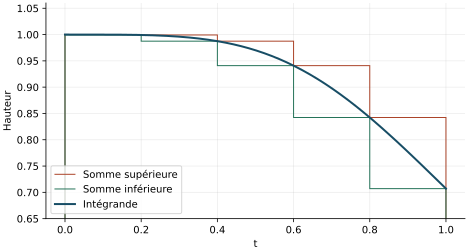

# B/L · Mathématiques · 18 juin 2024 · Planche 1 · Corrigé brut

*Corrigé rédigé par IA, non officiel. Signalez toute erreur.*

**Rédaction** · GPT-6.2 Astra Ultra · vitesse non renseignée

**Une intégrale symétrique et l’énergie d’une projection**

## Préparation à l’oral

Présenter la comparaison à une intégrale convergente avant le changement de variable qui donne la valeur de la limite. Dans le second exercice, conserver au tableau une base orthonormée adaptée et distinguer l’égalité de matrices du calcul en espérance.

La préparation dure 90 minutes, sans calculatrice. Le passage dure 30 minutes, dont au plus 15 minutes de présentation. Le rapport recommande de viser 10 à 13 minutes pour garder du temps de discussion.

## Exercice 1 · Intégrale de 1 sur la racine de 1 plus t puissance quatre

Écrivons $f(t)=(1+t^4)^{-1/2}$ et $F(x)=\int_0^x f(t)\,dt$ pour $x\ge0$.

### Question 1.1

L’intégrande est continue sur $[0,+\infty[$. Donc $F$ est de classe $C^1$, avec dérivée à droite en zéro, et $F'(x)=1/\sqrt{1+x^4}>0$. Ainsi $F$ est strictement croissante et $F(0)=0$.

### Question 1.2

Pour $x\ge1$, $0\le F(x)-F(1)\le\int_1^x t^{-2}\,dt=1-1/x\le1$. Pour $x\le1$, la croissance donne $F(x)\le F(1)$. Croissante et majorée, $F$ a donc une limite finie $\ell$.

### Question 1.3

Pour $R>1$, poser $s=1/t$ dans $\int_1^R (1+t^4)^{-1/2}\,dt$. Puisque $t>0$, $\sqrt{1+t^4}=\sqrt{1+s^4}/s^2$ et $dt=-ds/s^2$. L’intégrale devient $\int_{1/R}^1(1+s^4)^{-1/2}\,ds$, dont la limite est $F(1)$ par continuité en 0. D’où $\ell=F(1)+F(1)=2F(1)$.

### Question 1.4a

La fonction $f$ décroît. Pour $(k-1)/n\le t\le k/n$, $f(k/n)\le f(t)\le f((k-1)/n)$. Intégrer sur cet intervalle puis sommer pour $1\le k\le n$ donne $s_n\le F(1)\le S_n$, avec $s_n$ la somme des valeurs aux bouts droits divisée par $n$, $S_n$ celle des bouts gauches divisée par $n$.

### Question 1.4b

Par télescopage $S_n-s_n=(f(0)-f(1))/n=(1-1/\sqrt2)/n$. La largeur tend vers zéro. Les deux sommes encadrent donc la même valeur avec une erreur au plus égale à cette largeur.

## Exercice 2 · Projection d’un vecteur aléatoire

Les coordonnées $X_1,\ldots,X_n$ du vecteur $X$ sont indépendantes, centrées et de même variance $\sigma^2$. La matrice $P$ projette orthogonalement sur un sous-espace $H$ de dimension $k$.

### Question 2.1

Pour tout $i$, $(PX)_i=\sum_{j=1}^n P_{ij}X_j$. Ses termes ont une espérance et $E[(PX)_i]=\sum_jP_{ij}E[X_j]=0$.

### Question 2.2

Comme $E[X_i]=0$, $E[X_i^2]=V(X_i)=\sigma^2$. Par additivité $E[\|X\|^2]=\sum_i E[X_i^2]=n\sigma^2$.

### Question 2.3a

Compléter une base orthonormée de $H$ par une de $H^\perp$. Si $Q$ est la matrice orthogonale de cette base, $P=QDQ^T$ où $D=\operatorname{diag}(I_k,0)$. Ainsi $P^T=P$, $P^2=QD^2Q^T=P$, et l’invariance de la trace par changement de base donne $\operatorname{tr}P=k$.

### Question 2.3b

Le carré de la norme vaut $(PX)^T(PX)=X^TP^TPX=X^TPX$. En coordonnées, c’est $\sum_{i,j}P_{ij}X_iX_j$. Si $i\ne j$, l’indépendance et le centrage donnent $E[X_iX_j]=0$. Pour $i=j$, le moment vaut $\sigma^2$. Les produits sont intégrables par Cauchy–Schwarz. Ainsi $E[\|PX\|^2]=\sigma^2\sum_iP_{ii}=k\sigma^2$.

### Question 2.3c

On a $X=PX+(I-P)X$ avec un terme dans $H$ et l’autre dans $H^\perp$. Pythagore donne $\|(I-P)X\|^2=\|X\|^2-\|PX\|^2$. L’espérance cherchée est $(n-k)\sigma^2$, y compris zéro quand $k=n$.

## Reprise avec le jury

Pourquoi l’espérance du carré de la longueur projetée dépend-elle seulement de la dimension ? Les produits croisés ont espérance nulle et les carrés des coordonnées ont même espérance. On pourrait remplacer l’indépendance par l’absence de corrélation, en conservant les autres hypothèses.
