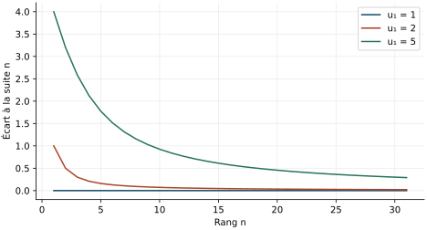

# B/L · Mathématiques · 18 juin 2024 · Planche 2 · Corrigé guidé

*Corrigé rédigé par IA, non officiel. Signalez toute erreur.*

**Rédaction** · GPT-6.2 Astra Ultra · vitesse non renseignée

**Écart à une suite explicite et décomposition en espaces propres**

## Préparation à l’oral

Commencer par la solution de référence puis écrire la récurrence sur son écart. Dans l’exercice d’algèbre, identifier les deux noyaux, établir leur intersection, puis donner la décomposition explicite d’un vecteur avant d’en déduire la base propre.

La préparation dure 90 minutes, sans calculatrice. Le passage dure 30 minutes, dont au plus 15 minutes de présentation. Le rapport recommande de viser 10 à 13 minutes pour garder du temps de discussion.

## Exercice 1 · Une récurrence positive

À partir de $u_1\ge1$, on définit $u_{n+1}=u_n+n/u_n$ pour $n\ge1$.

### Question 1.1

> [!INDICATION]
> Calculer les premiers termes puis identifier une égalité récurrente.

#### Solution

Si $u_1=1$, l’égalité $u_n=n$ est vraie au rang initial et entraîne $u_{n+1}=n+n/n=n+1$. Par récurrence $u_n=n$ à tout rang.

### Question 1.2

> [!INDICATION]
> Une limite finie bornerait tous les dénominateurs.

#### Solution

De $u_1>0$, la récurrence assure $u_n>0$ et $u_{n+1}-u_n=n/u_n>0$. Si la suite était bornée par $M$, on aurait $u_{n+1}-u_n\ge n/M$, puis $u_{n+1}\ge u_1+n(n+1)/(2M)$, contradiction. Une suite croissante non majorée tend vers $+\infty$.

### Question 1.3a

> [!INDICATION]
> Remplacer le numérateur n par u moins son écart.

#### Solution

Pour $u_1>1$, posons $v_n=u_n-n$. Alors $v_{n+1}=v_n+n/u_n-1=v_n-v_n/u_n=v_n(1-1/u_n)$. Ici $f(t)=1-1/t$ pour $t>0$.

### Question 1.3b

> [!INDICATION]
> Observer le signe et la taille de chaque multiplicateur.

#### Solution

Comme $u_n\ge u_1>1$, tous les facteurs $1-1/u_n$ sont dans $]0,1[$. Le terme initial $v_1>0$ reste strictement positif et $v_{n+1}<v_n$. La suite minorée et décroissante admet donc une limite réelle $L\ge0$.

### Question 1.3c

> [!INDICATION]
> Diviser la relation définissant l’écart par n.

#### Solution

On a $u_n/n=1+v_n/n$. Comme $0<v_n\le v_1$, le dernier terme tend vers zéro. Ainsi $u_n/n\to1$.

## Exercice 2 · Un polynôme annulateur

L’endomorphisme réel $f$ vérifie $f^2-8f+15I=0$. Nous cherchons des espaces propres qui engendrent $\mathbb R^n$.

### Question 2.1

> [!INDICATION]
> Factoriser le polynôme scalaire avant de remplacer son indéterminée.

#### Solution

On a $t^2-8t+15=(t-3)(t-5)$. Les scalaires $a=3,b=5$ conviennent, puisque $(f-aI)(f-bI)=f^2-(a+b)f+abI=0$.

### Question 2.2

> [!INDICATION]
> Choisir une base dans chacun des deux noyaux supposés supplémentaires.

#### Solution

Pour $x\in\ker(f-aI)$ on a $f(x)=ax$, et pour $x\in\ker(f-bI)$ on a $f(x)=bx$. La réunion de deux bases de ces noyaux supplémentaires est une base de l’espace. La matrice y est diagonale avec des coefficients $a$ ou $b$, donc $f$ est diagonalisable.

### Question 2.3a

> [!INDICATION]
> Appliquer les deux relations propres au même vecteur.

#### Solution

Pour $x$ dans l’intersection, $ax=f(x)=bx$ et $(a-b)x=0$. Puisque $a\ne b$, l’intersection est réduite à $\{0\}$.

### Question 2.3b

> [!INDICATION]
> Chercher les composantes en combinant x et f(x).

#### Solution

Pour tout $x$, poser $u=(f-bI)x/(a-b)$ et $v=(f-aI)x/(b-a)$. Le calcul donne $u+v=x$. Le produit annulateur donne $(f-aI)u=0$, et les deux facteurs polynomiaux en $f$ commutent, d’où $(f-bI)v=0$. Tout vecteur appartient donc à la somme des noyaux. Avec 2.3a, celle-ci est directe.

## Reprise avec le jury

Peut-on passer à la limite dans la récurrence en gardant n dans une égalité supposée entre constantes ? Pour une limite finie positive, le terme ajouté deviendrait arbitrairement grand. Une sommation de minorants contradictoires évite toute ambiguïté. En algèbre, l’une des deux valeurs propres possibles peut être absente, par exemple lorsque f est scalaire.
