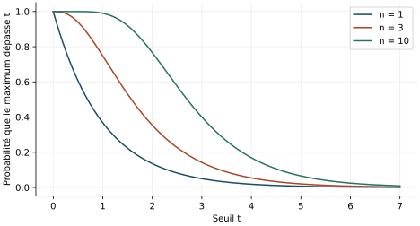

# B/L · Mathématiques · 19 juin 2024 · Planche 1 · Corrigé guidé

*Corrigé rédigé par IA, non officiel. Signalez toute erreur.*

**Rédaction** · GPT-6.2 Astra Ultra · vitesse non renseignée

**Le maximum d’exponentielles et les prix compatibles avec neuf trocs**

## Préparation à l’oral

Relier la densité du maximum à l’aire sous la courbe de survie. Écrire l’intégration par parties sur un intervalle fini avant de passer à la limite. Pour les fruits, traduire l’équilibre d’un troc par un produit scalaire puis compter les dimensions.

La préparation dure 90 minutes, sans calculatrice. Le passage dure 30 minutes, dont au plus 15 minutes de présentation. Le rapport recommande de viser 10 à 13 minutes pour garder du temps de discussion.

## Exercice 1 · Le dernier de n temps exponentiels

Les $X_i$ sont indépendantes de loi exponentielle de paramètre 1. On pose $M_n=\max(X_1,\ldots,X_n)$.

### Question 1.1

> [!INDICATION]
> Que doit vérifier chaque observation pour que le maximum soit au plus t ?

#### Solution

L’événement $\{M_n\le t\}$ est l’intersection des $\{X_i\le t\}$. Par indépendance, $F_n(t)=0$ pour $t<0$ et $F_n(t)=(1-e^{-t})^n$ pour $t\ge0$. Cette fonction est continue, de classe $C^1$ par morceaux. Une densité est nulle pour $t\le0$ et vaut $f_n(t)=ne^{-t}(1-e^{-t})^{n-1}$ pour $t>0$. La valeur choisie en zéro ne modifie aucune probabilité.

### Question 1.2

> [!INDICATION]
> Comparer le maximum à une variable dont l’espérance est immédiate.

#### Solution

Les $X_i$ étant positives presque sûrement, $0\le M_n\le\sum_i X_i$. Chacune a espérance 1. Par monotonie et linéarité de l’espérance, $M_n$ est intégrable et $E[M_n]\le n$.

### Question 1.3

> [!INDICATION]
> Un dépassement du maximum nécessite au moins un dépassement individuel.

#### Solution

Pour $t\ge0$, $1-F_n(t)=P(\bigcup_i\{X_i>t\})\le ne^{-t}$. Ainsi $0\le t(1-F_n(t))\le nt e^{-t}\to0$ pour chaque $n$ fixé.

### Question 1.4

> [!INDICATION]
> Prendre pour primitive de la densité une fonction qui s’annule à l’infini.

#### Solution

Sur $[0,R]$, une intégration par parties avec $F_n-1$ donne
$$\int_0^R t f_n(t)\,dt=-R(1-F_n(R))+\int_0^R(1-F_n(t))\,dt.$$
Le terme au bord tend vers zéro par 1.3. Le membre de gauche tend vers $E[M_n]$ par la formule de transfert et l’intégrabilité de 1.2. Il en résulte $E[M_n]=\int_0^\infty(1-F_n(t))\,dt$.

### Question 1.5

> [!INDICATION]
> Poser y égal à la fonction de répartition d’une seule observation.

#### Solution

Pour $y=1-e^{-t}$, $dy=(1-y)dt$. Les bornes 0 et $+\infty$ deviennent 0 et 1. D’où $E[M_n]=\int_0^1(1-y^n)/(1-y)\,dy$. Pour $0\le y<1$, le quotient vaut $1+y+\cdots+y^{n-1}$ et il se prolonge en 1 par $n$. L’intégration de cette somme finie donne $E[M_n]=\sum_{k=1}^n1/k$.

## Exercice 2 · Prix et trocs

Les vecteurs $x,y\in\mathbb R^{10}$, à coordonnées strictement positives, représentent deux systèmes de prix. Un vecteur $v_j$ encode les quantités demandées moins les quantités données dans le troc $j$.

### Question 2.1

> [!INDICATION]
> Calculer la différence de valeur entre les deux côtés du troc.

#### Solution

Pour Xavier, le prix des fruits demandés moins celui des fruits donnés est $\sum_i x_i(v_j)_i=x\cdot v_j$. L’hypothèse d’équilibre annule cette différence. Le même calcul avec $y$ donne $y\cdot v_j=0$. Les deux vecteurs sont orthogonaux à chacun des neuf trocs.

### Question 2.2

> [!INDICATION]
> Examiner la première coordonnée d’une relation, puis la suivante.

#### Solution

Dans le cas proposé $v_j=-e_j+2e_{j+1}$. Si $\sum_{j=1}^9 a_jv_j=0$, la première coordonnée donne $-a_1=0$. Les coordonnées de rang $i$ entre 2 et 9 donnent $2a_{i-1}-a_i=0$. De proche en proche, tous les coefficients sont nuls, ce qui établit la liberté.

### Question 2.3a

> [!INDICATION]
> Prendre l’orthogonal du sous-espace engendré par les neuf propositions.

#### Solution

Si la famille est libre, son sous-espace engendré $V$ a dimension 9. Alors $\dim V^\perp=10-9=1$. Les vecteurs non nuls $x,y$ lui appartiennent, donc $y=cx$ avec $c\ne0$, et même $c>0$ par positivité des coordonnées. Pour tout nouveau troc $w$, $y\cdot w=c(x\cdot w)$, ce qui donne l’équivalence des deux jugements d’équilibre.

### Question 2.3b

> [!INDICATION]
> Tester un changement commun d’unité monétaire.

#### Solution

Rien n’impose $c=1$. Dans l’exemple des trocs $v_j=-e_j+2e_{j+1}$, choisir $x_j=2^{10-j}$ et $y_j=2x_j$. Chaque prix est positif et $-x_j+2x_{j+1}=0$, de même pour $y$. Les neuf trocs sont indépendants et équilibrés mais $x\ne y$.

## Reprise avec le jury

La positivité des prix fixe-t-elle leur échelle ? Si tous les prix doublent, chaque troc équilibré le reste. Une unité de prix imposée pour un fruit permettrait en revanche de déterminer le facteur de proportionnalité. Pour le maximum, demander en reprise pourquoi la majoration de sa densité par une constante ne suffirait pas à justifier l’intégrabilité du premier moment.

Les neuf questions sont regroupées page 1 du PDF institutionnel. La page 2 reprend les consignes de préparation et de passage.
