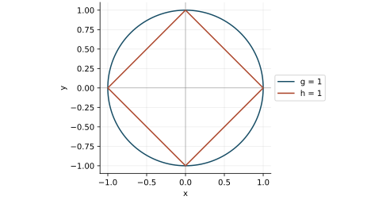

# B/L · Mathématiques · 19 juin 2024 · Planche 2 · Corrigé guidé

*Corrigé rédigé par IA, non officiel. Signalez toute erreur.*

**Rédaction** · GPT-6.2 Astra Ultra · vitesse non renseignée

**Un prix multiplicatif et trois fonctions de deux variables**

## Préparation à l’oral

Garder visibles les deux moments du rendement et utiliser l’indépendance avant de calculer la variance. Pour l’analyse, dessiner d’abord les deux diagonales passant par l’origine puis un cercle et un losange de même niveau.

La préparation dure 90 minutes, sans calculatrice. Le passage dure 30 minutes, dont au plus 15 minutes de présentation. Le rapport recommande de viser 10 à 13 minutes pour garder du temps de discussion.

## Exercice 1 · Multiplicateurs indépendants

Le prix vaut $X_0=1$ et $X_n=R_n X_{n-1}$, les $R_i$ indépendants prenant chacun $1-a$ et $1+a$ avec probabilités $1/2$, pour $0<a<1$.

### Question 1.1

> [!INDICATION]
> Dérouler la récurrence pour faire apparaître un produit de variables indépendantes.

#### Solution

Pour $n\ge1$, $X_n=\prod_{i=1}^n R_i$. Or $E[R_i]=((1-a)+(1+a))/2=1$. L’indépendance donne $E[X_n]=1^n=1$. Le résultat vaut aussi au rang zéro car $X_0=1$.

### Question 1.2

> [!INDICATION]
> Faire le même calcul pour le second moment, puis soustraire le carré de la moyenne.

#### Solution

On a $E[R_i^2]=((1-a)^2+(1+a)^2)/2=1+a^2$. Les carrés sont indépendants et $E[X_n^2]=(1+a^2)^n$. Ainsi $V(X_n)=(1+a^2)^n-1$ pour $n\ge0$, où l’on retrouve $V(X_0)=0$.

### Question 1.3

> [!INDICATION]
> Seul le deuxième multiplicateur est indépendant du premier prix.

#### Solution

Comme $X_1X_2=R_1^2R_2$, $E[X_1X_2]=E[R_1^2]E[R_2]=1+a^2$. Les deux prix ont moyenne 1, donc $\operatorname{Cov}(X_1,X_2)=a^2$.

### Question 1.4

> [!INDICATION]
> Utiliser le produit des deux valeurs possibles dans la somme des logarithmes.

#### Solution

Les deux rendements sont strictement positifs et $m=E[\ln R_1]=\frac12\ln((1-a)(1+a))=\frac12\ln(1-a^2)<0$, car $0<1-a^2<1$.

### Question 1.5

> [!INDICATION]
> Choisir un seuil logarithmique strictement entre la moyenne m et zéro.

#### Solution

Les logarithmes des rendements sont indépendants, de même loi, de variance finie car ils n’ont que deux valeurs. La loi faible des grands nombres donne $n^{-1}\ln X_n=n^{-1}\sum_i\ln R_i\to m$ en probabilité. Choisissons $\delta=-m/2>0$. Si $X_n\ge e^{-\delta n}$, alors $n^{-1}\ln X_n\ge m/2$, ce qui impose un écart à $m$ d’au moins $-m/2>0$. La probabilité tend donc vers zéro. Avec une probabilité tendant vers 1, le prix est inférieur au seuil décroissant $e^{-\delta n}$.

## Exercice 2 · Courbes de niveau et extrema

Pour tout couple réel, posons $f(x,y)=xy$, $g(x,y)=x^2+y^2$ et $h(x,y)=(|x|+|y|)^2$.

### Question 2.1

> [!INDICATION]
> Développer h et exploiter le carré de la différence des valeurs absolues.

#### Solution

Le carré $(|x|-|y|)^2$ est positif ou nul, donc $2|xy|\le x^2+y^2=g$. Par développement $h=g+2|xy|$, d’où $g\le h\le2g$. Cela donne toutes les inégalités dans le bon ordre.

### Question 2.2

> [!INDICATION]
> Comparer les valeurs le long des deux diagonales au voisinage de l’origine.

#### Solution

Le gradient de $f$ vaut $(y,x)$, donc le seul point critique est $(0,0)$, où $f=0$. Pour tout $t\ne0$, $f(t,t)=t^2>0$ et $f(t,-t)=-t^2<0$. Ces deux types de points existent dans tout voisinage de l’origine. Elle est un point selle, sans maximum ni minimum local.

### Question 2.3

> [!INDICATION]
> Pour chaque niveau, fixer le signe de la constante puis prendre la racine carrée.

#### Solution

Au niveau $c<0$, les deux ensembles sont vides. Au niveau 0, chacun se réduit à l’origine. Pour $c>0$, la ligne $g=c$ est le cercle de centre 0 et de rayon $\sqrt c$. La ligne $h=c$ est le losange $|x|+|y|=\sqrt c$, de sommets $(\pm\sqrt c,0)$ et $(0,\pm\sqrt c)$. Toutes les autres courbes positives se déduisent de celles du dessin par homothétie de rapport $\sqrt c$.

### Question 2.4

> [!INDICATION]
> Rester hors des axes tout en s’en approchant.

#### Solution

Pour $x=1$ et $y=1/n$ avec $n\ge1$, $g/|f|=(1+1/n^2)/(1/n)=n+1/n$. Cette quantité n’est pas bornée alors que les deux coordonnées restent non nulles. Aucune constante $C$ ne satisfait l’inégalité universelle.

## Reprise avec le jury

Comment un prix de moyenne constante peut-il se trouver sous un seuil exponentiellement petit avec probabilité tendant vers un ? La moyenne est sensible aux très grandes valeurs rares. La convergence obtenue est en probabilité et ne permet pas à elle seule de passer à la limite dans les espérances.
