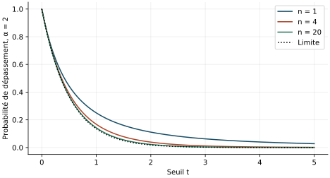

# B/L · Mathématiques · 21 juin 2024 · Planche 1 · Corrigé brut

*Corrigé rédigé par IA, non officiel. Signalez toute erreur.*

**Rédaction** · GPT-6.2 Astra Ultra · vitesse non renseignée

**Minimum de variables de Pareto et valeur initiale critique**

## Préparation à l’oral

Commencer par la survie de la loi de Pareto, qui suffit pour le minimum et pour la partie entière supérieure. Dans la récurrence, écrire le quotient de deux termes, puis choisir entre le raisonnement par monotonie et le passage aux logarithmes pour construire le seuil.

La préparation dure 90 minutes, sans calculatrice. Le passage dure 30 minutes, dont au plus 15 minutes de présentation. Le rapport recommande de viser 10 à 13 minutes pour garder du temps de discussion.

## Exercice 1 · Une loi à queue de puissance

Pour $\alpha>0$, $X$ a densité nulle jusqu’à 1 puis $\alpha x^{-\alpha-1}$ pour $x>1$.

### Question 1.1

Si $t\le1$, $P(X>t)=1$. Si $t>1$, $P(X>t)=\int_t^\infty\alpha x^{-\alpha-1}\,dx=t^{-\alpha}$. Les deux expressions se raccordent en 1.

### Question 1.2

Comme $X>1$ presque sûrement, sa moyenne est finie exactement quand $\alpha\int_1^\infty x^{-\alpha}\,dx$ converge. Si $\alpha=1$ la divergence est logarithmique, et si $0<\alpha<1$ la primitive croît comme une puissance positive. Pour $\alpha>1$, l’intégrale donne $E[X]=\alpha/(\alpha-1)$.

### Question 1.3

Puisque $\ln X>0$ presque sûrement, $Y=\lceil\ln X\rceil$ est dans $\mathbb N^*$. Pour $k\ge1$, l’événement $Y=k$ s’écrit $e^{k-1}<X\le e^k$. En soustrayant les survies on obtient $P(Y=k)=e^{-\alpha(k-1)}-e^{-\alpha k}=(1-e^{-\alpha})(e^{-\alpha})^{k-1}$. C’est la loi géométrique sur $\mathbb N^*$ de paramètre $1-e^{-\alpha}$.

### Question 1.4

Pour $Y_n=\min(X_1,\ldots,X_n)$, $Y_n>1$ presque sûrement. Pour $t\le0$, $P(n(Y_n-1)>t)=1$. Pour $t>0$, par indépendance, la probabilité vaut $(1+t/n)^{-n\alpha}$. Son logarithme tend vers $-\alpha t$ car $\ln(1+h)/h\to1$. La limite vaut donc $e^{-\alpha t}$ pour $t>0$. C’est la survie d’une loi exponentielle de paramètre $\alpha$.

## Exercice 2 · Réitérer un carré

La valeur initiale est $u_0>0$ et $u_{n+1}=u_n^2/(n+1)$. Par récurrence tous les termes sont strictement positifs.

### Question 2.1

Une éventuelle limite finie $L$ satisfait $u_n^2/(n+1)\to0$. Le membre de gauche, $u_{n+1}$, tend aussi vers $L$. Ainsi $L=0$. La positivité exclut $-\infty$, donc les seules limites possibles sont 0 et $+\infty$.

### Question 2.2a

On a $u_{n+1}/u_n=u_n/(n+1)$. Si $u_{p+1}\le u_p$, alors $u_p\le p+1$ et $u_{p+1}\le p+1<p+2$, donc $u_{p+2}<u_{p+1}$. Le même argument se propage par récurrence. La suite est finalement décroissante et minorée par 0. Sa limite finie est 0 par 2.1.

### Question 2.2b

Si aucun rang ne vérifie l’hypothèse, alors $u_{n+1}>u_n$ pour tout $n$. La suite est strictement croissante. Bornée, elle aurait une limite finie au moins égale à $u_0>0$, impossible par 2.1. Elle tend donc vers $+\infty$.

### Question 2.3

Si $u_p\le p+1$, le quotient $u_{p+1}/u_p$ est au plus 1. La condition de 2.2a s’applique, et $u_n\to0$.

### Question 2.4

Si $u_n\ge n+2$, alors $u_{n+1}\ge(n+2)^2/(n+1)=n+3+1/(n+1)>n+3$. Une telle inégalité au rang $p$ se propage à tout $n\ge p$. La borne $u_n\ge n+2$ impose la divergence vers $+\infty$.

### Question 2.5

Posons $w_n=2^{-n}\ln u_n$. Pour $k\ge1$, $w_k=w_{k-1}-2^{-k}\ln k$, donc $w_n=\ln u_0-\sum_{k=1}^n2^{-k}\ln k$. La série des termes positifs converge. En effet $k\le2^{k-1}$ par récurrence et $\sum_{k\ge1}(k-1)/2^k=1$ par dérivation de la série géométrique. Sa somme $s$ vérifie donc $0\le s\le\ln2$. Le nombre $a=e^s$ appartient à $[1,2]$. Si $u_0<a$, alors $w_n\to\ln u_0-s<0$, et $\ln u_n=2^nw_n\to-\infty$, soit $u_n\to0$. Si $u_0>a$, la limite de $w_n$ est strictement positive et $u_n\to+\infty$. Cela établit le seuil demandé.

## Reprise avec le jury

Que devient la suite si la valeur initiale est exactement critique ? Avec la formule logarithmique de la dernière réponse, $\ln u_n=\sum_{j\ge1}2^{-j}\ln(n+j)$. Chaque terme logarithmique est au moins $\ln(n+1)$, et les poids somment à 1. Ainsi $u_n\ge n+1$ et la suite critique tend elle aussi vers l’infini.
