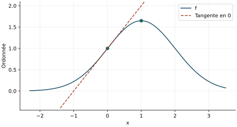

# B/L · Mathématiques · 21 juin 2024 · Planche 2 · Corrigé brut

*Corrigé rédigé par IA, non officiel. Signalez toute erreur.*

**Rédaction** · GPT-6.2 Astra Ultra · vitesse non renseignée

**Une gaussienne translatée et un projecteur oblique**

## Préparation à l’oral

Relier successivement la dérivée, l’intégration sur un segment et la complétion du carré. Réserver le second tableau aux deux formes linéaires qui définissent G et à celle qui fixe la direction du projecteur. Garder les coordonnées de la base trouvée pour la reprise.

La préparation dure 90 minutes, sans calculatrice. Le passage dure 30 minutes, dont au plus 15 minutes de présentation. Le rapport recommande de viser 10 à 13 minutes pour garder du temps de discussion.

## Exercice 1 · Étude d’une exponentielle

On considère sur la droite $f(x)=\exp(x-x^2/2)$.

### Question 1.1

On a $f'(x)=(1-x)f(x)$. Comme $f>0$, elle croît strictement jusqu’à $x=1$ puis décroît strictement, et $f(1)=\sqrt e$. L’exposant $1/2-(x-1)^2/2$ tend vers $-\infty$ aux deux infinis.
 
| Abscisse | $-\infty$ | $1$ | $+\infty$ |
|---|---:|---:|---:|
| Valeur ou limite | $0$ | $\sqrt e$ | $0$ |
| Variation vers la colonne suivante | Croît | Décroît | |

### Question 1.2

On a $xf=f-f'$. Pour $R>0$, $\int_0^R xf(x)\,dx=\int_0^R f(x)\,dx+f(0)-f(R)$. Les deux intégrales convergent à l’infini, par exemple pour $x\ge4$ on a $x-x^2/2\le-x$, et $f(x)\le e^{-x}$, $xf(x)\le xe^{-x}$. Comme $f(0)=1$ et $f(R)\to0$, on obtient $\int_0^\infty xf(x)\,dx=1+\int_0^\infty f(x)\,dx$.

### Question 1.3

Poser $y=x-1$. Alors $x-x^2/2=1/2-y^2/2$ et $dx=dy$. L’intégrale sur la droite vaut $\sqrt e\int_{-\infty}^{+\infty}e^{-y^2/2}\,dy=\sqrt{2\pi e}$, puisque la densité normale centrée réduite s’intègre à 1.

### Question 1.4

Posons $z=x-x^2/2$. Alors $z^2=x^2-x^3+O(x^4)$ et $z^3=x^3+O(x^4)$. La formule $e^z=1+z+z^2/2+z^3/6+O(z^4)$ donne $f(x)=1+x-x^3/3+O(x^4)$. La tangente en zéro est $y=1+x$. À proximité de zéro la courbe est au-dessus à gauche, au-dessous à droite. En outre $f''(x)=x(x-2)f(x)$ change de signe en zéro, qui est un point d’inflexion.

## Exercice 2 · Supplémentaires dans un espace de dimension quatre

On donne $u_1=(2,-1,-3,2)$, $u_2=(3,1,0,5)$ et $F=\operatorname{Vect}(u_1,u_2)$. Le sous-espace $G$ est défini par $L_1=4x+y-z-t=0$ et $L_2=3y-3z+t=0$.

### Question 2.1

L’application $(x,y,z,t)\mapsto(L_1,L_2)$ est linéaire et son noyau est $G$. Celui-ci est donc un sous-espace de $\mathbb R^4$.

### Question 2.2

Les vecteurs $u_1,u_2$ ne sont pas colinéaires, notamment par leurs troisièmes coordonnées. Pour $i=1,2$, $L_1(u_i)=L_2(u_i)=8$. Ainsi $a u_1+b u_2\in G$ si et seulement si $a+b=0$. L’intersection est la droite engendrée par $v=u_2-u_1=(1,2,3,3)$.

### Question 2.3

La famille $(v,u_1)$ est une base de $F$, car $v=u_2-u_1$ et les deux générateurs originels sont libres. Dans $G$, $L_2=0$ donne $t=3(z-y)$, puis $L_1=0$ donne $z=x+y$, donc $t=3x$. Ainsi $G=\{(x,y,x+y,3x)\}$ est de dimension deux. Le vecteur $g=(0,1,1,0)$ appartient à $G$ et n’est pas colinéaire à $v$. Une base est $(v,g)$.

### Question 2.4

$F+G$ est engendré par $(v,u_1,g)$. La formule des dimensions donne $\dim(F+G)=2+2-1=3$. Cette famille génératrice de trois vecteurs est donc une base de $H$.

### Question 2.5a

Posons $L(x,y,z,t)=3x-2y+z+4t$, $S=\ker L$ et $w=(1,1,0,0)$. Comme $L(w)=1$, $L$ est non nulle et $S$ a dimension trois. Si $cw\in S$, $c=L(cw)=0$. La droite $D=\operatorname{Vect}(w)$ et $S$ ont intersection nulle et leurs dimensions totalisent quatre, donc $\mathbb R^4=S\oplus D$.

### Question 2.5b

Le projeté de $u$ est un multiple $cw$ tel que $u-cw\in S$. Cela équivaut à $L(u)-cL(w)=0$, donc $c=L(u)$. Finalement $p(x,y,z,t)=(3x-2y+z+4t)(1,1,0,0)$. La formule fixe $w$ et annule chaque vecteur de $S$.

## Reprise avec le jury

Le projecteur est-il orthogonal ? Son noyau a pour vecteur normal $(3,-2,1,4)$, qui n’est pas colinéaire à $(1,1,0,0)$. La décomposition utilisée reste bien valable, car projeter parallèlement au noyau ne suppose pas l’orthogonalité.
