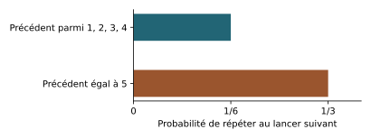
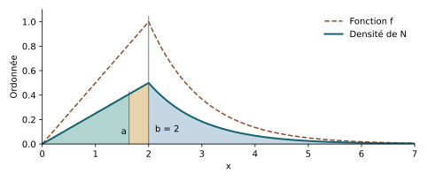

# B/L 2024 · Mathématiques · Corrigé brut

*Corrigé rédigé par IA, non officiel. Signalez toute erreur.*

**Rédaction** · GPT-6.2 Astra Ultra · vitesse non renseignée · 26 novembre 2026

**Composition de mathématiques** · Écrit commun, 4 heures.

## Problème A. Lancers de dés et construction de densités

### Question A.1a

Écrivons $p_j=P(R_0=j)$. Les quatre valeurs $j=1,2,3,4$ ont chacune probabilité $1/6$, la valeur $5$ a probabilité $2/6=1/3$. Toute autre valeur a probabilité nulle.

### Question A.1b

La moyenne est $E(R_0)=(1+2+3+4+5+5)/6=10/3$.

### Question A.2a

$X$ suit la loi de Bernoulli de paramètre $1/3$. Donc $P(X=1)=1/3$ et $P(X=0)=2/3$.

### Question A.2b

$E(X)=1/3$. Comme $X^2=X$, $V(X)=1/3-1/9=2/9$.

### Question A.3a

Pour $k\ge1$, les $k-1$ premiers lancers de rang positif ne donnent aucun cinq et le suivant donne cinq. L’indépendance donne $P(Y=k)=(2/3)^{k-1}/3$. La probabilité de n’obtenir aucun cinq sur les $k$ premiers lancers est $(2/3)^k\to0$, donc $Y$ a bien la loi géométrique sur les entiers strictement positifs.

### Question A.3b

Avec le paramètre $p=1/3$, la formule du cours donne $E(Y)=1/p=3$.

### Question A.3c

La loi géométrique de paramètre $p$ a pour variance $(1-p)/p^2$. Ici $V(Y)=6$.

### Question A.4a

Les événements $\{R_{i-1}=R_i=j\}$ sont disjoints et, par indépendance, de probabilités $p_j^2$. Ainsi $P(S_i)=4/36+1/9=2/9$.

### Question A.4b

$S_1\cap S_2$ signifie $R_0=R_1=R_2$. Sa probabilité vaut $4(1/6)^3+(1/3)^3=1/18$, différente de $P(S_1)P(S_2)=4/81$. Ainsi la famille n’est pas indépendante.

### Question A.4c

$P(R_1=5\mid S_2)=P(R_1=R_2=5)/P(S_2)=(1/9)/(2/9)=1/2$.

### Question A.5a

$Z$ est le premier indice $i\ge1$ où $S_i$ se réalise. Pour $k\ge1$, $\{Z=k\}=S_1^c\cap\cdots\cap S_{k-1}^c\cap S_k$, avec intersection vide de contraintes avant $k=1$. De plus $S_1,S_3,\ldots,S_{2m-1}$ sont indépendants car leurs paires de lancers sont disjointes. La probabilité de ne jamais répéter est majorée par $(7/9)^m$ pour tout $m$, donc nulle.

### Question A.5b

Si $Z$ était géométrique, son paramètre serait $p=P(Z=1)=2/9$. Or $P(Z=2)=P(S_2)-P(S_1\cap S_2)=2/9-1/18=1/6$, alors que $(1-p)p=14/81$. Ces fractions diffèrent. Le schéma rappelle pourquoi une égalité avec le dernier résultat dépend de la valeur qu’il portait.

### Question A.6

Pour tout $j$ possible sur le dé rouge, $P(B=j\mid R_0=j)=1/6$. En sommant sur $j$, $P(B=R_0)=\sum_j p_j/6=1/6$.

### Question A.7

Le dé vert porte deux faces $1$, une face $3$ et trois faces $5$. Par indépendance $P(V=R_0)=(2/6)(1/6)+(1/6)(1/6)+(3/6)(2/6)=1/4$.

### Question A.8a

Les minima valent $f(1)=\min(1/2,e)=1/2$, $f(2)=1$ et $f(2+\ln 2)=\min(1+(\ln 2)/2,1/2)=1/2$.

### Question A.8b

La droite $x/2$ est strictement croissante, tandis que $e^{2-x}$ est strictement décroissante. Elles se rencontrent en $x=2$, où chacune vaut un. Il ne peut donc y avoir d’autre point commun.

### Question A.8c

Le graphe est le segment $f(x)=x/2$ pour $0\le x\le2$, suivi de $f(x)=e^{2-x}$ pour $x\ge2$, avec asymptote horizontale $0$. Au sommet $(2,1)$, les dérivées unilatérales valent $1/2$ et $-1$. Le tracé en tirets représente $f$ et le trait plein la densité $f/2$ calculée en A.9a.

### Question A.9a

La fonction $f$ est positive et $\int_0^2x\,dx/2=1$, $\int_2^\infty e^{2-x}dx=1$. La normalisation $2\lambda=1$ donne $\lambda=1/2$. On prolonge la densité par zéro pour les abscisses négatives.

### Question A.9b

$P(N>2)=(1/2)\int_2^\infty e^{2-t}dt=1/2$.

### Question A.9c

Si $x\ge0$, l’événement $N>x+2$ implique $N>2$. Le quotient des probabilités vaut $(e^{-x}/2)/(1/2)=e^{-x}$, également pour $x=0$.

### Question A.9d

$E(N)=\frac12(\int_0^2t^2dt/2+\int_2^\infty te^{2-t}dt)$. Le premier terme entre parenthèses vaut $4/3$. Une primitive du second intégrande est $-(t+1)e^{2-t}$, dont la limite est nulle à l’infini. Ainsi $E(N)=(4/3+3)/2=13/6$.

### Question A.10a

On veut $P(N\ge b)=P(V=5)=1/2$. La densité est strictement positive sur $]0,\infty[$, donc la fonction de répartition y est strictement croissante. Par A.9b, l’unique solution est $b=2$.

### Question A.10b

On veut $P(N<a)=P(V=1)=1/3$. Pour $0<a<2$, $P(N<a)=\int_0^a t\,dt/4=a^2/8$. Donc $a=\sqrt{8/3}<2$. La masse intermédiaire vaut $1-1/3-1/2=1/6$, comme pour la valeur $3$.

### Question A.11

Prenons une densité égale à $1/6$ sur $[1,5[$, à $1/3$ sur $[5,6[$ et à zéro ailleurs. Son intégrale vaut $4/6+1/3=1$. Alors $P(\lfloor G\rfloor=j)=\int_j^{j+1}g(t)dt$ donne $1/6$ pour $j=1,2,3,4$, $1/3$ pour $j=5$ et zéro sinon. C’est la loi de $R_0$.

## Problème B. Itération d’une fonction et vitesse de convergence

### Question B.12a

À l’infini $e^{-1/x}\to1$, donc $g(x)=x-2e^{-1/x}\to+\infty$.

### Question B.12b

Quand $x\downarrow0$, $-1/x\to-\infty$, donc $e^{-1/x}\to0$. On obtient $g(x)\to0$.

### Question B.12c

$g(x)-x=-2e^{-1/x}<0$ pour tout $x>0$. Aucun point commun sur le domaine donné.

### Question B.13a

Pour $t\downarrow0$, $\ln t\to-\infty$ et $t\to0$. Pour $t\to\infty$, $h(t)=t((\ln t)/t-1)\to-\infty$ par croissance comparée.

### Question B.13b

Sur $]0,\infty[$, $h'(t)=1/t-1=(1-t)/t$.

### Question B.13c

La dérivée est positive sur $]0,1[$, nulle en $1$, négative sur $]1,\infty[$. Le tableau se lit $-\infty\nearrow h(1)=-1\searrow-\infty$ lorsque $t$ parcourt l’intervalle de gauche à droite.

### Question B.13d

$\ln(2t)-t=\ln2+h(t)\le\ln2-1<0$, puisque $2<e$. L’inégalité est stricte même au maximum.

### Question B.13e

Appliquons B.13d à $t=1/x$. On obtient $\ln(2/x)<1/x$, donc $2e^{-1/x}<x$ après exponentiation et multiplication par $xe^{-1/x}>0$. Ainsi $g(x)>0$.

### Question B.14a

$u_0>0$ est donné. Si $u_n>0$, alors $u_{n+1}=g(u_n)$ est défini et strictement positif par B.13e. La récurrence construit tous les termes.

### Question B.14b

$u_{n+1}-u_n=-2e^{-1/u_n}<0$. La suite est décroissante et minorée par zéro, donc converge vers un réel $L\ge0$.

### Question B.14c

Si $L>0$, la continuité de $g$ sur son domaine donnerait $L=g(L)$, contredisant B.12c. Par B.14b il reste $L=0$.

### Question B.15a

La fonction est dérivable au voisinage de zéro, de valeur $1$ et de dérivée $\alpha$ en zéro. Ainsi $(1-s)^{-\alpha}=1+\alpha s+o(s)$.

### Question B.15b

Si $t_k=1/u_k\to+\infty$, alors $2u_k^{-1}e^{-1/u_k}=2t_ke^{-t_k}\to0$ par croissance comparée.

### Question B.15c

Posons $s_k=2u_k^{-1}e^{-1/u_k}$. Alors $u_{k+1}=u_k(1-s_k)$ et B.15a–b donnent $u_{k+1}^{-\alpha}-u_k^{-\alpha}=u_k^{-\alpha}s_k(\alpha+o(1))$. Or $u_k^{-\alpha}s_k=2t_k^{\alpha+1}e^{-t_k}\to0$. La différence tend donc vers zéro.

### Question B.15d

Pour $\varepsilon>0$, choisissons $p$ tel que $|u_{k+1}^{-\alpha}-u_k^{-\alpha}|\le\varepsilon$ pour $k\ge p$. La somme télescopique de $p$ à $n-1$ est majorée en module par $(n-p)\varepsilon$. La contribution fixe $C=|u_p^{-\alpha}-u_0^{-\alpha}|$ vérifie $C\le n\varepsilon$ dès que $n\ge C/\varepsilon$. Ainsi pour tout $n\ge q=\max(p,\lceil C/\varepsilon\rceil)$, la différence demandée est au plus $2\varepsilon n$.

### Question B.15e

Par B.15d, $0\le u_n^{-\alpha}/n\le u_0^{-\alpha}/n+2\varepsilon$ pour tout $n\ge\max(q,1)$. La limite supérieure est au plus $2\varepsilon$ pour tout $\varepsilon>0$. Le quotient tend vers zéro.

### Question B.15f

Appliquons B.15e avec l’exposant $1/\alpha$. La quantité positive $u_n^{-1/\alpha}/n$ tend vers zéro, donc son inverse élevé à la puissance $\alpha$ tend vers $+\infty$. Cet inverse élevé à la puissance $\alpha$ est précisément $n^\alpha u_n$.

### Question B.16a

Sur le quadrant ouvert, $\partial_x F=1-y e^{-1/x}/x^2$ et $\partial_y F=-e^{-1/x}$.

### Question B.16b

Pour chaque $x>0$, la fonction $y\mapsto F(x,y)$ est strictement décroissante. Tout voisinage d’un point du domaine contient à la fois une valeur supérieure et une valeur inférieure. Il n’y a aucun extremum local.

### Question B.17a

$F(x,y)=0$ équivaut à $x=ye^{-1/x}$. En posant $t=1/x>0$, cela devient $te^{-t}=1/y$, puis $h(t)=\ln t-t=-\ln y$. Ainsi $r=-\ln y$.

### Question B.17b

Le maximum de $h$ est $-1$. Pour $r>-1$ il n’y a pas de solution, pour $r=-1$ il y a la seule solution $t=1$, et pour $r<-1$ il y en a deux. Dans ce dernier cas, continuité et stricte monotonie donnent une unique solution sur chacun des intervalles $]0,1[$ et $]1,\infty[$.

### Question B.17c

Puisque $t\mapsto1/t$ est une bijection sur les réels strictement positifs, le nombre de solutions en $x$ est inchangé. Pour $0<y<e$, il est nul. Pour $y=e$, il y en a une, $x=1$. Pour $y>e$, il y en a deux.

## Problème C. Isométries de l’espace euclidien

### Question C.18a

Chaque coordonnée de $\rho(x,y,z)=(-y,z,-x)$ est une forme linéaire. Les images des vecteurs canoniques sont $(0,0,-1)$, $(-1,0,0)$ et $(0,1,0)$. Ainsi $A=\begin{pmatrix}0&-1&0\\0&0&1\\-1&0&0\end{pmatrix}$.

### Question C.18b

Le produit $A^TA$ est leur matrice de Gram, donc vaut $I_3$. En particulier $A$ est inversible et $A^{-1}=A^T$.

### Question C.19a

$(-y,z,-x)=(x,y,z)$ équivaut à $y=z=-x$. Le vecteur $v_1=(1,-1,-1)$ est donc propre pour la valeur propre $1$.

### Question C.19b

Pour $v_2=(2,1,1)$, on trouve $\langle v_1,v_2\rangle=2-1-1=0$.

### Question C.19c

Un vecteur $(a,b,c)$ orthogonal à $v_1$ et $v_2$ vérifie $a-b-c=0$ et $2a+b+c=0$. D’où $a=0$, $c=-b$. Puisque $\|v_2\|^2=6$, prenons $b=\sqrt3$ et $v_3=(0,\sqrt3,-\sqrt3)$, de norme $\sqrt6$.

### Question C.19d

Les trois vecteurs sont non nuls et deux à deux orthogonaux, donc libres. Ils forment une base de l’espace de dimension trois.

### Question C.19e

$\rho(v_2)=(-1,1,-2)$ et $\rho(v_3)=(-\sqrt3,-\sqrt3,0)$. Leurs produits scalaires avec $v_1$ sont nuls. En prenant ceux avec $v_2$ et $v_3$ et en divisant par $6$, on obtient $\alpha=-1/2$, $\beta=\sqrt3/2$, $\gamma=-\sqrt3/2$ et $\delta=-1/2$.

### Question C.19f

Le vecteur $v_1$ est fixe et C.19e fournit les autres colonnes. Ainsi $B=\begin{pmatrix}1&0&0\\0&-1/2&-\sqrt3/2\\0&\sqrt3/2&-1/2\end{pmatrix}$.

### Question C.19g

Il faut $\cos\theta=-1/2$ et $\sin\theta=-\sqrt3/2$. Le choix $\theta=-2\pi/3$ convient. Choisir l’opposé de $v_3$ à C.19c aurait changé le signe de l’angle et les deux coefficients correspondants.

### Question C.20a

$-1\notin S(C)$ signifie $\det(C+I_3)\ne0$. Or $C^T+I_3=(C+I_3)^T$ a le même déterminant, donc est inversible.

### Question C.20b

$(C^T+I_3)(C-I_3)=C^TC-C^T+C-I_3=C-C^T$, puisque $C^TC=I_3$.

### Question C.20c

Avec $a=C_{12}-C_{21}$, $b=C_{13}-C_{31}$ et $c=C_{23}-C_{32}$, la différence vaut $D=\begin{pmatrix}0&a&b\\-a&0&c\\-b&-c&0\end{pmatrix}$.

### Question C.20d

Comme $D^T=-D$, $\det D=\det(-D)=-\det D$. Donc $\det D=0$ et le noyau contient un vecteur non nul. Cela vaut aussi si $a=b=c=0$.

### Question C.20e

Pour $w\ne0$ dans $\ker D$, C.20b donne $(C^T+I_3)(C-I_3)w=0$. Le premier facteur est inversible par C.20a sous l’hypothèse de la question. Ainsi $Cw=w$ et $1\in S(C)$.

### Question C.21

Si $-1\notin S(C)$, C.20e donne $1\in S(C)$. Sinon il existe $w\ne0$ tel que $Cw=-w$, donc $(-C)w=w$ et $1\in S(-C)$. Cela donne l’appartenance à l’union dans tous les cas.

### Question C.22a

Posons $P=VV^T/(V^TV)$. On a $P^T=P$, $PV=V$ et $P^2=P$ car $V^TV$ est scalaire. Comme $H_V=2P-I_3$, les trois réponses sont $H_V^T=H_V$, $H_VV=V$ et $H_V^TH_V=(2P-I_3)^2=I_3$.

### Question C.22b

Puisque $H_V^2=I_3$, l’égalité $H_VX=Y$ implique $X=H_VY$ en multipliant par $H_V$. Le même calcul donne la réciproque.

### Question C.23a

Posons $s=X^TY$. On a $\|X+Y\|^2=2+2s>0$ et $(X+Y)^TX=1+s$. Ainsi $H_{X+Y}X=2(X+Y)(1+s)/(2+2s)-X=Y$.

### Question C.23b

Écrivons $H=H_{V+e_1}$. Par C.23a–22b $HV=e_1$ et $He_1=V$. La matrice $R$ fixe $e_1$ et est orthogonale par $\cos^2\tau+\sin^2\tau=1$. Le produit $M=HRH$ est donc orthogonal, soit $M^TM=I_3$. De plus $MV=HRe_1=He_1=V$, vecteur propre non nul de valeur propre $1$.

### Question C.24a

Comme $\varphi(u)=u$ et que $\varphi$ préserve les produits scalaires, $\langle\varphi(x),u\rangle=\langle\varphi(x),\varphi(u)\rangle=\langle x,u\rangle=0$. Aucune hypothèse de fixité sur $x$ n’est requise.

### Question C.24b

Tout $y\in\varphi(E_1^\perp)$ s’écrit $y=\varphi(x)$ avec $x\perp E_1$. Donc $x\perp u$ et C.24a donne $y\perp u$. Comme $E_1=\mathbb Ru$, cela signifie $y\in E_1^\perp$.

### Question C.24c

La première colonne est $(1,0,0)^T$ par $\varphi(u)=u$. Comme $v,w\perp u$, C.24a donne $\langle\varphi(v),u\rangle=\langle\varphi(w),u\rangle=0$. La première ligne est $(1,0,0)$. Ainsi $n_{11}=1$ et $n_{12}=n_{13}=n_{21}=n_{31}=0$.

### Question C.24d

Dans la base orthonormée donnée, la préservation du produit scalaire implique $N^TN=I_3$. D’après C.24c, $N=\operatorname{diag}(1,K)$ pour le bloc $K=\left(\begin{smallmatrix}n_{22}&n_{23}\\n_{32}&n_{33}\end{smallmatrix}\right)$. Le produit demandé vaut donc $K^TK=I_2$.

*Sources* · [Sujet officiel](https://www.ens.psl.eu/sites/default/files/2024_blses_sujet_composition_mathematiques.pdf) · [Rapport du jury](https://www.ens.psl.eu/sites/default/files/2024_bl_rapport_ecrit_mathematiques.pdf).
