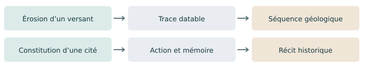

# B/L 2024 · Philosophie à l’oral · Billets du 10 juin 2024 · Corrigé guidé

*Corrigé rédigé par IA, non officiel. Signalez toute erreur.*

**Rédaction** · GPT-6.2 Astra Ultra · vitesse non renseignée · 26 novembre 2026

Le jury accorde 1 h 30 de préparation. On choisit un des deux sujets du billet pour un exposé de vingt minutes, suivi de dix minutes de discussion. Les 18 propositions ci-dessous développent les deux options de chaque billet. Le feuillet est daté du 10 juin 2024. Dans l’édition guidée, chaque développement se prolonge par une question d’entretien et une réponse argumentée.

## Billet 1

Le sujet retenu au passage est **Le serment**.

### Peut-on créer un homme nouveau ?

Élever un enfant, c’est attendre de lui des capacités qui ne sont pas encore les siennes. Ce projet devient inquiétant lorsqu’une autorité prétend savoir d’avance quel « homme nouveau » elle produira. Une institution transforme effectivement des conduites. L’école fait acquérir une langue écrite et l’habitude d’argumenter avec des inconnus. Mais son succès apparaît aussi quand l’élève retourne l’argument contre son professeur. Une fabrication dont le produit s’écarte du modèle a échoué. Une éducation peut réussir précisément par cet écart. Arendt, dans ses réflexions sur l’éducation, rattache l’arrivée des nouveaux venus à la possibilité de commencements imprévus. On peut créer des institutions qui rendent ces commencements possibles. Vouloir garantir le type humain qui en sort reviendrait à supprimer la capacité même de commencer.

> [!INDICATION]
> Un changement durable de conduite prouve-t-il que la personne a été refaite ?

Une conduite peut tenir à la surveillance. La possibilité de poursuivre, de discuter ou de réviser cette conduite permet de distinguer acquisition et conformité.

### Le serment

Prêter serment devant un tribunal ne rend pas soudain infaillible la mémoire du témoin. Que change alors la formule solennelle ? Elle transforme la situation de parole. Le témoin accepte de répondre de ce qu’il affirme devant des personnes habilitées à le questionner. Dans le vocabulaire d’Austin, dire certaines paroles dans les circonstances requises accomplit un acte. L’exactitude du témoignage exige encore des recoupements. Et si un groupe demandait de jurer une fidélité sans réserve ? L’engagement public qui soutenait la confiance pourrait interdire toute rectification. Un serment vaut par la responsabilité définie qu’il institue, celle de dire ce que l’on tient pour vrai et d’avouer ce qu’on ignore. Il perd sa justification lorsqu’il prétend soustraire cet engagement à tout examen.

> [!INDICATION]
> Un témoin de bonne foi respecte-t-il son serment s’il se trompe ?

Il peut avoir tenu son engagement tout en faisant une erreur. La bonne foi impose alors aussi de signaler l’erreur dès qu’elle est découverte.

## Billet 2

Le sujet retenu au passage est **L'orgueil**.

### Peut-on perdre son identité ?

Une personne qui perd ses papiers peut rester la même aux yeux de ses proches tout en devenant incapable de faire reconnaître son nom à une frontière. L’identité comprend ici plusieurs relations, dont les conditions de maintien diffèrent. La continuité d’un corps ne suffit pas à préserver une identité professionnelle. Une modification profonde de nos convictions ne suffit pas davantage à faire disparaître nos obligations anciennes. Ricœur distingue la permanence de traits reconnaissables et la capacité de se tenir pour celui qui a promis. Une personne peut avoir changé de caractère et néanmoins répondre aujourd’hui d’un engagement pris hier. Perdre une identité est donc possible lorsqu’un lien de reconnaissance ou un récit se défait. Parler d’une perte totale suppose encore un sujet auquel cette perte arrive et des témoins capables de la reconnaître.

> [!INDICATION]
> Un pseudonyme fait-il perdre son identité ?

Il peut protéger un état civil tout en constituant une identité publique stable. Il faut préciser pour qui et dans quelle pratique le nom identifie.

### L'orgueil

Un élève refuse une correction exacte parce qu’elle vient d’un camarade moins avancé que lui. Ce qui est touché, c’est le rang qu’il s’attribue. Pourtant on peut être fier d’un travail bien conduit et demander volontiers comment l’améliorer. L’orgueil apparaît quand le sentiment de sa valeur rend intolérable une dépendance réelle ou supposée. La distinction de Rousseau entre amour de soi et amour-propre éclaire le rôle de la comparaison. Si ma valeur exige que l’autre soit plus bas, sa réussite devient pour moi une perte, même si elle ne change rien à mes capacités. Reste qu’un refus de s’abaisser peut défendre une dignité commune. Le critère est alors de savoir si je pourrais reconnaître à l’autre la même exigence de respect.

> [!INDICATION]
> La modestie affichée suffit-elle à écarter l’orgueil ?

On peut se déprécier pour obtenir une protestation admirative. C’est le rapport à l’estime d’autrui, jusque dans le désaccord, qu’il faut examiner.

## Billet 3

Le sujet retenu au passage est **La propriété**.

### Avons-nous le droit d'être heureux ?

Le bonheur est un état que personne ne peut nous remettre comme une somme due. En ce sens, un « droit au bonheur » manque de débiteur et de prestation déterminée. Mais dire à quelqu’un qu’il n’a pas le droit d’être heureux exprime souvent autre chose, par exemple le reproche d’oublier les malheurs d’autrui. Est-il juste de faire de sa propre tristesse un devoir de solidarité ? Une joie peut soutenir une amitié ou rendre l’action commune possible. Elle devient moralement contestable si elle suppose effectivement l’humiliation ou la privation d’un tiers. On peut donc revendiquer la liberté de poursuivre une vie heureuse et des conditions qui la rendent possible. Ce droit implique un examen des moyens employés et de l’égalité d’accès aux conditions du bonheur.

> [!INDICATION]
> Une politique devrait-elle garantir que tout le monde se sente heureux ?

Elle peut garantir des libertés et des ressources. Réduire ces biens à la satisfaction déclarée risquerait de pénaliser la personne qui proteste contre une injustice.

### La propriété

À qui appartient un livre prêté ? Son propriétaire ne le possède pas matériellement, et son lecteur ne peut pas le vendre. La propriété articule donc des pouvoirs distincts, définis par une règle publique. Une défense classique, chez Locke, invoque le travail par lequel une personne rend disponible une ressource. Mais le produit de mon effort et le sol dont j’exclus désormais autrui ne sont pas une seule et même chose. La justification doit considérer ceux qui dépendaient déjà de l’usage de ce sol. Il existe d’ailleurs des biens régis par des usages communs et des droits d’auteur temporaires. La propriété rend la prévision et l’indépendance possibles. Sa portée est justifiée lorsque les règles d’attribution, de transmission et de limitation restent défendables pour tous ceux auxquels l’exclusion s’impose.

> [!INDICATION]
> Un bien commun est-il une chose abandonnée ?

Des usagers peuvent se donner des règles strictes d’accès et d’entretien. L’absence de propriétaire individuel n’implique donc pas l’absence de responsabilité.

## Billet 4

Le sujet retenu au passage est **Où commence ma liberté ?**.

### Où commence ma liberté ?

« Où » suggère une frontière entre ma liberté et celle d’autrui. Pourtant je ne pourrais pas librement publier un texte sans langue commune, lecteurs et règles qui protègent l’expression. Les autres sont à la fois une limite et une condition. Il faut également distinguer l’absence d’obstacle et la possibilité de ne pas dépendre d’une permission arbitraire. Un élève que le règlement autorise à prendre la parole possède une garantie différente de celui qui dépend de la faveur révocable du professeur. La liberté commence ainsi lorsque je peux engager une action dont je comprends les conditions et demander raison des obstacles. Elle s’élargit parfois grâce aux limites réciproques qu’une institution impose, par exemple lorsqu’un temps de parole partagé rend audibles ceux qui étaient systématiquement interrompus.

> [!INDICATION]
> Un empêchement momentané détruit-il toujours une liberté ?

Attendre son tour restreint l’action immédiate mais peut assurer à chacun une possibilité réelle de parler, à condition que la règle soit équitable.

### L'intuition

Le médecin expérimenté reconnaît parfois une anomalie avant de pouvoir dire quel détail l’a alerté. L’intuition désigne alors la manière immédiate dont une réponse se présente, sans préjuger de la durée de l’apprentissage qui l’a rendue possible. Il serait imprudent de la confondre avec une certitude. Un préjugé peut avoir exactement la même assurance subjective. Chez Descartes, l’intuition intellectuelle désigne la saisie claire d’une relation simple, bien différente d’un pressentiment obscur. En géométrie aussi, voir une relation sur un dessin suggère une preuve mais ne garantit pas que le dessin représente tous les cas. On peut donc faire droit à l’intuition comme mode de découverte, puis demander par quel contrôle sa portée exacte sera établie.

> [!INDICATION]
> Le contrôle fait-il disparaître ce qui était intuitif ?

Il peut confirmer le résultat sans changer la manière dont on l’a d’abord trouvé. Découvrir une réponse et établir sa validité sont deux actes distincts.

## Billet 5

Le sujet retenu au passage est **L'enseignement peut-il se passer d'exemples ?**.

### L'enseignement peut-il se passer d'exemples ?

Si je montre trois triangles à un enfant, il risque de croire que tous doivent avoir la même orientation. Une série d’exemples ne suffit donc pas à produire le concept. Une définition exacte peut inversement demeurer inopérante chez un élève incapable de reconnaître un triangle obtus présenté sur sa pointe. Le maître doit choisir des cas qui font varier l’accidentel et maintiennent le trait pertinent, puis laisser l’élève construire un cas nouveau. La démonstration géométrique sur une figure singulière atteint le général lorsque chaque étape invoque des propriétés valables dans tous les cas. L’enseignement peut momentanément procéder sans illustration. Transmettre une règle comprise exige cependant quelque manière d’en éprouver l’usage. Le contre-exemple est parfois le meilleur maître, puisqu’il montre à l’élève ce que sa première règle autorisait à tort.

> [!INDICATION]
> Pourquoi multiplier les exemples ne suffit-il pas toujours ?

S’ils possèdent tous le même trait accidentel, ils renforcent la confusion. Un seul cas bien choisi peut départager deux critères concurrents.

### L'énergie du désespoir

Une équipe qui se croyait éliminée cesse de ménager ses forces et invente une manière plus simple de jouer. Pourquoi appeler « énergie » ce qui ressemble à la perte de tout motif ? Le désespoir peut lever un calcul paralysant. Si l’on ne compte plus sur une récompense incertaine, il reste parfois à sauver quelque chose ici et maintenant, un lien, un effort partagé, la dignité d’une personne. Mais une perte d’espoir peut aussi épuiser les moyens d’agir et rendre l’aide d’autrui indispensable. La formule désigne une possibilité paradoxale, jamais une vertu exigible de celui qui souffre. Dans l’exemple de l’équipe, une fin plus proche s’est substituée à la fin devenue inaccessible. L’énergie vient de ce déplacement et du soutien réciproque.

> [!INDICATION]
> L’exemple suppose-t-il qu’il reste toujours une victoire possible ?

Non. On peut renoncer à gagner et garder une raison d’agir pour un partenaire. Cela change le sens de l’action sans promettre son succès.

## Billet 6

Le sujet retenu au passage est **L'histoire peut-elle se répéter ?**.

### Espérer

Espérer un résultat d’examen n’est ni calculer sa probabilité ni tenir sa réussite pour acquise. L’espérance suppose un bien jugé possible dont l’issue échappe en partie à notre action. Elle peut nourrir un effort lorsque le résultat demeure lointain. Elle peut aussi nous faire attendre passivement ce qui dépend de nous. Les stoïciens invitent à distinguer ce qui relève de notre jugement et ce qui dépend des événements. Leur objection vise le trouble qui naît quand notre bonheur est suspendu à une issue extérieure. Pourtant l’espoir partagé de guérir un malade peut soutenir des gestes présents que nul ne ferait seul. Une espérance lucide maintient ensemble l’incertitude du résultat et la précision des tâches dont nous pouvons répondre aujourd’hui.

> [!INDICATION]
> L’espoir et la prévision peuvent-ils avoir le même objet ?

Oui. On peut prévoir une issue probable et en espérer une autre. La prévision porte sur les raisons de croire, l’espoir sur la valeur d’une possibilité.

### L'histoire peut-elle se répéter ?

Chaque événement occupe une date et prend place dans un réseau de causes singulier. En ce sens une crise ne revient jamais à l’identique. Pourtant on peut reconnaître une structure répétée, par exemple une panique bancaire dans laquelle la crainte des retraits d’autrui pousse chacun à retirer son dépôt. L’analogie devient explicative si le mécanisme est établi et si les différences d’institutions sont précisées. Elle devient trompeuse si deux images semblables dispensent d’examiner les causes. De plus, connaître une histoire antérieure transforme l’action présente. Une garantie des dépôts peut modifier les attentes qui produisaient la panique. L’histoire se répète par certains rapports et par les récits que les acteurs en font, jamais comme un scénario qui supprimerait leur initiative.

> [!INDICATION]
> La différence des dates rend-elle toute comparaison impossible ?

Les situations singulières peuvent mettre en jeu le même mécanisme. Il faut en préciser les conditions et vérifier qu’elles sont réunies à chaque date.

## Billet 7

Le sujet retenu au passage est **Histoire et devenir**.

### Comment ne pas s'ennuyer ?

Dans une salle d’attente, regarder sans cesse l’heure peut accroître l’ennui. Ce malaise signale que le temps est vécu comme un obstacle entre nous et ce qui devrait enfin arriver. Accumuler les distractions fonctionne un moment, mais risque d’entretenir l’incapacité de s’intéresser durablement à une chose. Pascal voit dans le divertissement une façon d’éviter l’épreuve de rester avec soi-même. Il ne s’ensuit pas que tout loisir soit frivole. Apprendre un jeu ou écouter quelqu’un fait naître des différences que l’on ne savait pas d’abord percevoir. L’intérêt se construit par un engagement. Reste le cas d’un travail répétitif imposé, où recommander à quelqu’un de « s’intéresser » masque l’absence d’initiative réelle. Échapper à l’ennui peut exiger de changer l’activité ou ses conditions collectives.

> [!INDICATION]
> S’ennuyer est-il toujours perdre son temps ?

Le malaise peut révéler une activité devenue vide ou un désir qu’on n’avait pas formulé. Encore faut-il avoir l’occasion d’en faire quelque chose.

### Histoire et devenir

Une montagne s’érode et une cité adopte une nouvelle constitution. Les deux changent. Parler d’histoire demande-t-il davantage que constater un devenir ? On peut reconstituer l’histoire géologique d’un versant en reliant des traces à une succession irréversible. Dans l’histoire humaine s’ajoute la capacité des acteurs à se souvenir, à interpréter leur passé et à agir en fonction du récit qu’ils en font. Une commémoration peut ainsi changer le sens public d’une bataille sans en modifier l’issue passée. Le devenir fournit la matière temporelle, mais toute succession ne constitue pas encore une explication historique. Il faut déterminer quelles transformations compter, par quels indices les dater et quels liens fondent leur intelligibilité. Le récit risque l’illusion lorsqu’il transforme le résultat connu en but nécessaire de chaque étape.

> [!INDICATION]
> Attribuer une histoire à une espèce revient-il à lui prêter une intention ?

Non. Des traces et des mécanismes peuvent expliquer des changements irréversibles sans que les êtres concernés se soient représenté leur terme.

## Billet 8

Le sujet retenu au passage est **L'indifférence**.

### Y-a-t-il des conflits insolubles ?

Deux personnes réclament le même lieu, l’une pour préserver un culte, l’autre pour rendre accessible un service public. Trouver un horaire partagé résout un problème de coordination. Il peut laisser entier un conflit de principes si chaque partie estime que partager trahirait précisément sa raison d’agir. Tout conflit ne tient donc pas à une information manquante ou à une mauvaise volonté. Faut-il alors parler d’insolubilité ? Une décision judiciaire tranche ce que chacun peut faire, sans rendre nécessairement compatibles les jugements moraux en présence. On peut aussi déplacer la question et chercher quels usages nécessitent effectivement ce lieu. Un conflit peut ainsi demeurer sans solution qui réconcilie toutes les valeurs, tout en admettant une issue justifiable, révisable et supportable pour les personnes en désaccord.

> [!INDICATION]
> Un compromis est-il toujours une solution de principe ?

Il peut seulement rendre la coexistence possible. Une procédure équitable compte alors même si chacun conserve sa conviction sur le fond.

### L'indifférence

Être indifférent à deux stylos de même qualité signifie qu’aucune différence pertinente ne commande le choix. Rester indifférent à la souffrance d’un voisin signifie autre chose. Une différence qui devrait compter ne retient pas l’attention. Le même mot désigne donc une égalité de raisons et une défaillance du jugement ou de la sensibilité. L’impartialité d’un juge requiert une certaine indifférence à la richesse des parties. Mais ignorer qu’une partie a besoin d’un interprète compromettrait l’égalité qu’il prétend assurer. Il faut demander à quoi, pour quelle fin, on demeure indifférent. La capacité de suspendre ses préférences peut être une condition d’une sollicitude plus exacte, tandis que la neutralité affichée peut laisser agir les inégalités acquises.

> [!INDICATION]
> Peut-on cultiver une bonne indifférence ?

Oui, envers ce qui ne doit pas peser dans une décision. Elle exige justement de savoir reconnaître les différences qui, elles, doivent compter.

## Billet 9

Le sujet retenu au passage est **Le narcissisme**.

### Le progrès est-il un mythe ?

Un traitement plus efficace établit un progrès si l’on a fixé un critère, par exemple la réduction d’une douleur à effets secondaires comparables. Passer de ce progrès circonscrit à une histoire dans laquelle tout avenir serait supérieur au passé exige une preuve d’un autre ordre. On risque de transformer une succession technique en garantie morale. Des moyens de communication plus rapides peuvent aussi accélérer la diffusion de rumeurs. Pourtant dénoncer le mythe n’oblige pas à nier la possibilité de réels acquis. Condorcet lie l’instruction à la capacité de mettre à l’épreuve les autorités, ce qui désigne une tâche transmissible, exposée aux revers. Le progrès devient mythique s’il dispense les acteurs de préciser les biens, les bénéficiaires et les institutions qui permettront de les conserver.

> [!INDICATION]
> Un progrès réversible mérite-t-il encore ce nom ?

Une liberté acquise améliore réellement une situation même si elle peut être perdue. Sa fragilité donne une raison de construire des garanties.

### Le narcissisme

Dans le récit d’Ovide, Narcisse s’attache à une image qui semble lui répondre parce qu’elle reproduit ses gestes. L’image a l’apparence d’une relation, sans l’indépendance d’un autre qui pourrait le contredire ou le surprendre. Ce trait aide à distinguer le narcissisme de l’attention légitime portée à soi. S’entraîner à mieux parler peut rendre plus disponible à un interlocuteur. Ne chercher dans l’interlocuteur que le reflet admiratif de son propre discours détruit l’échange. Le danger apparaît également dans les groupes qui n’acceptent comme preuves de leur valeur que des images d’eux-mêmes. On ne sort pas du narcissisme en s’interdisant toute estime de soi. On en sort dans la mesure où le désaccord, la vulnérabilité et les projets d’autrui peuvent modifier l’image que l’on tenait à préserver.

> [!INDICATION]
> Aimer son image signifie-t-il nécessairement s’ignorer ?

L’image peut révéler un aspect de soi. L’illusion commence lorsqu’on refuse tout renseignement ou toute relation qui risquerait de la corriger.

[Source des billets](https://www.ens.psl.eu/sites/default/files/bl_sujets_oraux_philosophie_10062024.pdf) · [Rapport annuel du jury](https://www.ens.psl.eu/sites/default/files/2024_bl_rapport_oral_philosophie.pdf).
