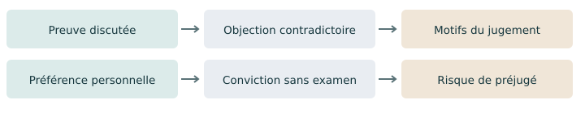

# B/L 2024 · Philosophie à l’oral · Billets du 13 juin 2024 · Corrigé brut

*Corrigé rédigé par IA, non officiel. Signalez toute erreur.*

**Rédaction** · GPT-6.2 Astra Ultra · vitesse non renseignée · 26 novembre 2026

Le jury accorde 1 h 30 de préparation. On choisit un des deux sujets du billet pour un exposé de vingt minutes, suivi de dix minutes de discussion. Les 22 propositions ci-dessous développent les deux options de chaque billet. Le feuillet est daté du 13 juin 2024.

## Billet 1

Le sujet retenu au passage est **La fraternité**.

### Qu'est-ce qu'un problème scientifique ?

Une anomalie devient un problème scientifique lorsqu’une attente précise rencontre un résultat qui lui résiste. Une étoile absente d’une photographie peut simplement avoir été masquée par un nuage. Pour en faire une question d’astronomie, il faut contrôler l’instrument, comparer d’autres observations et déterminer quelles hypothèses sont en concurrence. Bachelard insiste sur la construction des problèmes. Elle ne signifie pas que le savant invente la réponse à son gré. Il prépare les conditions dans lesquelles les choses pourront le démentir. Une bonne formulation peut d’ailleurs transformer un échec vague en recherche féconde en écartant une opposition mal posée. L’intérêt du problème se mesure aux opérations de preuve qu’il rend possibles et aux connaissances qu’une réponse obligerait à réviser.

### La fraternité

Des personnes étrangères les unes aux autres s’appellent « frères » dans une déclaration politique. L’image tire sa force d’un lien qu’on ne choisit pas, mais risque d’en reprendre les exclusions, comme si seuls les semblables avaient droit au secours. La fraternité publique peut précisément se comprendre comme l’extension à l’inconnu d’une obligation ordinairement associée aux proches. Elle ne se confond pas avec la charité d’un bienfaiteur qui resterait seul juge des besoins. Reconnaître en autrui un égal permet aussi de lui demander son avis et de recevoir son aide. La difficulté tient à l’institution d’un lien qui doit garder quelque chose de spontané. Des droits sociaux peuvent en assurer le plancher sans prescrire à chacun un sentiment familial.

## Billet 2

Le sujet retenu au passage est **Le mérite**.

### Qu'est-ce qu'un esprit libre ?

Un esprit qui refuse systématiquement toute opinion reçue demeure orienté par celle-ci, puisqu’il suffit de connaître le parti dominant pour prévoir le sien. La liberté intellectuelle demande autre chose que l’originalité. Kant, dans sa réflexion sur les Lumières, associe la sortie de la minorité à l’usage public de la raison. Exposer ses raisons permet de distinguer une conviction éprouvée d’un simple réflexe de révolte. Mais penser par soi-même n’implique pas de refaire tout le savoir. On peut s’appuyer sur un spécialiste dont les méthodes et les motifs de confiance sont accessibles. Est libre l’esprit capable de reconnaître ses dépendances, d’en vérifier la légitimité et de changer d’avis sans y voir nécessairement une humiliation.

### Le mérite

Deux élèves arrivent au même résultat, l’un après des années de soutien, l’autre en ayant appris seul. Quel mérite reconnaît-on ? La réussite constate un effet, l’effort décrit une conduite, et le mérite prétend relier cette conduite à une récompense juste. Ces trois critères divergent. On peut légitimement exiger une compétence pour confier une opération délicate sans prétendre que toutes les conditions de la compétence sont personnellement méritées. Rawls souligne la contingence des talents et des milieux initiaux lorsqu’il examine les institutions justes. Ce constat n’efface pas la responsabilité. Il oblige à préciser ce que récompense une règle et à rendre ses conditions d’accès discutables. Reconnaître un effort singulier n’autorise pas à traiter tous les désavantages comme des fautes.

## Billet 3

Le sujet retenu au passage est **L'intime conviction**.

### La souveraineté peut-elle se partager ?

Dans une fédération, un parlement local vote certaines lois et un parlement commun en vote d’autres. Plusieurs centres de décision suffisent-ils à partager la souveraineté ? Il faut distinguer la répartition des compétences et le pouvoir de déterminer cette répartition. Chez Rousseau, la souveraineté appartient au corps politique comme auteur de la loi générale. Des représentants ou des magistrats peuvent exercer des fonctions distinctes sans devenir autant de souverains privés. Mais faire de toute pluralité un simple pouvoir délégué méconnaît les constitutions dans lesquelles aucune autorité ne peut modifier seule les compétences communes. On peut alors partager l’exercice et soumettre la révision elle-même à un accord entre niveaux. La question décisive porte sur qui tranche les désaccords et dans quelles conditions chacun peut contester la règle.

### L'intime conviction

Le juré forme personnellement son jugement, alors que les pièces ont été discutées publiquement. Pourquoi faire appel à son intime conviction ? Aucun tableau de poids fixes ne peut additionner mécaniquement un témoignage fragile, une chronologie et un document contesté. Le jugement doit apprécier leurs rapports. L’intimité désigne ici une responsabilité qu’on ne peut déléguer à une formule. Elle ne transforme pas l’impression spontanée en preuve. Un récit très assuré peut emporter l’adhésion et rester faux. La contradiction, l’examen des hypothèses alternatives et les garanties de procédure permettent d’éprouver la conviction sans prétendre effacer le sujet qui juge. Une conviction digne de ce rôle doit pouvoir identifier ce qui la fonde, ce qui la ferait vaciller et la portée du doute subsistant.

## Billet 4

Le sujet retenu au passage est **Qu'est-ce qu'un argument ?**.

### Qu'est-ce qu'un argument ?

Dire « cette décision est injuste » exprime un jugement. Ajouter que deux demandes identiques ont été traitées différemment sans raison pertinente commence à fournir un argument. Un argument présente une conclusion comme soutenue par des prémisses dont le destinataire peut examiner la vérité et le lien avec cette conclusion. Sa force ne se confond pas avec sa réussite persuasive. Une intimidation peut emporter l’accord sans rien prouver. À l’inverse une inférence valide peut partir d’une prémisse contestable. Il faut donc distinguer la forme du raisonnement, la qualité de ses données et la pertinence de la réponse à l’objection effectivement formulée. Argumenter, c’est accepter qu’en refusant une de ces étapes l’interlocuteur pose une question à laquelle on doit encore répondre.

### La rareté

Une eau abondante dans une région peut devenir rare pour les habitants d’un quartier sans canalisation. La rareté décrit une relation entre une quantité disponible, des besoins et des conditions d’accès. Elle ne se réduit ni au petit nombre ni au prix élevé. Un objet unique peut ne trouver aucun acquéreur. Inversement des places de formation deviennent rares lorsque l’on limite politiquement leur nombre. L’économie doit comparer des usages concurrents, mais ce cadre peut naturaliser des restrictions créées par une règle de propriété. Distinguer une limite matérielle d’une distribution évitable change ce qu’on peut faire. La rareté attire enfin le désir et peut devenir fabriquée par celui qui contrôle l’offre. Il importe alors de demander pour qui la chose manque et pourquoi.

## Billet 5

Le sujet retenu au passage est **Le nihilisme**.

### Qu'est-ce qu'un choix éclairé ?

Avant une décision importante, recevoir un dossier de cent pages ne garantit pas qu’on ait compris les options. L’information peut même servir à décourager les questions. Un choix éclairé demande d’abord de distinguer les issues possibles, les conséquences significatives pour la personne et ce qui demeure incertain. Il demande aussi que la personne puisse confronter l’information à ses propres fins. Dans un consentement médical, un chiffre moyen ne dit pas à lui seul quelle perte de mobilité on serait prêt à accepter. Une explication adaptée et la possibilité de revenir sur une décision rendent l’autonomie concrète. Exiger une connaissance totale serait paralysant. Le seuil raisonnable dépend des enjeux et de la réversibilité, mais il exclut la dissimulation d’une alternative pertinente.

### Le nihilisme

Affirmer qu’une coutume est injuste suppose encore une valeur au nom de laquelle la critiquer. Le nihilisme désigne une difficulté plus radicale, lorsque les valeurs qui donnaient sens aux jugements perdent leur autorité et que l’on ne sait plus ce qui peut les fonder. Nietzsche analyse cette crise comme un processus historique de dévalorisation des valeurs suprêmes. La négation n’aboutit pas nécessairement à l’indifférence tranquille. On peut rester violemment attaché à la disparition de tout ce qui comptait ou travailler à de nouvelles évaluations. Mais proclamer une préférence nouvelle ne suffit pas à la rendre défendable. Comprendre le nihilisme demande d’examiner ce qui s’effondre, quelles habitudes continuent de nous orienter et comment une justification reste possible après la perte de l’ancienne garantie.

## Billet 6

Le sujet retenu au passage est **Y-a-t-il des expériences de la liberté ?**.

### Y-a-t-il des expériences de la liberté ?

Un musicien éprouve parfois plus de liberté après avoir acquis une technique exigeante. L’expérience immédiate d’être sans obstacle n’épuise donc pas la liberté. On peut en reconnaître plusieurs expériences, comme l’hésitation entre des fins incompatibles, la découverte d’un pouvoir d’agir collectif ou le soulagement lorsqu’une dépendance arbitraire cesse. Elles témoignent d’un changement concret dans ce qu’une personne peut faire. Elles ne démontrent pas à elles seules une indépendance métaphysique à l’égard de toute cause. Spinoza met en garde contre l’illusion de celui qui connaît son désir et ignore ce qui le détermine. Cette objection n’annule pas l’expérience. Elle invite à comparer les capacités, les contraintes et la compréhension des motifs avant et après la libération ressentie.

### La communauté des savants

Un résultat signé par une personne doit beaucoup à des techniques transmises et à des lecteurs capables d’en refaire la démonstration. La communauté des savants produit des conditions de contrôle que l’individu seul ne pourrait réunir. Publicité des méthodes et possibilité de réplication n’exigent pourtant pas que la majorité ait toujours raison. Un accord très large peut refléter l’emploi du même instrument mal étalonné. La critique scientifique dépend alors de la diversité des approches et de la possibilité institutionnelle de contredire une autorité. Une communauté est proprement savante dans la mesure où elle organise la correction de ses jugements. Son ouverture aux objections importe autant que la confiance réglée qui permet à chacun d’utiliser des acquis qu’il n’a pas personnellement établis.

## Billet 7

Le sujet retenu au passage est **Le bonheur et la vertu**.

### La conscience peut-elle être collective ?

Une assemblée peut décider ce qu’aucun de ses membres ne voulait exactement. Cela prouve l’existence d’un résultat collectif, pas celle d’un esprit géant qui l’aurait éprouvé. Durkheim emploie l’idée de conscience collective pour décrire des croyances et des sentiments communs qui précèdent chaque individu et s’imposent à lui. Un deuil public en est un exemple, avec ses rites et ses mots disponibles. Mais chacun peut vivre ces formes différemment, et certains peuvent en contester le sens. Il faut donc distinguer la circulation de représentations communes, la capacité d’un groupe à délibérer et l’unité subjective d’un vécu. Une conscience peut être collective par ses supports et ses objets sans que les sensations individuelles se fondent en une personne unique.

### Le bonheur et la vertu

Une personne juste perd sa situation pour avoir refusé de tromper. Si le bonheur signifie satisfaction et sécurité immédiates, la vertu peut clairement lui coûter. Si le bonheur désigne la qualité d’une vie entière, avoir pu agir sans mépriser ses propres raisons peut en constituer une part décisive. Aristote associe le bonheur à une activité conforme à la vertu tout en reconnaissant qu’une vie a besoin de certains biens extérieurs. Il évite ainsi deux facilités, promettre une récompense à l’acte juste et déclarer les circonstances entièrement indifférentes. Il reste à reconnaître le malheur réel de la personne sans la croire intérieurement vaincue. La justice d’une société se mesure aussi à ce qu’elle fait pour que l’action droite ne demande pas constamment de tels sacrifices.

## Billet 8

Le sujet retenu au passage est **Le savoir émancipe-t-il ?**.

### Le savoir émancipe-t-il ?

Connaître les règles d’un formulaire peut permettre de faire valoir un droit que l’on ignorait. Le savoir élargit ici les possibilités parce qu’il rend une institution lisible et une contestation possible. Pourtant une information vraie sur une injustice peut accroître le sentiment d’impuissance si aucune procédure ne permet d’agir. Et celui qui possède un savoir peut le réserver pour maintenir d’autres personnes sous sa tutelle. L’émancipation n’est donc pas la conséquence automatique de l’accumulation de connaissances. Elle suppose la capacité de vérifier, d’appliquer et de transmettre ce qu’on sait. Une pédagogie émancipatrice rend progressivement inutile l’autorité du maître sur le jugement particulier de l’élève tout en lui apprenant à reconnaître les domaines où il doit encore enquêter.

### Le ridicule

On trébuche au milieu d’un discours solennel et l’auditoire rit. Le ridicule naît du décalage entre une prétention ou une attente et un détail qui la défait sous le regard d’autrui. Bergson remarque dans *Le Rire* que la raideur d’une habitude se prête au comique. Cette correction par le rire peut rappeler à un orateur que sa majesté était jouée. Mais la même mécanique peut punir une singularité parfaitement légitime. Le groupe fait alors passer une norme locale pour l’évidence du bon sens. Pour juger le ridicule, il faut donc distinguer celui qui rit, la prétention réellement mise en défaut et le coût de l’exposition pour celui qui la subit. Être risible ne réfute pas une idée.

## Billet 9

Le sujet retenu au passage est **La crédulité**.

### Faut-il être modéré ?

À une table commune, prendre une part mesurée évite d’en priver les autres. Mais entre une injustice et le respect d’un droit, recommander la position médiane peut perpétuer le tort. La modération est-elle quantité moyenne ou justesse dans la manière d’agir ? Chez Aristote, le juste milieu se détermine relativement à la situation et par le jugement pratique. Il ne se calcule pas comme la moyenne entre deux opinions. Un refus ferme peut ainsi être mesuré s’il protège exactement le bien menacé, tandis qu’une faible concession peut déjà être excessive. La vertu garde une portée critique envers les emballements de notre propre camp. Elle suppose de pouvoir donner raison de l’intensité, du moment et de la durée d’une réponse.

### La crédulité

Accorder du crédit à un témoignage est indispensable, puisque personne ne peut tout vérifier. La crédulité commence-t-elle dès que l’on croit sur parole ? Ce serait rendre impossible l’apprentissage. Elle apparaît plutôt lorsque l’assentiment excède les raisons disponibles et résiste aux vérifications proportionnées à l’enjeu. Un même récit peut être reçu provisoirement pour orienter une question et ne pas suffire à accuser quelqu’un. Il faut aussi examiner le désir du destinataire de croire une nouvelle flatteuse. Le remède n’est pas une méfiance uniforme, facilement captée par la première personne qui se présente comme seule lucide. C’est un art gradué de la confiance, attentif à la source, à l’indépendance des recoupements et à la possibilité effective de corriger l’erreur.

## Billet 10

Le sujet retenu au passage est **Que peut la philosophie ?**.

### Que peut la philosophie ?

Une dispute sur la liberté à l’école oppose parfois ceux qui veulent pouvoir choisir un cours à ceux qui veulent pouvoir discuter son règlement. La philosophie peut faire apparaître cette différence et demander quel principe justifie chacune des demandes. Clarifier les mots n’est pourtant pas résoudre à la place des personnes le problème d’emploi du temps. Son pouvoir porte sur les raisons, les compatibilités et les présupposés d’une décision. Dans les dialogues de Platon, une réfutation peut avoir pour premier effet de rendre l’interlocuteur moins sûr de savoir ce qu’il savait nommer. Ce résultat devient fécond si l’embarras engage une recherche et modifie une conduite. La philosophie peut donc transformer la manière dont une situation se présente, tout en dépendant d’enquêtes et de choix pratiques pour la changer concrètement.

### La vie sauvage

Une forêt dite sauvage peut porter les traces anciennes de pratiques humaines. « Sauvage » signifie-t-il absence de toute histoire humaine, ou relative autonomie des processus qui s’y déroulent aujourd’hui ? La seconde définition permet de décrire des degrés sans fabriquer un passé imaginaire. Elle fait aussi place aux espèces qui vivent au milieu des villes sans y être domestiquées. Mais valoriser toute spontanéité comme bonne méconnaîtrait la souffrance et les conflits propres aux milieux vivants. Une politique de protection peut chercher à laisser faire certains processus tout en répondant des effets d’anciens aménagements. Il faut enfin distinguer cette question écologique de l’usage qui qualifie abusivement des peuples de « sauvages » pour disqualifier leurs institutions.

## Billet 11

Le sujet retenu au passage est **Le droit de résistance**.

### Qu'est-ce qui est absurde ?

Dire qu’un raisonnement conduit à l’absurde signifie qu’il produit une contradiction. Dire qu’une attente administrative est absurde peut signifier que la procédure détruit la fin qu’elle était censée servir. Dans *Le Mythe de Sisyphe*, Camus situe l’absurde dans la confrontation entre l’exigence humaine de sens et le silence du monde. Ces trois usages ont en commun une incompatibilité, mais la logique permet de réfuter une proposition tandis qu’une existence ne se résout pas comme une équation. Le sentiment d’absurdité peut motiver une recherche de raisons ou la révision d’un projet. Il ne démontre ni que rien ne compte ni que l’expérience soit privée de toute valeur. Il faut toujours identifier les termes précis entre lesquels le sens se dérobe.

### Le droit de résistance

Un citoyen conteste devant un juge l’ordre qu’une administration lui a donné. Résister signifie ici opposer à une décision particulière le droit même dont l’autorité se réclame. Ce recours diffère du désaccord moral avec une loi régulièrement adoptée. Dans ce second cas, à quels titres la conscience peut-elle suspendre l’obéissance sans transformer toute préférence en exemption ? Il faut pouvoir identifier un tort grave, proposer des raisons partageables et accepter que ces raisons soient examinées par autrui. La difficulté institutionnelle est que le pouvoir mis en cause peut prétendre être seul juge de la contestation. La publicité des motifs, l’indépendance des recours et la protection des personnes permettent de comprendre la fonction d’un droit de résistance. Il maintient ouverte l’exigence de justification du pouvoir.

[Source des billets](https://www.ens.psl.eu/sites/default/files/bl_sujets_oraux_philosophie_13062024.pdf) · [Rapport annuel du jury](https://www.ens.psl.eu/sites/default/files/2024_bl_rapport_oral_philosophie.pdf).
