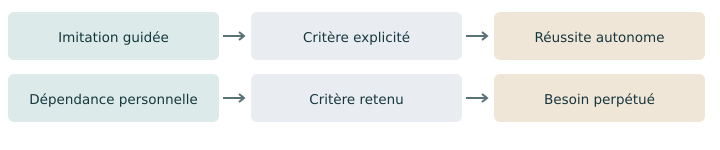

# B/L 2024 · Philosophie à l’oral · Billets du 15 juin 2024 · Corrigé guidé

*Corrigé rédigé par IA, non officiel. Signalez toute erreur.*

**Rédaction** · GPT-6.2 Astra Ultra · vitesse non renseignée · 26 novembre 2026

Le jury accorde 1 h 30 de préparation. On choisit un des deux sujets du billet pour un exposé de vingt minutes, suivi de dix minutes de discussion. Les 24 propositions ci-dessous développent les deux options de chaque billet. La date imprimée sur le feuillet est le 15 juin 2024. Le nom de fichier et le lien du calendrier portent le 14 juin. Dans l’édition guidée, chaque développement se prolonge par une question d’entretien et une réponse argumentée.

## Billet 1

Le sujet retenu au passage est **Expliquer**.

### Peut-on se trahir soi-même ?

Trahir suppose d’ordinaire deux personnes, celle qui a reçu une confiance et celle dont l’attente est déçue. Comment occuper les deux positions ? Une promesse faite à autrui engage aussi l’idée de la personne que l’on accepte d’être. Rester silencieux devant une injustice après avoir souvent défendu un camarade peut apparaître ensuite comme une rupture avec cette exigence. Il ne s’ensuit pas que toute évolution soit infidèle. Renoncer à un engagement dont on découvre le caractère injuste peut au contraire rester fidèle à ses raisons les plus profondes. La trahison de soi devient intelligible lorsqu’on peut identifier une exigence encore reconnue qu’on a sacrifiée en refusant de se l’avouer. Elle diffère d’un changement assumé et justifiable.

> [!INDICATION]
> Le regard d’autrui est-il nécessaire pour éprouver cette trahison ?

Il peut la révéler mais ne la définit pas. On peut reconnaître intérieurement la contradiction entre une conduite et une exigence maintenue.

### Expliquer

Expliquer une panne consiste à identifier le détail dont dépend son apparition. Expliquer une défaite électorale mobilise souvent plusieurs causes et des raisons d’acteurs. Dans les deux cas une simple chronologie ne suffit pas. Il faut montrer ce qui rend le fait intelligible et, selon l’enquête, ce qui se serait probablement passé si certaines conditions avaient changé. L’explication ne fait pas disparaître l’événement dans une formule. Une loi générale doit encore être reliée à des circonstances établies. Expliquer une conduite n’équivaut pas non plus à l’excuser. Comprendre l’influence d’une pression sociale peut éclairer la marge de choix qui restait. Une bonne explication répond ainsi à une question déterminée et précise ce qu’elle ne prétend pas encore établir.

> [!INDICATION]
> Une explication peut-elle être vraie tout en restant insuffisante ?

Une cause contributive réelle peut laisser ouverte la question décisive, par exemple pourquoi deux situations soumises à la même pression ont divergé.

## Billet 2

Le sujet retenu au passage est **Peut-il être préférable de ne pas savoir ?**.

### Peut-il être préférable de ne pas savoir ?

Une personne peut refuser de connaître le résultat d’une prédiction médicale lorsqu’aucune décision actuelle n’en dépend. Le savoir est disponible, mais sa possession peut bouleverser durablement la manière d’envisager chaque jour. Reconnaître une faculté de ne pas savoir protège ici l’autonomie qui motive normalement le droit d’être informé. La situation change si l’ignorance fait courir à d’autres un risque qu’ils ne peuvent choisir. De même, éviter de connaître les conséquences de son activité afin de continuer tranquillement constitue une ignorance organisée. Il faut donc distinguer la revendication face à une information imposée et le devoir d’enquête lié à une responsabilité. La préférence pour l’ignorance peut être justifiée lorsque la personne comprend ce qu’elle refuse et demeure en mesure de réexaminer son choix.

> [!INDICATION]
> Ignorer volontairement une information est-il contradictoire ?

On peut connaître son existence, sa portée générale et les conditions d’accès, tout en refusant d’en apprendre le contenu particulier.

### Le ressentiment

Le souvenir d’une injure peut soutenir une demande de réparation. Il devient ressentiment lorsque la relation à l’offense organise durablement la manière d’évaluer autrui et soi-même. Nietzsche étudie dans la *Généalogie de la morale* le renversement par lequel une impuissance à agir peut engendrer des évaluations qui condamnent l’adversaire pour ce qu’il est. Cette analyse explique une formation des valeurs, mais ne permet pas de disqualifier d’un mot toute plainte des personnes dominées. Il faut examiner la vérité du tort et la possibilité réelle d’y répondre. Le ressentiment enferme lorsqu’il exige la perpétuation de l’offenseur comme centre de sa propre vie. Une justice qui reconnaît le tort peut ouvrir d’autres manières d’agir sans demander l’oubli.

> [!INDICATION]
> En quoi une demande de réparation échappe-t-elle au ressentiment ?

Elle peut viser un changement vérifiable et permettre la reprise d’une activité autonome. Son bien-fondé doit être examiné indépendamment de l’émotion qui l’accompagne.

## Billet 3

Le sujet retenu au passage est **La barbarie**.

### Pourquoi travailler ?

On travaille pour vivre, mais deux tâches procurant le même revenu peuvent avoir des sens très différents. L’une donne une prise sur le résultat, l’autre réduit l’activité à suivre des instructions dont la fin demeure étrangère. Il faut distinguer la nécessité matérielle, la participation à une vie commune et la possibilité de reconnaître ses capacités dans une œuvre. Marx montre que l’aliénation peut affecter le rapport du travailleur à son activité et à son produit. Cela n’implique pas que tout travail rémunéré soit également aliénant, ni que le travail domestique gratuit soit libre par nature. Demander pourquoi travailler conduit donc à juger les formes d’organisation qui permettent de contribuer, de subsister et de garder du temps pour d’autres biens.

> [!INDICATION]
> Une activité cesse-t-elle d’être du travail si elle procure du plaisir ?

Le plaisir est compatible avec la contrainte d’une tâche, des obligations envers autrui et la production d’un résultat qui demande un effort.

### La barbarie

Les Grecs appelaient barbares ceux dont la langue leur était étrangère. Employer le mot pour qualifier une pratique cruelle fait passer d’une différence de culture à un jugement moral. Si l’on confond les deux, on fera de l’étranger une personne dépourvue d’humanité. Dans « Des cannibales », Montaigne retourne le regard vers les usages de ceux qui se disent civilisés. Le dépaysement critique ne commande pourtant pas de renoncer à toute condamnation. On peut juger la cruauté d’une pratique en considérant les souffrances et l’humiliation qu’elle impose, et soumettre ses propres coutumes au même test. La barbarie peut dès lors surgir au cœur d’institutions raffinées. L’emploi du terme exige de nommer le tort plutôt que d’assigner une essence à un peuple.

> [!INDICATION]
> Le refus de l’ethnocentrisme rend-il toute critique impossible ?

Il interdit surtout de prendre sa propre coutume pour preuve suffisante. Une critique justifiée doit écouter les personnes concernées et appliquer des critères réciproques.

## Billet 4

Le sujet retenu au passage est **Y-a-t-il un monde de l'art ?**.

### Y-a-t-il un monde de l'art ?

Une même boîte a l’air banale au magasin et énigmatique dans une exposition. Le « monde de l’art » désigne-t-il un milieu social qui confère un statut, ou un ensemble d’interprétations grâce auxquelles on voit autrement ? Danto examine le cas d’objets visuellement indiscernables dont l’un est une œuvre. Les propriétés visibles isolées ne suffisent pas à les distinguer. Une histoire de formes et de questions rend intelligible la seconde présentation. Pourtant une institution qui exposerait n’importe quoi sans donner de prise à l’examen ne garantirait pas la qualité de l’œuvre. Il faut distinguer l’accès à un espace de propositions artistiques et le jugement sur ce qu’une proposition y accomplit. Le monde de l’art rend certaines différences perceptibles tout en restant contestable dans ses exclusions.

> [!INDICATION]
> Une œuvre méconnue appartient-elle déjà à l’art ?

Elle peut mobiliser des formes et des intentions reconnaissables avant sa consécration. Être admis par une institution n’épuise pas la question de son statut.

### La fatigue

Deux kilomètres paraissent plus longs au retour d’une journée difficile qu’au début d’une promenade. La fatigue ne modifie pas la distance mesurée, mais le paysage des possibilités corporelles. Ce qui était immédiatement faisable exige désormais un effort ou une interruption. Réduire cette expérience à une défaillance de volonté méconnaît ce que le corps signale. Pourtant la fatigue se transforme selon le sens de l’activité, le soutien disponible ou la perspective d’en voir la fin. Elle a aussi une dimension sociale lorsque l’organisation du travail rend invisible le repos nécessaire à la poursuite des tâches. Reconnaître une limite corporelle permet de distinguer un effort librement consenti d’une injonction qui consomme les conditions mêmes de l’action.

> [!INDICATION]
> Se reposer est-il une pure absence d’activité ?

Le repos restaure des possibilités de mouvement et d’attention. Il peut être une condition active de la capacité à décider et à poursuivre un projet.

## Billet 5

Le sujet retenu au passage est **Aimer, est-ce vraiment connaître ?**.

### Aimer, est-ce vraiment connaître ?

Celui qui aime remarque parfois un changement de voix que personne d’autre n’entend. L’attention patiente donne accès à des singularités qu’un observateur pressé néglige. Pourtant le même attachement peut former un écran lorsque l’on interprète toute parole selon l’image qu’on souhaite préserver. Aimer ne garantit donc aucune transparence psychologique. Il peut ouvrir un rapport de connaissance à condition de laisser l’autre corriger ce qu’on croit savoir. L’aveu librement confié n’est pas un renseignement que l’on aurait eu le droit d’exiger. Une partie de la vérité sur autrui tient précisément à sa capacité de changer et de ne pas correspondre à notre récit. Aimer peut faire mieux connaître lorsque le désir de comprendre accepte une limite à la maîtrise.

> [!INDICATION]
> Une personne extérieure voit-elle parfois mieux que les proches ?

Sa distance peut mettre en lumière un fait dénié. Elle peut aussi manquer d’indices contextuels. Il faut confronter les interprétations aux paroles et aux actes.

### L'instant

Sur une horloge, l’instant peut être représenté par un point dépourvu de durée. Comment alors percevoir le passage d’une mélodie ? Une note isolée de tout souvenir de la précédente ne formerait aucun motif. Le présent vécu retient ce qui vient de passer et anticipe la suite sans se réduire à un intervalle arbitrairement mesuré. Bergson critique la confusion entre la durée vécue et un espace découpé en unités juxtaposées. Mais la précision des instants mesurés garde sa nécessité pour coordonner des actions. « C’est l’instant de partir » désigne encore un seuil pratique, déterminé par ce qui peut se perdre si l’on attend. Il faut ainsi distinguer le point du calcul, l’épaisseur de l’expérience et l’occasion de décider.

> [!INDICATION]
> Un instant décisif peut-il durer plusieurs minutes ?

Oui lorsqu’il désigne une occasion pratique pendant laquelle une décision change l’issue. Sa durée dépend alors de la situation, pas de la géométrie du temps.

## Billet 6

Le sujet retenu au passage est **Pourquoi obéir ?**.

### Pourquoi obéir ?

Au feu rouge, je peux obéir par peur d’une sanction, par souci d’éviter une collision ou par reconnaissance d’une règle commune. Ces motifs produisent le même arrêt sans avoir la même valeur. Expliquer une obéissance par la contrainte ne justifie pas l’autorité qui l’exige. Une règle peut faire gagner à tous une capacité de coordination dont personne ne disposerait seul. Mais l’argument perd sa force si les personnes soumises à la règle ne disposent d’aucun moyen de discuter ses fins ou de signaler ses effets injustes. La raison d’obéir tient alors aux biens de coopération et aux conditions de légitimité. Elle n’équivaut pas à un transfert total de responsabilité vers celui qui commande.

> [!INDICATION]
> Obéir à une règle peut-il être une manifestation d’autonomie ?

Oui lorsqu’on peut en comprendre et en défendre le principe, y compris lorsqu’elle contrarie l’intérêt immédiat de celui qui l’applique.

### Le miracle

Une guérison inattendue peut être appelée miracle par celui qui y reconnaît un signe et événement inexpliqué par le médecin. La rareté ne suffit pas à trancher entre les deux descriptions. Ce qui est très improbable selon un modèle n’en viole pas nécessairement les lois. Hume demande de mettre en balance la solidité d’un témoignage et celle de l’expérience régulière à laquelle il semble s’opposer. Son argument porte sur la justification de la croyance, non sur l’intensité de la gratitude éprouvée. Même une enquête qui établirait scrupuleusement la réalité de la guérison laisserait à justifier son interprétation comme intervention surnaturelle. La question du miracle articule donc preuve d’un fait, limites du savoir présent et sens religieux donné à ce fait.

> [!INDICATION]
> Découvrir une cause retire-t-il toute signification à ce que quelqu’un nommait miracle ?

Cela modifie la prétention à une exception aux lois naturelles. Une interprétation religieuse du sens de l’événement peut subsister sur un autre plan.

## Billet 7

Le sujet retenu au passage est **Pourquoi la justice a-t-elle besoin d'institutions ?**.

### Pourquoi la justice a-t-elle besoin d'institutions ?

Deux voisins assurent chacun se souvenir d’un accord sur une limite de terrain. La seule conviction personnelle ne peut départager les versions. La justice a besoin de procédures de preuve, d’un tiers impartial, d’une possibilité d’appel et de moyens d’exécuter une décision. L’institution fait durer ces garanties au-delà de la vertu d’un individu. Elle permet aussi aux parties de faire valoir une règle dont l’issue ne dépend pas uniquement de leur force. Mais un appareil stable peut appliquer régulièrement une règle injuste. Distinguer la légalité de la justice conduit alors à demander comment la critique, la révision et la publicité sont elles-mêmes instituées. Le besoin d’institutions vient autant de la nécessité de rendre les jugements contestables que de celle de leur donner force.

> [!INDICATION]
> Pourquoi la bonté d’un arbitre ne suffit-elle pas ?

Les personnes doivent pouvoir connaître les règles et contester une erreur sans dépendre de la faveur de cet arbitre ou de son successeur.

### Le dégoût

Le dégoût provoque un mouvement de recul qui paraît parfois précéder tout jugement. Devant une nourriture avariée, cette distance peut nous protéger. Mais un aliment apprécié ailleurs peut aussi nous répugner par simple habitude. Lorsque le dégoût se porte sur des personnes, son évidence corporelle risque de faire passer un apprentissage social pour une raison morale. Il faut distinguer ce que l’émotion révèle de notre histoire sensible et ce qu’elle autorise à conclure sur son objet. Le dégoût envers une pratique cruelle peut alerter sur un tort réel, qui devra être décrit indépendamment de l’intensité de l’aversion. Reconnaître un affect n’oblige ni à l’ignorer ni à lui déléguer le jugement sur la dignité des autres.

> [!INDICATION]
> Peut-on critiquer un dégoût qu’on continue d’éprouver ?

Oui. L’affect immédiat et l’assentiment qu’on lui donne sont distincts. Revoir des habitudes ou des représentations peut ensuite transformer la sensibilité.

## Billet 8

Le sujet retenu au passage est **Peut-il y avoir un État mondial ?**.

### Peut-il y avoir un État mondial ?

Les émissions d’un pays affectent les habitants d’autres pays. Une règle commune semble donc nécessaire, mais exige-t-elle un État mondial ? Un État dispose d’institutions qui produisent et font respecter un droit commun. Une fédération d’États peut coordonner certaines compétences sans constituer un souverain unique sur toutes les autres. Kant, dans son projet de paix perpétuelle, examine une fédération d’États libres et le danger d’un pouvoir universel despotique. L’absence de rival extérieur pourrait favoriser la paix et priver en même temps les citoyens de recours contre la concentration du pouvoir. La possibilité d’un État mondial se mesure donc à la représentation, au contrôle des autorités et à la diversité des niveaux de décision, autant qu’à sa capacité matérielle à imposer une règle.

> [!INDICATION]
> Une institution mondiale qui fixe une norme sanitaire est-elle déjà un État ?

Elle peut exercer une compétence commune limitée. Il faut examiner l’origine de son autorité, ses moyens d’exécution et la manière dont ses pouvoirs sont révisés.

### Classer

Ranger des livres par taille et les ranger par discipline sont deux classements exacts pour des buts différents. Classer exige un critère, une unité de comparaison et une décision sur les cas frontières. Certaines classifications prétendent en outre révéler des relations réelles. Classer les espèces selon des parentés évolutives peut mieux expliquer leurs ressemblances qu’un simple tri par couleur. Mais classer des personnes peut modifier les conduites de ceux qui classent comme de ceux qui reçoivent une étiquette. Une catégorie administrative créée pour ouvrir un droit peut aussi enfermer quelqu’un dans une description périmée. Un classement se juge donc par sa cohérence, sa pertinence pour l’enquête et la possibilité de rectifier ses effets sur les êtres classés.

> [!INDICATION]
> Le fait qu’un classement soit construit le rend-il arbitraire ?

Non. Un critère est choisi, mais on peut vérifier s’il correspond aux relations recherchées et s’il explique des différences auparavant mal comprises.

## Billet 9

Le sujet retenu au passage est **A-t-on besoin de maîtres ?**.

### A-t-on besoin de maîtres ?

Un maître de musique demande à son élève de recommencer une phrase et lui montre comment entendre une note trop basse. Il pourrait aussi corriger sans expliquer et rendre l’élève perpétuellement dépendant de son verdict. On a besoin d’autrui pour accéder à des exigences que l’on ne sait pas d’abord percevoir. Mais une autorité pédagogique se justifie si elle transmet le critère qui permettra de la discuter et de s’en passer. Kant décrit la minorité comme l’incapacité de se servir de son entendement sans la direction d’autrui. Il faut distinguer l’accompagnement qui forme cette capacité et la tutelle qui empêche son exercice. Devenir autonome ne signifie pas ne plus rien apprendre d’un maître, mais choisir et évaluer les médiations dont on a besoin.

> [!INDICATION]
> Le maître doit-il accepter toute objection de l’élève ?

Il doit pouvoir en examiner les raisons. Une exigence justifiée de sécurité ou de rigueur peut subsister sans que la seule autorité personnelle fasse preuve.

### Force et droit

La force obtient parfois l’exécution d’un ordre. Le droit prétend ajouter une obligation qui vaut même lorsque la contrainte immédiate disparaît. Rousseau, en examinant le prétendu droit du plus fort, remarque que si céder à la force suffisait à créer un devoir, tout changement de puissance changerait sur-le-champ le titulaire légitime. La notion de droit n’expliquerait plus rien. Pourtant un droit dénué de toute garantie peut rester lettre morte pour celui qui ne possède aucune force propre. L’enjeu est d’instituer une force publique limitée et contrôlée qui protège des obligations justifiées par d’autres raisons que sa propre supériorité. La contrainte intervient alors dans l’effectivité du droit, sans fournir le critère de sa justice.

> [!INDICATION]
> Une loi est-elle injuste parce qu’elle peut être imposée ?

La possibilité d’exécution ne tranche pas son bien-fondé. Il faut évaluer sa règle, ses fins et les garanties offertes contre les abus.

## Billet 10

Le sujet retenu au passage est **Le désir est-il sans limites ?**.

### Le désir est-il sans limites ?

La soif s’apaise après qu’on a bu. Le désir de prestige, lui, peut recommencer à chaque comparaison avec une personne mieux classée. Ces exemples suggèrent que le désir a des structures différentes selon ses objets et l’ordre social où il se forme. Épicure distingue les désirs naturels et nécessaires de ceux qui ne rencontrent aucun terme stable dans la nature de l’objet. Mais une curiosité intellectuelle peut être indéfiniment renouvelée sans rendre chaque satisfaction vaine. Il faut distinguer absence de borne finale, dépendance insatiable et possibilité d’une satisfaction présente. La liberté ne consiste pas nécessairement à tout limiter. Elle demande d’identifier les désirs dont la poursuite détruit continuellement le bien qu’ils nous promettent.

> [!INDICATION]
> Peut-on être satisfait et continuer à désirer ?

La satisfaction d’un problème résolu peut ouvrir une nouvelle question. L’ouverture indéfinie d’une activité diffère de l’impossibilité d’en goûter le moindre résultat.

### Éduquer et instruire

Instruire un élève sur les preuves lui transmet des connaissances. L’obliger à écouter une objection sans humilier celui qui la présente engage aussi une manière de vivre avec autrui. Distinguer instruction et éducation évite de faire d’un fort savoir la garantie d’une bonne conduite. Mais une transmission prétendument neutre forme déjà des habitudes, comme vérifier une source, accepter de corriger une réponse ou plagier si seule la note compte. Condorcet défend une instruction publique qui permette de juger par soi-même et se méfie de la formation de croyances politiques obligatoires. L’école doit donc expliciter les normes nécessaires à l’apprentissage commun sans s’attribuer le droit de fixer toutes les fins de la vie d’un élève.

> [!INDICATION]
> Transmettre le respect de la preuve revient-il à imposer une opinion ?

Il s’agit d’une règle de discussion qui permet de contester des opinions particulières, y compris celles du professeur. Sa portée reste définie.

## Billet 11

Le sujet retenu au passage est **A-t-on toujours le choix ?**.

### A-t-on toujours le choix ?

Une personne sommée d’accepter un contrat sous la menace de perdre immédiatement son logement peut prononcer « oui ». L’existence grammaticale d’une autre réponse ne suffit pas à établir une liberté effective. Il faut distinguer alternatives logiquement possibles, options matériellement accessibles et capacité de délibérer sans pression disproportionnée. Pourtant déclarer tout choix impossible dès qu’une contrainte existe effacerait les initiatives réellement prises dans des circonstances difficiles. On peut reconnaître une marge étroite sans s’en servir pour rendre l’individu responsable de toute sa situation. La question exige donc un examen concret des coûts du refus, des informations et du soutien accessible. Faire exister de nouvelles options peut être une tâche collective, au-delà du simple conseil de mieux choisir.

> [!INDICATION]
> Dire que quelqu’un aurait pu faire autrement suffit-il à le blâmer ?

Il faut déterminer ce que cette autre action aurait coûté, ce qu’il savait et ce qu’il était raisonnable de lui demander dans ces circonstances.

### La confusion

On confond deux visages qui se ressemblent, mais aussi deux notions lorsque le même mot sert à désigner la cause d’un acte et sa justification. Dans le premier cas une distinction perceptive a manqué. Dans le second, un raisonnement entier peut sembler convaincant parce que le terme change de sens en cours de route. Sortir de la confusion demande davantage que remplacer un mot par sa définition. Un exemple où les notions se séparent montre quelles conséquences leur différence entraîne. La fatigue explique une erreur sans suffire à l’excuser si l’on a volontairement ignoré un danger. Il existe aussi des situations réellement mêlées, où la bonne analyse maintient plusieurs causes plutôt que d’imposer une séparation fictive.

> [!INDICATION]
> Toute distinction supplémentaire clarifie-t-elle le problème ?

Une distinction sans effet sur les cas ni sur les raisons peut encombrer l’analyse. Sa valeur se mesure à ce qu’elle permet de comprendre autrement.

## Billet 12

Le sujet retenu au passage est **Y-a-t-il de mauvais désirs ?**.

### Y-a-t-il de mauvais désirs ?

Désirer vaincre à un jeu peut nourrir un entraînement partagé. Désirer humilier le perdant donne un autre objet à une impulsion apparemment semblable. Juger un désir réclame donc d’identifier ce qu’il vise, comment il a été formé et ce qu’exigerait sa satisfaction. Une pensée passagère non choisie ne se juge pas comme la décision de l’entretenir ou de l’accomplir. Cependant s’interdire toute critique de ses désirs sous prétexte qu’ils sont spontanés empêcherait d’examiner les habitudes et les comparaisons sociales qui les renforcent. Un désir devient mauvais par son objet, sa disproportion ou le genre de dépendance qu’il construit. Ce jugement justifie un travail sur l’attention et l’action, sans confondre éprouver et consentir.

> [!INDICATION]
> Un désir nuisible envers soi et un désir injuste envers autrui se jugent-ils pareillement ?

Le premier concerne notamment les conditions d’une vie bonne, le second les droits d’autres personnes. Les critères peuvent se recouper sans être identiques.

### La fin de l'État

La « fin » de l’État peut désigner sa raison d’être ou sa disparition. Dans le premier sens, la sécurité explique une part de l’institution politique. Hobbes rapporte l’établissement d’un pouvoir commun à la recherche de la paix entre individus vulnérables. Mais la sécurité d’un gouvernement n’est pas nécessairement celle de ses habitants, et une paix qui interdit toute contestation laisse ouverte la question de la liberté. Dans le second sens, imaginer la disparition de l’État suppose d’indiquer quelles pratiques assureraient les garanties, les arbitrages et les biens communs qui lui étaient confiés. Les deux sens se rejoignent lorsqu’une institution est jugée à partir de ce qu’elle permet aux personnes de faire, plutôt qu’à partir de sa seule conservation.

> [!INDICATION]
> Une collectivité sans État serait-elle forcément sans règles ?

Des coutumes, des assemblées et des obligations réciproques peuvent exister. Il reste à préciser qui protège les personnes lorsque l’accord local leur fait défaut.

[Source des billets](https://www.ens.psl.eu/sites/default/files/bl_sujets_oraux_philosophie_14062024.pdf) · [Rapport annuel du jury](https://www.ens.psl.eu/sites/default/files/2024_bl_rapport_oral_philosophie.pdf).
