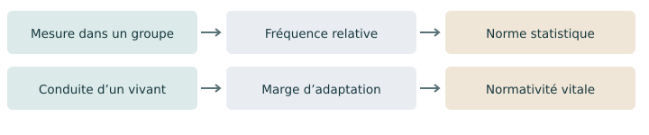

# B/L 2024 · Philosophie à l’oral · Billets du 17 juin 2024 · Corrigé guidé

*Corrigé rédigé par IA, non officiel. Signalez toute erreur.*

**Rédaction** · GPT-6.2 Astra Ultra · vitesse non renseignée · 26 novembre 2026

Le jury accorde 1 h 30 de préparation. On choisit un des deux sujets du billet pour un exposé de vingt minutes, suivi de dix minutes de discussion. Les 24 propositions ci-dessous développent les deux options de chaque billet. Le feuillet est daté du 17 juin 2024. Dans l’édition guidée, chaque développement se prolonge par une question d’entretien et une réponse argumentée.

## Billet 1

Le sujet retenu au passage est **L'innocence**.

### Qu'est-ce qui dépend de nous ?

Un marin décide de réduire la voile, mais ne décide pas du vent. Le *Manuel* d’Épictète distingue ce qui relève de notre jugement et de notre impulsion de ce qui échappe à notre autorité, comme la réputation ou l’issue d’une entreprise. Cette distinction prévient la confusion entre bien agir et tout réussir. Pourtant le domaine de l’action ne se partage pas en deux cases étanches. S’exercer accroît une capacité et s’accorder avec d’autres rend possible une action qui nous dépassait isolément. De plus, nos premiers mouvements affectifs ne sont pas entièrement choisis. Dépend de nous, à des degrés divers, ce sur quoi une initiative responsable peut porter. Cette réponse permet d’agir sur les conditions externes sans se reprocher d’en maîtriser tous les effets.

> [!INDICATION]
> Un échec prouve-t-il qu’aucune partie de la situation ne dépendait de nous ?

Le résultat engage plusieurs causes. On peut évaluer la qualité d’une décision et de sa préparation sans confondre celles-ci avec son issue.

### L'innocence

Une personne acquittée faute de preuves et un enfant qui ignore le sens d’une faute peuvent être dits innocents. Dans le premier cas il s’agit d’une position juridique. La présomption d’innocence attribue à l’accusation la charge de prouver la culpabilité. Dans le second, on évoque l’absence d’intention ou de discernement. Les deux ne se recouvrent pas. Un acte dommageable peut être établi sans que son auteur ait compris ce qu’il faisait. La réparation envers la victime reste alors une autre question. L’innocence peut enfin désigner la confiance de celui qui ne soupçonne pas la tromperie, qualité qui ne donne aucune garantie contre l’erreur. Préciser ces sens évite de demander à une personne de prouver sa pureté pour bénéficier de ses droits.

> [!INDICATION]
> Une enquête indispensable viole-t-elle la présomption d’innocence ?

Elle est compatible avec cette présomption si elle examine aussi les éléments à décharge et ne traite pas le soupçon comme une condamnation.

## Billet 2

Le sujet retenu au passage est **La guerre**.

### Tout savoir peut-il se transmettre ?

Une recette donne les quantités et la température, mais le débutant ne sait pas encore reconnaître la consistance d’une pâte. Est-ce un savoir intransmissible ? L’échec de la consigne écrite montre une limite d’un mode de transmission, pas nécessairement de toute transmission. Montrer un geste, pratiquer sous le regard d’un autre et recevoir une correction forment le savoir-faire que les mots seuls ne suffisaient pas à produire. Pourtant l’apprentissage requiert une appropriation personnelle. Personne ne peut effectuer à la place du novice l’ajustement qu’il doit sentir. Le savoir peut souvent se transmettre par la construction d’occasions d’apprendre, tout en transformant le contenu et en laissant un reste lié à une expérience singulière. Il faut donc distinguer transmettre et déposer une copie.

> [!INDICATION]
> Une démonstration mathématique est-elle parfaitement transmissible ?

Les étapes peuvent être intégralement formulées, mais les comprendre exige encore que le lecteur reconnaisse leur portée et sache en faire usage.

### La guerre

Toutes les violences collectives ne constituent pas une guerre, et un état de guerre peut persister pendant une trêve sans affrontement en cours. Le concept désigne aussi une relation organisée entre puissances ou groupes qui se reconnaissent un adversaire public. Rousseau distingue la guerre comme relation entre États de la haine personnelle entre individus. Cette distinction aide à comprendre pourquoi une personne civile ne devient pas moralement coupable du seul fait de son appartenance. Les conflits internes mettent toutefois à l’épreuve une définition exclusivement étatique. Il faut alors examiner l’organisation de la contrainte et la rupture des garanties communes. Penser la guerre demande enfin de distinguer l’explication de ses causes et sa justification. La paix exige des institutions qui rendent le désaccord politiquement traitable.

> [!INDICATION]
> Une paix se réduit-elle à l’interruption des hostilités ?

Une trêve peut sauver des vies tout en laissant intacte la relation d’ennemis. Une paix durable demande des garanties et des procédures de règlement.

## Billet 3

Le sujet retenu au passage est **Le sens du devoir**.

### Qu'est-ce qu'un paradoxe ?

Un paradoxe va contre une opinion reçue, mais toute provocation n’est pas un paradoxe instructif. Celui de Zénon sur la course oblige à concilier l’expérience du mouvement et la division indéfinie d’un trajet. La difficulté vient de raisons qui semblent chacune admissibles et dont la combinaison produit une conclusion surprenante. Distinguer une infinité de subdivisions d’une durée infinie permet de localiser le passage contestable. D’autres paradoxes révèlent une contradiction dans les règles mêmes d’un langage. Leur intérêt est donc méthodique. Au lieu de rire d’une conclusion invraisemblable, on précise les prémisses et l’inférence qui la font apparaître inévitable. Une fois le point de tension résolu, la surprise initiale peut laisser place à une connaissance nouvelle des concepts.

> [!INDICATION]
> Une contradiction est-elle toujours paradoxale ?

Deux phrases incompatibles peuvent résulter d’une simple inadvertance. Le paradoxe exige généralement qu’une raison plausible nous conduise vers cette incompatibilité.

### Le sens du devoir

Une personne rapporte un portefeuille qu’elle aimerait garder. Le sens du devoir se manifeste lorsqu’elle reconnaît une raison d’agir qui vaut malgré son intérêt immédiat. Chez Kant, la valeur morale dépend de la maxime et du respect de la loi, non du seul fait que l’acte extérieur corresponde à la règle. Pourtant ressentir une obligation avec intensité ne garantit pas qu’elle soit juste. Un employé peut éprouver comme devoir une consigne discriminatoire apprise très tôt. Il faut pouvoir examiner si la maxime est généralisable et si elle respecte la personne concernée. Le sens du devoir inclut donc une sensibilité aux exigences et la responsabilité de les soumettre à une réflexion. L’obéissance scrupuleuse ne remplace pas ce jugement.

> [!INDICATION]
> Une conduite généreuse accomplie avec plaisir a-t-elle forcément moins de valeur ?

Le plaisir ressenti ne détermine pas à lui seul la maxime. Il faut demander ce qui ferait maintenir le geste quand l’agrément immédiat disparaît.

## Billet 4

Le sujet retenu au passage est **Y-a-t-il des révolutions en art ?**.

### La précaution

On ferme temporairement un sentier après un éboulement voisin, sans pouvoir calculer exactement le risque d’un nouveau glissement. La prévention répond à un danger identifié dont on peut estimer la probabilité. La précaution intervient lorsque les connaissances restent incertaines mais que les dommages plausibles seraient graves ou irréversibles. Attendre une certitude peut revenir à décider en faveur du risque. Inversement invoquer une possibilité purement imaginaire pour interdire toute action rendrait la vie commune impossible. Il faut chercher des indices, comparer les coûts des options et décider de mesures proportionnées, révisables lorsque l’enquête avance. La précaution est donc une forme active de décision sous incertitude. Elle oblige à organiser l’acquisition de connaissances et à rendre visibles les personnes qui supporteraient l’erreur.

> [!INDICATION]
> L’absence de preuve du danger établit-elle la sécurité ?

Elle peut signifier que les investigations sont insuffisantes. Il faut examiner leur qualité, les scénarios plausibles et les conséquences des différentes erreurs.

### Y-a-t-il des révolutions en art ?

Changer la couleur d’un décor renouvelle un spectacle sans révolutionner le théâtre. Une révolution artistique modifie plus profondément les critères qui rendent une œuvre lisible ou même reconnaissable comme œuvre. Les ready-made de Duchamp déplacent par exemple l’attention de la fabrication manuelle vers le choix, le contexte et l’acte de désignation. Pourtant cette rupture serait incompréhensible sans les pratiques d’exposition et les attentes antérieures qu’elle déplace. De plus, une innovation isolée devient historiquement révolutionnaire si elle ouvre à d’autres des possibilités durables de création et de jugement. Le terme ne mesure donc pas simplement la violence du scandale initial. Il désigne une modification des opérations disponibles, dont l’étendue se juge souvent après coup.

> [!INDICATION]
> Une révolution artistique abolit-elle ce qui la précède ?

Elle peut faire coexister des critères nouveaux avec des formes anciennes qui continuent d’être pratiquées et parfois relues autrement.

## Billet 5

Le sujet retenu au passage est **L'exception**.

### Faut-il condamner les illusions ?

Une illusion d’optique persiste parfois alors même que l’on connaît la mesure exacte des lignes. L’illusion diffère alors de l’erreur à laquelle on peut cesser d’adhérer. Elle révèle le fonctionnement de la perception. Dans d’autres cas, on appelle illusion une croyance nourrie par un désir, comme la certitude qu’un proche ne pourrait jamais se tromper. Freud distingue, dans sa réflexion sur l’illusion, cette origine dans le désir de la question séparée de savoir si le contenu est faux. Condamner toutes les illusions ensemble manquerait aussi le jeu volontaire d’une fiction dont le spectateur connaît le cadre. La critique doit viser la manière dont l’illusion empêche ou stimule l’épreuve du réel et les torts qu’entraîne le refus de la corriger.

> [!INDICATION]
> Une fiction émouvante nous trompe-t-elle ?

On peut éprouver réellement une émotion tout en sachant qu’une scène est inventée. La croyance à l’existence de l’événement n’est pas nécessaire.

### L'exception

Accorder plus de temps à un candidat empêché d’écrire aussi vite que les autres fait exception à une règle de durée. Est-ce rompre l’égalité ou en réaliser le principe ? Aristote définit l’équité comme une correction de la loi générale lorsque la singularité d’un cas échappe à la formulation générale. L’exception doit alors être justifiable par une raison que l’on appliquerait à tout cas comparable. Elle se distingue du privilège accordé parce que le requérant est puissant. Mais des exceptions qui se multiplient peuvent révéler une règle mal construite et exiger sa révision publique. Leur fonction varie donc selon qu’elles manifestent une limite de la généralité, protègent la finalité de la règle ou permettent au décideur de s’en dispenser arbitrairement.

> [!INDICATION]
> Une exception peut-elle confirmer une règle ?

Elle peut montrer où la règle ordinaire s’applique en précisant son domaine. Un contre-exemple à un énoncé réellement universel le réfute, lui.

## Billet 6

Le sujet retenu au passage est **Penser est-il assimilable à un travail ?**.

### Penser est-il assimilable à un travail ?

Une pensée peut surgir pendant une promenade alors que le problème avait résisté à plusieurs heures d’effort. Ce surgissement contredit-il l’idée d’un travail de la pensée ? Chercher exige de fixer une question, essayer des hypothèses, revenir sur une objection et en conserver la trace. Ce sont des efforts réglés qui transforment la manière dont on peut comprendre un objet. Mais le résultat n’obéit pas au commandement de la volonté comme une tâche répétitive. L’attention disponible et l’interruption peuvent être fécondes. Assimiler totalement la pensée au travail mesurable conduirait à prendre le temps passé pour un critère de justesse. La comparaison éclaire la patience et l’apprentissage nécessaires, tout en laissant ouverte la part d’invention et de révision des fins.

> [!INDICATION]
> Une machine qui produit rapidement une réponse retire-t-elle tout travail au penseur ?

Formuler le problème, contrôler la pertinence de la réponse et pouvoir répondre de ses conséquences restent des opérations intellectuelles distinctes.

### La dette

Je dois une somme à une amie et je lui dois aussi beaucoup pour son aide. La première dette peut être éteinte par un paiement défini. La seconde relève de la gratitude et se dénaturerait si un tarif prétendait la solder. La dette lie le présent à un bien ou à une promesse antérieure, mais peut produire aussi une dépendance. Un créancier qui maintient indéfiniment le débiteur dans l’impossibilité de s’acquitter transforme une obligation en pouvoir sur sa personne. Des règles de prescription ou de remise peuvent préserver la possibilité d’un nouvel avenir économique. Toute dette ne doit donc pas être traitée selon un modèle comptable. Il faut préciser son origine, son terme possible et les libertés qu’elle affecte.

> [!INDICATION]
> Un don crée-t-il nécessairement une dette ?

Il peut faire naître de la gratitude sans créance exigible. Un cadeau dont le prix caché serait l’obéissance cesse de fonctionner comme un don libre.

## Billet 7

Le sujet retenu au passage est **A-t-on le droit de se révolter ?**.

### A-t-on le droit de se révolter ?

Un groupe de citoyens refuse de considérer une décision régulière comme juste et réclame publiquement sa révision. Demander s’il en a le droit oblige à distinguer les garanties juridiques de contestation et la justification morale d’une opposition à la loi elle-même. Une indignation sincère ne tranche pas à elle seule. Il faut préciser le tort invoqué, les personnes affectées, les raisons partageables et les possibilités institutionnelles de recours. Dans sa réflexion sur la désobéissance civile, Rawls examine la portée d’une adresse publique au sens de la justice des concitoyens. Le jugement doit aussi considérer les droits de ceux qui désapprouvent. Une société politique montre sa légitimité en laissant examiner ses règles à la lumière des principes qu’elle proclame.

> [!INDICATION]
> Une révolte peut-elle être compréhensible sans être justifiée en tout point ?

Expliquer les griefs et l’absence de recours ne suffit pas à justifier chaque action. L’examen du tort initial et celui des moyens restent distincts.

### Le normal et le pathologique

Une personne peut présenter une caractéristique rare sans être malade. À l’inverse un trouble très fréquent n’est pas rendu sain par sa banalité. Canguilhem distingue la norme statistique, qui indique une fréquence, de la normativité du vivant, sa capacité à instituer des manières de vivre et à supporter des variations du milieu. Un état peut rester viable à des conditions si étroites que la latitude d’action a réellement diminué. La parole de la personne et l’étude de son milieu deviennent alors essentielles. Cela ne rend pas arbitraires les mesures médicales. Elles permettent d’établir les contraintes et les possibilités de traitement. Le jugement sur le pathologique gagne à les relier à ce que la personne peut effectivement faire et éprouver.

> [!INDICATION]
> Une différence corporelle qui gêne dans un seul milieu est-elle forcément une maladie ?

Il faut examiner le milieu lui-même. Un aménagement peut lever une limitation sans qu’il soit nécessaire de définir la personne par un défaut intrinsèque.

## Billet 8

Le sujet retenu au passage est **Le désenchantement**.

### Peut-on nier l'évidence ?

Voir le soleil se déplacer semble évident, mais cette évidence d’apparition ne démontre pas que le soleil tourne autour d’une Terre immobile. On peut donc refuser la conclusion qu’on avait attachée à une expérience sans nier ce qui apparaît. Dans le doute cartésien, la remise en question des croyances cherche une certitude qui résiste aux motifs de douter. Elle n’ordonne pas de déclarer faux tout ce que l’on perçoit. Reste le cas du déni, où la gêne suscitée par un fait conduit à rejeter d’avance chaque preuve. Son caractère volontaire se reconnaît souvent à l’absence de condition concevable de révision. Nier l’évidence peut ainsi être une exigence critique ou une fuite, selon la distinction proposée et les épreuves qu’on accepte.

> [!INDICATION]
> Une expérience nouvelle qui contredit un calcul doit-elle être rejetée ?

Ni le calcul ni l’observation ne sont infaillibles par leur seule forme. Il faut vérifier hypothèses, instruments et inférence avant de localiser l’erreur.

### Le désenchantement

Une éclipse autrefois interprétée comme un signe devient prévisible par le calcul. Weber associe le désenchantement à une rationalisation par laquelle les événements apparaissent en principe explicables et maîtrisables sans recours aux forces magiques. Cela ne signifie pas que chaque individu comprenne personnellement le fonctionnement des techniques qui l’entourent. Il peut même en dépendre davantage. Cela ne démontre pas non plus que toute valeur ait disparu. La connaissance scientifique décrit des moyens et des conséquences, mais ne choisit pas entre toutes les fins ultimes. Le désenchantement peut donc produire une responsabilité nouvelle et une inquiétude sur le sens. La capacité d’admirer une éclipse prévisible montre enfin que la perte d’une explication magique n’épuise pas l’expérience du merveilleux.

> [!INDICATION]
> Une société techniquement avancée est-elle nécessairement débarrassée des croyances irrationnelles ?

La possibilité de calculer certains phénomènes ne garantit pas l’usage critique de la raison dans toutes les décisions ou toutes les croyances.

## Billet 9

Le sujet retenu au passage est **L'attente**.

### Qu'est-ce qu'un tyran ?

Un gouvernant sévère et un tyran peuvent prendre la même mesure impopulaire. Le critère ne peut donc être la seule humeur des gouvernés. Dans une distinction classique d’Aristote, la tyrannie oriente le pouvoir d’un seul vers l’avantage du gouvernant, au lieu du bien commun. Cette orientation s’observe aussi dans les institutions. Les décisions dépendent-elles d’une volonté sans recours, la critique est-elle possible et la règle lie-t-elle celui qui l’édicte ? Même un pouvoir momentanément bienveillant peut rester tyrannique si les sujets vivent à la merci d’un changement arbitraire. Le terme demande donc de confronter les fins proclamées aux garanties effectives. Il faut éviter de l’utiliser comme simple injure contre une autorité dont on désapprouve une décision.

> [!INDICATION]
> Une décision majoritaire peut-elle présenter un caractère tyrannique ?

La majorité peut priver durablement une minorité de droits et de recours. Le nombre des décideurs ne suffit pas à écarter l’arbitraire.

### L'attente

Attendre un train et attendre un ami peuvent durer également longtemps. Dans le premier cas, le temps est scandé par un horaire et un retard mesurable. Dans le second, il est chargé des interprétations possibles de l’absence. L’attente est une manière active d’habiter le présent à partir d’un événement futur qui ne dépend pas entièrement de nous. Elle peut devenir une suspension paralysante lorsque toute valeur du moment dépend du signal espéré. Mais savoir attendre peut aussi faire place à une parole ou à une maturation que l’impatience détruirait. Il faut donc distinguer attente imposée et disponibilité choisie. Le pouvoir de faire attendre manifeste parfois une asymétrie sociale, lorsque le temps d’une personne compte systématiquement moins que celui d’une autre.

> [!INDICATION]
> Attendre revient-il à n’avoir rien décidé ?

On peut décider de ne pas agir prématurément et fixer un moment où l’on réévaluera la situation. L’attente possède alors des raisons et des limites.

## Billet 10

Le sujet retenu au passage est **Qu'est-ce qu'une expérience de pensée ?**.

### Qu'est-ce qu'une expérience de pensée ?

Galilée imagine deux corps inégalement lourds liés ensemble pour éprouver l’idée que le plus lourd tombe toujours plus vite. Selon cette idée, le plus léger devrait ralentir le plus lourd, mais l’ensemble, devenu plus lourd, devrait tomber plus vite. Cette contradiction met à l’épreuve un principe sans qu’il soit nécessaire d’assister à la chute imaginée. L’expérience de pensée isole des conditions, demande quelles conséquences suivent de l’hypothèse et expose une tension accessible au jugement. Elle ne permet pas pour autant de fixer par imagination la valeur d’une accélération réelle. Sa force dépend de la clarté du dispositif et de la pertinence des prémisses admises. Elle transforme donc la question à soumettre ensuite au calcul ou à l’observation.

> [!INDICATION]
> Qu’est-ce qui la distingue d’une simple histoire fictive ?

Les détails sont choisis pour tester une thèse déterminée. On doit pouvoir expliquer quelle réponse deviendrait impossible ou quelle distinction serait rendue nécessaire.

### Les coutumes

Une coutume se reconnaît à la répétition partagée d’une conduite et à l’attente que les autres la poursuivront. Saluer en entrant dans une pièce peut établir une reconnaissance réciproque sans qu’aucun texte l’ordonne. Mais la facilité acquise fait parfois passer une règle locale pour une nécessité naturelle. Montaigne tire de la diversité des usages un moyen d’examiner ses propres évidences. Constater la diversité ne suffit ni à déclarer toutes les pratiques équivalentes ni à autoriser l’étranger à juger sans comprendre. Il faut déterminer les fonctions, les voix et les effets de l’usage. Une coutume demeure vivante lorsque ses participants peuvent la transmettre, la discuter et en corriger les conséquences au lieu de se voir imposer un passé immobile.

> [!INDICATION]
> Une coutume récente est-elle une contradiction ?

Un usage peut se stabiliser rapidement si les attentes deviennent réciproques. L’ancienneté renforce parfois son autorité sans constituer sa seule condition d’existence.

## Billet 11

Le sujet retenu au passage est **L'indépendance**.

### Les sciences doivent-elles être neutres ?

Le résultat d’une mesure doit pouvoir être contrôlé indépendamment des préférences politiques de l’expérimentateur. C’est une exigence de méthode. Le choix de mesurer la pollution d’un quartier plutôt que celle d’un autre engage pourtant des priorités et des ressources. Weber distingue le constat de faits et le jugement sur ce qui doit être. Une enquête peut éclairer les conséquences d’un choix public sans prétendre en déduire mécaniquement la fin souhaitable. Exiger une neutralité totale masquerait les choix de sujets et les risques assumés. Renoncer à toute objectivité livrerait au contraire les faits aux intérêts dominants. La bonne exigence est la publicité des méthodes, des incertitudes et des conditions de financement, avec possibilité de contradiction indépendante.

> [!INDICATION]
> Mentionner ses valeurs dans un travail détruit-il son objectivité ?

Les rendre explicites peut aider à contrôler leurs effets. La solidité des conclusions dépend encore des données, des méthodes et de leur examen contradictoire.

### L'indépendance

Une personne qui vit seule dépend d’un réseau d’eau, de transport et de soins. L’absence de relations visibles n’est donc pas un critère sûr d’indépendance. Il faut préciser envers qui et pour quelle action on veut ne pas dépendre. Disposer de ressources propres peut soustraire à une permission arbitraire. Mais une coopération choisie peut également donner une autonomie supérieure à l’isolement. Un journal indépendant doit pouvoir enquêter sur celui qui le finance, ce qui exige parfois plusieurs sources de revenu et des règles collectives. L’indépendance se définit ainsi moins par la suppression de toute relation que par la capacité de les connaître, d’en diversifier les appuis et de contester les décisions qui nous concernent.

> [!INDICATION]
> Peut-on devenir plus indépendant en demandant de l’aide ?

Oui si cette aide développe une capacité durable ou ouvre des alternatives. Il faut aussi examiner si les conditions du soutien instaurent une nouvelle dépendance arbitraire.

## Billet 12

Le sujet retenu au passage est **Qu'est-ce qu'un musée ?**.

### Qu'est-ce qu'un musée ?

Une réserve fermée au public conserve des objets, mais la fonction d’un musée ne s’épuise pas dans le stockage. Sélectionner, rapprocher, éclairer et documenter produisent une manière de voir. Un masque autrefois porté dans un rite peut devenir œuvre d’art ou document ethnographique selon le parcours proposé. Le déplacement protège parfois l’objet tout en risquant d’effacer ses usages et l’histoire de son acquisition. Un musée défendable doit donc rendre accessibles les raisons de ses classements et la parole des communautés concernées. Il garde des traces que personne ne pourrait seul conserver, mais peut aussi rouvrir une histoire plutôt que consacrer une fois pour toutes le récit de ceux qui ont collectionné.

> [!INDICATION]
> Restituer un objet revient-il à renoncer à toute transmission ?

Non. Une transmission peut prendre la forme d’une coopération, de documents partagés ou d’une présentation dans le lieu auquel l’objet est rendu.

### Le pardon

Pardonner une offense ne signifie ni nier qu’elle a eu lieu ni déclarer qu’elle était justifiée. Sans reconnaissance du tort, l’objet du pardon disparaîtrait. Arendt lie le pardon à la difficulté créée par l’irréversibilité de l’action. Ce qui a été fait ne peut être effacé, mais la relation future n’est pas obligée de reproduire indéfiniment le rapport entre l’offenseur et l’offensé. Cela n’autorise personne à exiger le pardon de la victime ni à remplacer une réparation publique par une réconciliation déclarée. Le droit peut juger un acte au nom de la collectivité tandis qu’une personne décide, à son rythme, de la relation qu’elle souhaite ou non poursuivre. Pardonner demeure distinct d’oublier et de refaire confiance.

> [!INDICATION]
> Le pardon suppose-t-il de reprendre la relation antérieure ?

Une personne peut renoncer à un ressentiment ou à une demande personnelle tout en maintenant une distance protectrice et en souhaitant justice.

[Source des billets](https://www.ens.psl.eu/sites/default/files/bl_sujets_oraux_philosophie_17062024.pdf) · [Rapport annuel du jury](https://www.ens.psl.eu/sites/default/files/2024_bl_rapport_oral_philosophie.pdf).
