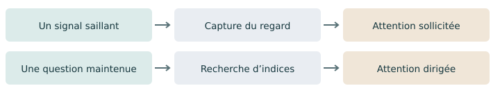

# B/L 2024 · Philosophie à l’oral · Autres tirages du jury · Corrigé guidé

*Corrigé rédigé par IA, non officiel. Signalez toute erreur.*

**Rédaction** · GPT-6.2 Astra Ultra · vitesse non renseignée · 26 novembre 2026

Le jury accorde 1 h 30 de préparation. On choisit un des deux sujets du billet pour un exposé de vingt minutes, suivi de dix minutes de discussion. Les 20 propositions ci-dessous développent les deux options de chaque billet. Les dix derniers billets de la liste annuelle se trouvent page 7. La date de ces passages ne figure pas dans les sources consultées. La dernière paire est imprimée sans puce. Dans l’édition guidée, chaque développement se prolonge par une question d’entretien et une réponse argumentée.

## Billet 1

Le sujet retenu au passage est **Suis-je propriétaire de mon corps ?**.

### Suis-je propriétaire de mon corps ?

Dire « mon corps » affirme immédiatement un droit de refuser qu’autrui y touche. Mais la propriété d’un objet comprend souvent la possibilité de le céder, de le vendre ou de s’en défaire. Suis-je au même sens propriétaire du corps grâce auquel j’apparais, j’agis et je donne mon consentement ? Le rapprochement avec la propriété protège une sphère de décision, notamment contre l’appropriation par un tiers. Il trouve une limite lorsque la personne, pour conserver de quoi vivre, subirait une pression à traiter ses capacités corporelles comme de simples biens disponibles. Merleau-Ponty distingue le corps vécu du corps considéré comme objet parmi d’autres. L’inviolabilité personnelle peut donc fonder un droit plus fort que la propriété sur certains points et moins aisément transférable sur d’autres.

> [!INDICATION]
> Refuser la métaphore de la propriété autorise-t-il autrui à décider pour moi ?

Au contraire, on peut fonder le consentement sur la dignité et l’intégrité de la personne, qui ne se transmettent pas comme un titre de propriété.

### Donner

Je donne un livre et je suis déçu de ne pas être remercié. Cette attente rend-elle le geste intéressé et donc impossible à appeler don ? Mauss montre que, dans certaines sociétés, donner, recevoir et rendre structurent des relations et des obligations. Cela empêche de définir tout don par l’absence absolue de retour. Mais un échange marchand fixe une contrepartie déterminée et exigible. Un don laisse normalement au destinataire une marge sur la réponse, y compris le refus. Lorsque le donateur impose durablement sa présence ou exige l’obéissance, la générosité peut devenir emprise. Donner ne consiste donc pas seulement à déplacer un objet. C’est ouvrir un rapport dont la valeur dépend aussi de la liberté conservée par celui qui reçoit.

> [!INDICATION]
> Peut-on donner sans rien perdre ?

Transmettre une connaissance ne me prive pas de son contenu. Le don peut porter sur une possibilité offerte ou un temps consacré plutôt que sur un bien soustrait.

## Billet 2

Le sujet retenu au passage est **Pourquoi voyager ?**.

### Pourquoi voyager ?

On voyage parfois très loin sans rencontrer autre chose que ses habitudes, tandis qu’un déplacement proche peut obliger à écouter une langue ou une histoire inconnue. Le kilométrage ne mesure donc pas le changement de point de vue. Montaigne présente la fréquentation du monde comme une manière de comparer ses coutumes et de desserrer la certitude qu’elles sont naturelles. Pourtant la curiosité peut aussi réduire les personnes rencontrées à des spectacles offerts au visiteur. Un voyage forme lorsqu’il accepte le temps, les traductions et la réciprocité d’une rencontre, et lorsque le retour permet de réexaminer ce que l’on croyait familier. La valeur du déplacement dépend de ce qu’il rend possible, mais aussi de ses coûts et de ceux qui l’accueillent.

> [!INDICATION]
> La lecture peut-elle remplacer le voyage ?

Elle donne accès à des expériences sans déplacement et prépare l’attention. La confrontation sensible et les imprévus d’une présence ont cependant d’autres effets.

### La réalité

Une pièce de monnaie tombée sous une armoire continue d’exister quand personne ne la perçoit. Son existence résiste à mon désir de la retrouver ailleurs. Faut-il alors réserver le réel à ce qui est indépendant de toute pensée humaine ? Un contrat ou une frontière n’existe que grâce à des institutions et produit pourtant des effets bien réels sur les personnes. Il faut donc distinguer l’indépendance à l’égard d’un jugement particulier et l’indépendance à l’égard de toute pratique collective. Le rêve lui-même est réel comme expérience sans que son contenu soit un événement de la chambre. Parler de réalité demande de préciser de quoi on affirme l’existence et par quels traits, résistances ou vérifications on peut la distinguer de ce qu’on imagine.

> [!INDICATION]
> Une construction sociale peut-elle être objectivement décrite ?

Oui. Une fois des règles établies, un individu ne peut en changer seul les effets, et une enquête peut vérifier comment elles s’appliquent.

## Billet 3

Le sujet retenu au passage est **Peut-on douter de soi ?**.

### Peut-on douter de soi ?

Douter de réussir un examen porte sur une capacité et peut conduire à vérifier sa préparation. Douter d’être présent pendant que l’on doute semble d’un autre ordre. Le cogito cartésien établit que l’acte même de douter atteste au moins un sujet pensant au moment où il s’exerce. Il ne garantit pas que toutes les croyances de ce sujet sur son caractère ou son avenir soient vraies. Le doute sur soi peut donc être intellectuellement fécond lorsqu’il précise ce qui doit être éprouvé. S’il devient un verdict global d’incapacité, il retire les occasions d’apprendre qui pourraient le corriger. La confiance justifiée ne suppose pas une transparence totale à soi-même, mais une possibilité de s’éprouver et de réviser ses jugements avec d’autres.

> [!INDICATION]
> La certitude du cogito donne-t-elle confiance dans tous ses choix ?

Elle établit l’existence de la pensée présente. Les qualités d’une décision dépendent encore de raisons, d’informations et d’expériences que le cogito ne fournit pas.

### L'idée de révolution

Changer le personnel d’un gouvernement sans modifier ses règles n’est pas nécessairement une révolution. L’idée de révolution suppose que l’ordre dans lequel les changements ordinaires se produisent soit lui-même transformé. En science, un nouveau cadre peut modifier ce qui compte comme problème ou comme explication. En politique, l’enjeu concerne l’origine de l’autorité et les institutions qui la rendent durable. La rupture absolue reste pourtant une image trompeuse. Les acteurs utilisent une langue, des savoirs et des organisations hérités pour instituer du nouveau. Une révolution se juge donc autant par ses continuités nécessaires que par les possibilités qu’elle ouvre. L’intensité du moment où un ordre cesse ne garantit ni la justice ni la stabilité de celui qui advient.

> [!INDICATION]
> Toute réforme progressive est-elle éloignée de l’idée de révolution ?

Une suite de réformes peut modifier en profondeur la source ou la distribution du pouvoir. Il faut examiner la structure transformée, pas seulement la vitesse.

## Billet 4

Le sujet retenu au passage est **Le repas**.

### Le sage a-t-il besoin d'autrui ?

La sagesse promet une certaine indépendance à l’égard des événements et des opinions. Faudrait-il en conclure qu’un sage n’a besoin de personne ? Aristote, dans sa discussion de l’amitié, demande pourquoi la personne heureuse aurait encore besoin d’amis. L’amitié n’est pas seulement un instrument qui comblerait un manque. Exercer une activité bonne avec un autre donne à cette activité une réalité propre et rend visibles des traits de conduite difficiles à apercevoir seul. Même celui qui cherche la maîtrise de son jugement a reçu une langue et des exemples. Il faut distinguer la dépendance à l’approbation et l’ouverture à une relation qui possède une valeur en elle-même. Une sagesse absolument fermée à autrui pourrait manquer les biens qu’elle prétend savoir évaluer.

> [!INDICATION]
> Demander conseil indique-t-il un manque de sagesse ?

Reconnaître une limite et confronter ses raisons peut au contraire former le jugement. La dépendance naît si la parole du conseiller dispense de toute évaluation.

### Le repas

Manger satisfait un besoin biologique. Prendre un repas suppose souvent des horaires, une préparation, des places et des manières d’offrir ou d’attendre. La même nourriture peut ainsi soutenir une relation d’hospitalité ou marquer une hiérarchie. Qui prépare, qui sert, qui peut refuser un aliment ? Ces questions révèlent le travail et les normes parfois invisibles derrière l’image d’une table commune. Pour autant la signification sociale ne se surajoute pas mécaniquement à une pure nature. Apprendre un goût, un rythme et une manière de partager transforme l’expérience de la faim elle-même. Le repas est un lieu où des besoins semblables s’inscrivent dans des formes de vie différentes, et où la possibilité de faire place à un inconnu éprouve la communauté.

> [!INDICATION]
> Un repas pris seul perd-il toute dimension sociale ?

Le menu, les horaires et les gestes restent souvent hérités de pratiques communes. La solitude peut aussi changer le sens attribué à ces habitudes.

## Billet 5

Le sujet retenu au passage est **L'aliénation**.

### Qu'est-ce qu'un cas de conscience ?

Tenir une confidence semble un devoir. Protéger quelqu’un d’un danger prévisible peut aussi en être un. Le cas de conscience survient lorsque des raisons sérieuses paraissent commander des actions incompatibles et que la simple application d’une règle ne supprime pas la difficulté. Il ne s’agit pas seulement de l’embarras entre ce qui plaît et ce qui coûte. Il faut vérifier les faits, distinguer un devoir strict d’une préférence et chercher une voie qui préserve les deux biens, par exemple obtenir l’accord de la personne pour solliciter de l’aide. Une décision peut rester douloureuse après cet examen. Reconnaître le coût moral subsistant permet alors de répondre de son choix et de réparer ce qui peut l’être.

> [!INDICATION]
> L’hésitation est-elle toujours signe de faiblesse morale ?

Elle peut marquer la perception de deux obligations réelles. Elle devient évitement si l’on refuse de chercher les informations ou de prendre la décision nécessaire.

### L'aliénation

Une ouvrière fabrique un objet de qualité sans pouvoir déterminer ni le rythme ni le sens de son activité. Parler d’aliénation permet de désigner une perte de prise sur une puissance qui reste pourtant la sienne. Chez Marx, le produit du travail et l’organisation de la production peuvent se dresser face au travailleur comme une puissance étrangère. Le malaise subjectif peut le signaler, mais une personne peut aussi s’accommoder d’une relation qui réduit durablement sa capacité de décider. Inversement toute activité difficile ou dépendante d’autrui n’est pas aliénée. L’apprentissage d’un instrument exige une discipline qu’on peut s’approprier. Distinguer ces cas suppose d’examiner qui fixe les fins, qui dispose du produit et quelles transformations de la relation sont possibles.

> [!INDICATION]
> Une rémunération élevée suffit-elle à mettre fin à l’aliénation ?

Elle peut réduire une dépendance matérielle sans donner prise sur les conditions ni la finalité du travail. Les deux dimensions méritent un examen distinct.

## Billet 6

Le sujet retenu au passage est **Aimer peut-il être un devoir ?**.

### Aimer peut-il être un devoir ?

Ordonner à quelqu’un d’éprouver une affection semble aussi vain que lui commander de trouver un plat délicieux. Si le devoir porte sur ce que la volonté peut orienter, l’amour comme sentiment immédiat paraît lui échapper. Kant distingue cependant l’inclination et un amour pratique qui se manifeste dans la bienfaisance. Agir avec attention envers une personne que l’on apprécie peu peut être un devoir, et cette manière d’agir peut transformer peu à peu la sensibilité sans garantir un résultat affectif. Il importe de ne pas utiliser ce devoir pour imposer à quelqu’un une intimité ou une réconciliation. On peut devoir considérer les intérêts d’autrui et respecter ses droits tout en conservant une distance choisie.

> [!INDICATION]
> Agir justement sans affection est-il hypocrite ?

L’hypocrisie consisterait à feindre un sentiment. On peut agir par principe et reconnaître honnêtement que l’affection n’est pas présente.

### Le conflit des interprétations

Deux lecteurs interprètent le silence final d’une pièce, l’un comme renoncement, l’autre comme refus. L’absence de verdict explicite ne rend pas les deux lectures automatiquement équivalentes. Il faut examiner les répliques antérieures, le geste scénique et les attentes que la pièce a construites. Un conflit d’interprétations peut alors révéler une ambiguïté travaillée par le texte plutôt qu’une simple ignorance des lecteurs. Ricœur associe l’interprétation à la pluralité des sens et à leur confrontation argumentée. Une lecture féconde explique davantage de détails et accepte ceux qui lui résistent. Mais tout différend ne se tranche pas par un document décisif. On peut maintenir plusieurs possibilités à condition de préciser leurs appuis et leurs limites.

> [!INDICATION]
> Pourquoi ne pas s’en remettre entièrement à l’intention déclarée de l’auteur ?

Elle apporte un témoignage pertinent, mais ne règle pas tous les effets de la forme produite ni tous les sens que le texte rend défendables.

## Billet 7

Le sujet retenu au passage est **L'attention**.

### Peut-on avoir des droits sans avoir des devoirs ?

Un très jeune enfant possède un droit à la protection sans pouvoir assumer les devoirs d’un adulte. Cet exemple suffit à réfuter une conception marchande dans laquelle il faudrait d’abord acquitter ses obligations pour obtenir des droits. Mais un droit peut tout de même impliquer des devoirs, supportés par d’autres personnes ou par des institutions. Il faut distinguer la corrélation entre le droit d’un titulaire et le devoir d’un tiers, et l’idée que tout titulaire devrait rendre un service en échange. Certains droits de participation s’accompagnent de règles d’exercice qui protègent les droits d’autrui. L’universalité des droits fondamentaux serait compromise si la dignité de chacun dépendait de sa performance morale ou de sa capacité actuelle à exercer des responsabilités.

> [!INDICATION]
> Une personne qui enfreint la loi perd-elle tous ses droits ?

Des restrictions déterminées peuvent être légalement justifiées, mais les droits fondamentaux et les garanties d’un jugement équitable continuent de s’appliquer.

### L'attention

Un bruit soudain attire l’attention, tandis que comprendre une démonstration demande de maintenir l’attention malgré ce qui cherche à la détourner. La faculté désigne donc à la fois une sélection subie et une orientation que l’on cultive. Sélectionner implique toujours laisser autre chose à l’arrière-plan. Une personne préoccupée par l’exactitude d’un dossier peut manquer la gêne de celui qui n’ose pas poser une question. Simone Weil souligne la dimension de disponibilité à autrui que suppose une attention véritable. Chercher une réponse n’est pas plaquer immédiatement sur ce qui se présente la catégorie que l’on avait préparée. Éduquer l’attention consiste à apprendre quand maintenir une question et quand la suspendre assez longtemps pour se laisser instruire par un détail inattendu.

> [!INDICATION]
> Être très concentré est-il toujours être attentif à la situation ?

La concentration peut exclure un indice important. Une attention ajustée ménage une possibilité de déplacer son regard lorsque la situation l’exige.

## Billet 8

Le sujet retenu au passage est **Le suicide**.

### Peut-on rester sceptique ?

Le sceptique suspend son jugement lorsque des raisons opposées lui paraissent de force comparable. Mais pour sortir d’une pièce, il emprunte une porte plutôt qu’un mur. Son action le contraint-elle à abandonner le scepticisme ? Sextus Empiricus distingue l’adhésion dogmatique à une thèse sur la nature des choses et la conduite ordinaire selon les apparences, les besoins et les usages. On peut traiter l’apparence comme guide pratique sans la déclarer infaillible. La difficulté devient plus aiguë lorsqu’une décision engage autrui. Attendre indéfiniment peut constituer une décision lourde de conséquences. Rester sceptique peut alors signifier maintenir des conclusions révisables tout en choisissant selon les meilleures raisons présentes. Le scepticisme se contredit s’il affirme dogmatiquement que toute connaissance est impossible.

> [!INDICATION]
> Suspendre un jugement oblige-t-il à attribuer la même probabilité à toutes les hypothèses ?

On peut refuser une certitude définitive tout en reconnaissant des différences solides de preuve. L’incertitude ne supprime pas toute hiérarchie des raisons.

### Le suicide

Comment penser le suicide sans réduire une personne à un jugement moral sur son acte ? Une explication psychologique attentive à une souffrance singulière et une étude sociologique portant sur des variations de fréquence ne répondent pas à la même question. Dans *Le Suicide*, Durkheim cherche comment certaines formes d’intégration et de régulation sociales éclairent des différences entre groupes. Une régularité statistique ne révèle pourtant ni la cause unique d’un cas ni ce qu’une personne éprouve. Sur le plan éthique, prendre au sérieux la parole d’une personne en détresse implique de protéger sa possibilité de recevoir du soutien et de retrouver des choix lorsque la souffrance paraît les effacer. La réflexion distingue ainsi connaître des conditions, écouter une expérience et reconnaître les obligations de soin, sans demander à la personne de justifier sa souffrance.

> [!INDICATION]
> Écouter quelqu’un et lui proposer une aide peuvent-ils aller ensemble ?

Oui. Accueillir sa parole sans jugement et mobiliser avec elle un soutien de confiance préservent sa place de personne et la possibilité d’un avenir différent.

## Billet 9

Le sujet retenu au passage est **Le plaisir est-il la fin du désir ?**.

### Le plaisir est-il la fin du désir ?

Boire met fin à la soif et procure du plaisir. Mais lorsque je recherche la vérité d’une nouvelle inquiétante, ce que je désire savoir pourrait me déplaire. Le plaisir est-il le but de tout désir ou le signe que certaines activités s’accomplissent ? Épicure fait du plaisir un principe de choix sans recommander de satisfaire chaque envie. Certains plaisirs entraînent davantage de trouble et certaines peines sont acceptées pour leurs suites. Aristote permet aussi de penser le plaisir qui accompagne une activité bien menée. Confondre ce plaisir avec l’objet visé rend difficile l’explication de la curiosité ou de l’amitié, qui demandent un intérêt pour autre chose que mon état. Le plaisir peut orienter, accompagner ou achever un désir selon la nature de celui-ci.

> [!INDICATION]
> Le désir renaissant après un plaisir montre-t-il que celui-ci a échoué ?

Une satisfaction locale peut être réelle. Il faut distinguer le renouvellement normal d’un besoin et une poursuite qui rend durablement impossible toute satisfaction.

### S'indigner

S’indigner devant une exclusion manifeste une perception du tort et non la seule contrariété d’un intérêt. L’indignation affirme implicitement que ce qui arrive à quelqu’un devrait compter pour d’autres. Elle peut rendre visibles des faits longtemps traités comme ordinaires. Pourtant sa vivacité ne garantit pas la justesse du récit qui l’a déclenchée. Une image sortie de son contexte peut entraîner une condamnation précipitée. Il faut donc passer du choc à l’enquête, identifier les personnes concernées et préciser ce qu’une réparation changerait effectivement. L’émotion risque aussi de s’épuiser dans la satisfaction de se savoir du bon côté. Une indignation responsable maintient le lien entre jugement, vérification et souci des conséquences pour ceux dont elle prétend défendre la cause.

> [!INDICATION]
> Prendre le temps de vérifier revient-il à manquer de solidarité ?

On peut protéger et écouter immédiatement les personnes concernées tout en vérifiant les accusations précises. La prudence n’interdit pas toute action présente.

## Billet 10

Le sujet retenu au passage est **Qu'est-ce qu'être moderne ?**.

### Qu'est-ce qu'être moderne ?

La machine la plus récente paraîtra bientôt ancienne. Si « moderne » signifie seulement contemporain, tout âge l’a été pour lui-même. Mais l’expression désigne aussi une manière de se rapporter à son temps, en prenant pour question ce qu’il tient pour évident. Dans *Le Peintre de la vie moderne*, Baudelaire associe la modernité au transitoire et au contingent dont l’artiste doit saisir la portée. Ce rapport au présent exige une attention à la forme particulière de la vie plutôt qu’une adhésion automatique à la nouveauté. Une mode peut être suivie passivement, et une technique ancienne réemployée pour poser une question pleinement actuelle. Être moderne serait ainsi rendre son présent pensable et transformable, tout en sachant que sa prétention à l’éternité sera elle-même mise à l’épreuve.

> [!INDICATION]
> Critiquer une innovation est-il nécessairement passéiste ?

La critique peut interroger les fins que sert l’innovation et ouvrir un autre avenir. Le critère porte sur le rapport au présent, pas sur l’approbation du dernier objet.

### Nier la vérité

Nier qu’un énoncé soit vrai peut être une opération ordinaire du jugement. Contester un calcul faux manifeste même un souci de vérité. Nier la vérité en général serait plus difficile, puisque la thèse selon laquelle aucune vérité n’existe demande encore à être tenue pour vraie. Il faut toutefois distinguer cette négation radicale du refus d’une prétention particulière à l’infaillibilité. Le déni apparaît aussi lorsque quelqu’un écarte un fait bien établi pour éviter ses conséquences. Sa conduite se distingue de la critique par l’impossibilité de désigner une preuve qui le ferait changer d’avis. Défendre la vérité exige alors des procédures de vérification et de correction, y compris contre les autorités qui prétendraient en détenir seules le monopole.

> [!INDICATION]
> Un désaccord durable montre-t-il que la vérité est relative ?

Il montre que les jugements divergent. Il faut encore examiner leurs objets, leurs preuves et leurs critères avant de conclure quoi que ce soit sur la vérité.

[Source des billets](https://www.ens.psl.eu/sites/default/files/2024_bl_rapport_oral_philosophie.pdf#page=7) · [Rapport annuel du jury](https://www.ens.psl.eu/sites/default/files/2024_bl_rapport_oral_philosophie.pdf).
