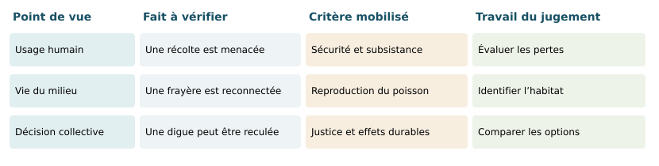

# B/L 2024 · Philosophie · Corrigé brut

*Corrigé rédigé par IA, non officiel. Signalez toute erreur.*

**Rédaction** · GPT-6.2 Astra Ultra · vitesse non renseignée · 26 novembre 2026

**La valeur de la nature** · Écrit commun, 6 heures.

## Dissertation

Un fleuve qui déborde emporte des récoltes. Le même débordement renouvelle une prairie humide et permet à certaines espèces de s’y reproduire. Sur quoi porte le désaccord entre qui redoute la crue et qui veut lui ménager un espace ? La description du débit et des sols peut être commune. Pourtant « bon » et « mauvais » changent de sens avec ce dont la vie ou le projet est en jeu. Par nature on peut entendre l’ensemble de ce qui arrive selon des causes, mais aussi les êtres dont le développement a son principe en eux-mêmes, et même, chez l’humain, ce que sa volonté trouve déjà donné. Parler de sa valeur demande davantage que connaître ses propriétés. C’est demander ce qui mérite d’être recherché, admiré, épargné ou combattu. Si toute valeur suppose une évaluation, le monde naturel vaut-il seulement ce que nous en attendons ? Et si la vie introduit déjà des différences entre le favorable et le nuisible, à quelles conditions ces différences donnent-elles aux humains des raisons d’agir ?

### I. Évaluer la nature suppose un terme de comparaison

Mesurer les mètres cubes d’eau qui franchissent un barrage ne suffit pas à évaluer un fleuve. Même sa valeur économique dépend d’un dispositif de choix. Un moulin tire parti du courant, une ville souhaite une eau potable stable, un propriétaire veut un terrain constructible. Introduire un prix peut rendre comparables certaines dépenses et révéler un coût jusqu’alors supporté par d’autres. Il faut cependant avoir fixé au préalable le bénéficiaire, l’horizon et ce qu’on accepte de remplacer. Une source et une station d’épuration peuvent rendre un service comparable sans fournir des expériences, des habitats ou des possibilités d’avenir identiques. La valeur d’usage indique une relation déterminée. Elle ne mesure pas tout ce qui arrive à ce dont on use.

La contemplation semble offrir un autre accès. Dans la *Critique de la faculté de juger*, Kant distingue le plaisir pris au beau de l’agrément que procure la satisfaction d’un besoin. On peut trouver belle une fleur dont on ne souhaite ni la cueillir ni manger le fruit. Le jugement de goût prétend même pouvoir être partagé par d’autres. Il y a là un dépassement de l’intérêt privé. Toutefois le beau est éprouvé dans un jugement, et la prétention à un accord n’est pas la constatation d’une propriété mesurable comme le poids de la fleur. L’utilité et la beauté ouvrent donc des rapports différents à la même chose. Une nature qui ne nous sert pas peut encore avoir de la valeur pour nous.

Or ces deux jugements supposent encore un humain capable d’employer la chose ou d’en jouir. Si les derniers humains disparaissaient, rien ne pourrait-il plus arriver de bon ou de mauvais à un être naturel ? Le simple fait de poser cette question oblige à regarder ce qui vit au bord du fleuve.

### II. Le vivant introduit des différences de valeur dans la nature

Une variation de température est, pour une pierre, une cause de dilatation. Pour un organisme, elle peut aussi être une occasion de se déplacer ou une menace pour sa survie. L’organisme maintient certaines relations avec son milieu par la nutrition, la réparation, le déplacement. On peut donc expliquer ce qui lui est défavorable en se fondant sur son organisation et sur ce qu’il peut encore faire, même si aucun observateur ne s’intéresse à son sort. Canguilhem, dans *Le Normal et le pathologique*, montre pourquoi santé et maladie ne se laissent pas identifier à la fréquence statistique d’un état. Un vivant malade peut subsister dans des conditions étroites qui lui conviennent. Ce qu’il a perdu est notamment la latitude de supporter une variation de ces conditions. La nature humaine est elle aussi concernée. La rareté d’un caractère corporel ne suffit pas à le déclarer pathologique, pas plus que sa fréquence ne suffit à rendre une souffrance acceptable.

Il existe donc des faits pertinents pour apprécier le sort d’un être avant que l’humain ne décide d’y trouver son avantage. Cette valeur pour le vivant ne confère cependant à aucun processus naturel un brevet de bonté universelle. Ce qui favorise le développement d’un parasite peut nuire à son hôte. La nature entendue comme totalité des causes comprend la lésion et la guérison. La maxime « suivre la nature » n’arbitre rien entre les deux. Dans son essai *La Nature*, John Stuart Mill examine précisément cette équivoque. S’il s’agit de l’ensemble des lois causales, même l’art de guérir leur obéit déjà. S’il s’agit du cours spontané des choses, en faire une règle de conduite interdirait de corriger la souffrance que ce cours produit. Connaître les normes de vie d’une espèce nous renseigne donc sur ce qu’une décision met en péril. Reste à comprendre pourquoi ce péril aurait prise sur notre conduite.

### III. Reconnaître une valeur oblige à répondre des raisons de nos choix

De « cet arbre peut vivre ici » on ne déduit pas directement « personne ne doit le couper ». Il faut encore justifier un principe pratique. On peut avancer celui-ci : lorsqu’une action délibérée détruit durablement les conditions de vie d’autres êtres, leur perte doit compter dans les raisons publiques de cette action, même si ceux qui décident ne subissent pas eux-mêmes le dommage. Ce principe distingue l’intérêt immédiat du décideur et ce qui mérite son attention. Il ne prescrit pas de maintenir toute chose en l’état. Abattre un arbre malade qui risque de tomber à la sortie d’une école peut se justifier. Abattre une forêt ancienne en supposant que quelques plants rendent d’emblée les mêmes possibilités à toutes les espèces réclame une autre démonstration. La biologie et l’histoire du lieu permettent de contester empiriquement cette prétendue équivalence.

Dans l’« Éthique de la terre », qui clôt l’*Almanach d’un comté des sables*, Aldo Leopold invite à considérer les sols, les eaux, les plantes et les animaux comme membres d’une communauté dont les humains font également partie. L’intérêt de ce déplacement apparaît dans le cas du fleuve. Le poisson n’occupe pas simplement une quantité d’eau interchangeable. Sa reproduction peut dépendre de la liaison entre le lit et une zone temporairement inondée. S’il s’agit de restaurer cet habitat tout en protégeant des habitations, une digue reculée peut laisser entrer la crue dans une prairie et maintenir une protection ailleurs. Le choix précis dépendra des lieux, des risques et des personnes concernées. La valeur du milieu intervient jusque dans la conception des options, au lieu de s’ajouter après coup au calcul d’une indemnité. Il faudra aussi tenir compte des habitants qui supportent le coût de cette mesure. Reconnaître d’autres vivants élargit la discussion sans abolir l’exigence de justice entre humains.

La nature ne nous remet ainsi aucune liste toute faite de nos devoirs. Elle comporte pourtant des êtres pour qui certaines différences comptent et des relations qu’une décision peut défaire irréversiblement. Le jugement humain explicite, hiérarchise et parfois révise des raisons. Il les inventerait arbitrairement s’il croyait pouvoir ignorer ce que deviennent effectivement les êtres et les milieux qu’il évalue. La valeur de la nature tient aussi à cette possibilité qu’a le monde vivant de démentir la mesure que nous prétendions lui imposer.

*Sources* · [Sujet officiel](https://www.ens.psl.eu/sites/default/files/2024_blses_sujet_composition_philosophie.pdf) · [Rapport du jury](https://www.ens.psl.eu/sites/default/files/2024_bl_rapport_ecrit_philosophie.pdf).
