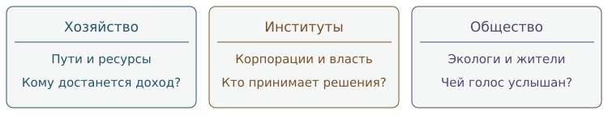

# BEL B/L — Russe 2024 · Corrigé brut

*Corrigé rédigé par IA, non officiel. Signalez toute erreur.*

**Rédaction** · GPT-6.2 Astra Ultra · vitesse non renseignée · 26 novembre 2026

## Кому достанется арктическая выгода?

В распоряжении читателя один документ. Вопросы журналиста и ответы директора проекта Arctida образуют разные голоса внутри одного интервью. Комментарий учитывает положение дел на дату публикации и различает данные доклада, оценки собеседника и его предположения о будущем.

## Анализ и комментарий

### Обещание заголовка

Слово «бенефициар» обычно требует уточнения: кто именно и в каком смысле получит выгоду? В заголовке названа целая страна. Однако в конце разговора Илья Шуманов отличает интересы нескольких корпораций от интересов жителей Арктики и даже планеты. Расстояние между этими двумя формулировками определяет смысл интервью. В мае 2023 года Катя Орлова расспрашивает руководителя недавно созданного проекта Arctida, кто и как распоряжается арктическими возможностями. Его группа исследовала несколько сотен чиновников, предпринимателей и представителей силовых структур. Изучается прежде всего формальное участие в принятии решений. Поэтому показательно уже вступление: журналиста интересует отсутствие экологов среди влиятельных фигур. Что нужно для того, чтобы географическое преимущество стало общественным благом, и кому доступно право судить о его цене?

### География возможностей и география зависимости

Первый вопрос соединяет группы, которые часто описывают общим словом «Россия». Собеседник начинает с того, что у каждой из них свои интересы. Затем он объясняет привлекательность Севера для грузоперевозок и энергетики. В интервью сокращение морского пути из Китая в Европу оценивается в тридцать процентов. Это оценка протяжённости маршрута, а не гарантированная скидка в тридцать процентов на доставленный товар. Для работы нужны инфраструктура и инвестиции, значительную часть которых берёт на себя государство. Оценки в тридцать процентов для газа и тринадцать для нефти относятся к неразведанным запасам Арктики в целом. Они не выражают ни долю России в мировой добыче, ни величину уже полученной выручки. Само соседство этих цифр с обещанием новых путей показывает, как в экономической речи будущее приобретает вид почти готового актива.

Контроль над пятьюдесятью тремя процентами арктической береговой линии, согласно ответу, позволяет России влиять на судьбу региона. Но доля береговой линии ещё не даёт права единолично решать, кому принадлежит морское дно. Есть и политическая граница возможностей. После февраля 2022 года другие страны отказались продолжать сотрудничество в прежнем формате во время российского председательства в Арктическом совете. Регион, где климатические процессы связывают интересы всей планеты, оказался затронут войной и разрывом привычных связей. Предположение о возобновлении диалога после войны в тексте остаётся предположением. Из него нельзя заключить, что сотрудничество уже восстановилось.

### Карта влияния и её белые пятна

Во втором смысловом узле меняется масштаб. Что означает слово «государство», если решения распределены между федеральными ведомствами, корпорациями и губернаторами? Шуманов вспоминает порядок приоритетов в выступлении президента: названы экономика, оборона, предупреждение чрезвычайных ситуаций и лишь затем очистка региона. Это прочтение выступления получает более весомое подкрепление, когда исследователь сопоставляет направления бюджетных расходов и состав участников обсуждения. По его словам, расходы на экологические программы, в том числе на обращение с отходами, сокращаются. Почти полное отсутствие экологов в обследованном круге означает слабое представительство их интересов. Оно не доказывает, что экологов на Севере вообще нет.

На региональном уровне собеседник называет, в частности, Мурманскую область, Карелию, Ненецкий и Ямало-Ненецкий автономные округа. Прежние связи Северо-Запада с Европой помогают понять, почему объявленный поворот в сторону Азии не может произойти мгновенно. На федеральном уровне пример Вячеслава Рукши связывает влияние с управленческой ролью «Росатома» на Северном морском пути. Упомянуты также предприятия «Норникеля», профильное министерство и университет. Далее журналист спрашивает о коррупционных связях. Шуманов поправляет саму постановку вопроса. Совмещение позиций в разных учреждениях создаёт возможность влиять на обсуждение на нескольких уровнях, но ещё не служит доказательством коррупции. Тем самым интервью показывает как силу составленного списка, так и его предел: формальная должность доступна наблюдению, реальный вес не всегда ей соответствует.

### Спор о шельфе и цена изоляции

В середине интервью обсуждение возможного противостояния сменяется описанием международной процедуры. Россия, Канада и Дания предъявляют пересекающиеся притязания в районе хребта Ломоносова. Журналист спрашивает, примет ли решение Арктический совет. Ответ переносит вопрос в иную институциональную плоскость. При определении внешних границ континентального шельфа государства представляют научные данные комиссии ООН. Речь идёт о правах на дно и его недра, а не о распространении государственной власти на весь водный столб. Кроме того, рекомендации о внешних границах не устраняют автоматически спор о разграничении между странами. Поэтому разговорное «разрешение», которое собеседник датирует 2022 годом, следует читать как его пересказ длительной процедуры, а не как документ о передаче России всей спорной территории. У документа ООН две даты. Подкомиссия одобрила рекомендации 20 октября 2022 года, а полная комиссия приняла их с поправками 6 февраля 2023 года. Разница между этими этапами помогает понять неточность интервью. Научная экспертиза идёт в другом временном ритме, чем политический конфликт.

Вопрос о том, зачем начинать проект именно сейчас, возвращает разговор к санкциям и изменению внешнеэкономических связей. Север выглядит направлением, которое российские промышленные группы вынуждены рассматривать внимательнее, потому что другие возможности ограничены. Но война одновременно поглощает средства, необходимые для самих арктических проектов. Шуманов упоминает сокращение программ очистки и природоохранных исследований. Получается парадокс: вынужденный рост интереса к региону сопровождается ослаблением способности оплатить его безопасное долгосрочное развитие. Упоминание военно-политического соперничества объясняет мотивацию государств, но не отменяет ни стоимости проектов, ни ограничений международного права.

### Кого не слышно при распределении выгод?

Последний вопрос об общественном контроле заставляет вернуться к исходной карте влияния. Собеседник приводит пример экологического фонда «Беллона». По его оценке, ограничение деятельности экологических организаций сужает возможности независимого наблюдения за проектами. Ещё нагляднее разрыв между влиянием и последствиями для малочисленных коренных народов. Объекты строятся на землях, где они живут, но их голос слабее слышен там, где выбирают приоритеты. Они присутствуют в рассказе как люди, о которых говорит эксперт, хотя журналист не берёт у них отдельного интервью. Это ограничение источника важно: знать, что голос плохо слышен, ещё не значит знать, что именно хотели бы сказать сами жители.

В финале Шуманов обсуждает возможный выход России из Арктического совета. Отсутствие общих ограничений могло бы расширить свободу действий властей, но экосистема, на восстановление которой иногда уходят столетия, за такую свободу платит иной ценой. Международные проекты по определению требуют партнёров. Возможное сближение с Китаем, Индией и арабскими странами названо одним из сценариев, а не готовой заменой Совету. Так заголовок возвращается к читателю уже в форме более точного вопроса. Для кого потепление открывает хозяйственную возможность, кто принимает решение о её использовании и кто будет отвечать за последствия после завершения проекта? Страна может располагать длинным побережьем и сильными корпорациями и при этом испытывать недостаток общественного контроля, без которого выгоду немногих легко принять за общее благо.

## Пояснения к тексту

### Обещание заголовка

У заголовка форма цитаты. В самом ответе Россия названа одним из возможных бенефициаров. Изменение климата здесь выступает условием некоторых хозяйственных проектов. Заголовок нельзя превращать в утверждение о пользе потепления для всех жителей страны.

### География возможностей и география зависимости

На первой странице приводятся разные по смыслу величины. Новые морские пути, потенциальные месторождения и государственное финансирование образуют цепочку условий. Ни один её элемент сам по себе не доказывает прибыльности конкретного проекта. На второй странице говорит собеседник 2023 года, а не наблюдатель за последующими событиями.

### Карта влияния и её белые пятна

Здесь полезно услышать поправку одного собеседника другому. Журналист предлагает термин «конфликт интересов», ответчик выбирает «лоббистский потенциал». Этот выбор ограничивает вывод, который можно добросовестно сделать из собранных данных.

### Спор о шельфе и цена изоляции

Форма вопроса позволяет увидеть, как журналист проверяет громкие высказывания. Фразы о будущих столкновениях и возможности нового объединения являются сценариями, а не установленными событиями. Доклад Arctida, о котором идёт речь, и интервью о докладе — разные источники.

### Кого не слышно при распределении выгод?

Коренные народы названы на последней странице. Их положение нельзя сводить только к вопросу о доходах: значение имеют территория проживания и возможность участвовать в решениях. Именно этот материал связывает критику экологических бюджетов с вопросом об устройстве общественного контроля.

Комментарий следует четырём страницам задания, соответствующим страницам 34–37 печатного сборника. Упоминания должностей, санкций и международного сотрудничества относятся к положению, которое обсуждалось в интервью мая 2023 года.

## Источники

[Задание](https://www.ens.psl.eu/sites/default/files/2024_blses_sujet_analyse_commentaire_russe.pdf) · [Отчёт жюри](https://www.ens.psl.eu/sites/default/files/2024_bl_rapport_ecrit_russe.pdf) · [Рекомендации комиссии ООН, титульный лист](https://www.un.org/depts/los/clcs_new/submissions_files/rus01_rev15/2023RusRev1RecSum.pdf#page=1)
