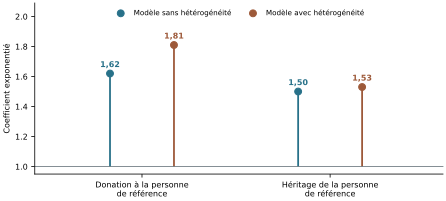

# BEL B/L — Sciences sociales 2024 · Corrigé brut

*Corrigé rédigé par IA, non officiel. Signalez toute erreur.*

**Rédaction** · modèle exact non renseigné (famille GPT-6) · effort non renseigné · vitesse non renseignée

**Révision (tour 1)** · modèle exact non renseigné (famille GPT-6) · effort non renseigné · vitesse non renseignée

**Révision (tour 2)** · GPT-6.2 Astra Ultra · vitesse non renseignée

**Révision (tour 3)** · GPT-6.2 Astra Ultra · vitesse non renseignée

**Révision (tour 4)** · GPT-6.2 Astra Ultra · vitesse non renseignée · 26 novembre 2026

**Problématique** : comment un transfert qui rapproche les ressources de parents et d’enfants à un moment de leur vie peut-il, sur une génération, creuser durablement les écarts entre bénéficiaires et non-bénéficiaires d’une même cohorte ?

En 1992, lorsque la boulangère Marcelle Pilon passe la main, sa famille va jusqu’à compter les pains que son fils devra fournir à deux de ses sœurs en compensation de l’entreprise reçue. Pourtant, un fonds de pâtisserie acquis des années auparavant pour le garçon ne figure pas dans les comptes du partage. Un même arrangement assure la continuité d’un commerce et prépare des avenirs différents aux membres d’une fratrie. L’enquête de Céline Bessière et Sibylle Gollac invite à déplacer le regard de l’instant de la succession vers ce qui s’est constitué bien avant et pourra fructifier après elle.

Un transfert intergénérationnel fait passer des ressources entre personnes appartenant à des générations différentes. Il peut être descendant ou ascendant, précoce ou tardif, familial ou organisé collectivement. Donations et successions portent sur des actifs qui procurent un usage, un revenu ou un pouvoir de décision. D’autres capitaux se transmettent par apprentissage ou introduction dans un réseau, ce qui demande la participation du bénéficiaire. Une dépense courante qui évite d’interrompre des études peut ainsi avoir un effet sur l’accumulation future. Pour parler d’**accélération**, constater qu’un enfant de famille aisée reste aisé ne suffit pas. Il faut montrer comment, relativement à une trajectoire sans transfert, un avantage initial fait croître l’écart plus vite ou permet de franchir plus tôt un seuil décisif. Encore faut-il dire entre qui l’on compare les ressources. Le jeune qui se rapproche du niveau de vie de ses parents peut, dans le même temps, s’éloigner de celui d’un autre jeune.

La solidarité entre âges peut d’abord amortir des écarts de ressources. Nous verrons ensuite comment un don devient un avantage cumulatif entre contemporains et au sein d’une fratrie. Son ampleur dépend enfin de la nature du bien transmis et des institutions qui organisent son partage, sa conservation et sa taxation.

* * *

Les besoins et les ressources se présentent rarement au même moment de la vie. Les frais de formation, de déménagement ou de premier logement surviennent souvent avant la stabilisation du revenu d’activité. Une famille qui avance un dépôt de garantie à un enfant lui donne accès à un logement aujourd’hui alors que sa capacité de payer les loyers se réalisera demain. La théorie du cycle de vie éclaire ce déplacement de ressources entre périodes. L’entraide devient particulièrement précieuse lorsque le jeune ne peut emprunter sur la seule promesse de ses revenus futurs. Le transfert réduit alors son exposition au risque de manquer un emploi éloigné ou de renoncer à des études faute de trésorerie.

Cet effet est mesurable sans attribuer à une aide familiale ce qui revient déjà aux prestations sociales. Nicolas Herpin et Jean-Hugues Déchaux exploitent l’enquête Budget de famille 2000-2001 en France métropolitaine (document 7). Ils comparent le revenu moyen de chaque groupe d’âge à la moyenne de tous les ménages pour le même périmètre de ressources. Dans les ménages dont la personne de référence a moins de 25 ans, cet indice vaut 0,44 après ajout des ressources sociales au revenu primaire. Il atteint 0,51 quand on ajoute ensuite le solde de l’entraide familiale. Pour les 45-54 ans, il passe au contraire de 1,26 à 1,24. L’écart entre les deux indices passe de 0,82 à 0,73. Ce resserrement de 0,09 point d’indice porte sur les moyennes de deux classes d’âge. Un recul de la dispersion des revenus au sein de chaque classe demanderait un autre calcul. L’enquête compare ici des groupes de ménages à une date, sans apparier chaque enfant à ses parents. Elle documente une compensation moyenne au début de la vie adulte.

Or rapprocher les ressources des classes d’âge n’efface pas les distances sociales. Dans la même enquête, ajouter l’entraide laisse à 0,73 l’indice des ménages d’employés et fait passer de 1,72 à 1,71 celui du groupe cadres, professions libérales et entrepreneurs. La famille peut assurer efficacement un descendant contre un manque passager tout en le maintenant au voisinage de la position sociale qui lui était accessible. Deux étudiants peuvent recevoir chacun une aide jugée généreuse au regard des ressources de leurs parents, l’une couvrant des courses, l’autre le logement entier dans une ville universitaire chère. Ce qui protège chacun contre un aléa n’égalise ni leurs conditions de travail ni la palette des études envisageables. Le résultat sur les revenus moyens courants ne règle donc pas la question du patrimoine à venir.

* * *

Le calendrier du transfert change les possibilités d’accumulation. À salaire comparable, deux ménages peuvent souhaiter acheter le même logement et se heurter au même prix. Celui qui reçoit un apport peut satisfaire l’exigence de fonds propres du prêteur. Celui qui doit le réunir sur son salaire reste locataire plus longtemps. Le premier commence alors plus tôt à rembourser le principal de sa dette et s’expose plus tôt aux variations du prix de son bien. Si les prix montent, il détient l’actif qui se valorise pendant que son contemporain doit accroître son effort d’épargne pour entrer sur le marché. Si les prix baissent, l’avantage de valorisation peut disparaître. Le don a dans les deux cas modifié la date du choix et la nature du risque supporté.

L’étude de Bertrand Garbinti sur l’enquête Patrimoine 2009-2010 donne un appui à ce mécanisme (document 6). Dans le modèle qui distingue les ménages désirant acheter des autres, et parmi ceux qui désirent acheter, le coefficient multiplicatif associé à une donation à la personne de référence vaut 1,81, celui associé à un héritage 1,53. Il s’agit de comparaisons avec la catégorie sans le transfert considéré, à caractéristiques prises en compte dans le modèle comparables. Une donation peut être décidée au moment du projet immobilier. La date de la succession échappe davantage au bénéficiaire. Ces observations sont compatibles avec le rôle de l’apport. Elles ne permettent pas d’attribuer mécaniquement tout l’écart estimé au versement lui-même. Un don ponctuel dans la catégorie des aides ordinaires a d’ailleurs un coefficient statistiquement non significatif. La forme du transfert compte autant que son existence.

Le modèle de durée fait apparaître deux marges. Dans la première colonne, qui traite tous les ménages comme susceptibles d’acheter, le coefficient d’une donation reçue par la personne de référence vaut 1,62. Dans la seconde, le modèle estime à 4,16 % la part qui ne souhaiterait pas devenir propriétaire et porte le coefficient à 1,81 parmi les acheteurs potentiels. Pour une succession les deux estimations sont respectivement 1,50 et 1,53. Le rôle du don concerne donc surtout le rythme du passage à la propriété chez les ménages susceptibles de le réaliser. Une entrée plus précoce donne du temps pour accumuler un actif, même si les deux ménages deviennent finalement propriétaires. Ces estimations ne disent pas combien d’années sont gagnées, ni combien de ménages supplémentaires achèteront dans toute leur vie.

La distribution des capitaux transmis infléchit également la trajectoire. Dans l’enquête Histoire de vie et Patrimoine 2017-2018 (document 2), 27,3 % des héritages de montant connu reçus par des personnes de profession libérale atteignent 100 000 euros, contre 6,7 % pour les héritages reçus par des employés. Le tableau porte sur les héritages déclarés, en France hors Mayotte. Le ménage qui n’a rien reçu n’entre pas dans ces pourcentages. L’écart de montant se double d’une inégalité d’usage. Une somme modeste peut combler un découvert ou financer une réparation indispensable. Un montant plus élevé, reçu dans un ménage dont les dépenses courantes sont déjà couvertes, se prête à un placement diversifié. Aux revenus du travail viennent alors s’ajouter les revenus de l’actif, puis, si une part en est épargnée, ceux produits à leur tour par le supplément de capital.

La famille transmet aussi des manières de se servir des ressources. Les dispositions acquises au contact de proches familiers des études longues peuvent rendre immédiatement intelligibles les choix de filière. Des relations professionnelles peuvent ouvrir un stage où s’apprennent les codes d’un métier. Dans *Les Héritiers* (1964), Pierre Bourdieu et Jean-Claude Passeron montrent comment l’institution universitaire reconnaît des compétences culturelles inégalement acquises dans le milieu d’origine. Cette reconnaissance peut convertir un avantage culturel en titre scolaire, puis en revenu qui permettra d’épargner. Elle demande du temps et demeure incertaine. Dans la famille Pilon étudiée par Bessière et Gollac (document 5), les études des filles servent à justifier la transmission du commerce au fils. Pourtant certaines ont obtenu des bourses et participé gratuitement au travail de la boutique. Le frère, rémunéré, a acquis tôt l’expérience et la position du repreneur. Lorsque la succession officialise son contrôle de l’entreprise, une partie de l’écart est déjà constituée. La notoriété locale de la famille se maintient et la répartition entre frère et sœurs se différencie. L’intérêt collectif à préserver l’affaire peut rendre coûteuse pour chacune la contestation de cette répartition.

* * *

La manière dont un avantage se perpétue dépend des biens en jeu. Début 2021, d’après l’Insee (document 1), les actifs professionnels forment 71 % du patrimoine brut des ménages dont la personne de référence est agricultrice ou agriculteur, contre 3 % dans les ménages de cadres. Ces pourcentages décrivent une composition. Ils ne donnent pas la valeur des patrimoines en euros. Céder un portefeuille de titres ne requiert pas la présence d’un enfant prêt à exercer le métier de ses parents. Maintenir une exploitation en activité exige des compétences, des débouchés et une répartition des droits entre héritiers. La vente pour partager le produit peut interrompre la continuité professionnelle. La conservation par un repreneur peut au contraire concentrer chez lui l’usage d’un actif productif. La latitude des héritiers est ainsi liée à la forme du bien et aux arrangements que la famille est en mesure de négocier.

Même dans un univers favorable aux transmissions, l’inégalité des fortunes à une date et la persistance des positions d’une génération à l’autre sont deux phénomènes distincts. Dans une étude historique de 314 binômes père-enfant de Loire-Inférieure entre 1800 et 1938, Luc Arrondel et Cyril Grange estiment à 0,37 la corrélation intergénérationnelle des patrimoines au décès (document 3). Le rang social des familles n’est donc ni entièrement indépendant ni figé. Une liaison positive dans un échantillon local ne suffit pas à établir que les inégalités nationales ont crû pendant toute la période. Le même document rapporte cependant qu’en France, sur les trente années étudiées par les auteurs, les montants transmis ont doublé en proportion du PIB. Quand les flux transmis prennent davantage de place relativement à la richesse produite dans l’année, obtenir ou manquer un héritage peut peser davantage sur la position des nouvelles générations. La croissance des revenus du travail, la fiscalité et l’évolution des prix d’actifs influent sur cet enjeu.

Enfin, le montant dont l’héritier dispose effectivement dépend de la manière dont les institutions définissent le lien familial. France Stratégie applique la législation de 2012 à des données de l’enquête Patrimoine 2010 (document 4). Parmi les héritages situés entre les 90e et 95e centiles, le taux effectif moyen atteint 37,5 % en ligne indirecte. Il est nettement inférieur en ligne directe. L’abscisse donne le rang des héritages par montant, toutes lignes de parenté réunies. Ainsi, 213 000 euros est le montant moyen de la tranche, et 37,5 % un taux moyen propre aux transmissions indirectes de cette tranche. Leur produit ne donne pas les droits moyens acquittés par ces bénéficiaires. Un taux effectif rapporte les droits au montant transmis avant impôt. Il intègre les effets du barème et des abattements. À transmission brute comparable, le régime de parenté peut donc laisser à l’un des bénéficiaires davantage de fonds à réinvestir. Si la fiscalité réduit une partie des écarts bruts, ses modalités peuvent aussi protéger la continuité d’une lignée. Inversement, les services publics d’enseignement, les bourses et les transferts sociaux peuvent donner accès aux études ou à un revenu malgré une faible capacité de soutien familial. Leurs effets dépendent des conditions de recours et des ressources culturelles permettant de s’orienter dans les dispositifs. Les institutions agissent ainsi sur les conditions mêmes de la conversion du capital reçu en possibilités futures.

* * *

Les transferts entre générations jouent un rôle accélérateur lorsqu’un apport inégal donne une avance durable dans l’accès au logement, à un outil de travail ou à une qualification, puis permet d’accumuler sur cette avance. La transmission peut aussi sécuriser une phase du cycle de vie, maintenir une position, ou se disperser au partage. Un même versement peut rapprocher un jeune ménage de ses parents en revenu courant tout en creusant l’écart patrimonial avec ses pairs. Pour juger de son effet, il faut donc suivre les bénéficiaires dans le temps, identifier la ressource transmise et observer les règles qui déterminent qui peut la faire fructifier. C’est à cette condition que la persistance d’une hiérarchie peut être distinguée de son aggravation.

[Sujet officiel](https://www.ens.psl.eu/sites/default/files/2024_blses_sujet_composition_sciences_sociales.pdf) · [Rapport du jury](https://www.ens.psl.eu/sites/default/files/2024_bl_rapport_ecrit_sciences_economiques_et_sociales.pdf)

## Vérification sur le sujet

Les sept documents et le rapport du jury ont été confrontés à la dissertation et au parcours guidé. Le tableau de l’entrée dans la propriété distingue deux modèles de durée. Les deux tableaux du document 7 distinguent le classement par âge du classement par milieu social.

Le document 2 permet de vérifier de quelle inégalité il est question. Parmi les héritages de montant connu reçus par les professions libérales, 27,3 % atteignent 100 000 euros, contre 6,7 % chez les employés. L’écart vaut 20,6 points et le rapport environ 4,1. Ces proportions portent sur les héritages déclarés. Pour mesurer l’inégalité devant la réception elle-même, il faudrait aussi compter les personnes qui n’ont rien reçu. Le document 3 apporte une autre comparaison, entre patrimoines des parents et des enfants. C’est elle qui permet d’interroger la persistance entre générations.
