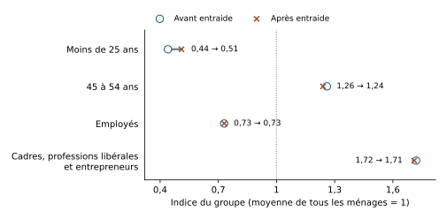
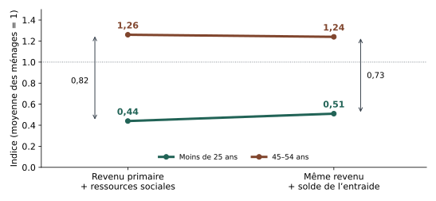
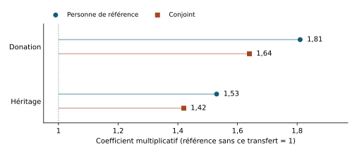
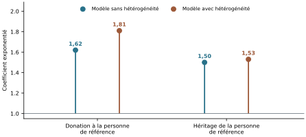
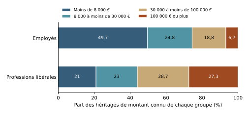

# BEL B/L — Sciences sociales 2024 · Corrigé guidé

*Corrigé rédigé par IA, non officiel. Signalez toute erreur.*

**Rédaction** · modèle exact non renseigné (famille GPT-6) · effort non renseigné · vitesse non renseignée

**Révision (tour 1)** · modèle exact non renseigné (famille GPT-6) · effort non renseigné · vitesse non renseignée

**Révision (tour 2)** · GPT-6.2 Astra Ultra · vitesse non renseignée

**Révision (tour 3)** · GPT-6.2 Astra Ultra · vitesse non renseignée

**Révision (tour 4)** · GPT-6.2 Astra Ultra · vitesse non renseignée · 26 novembre 2026

## Présentation du sujet

« Les transferts intergénérationnels de capitaux : des accélérateurs des inégalités ? » L’écrit commun à Ulm, Lyon, Paris-Saclay et ENSAE/INSEE/ENSAI dure six heures. Le candidat dispose d’un dossier de sept documents. Aucun document personnel n’est autorisé. La composition n’impose pas de nombre de mots. Il faut soutenir une réponse qui articule économie et sociologie, en utilisant aussi bien les données statistiques que l’enquête de terrain.

Réserver environ 65 minutes à la lecture et aux calculs, 40 minutes à la construction du plan, 230 minutes à la rédaction et 25 minutes à la relecture. Dans le tableau 2, inscrire le dénominateur à côté de chaque pourcentage choisi. Dans le tableau 7, entourer les deux colonnes dont la comparaison isole l’aide familiale.

## Analyse du sujet

> [!INDICATION]
> Un parent aide son enfant à se loger. Avec qui faut-il comparer ce jeune pour savoir si le transfert l’a avantagé ? Essayer successivement une comparaison avec ses parents, avec un contemporain puis avec sa propre trajectoire en l’absence d’aide.

> [!INDICATION]
> Un avantage transmis peut rester constant, s’amenuiser ou ouvrir droit à de nouveaux gains. Chercher dans le dossier un exemple de chacun de ces mécanismes.

#### Solution

Une génération peut désigner des personnes placées à un même degré d’une lignée, ou une cohorte née à une période voisine. Des parents peuvent aider un enfant, des grands-parents un petit-enfant, un actif un parent vieillissant. La solidarité publique peut mutualiser les ressources entre classes d’âge sans lien de parenté. Dans une enquête transversale, comparer des âges décrit une situation à une date. Pour isoler un effet de génération, il faudrait pouvoir comparer plusieurs cohortes à âge égal.

Un capital économique est un stock d’actifs. Un revenu est un flux. La donation transfère du vivant du donateur, la succession au décès. Une aide courante agit sur le budget et peut indirectement faciliter un investissement. Les capitaux culturel et social incluent des compétences reconnues, des dispositions acquises et des relations susceptibles d’être mobilisées. Expliquer leur transmission oblige à décrire un apprentissage ou une mise en relation. Un diplôme s’obtient, même lorsque les conditions familiales de son obtention sont très inégales.

Le terme **accélérateur** appelle une comparaison dynamique. Si une aide rend un apport suffisant pour obtenir un prêt aujourd’hui, l’avantage initial peut produire des effets durant toutes les années où un ménage comparable attend encore de pouvoir acheter. Pour établir empiriquement une accélération, il faudrait suivre des trajectoires comparables avec et sans transfert. Un tableau décrivant les héritages reçus suffit à documenter un écart de montant, sans suffire à son interprétation causale.

## Problématique

> [!INDICATION]
> Une même aide peut réduire un écart entre âges et accroître un écart entre ménages d’un même âge. Introduire ensuite une condition qui détermine la persistance de l’effet.

#### Solution

**Question retenue.** Comment un transfert qui rapproche les ressources de parents et d’enfants à un moment de leur vie peut-il, sur une génération, creuser durablement les écarts entre bénéficiaires et non-bénéficiaires d’une même cohorte ?

Une autre entrée consiste à demander à quelles conditions les ressources d’une génération deviennent une avance productive pour la suivante. Elle invite à étudier qui reçoit, à quel moment, sous quelle forme et avec quelles possibilités d’investissement. Dans les deux cas, la dernière partie doit expliquer pourquoi la force de la transmission change selon les familles, les institutions et les périodes.

## Plan détaillé

### Partie I — Une ressource entre âges peut amortir les difficultés de début de vie

> [!INDICATION]
> Identifier le besoin auquel répond le transfert et son calendrier. Quel indicateur permet d’en observer l’effet sur le revenu courant ?

#### Solution

**I.1. Le besoin de liquidités précède souvent le revenu.** Les frais d’installation se présentent alors que la personne ne peut toujours emprunter contre ses revenus futurs. Un dépôt de garantie avancé par la famille peut permettre un déménagement indispensable pour travailler. La théorie du cycle de vie fournit un cadre pour ce décalage. L’existence d’un parent capable d’avancer des fonds est une condition sociale de ce mode de lissage.

**I.2. Le solde d’entraide rapproche des classes d’âge.** Dans le document 7, prendre comme point de départ le revenu primaire augmenté des ressources sociales. Mesurer ensuite le changement dû à la prise en compte des aides reçues moins celles versées. Pour les ménages de moins de 25 ans, l’indice passe de 0,44 à 0,51. Ce gain de 0,07 est une variation d’indice. Ce n’est pas un gain de sept euros.

Le calcul se lit verticalement à chaque étape. Avant entraide, 1,26 moins 0,44 donne 0,82. Après entraide, 1,24 moins 0,51 donne 0,73. L’écart entre les deux indices passe de 0,82 à 0,73. Chaque colonne prend pour base le revenu moyen calculé sur son propre périmètre. On ne peut donc pas convertir les neuf centièmes de réduction en euros en les multipliant par un revenu moyen choisi arbitrairement.

**Transition.** Dans ce même document, le solde d’entraide change très peu l’indice des groupes professionnels. Un jeune peut se rapprocher du revenu moyen de tous les ménages tout en continuant à disposer de beaucoup moins de possibilités qu’un jeune d’un autre milieu.

### Partie II — Certains transferts font franchir un seuil et enclenchent une accumulation

> [!INDICATION]
> Relier une donation au projet concret qu’elle débloque. Chercher ensuite comment l’avantage grandit après la remise initiale.

#### Solution

**II.1. Recevoir assez tôt pour changer de trajectoire.** L’apport personnel peut rendre solvable un ménage auprès du prêteur. L’acquéreur commence à rembourser le principal tandis qu’un ménage comparable cherche encore à constituer l’apport. Séparer l’économie de loyer, les intérêts, les charges, l’endettement et la variation de valeur du logement. La hausse du prix n’est pas acquise d’avance. Le document 6 suggère une association plus forte pour une donation que pour un héritage dans le modèle avec hétérogénéité. La date du don peut elle-même dépendre de la préparation du projet.

**Lire un modèle de durée.** Les deux colonnes du document 6 décrivent des moments d’entrée. Le complément de 4,16 % vaut 95,84 % dans la population modélisée. Ce nombre est une proportion estimée de ménages susceptibles d’acheter, sans horizon de réalisation imposé. Le coefficient 1,81 multiplie le rythme instantané de transition chez ceux encore exposés, à caractéristiques comparables. Pour illustrer, si une probabilité de référence sur une période valait 20 % et si les risques étaient proportionnels avec un rapport de 1,81, la probabilité correspondante serait $1-(1-0{,}20)^{1{,}81}$, soit environ 33,2 %. Multiplier directement 20 % par 1,81 donnerait à tort 36,2 %. La probabilité de référence de 20 % est une hypothèse de calcul. Le tableau ne la fournit pas.

**II.2. Relier les montants transmis aux capacités de les faire fructifier.** Au document 2, partir d’une ligne de profession. Les héritages reçus par les employés atteignent ou dépassent 100 000 euros dans 6,7 % des cas renseignés, contre 27,3 % pour les professions libérales. La ligne vaut 100 % en additionnant les tranches de montant, aux arrondis près. Elle ne mesure ni la proportion des employés qui héritent ni la profession de tous les bénéficiaires de gros héritages.

**II.3. Expliquer le passage entre capitaux et entre générations.** Dans le cas Pilon, le frère devient tôt un professionnel rémunéré, puis le titulaire des actifs qui rendent le travail possible. Les sœurs obtiennent des ressources scolaires et participent gratuitement au commerce. La réputation familiale les concerne aussi, ce qui aide à comprendre le coût d’une contestation au moment du partage. Le fonds acquis avant la succession et les usages des biens rendent visibles des inégalités que la seule valeur des lots consignés devant le notaire saisirait mal.

> [!METHODE]
> Dans l’exemple ethnographique, distinguer le point de vue des intéressés, le contenu de l’acte notarié et ce que reconstitue l’enquête. Le cas explique un mécanisme. Il ne fournit pas la fréquence nationale des partages de ce type.

### Partie III — Le type d’actif et les institutions modulent la reproduction des écarts

> [!INDICATION]
> Une terre exploitée, un diplôme et une somme placée ne se conservent pas par les mêmes moyens. Examiner aussi ce que la fiscalité fait varier pour deux transmissions d’un montant comparable.

#### Solution

**III.1. Une transmission professionnelle impose des choix.** Reconduire l’activité peut demander qu’un héritier la reprenne personnellement. Le partage matériel peut en compromettre la viabilité. Dans le document 1, le patrimoine professionnel représente 71 % du patrimoine brut des ménages d’agriculteurs, contre 3 % chez les cadres. Ces groupes sont définis par la profession de la personne de référence. Une part élevée indique une forte exposition à la question de la reprise. Elle n’établit aucune comparaison en euros du patrimoine total des groupes.

**III.2. Situer la mobilité dans son contexte historique.** Arrondel et Grange observent 314 binômes père-enfant de Loire-Inférieure entre 1800 et 1938. La corrélation patrimoniale de 0,37 décrit un lien partiel. On peut simultanément observer des déclassements individuels et une forte concentration collective. Les auteurs replacent la transmission dans une histoire où changent les flux successoraux, la croissance et les institutions. Une corrélation père-enfant, la part du patrimoine détenue par une fraction de la population et le rapport entre flux transmis et PIB répondent à trois questions différentes.

**III.3. Les règles du partage et de la solidarité font varier l’avantage net.** Au document 4, relever la législation simulée, la ligne de parenté et l’unité du taux. Le chiffre de 37,5 % est un taux effectif moyen pour les héritages des 90e à 95e centiles en ligne indirecte. Un abattement accroît la différence entre le taux affiché sur la dernière tranche et le poids de l’impôt sur la transmission entière. Le financement collectif d’une bourse peut, de son côté, permettre à une étudiante de poursuivre une formation même quand sa famille finance surtout la reprise d’une entreprise par un autre enfant. Dans l’analyse de l’entraide du document 7, les ressources sociales et les prélèvements doivent être suivis séparément.

**Pourquoi ne pas calculer 37,5 % de 213 000 euros ?** Le document 4 donne au bas de l’axe la valeur moyenne des héritages de la tranche C90–95. Le taux de la courbe supérieure concerne la seule ligne indirecte. Les deux moyennes n’ont pas le même champ. Même sur un champ identique, le produit du taux moyen et du montant moyen exige de connaître la pondération avant de pouvoir le lire comme un impôt moyen.

## Références et exemples

| Document | Information à utiliser | Limite à préciser |
|---|---|---|
| 1. Insee, enquête Histoire de vie et Patrimoine 2020-2021 | Composition du patrimoine brut, notamment les actifs professionnels | Part de chaque composante, sans montant absolu |
| 2. Insee, enquête Histoire de vie et Patrimoine 2017-2018 | Montant des héritages reçus selon la catégorie des héritiers | Héritages de montant connu, hors Mayotte. La mention « ns » correspond à un effectif insuffisant |
| 3. Luc Arrondel et Cyril Grange, 2018 | Patrimoines au décès de pères et d’enfants en Loire-Inférieure | La corrélation ne mesure ni un taux de taxation ni la probabilité d’hériter |
| 4. France Stratégie, 2017 | Taux effectif par tranche de montant et par lien de parenté | Simulation de la législation 2012 sur l’enquête 2010 |
| 5. Céline Bessière et Sibylle Gollac, *Le Genre du capital*, 2020 | Donations anticipées, travail gratuit et contrôle de l’entreprise familiale | Le récit permet d’expliquer une décision située |
| 6. Bertrand Garbinti, Insee, 2014 | Coefficients associés à l’achat de la résidence principale | Comparaisons conditionnelles. Un coefficient multiplicatif ne se lit pas en points de pourcentage |
| 7. Nicolas Herpin et Jean-Hugues Déchaux, 2004 | Décomposition du revenu et indices par âge et par milieu social | Les indices portent sur des moyennes de groupes en France métropolitaine en 2000-2001 |

## Introduction et conclusion rédigées

#### Solution

Au départ de Marcelle Pilon à la retraite en 1992, la famille compte les pains qui reviendront à deux de ses filles après la transmission du commerce à son fils. Pourtant un fonds de pâtisserie déjà acquis pour celui-ci échappe au décompte. Que devient l’égalité entre enfants quand les actifs et les capacités de les exploiter ont commencé à se répartir avant la signature du partage ? Cette interrogation dépasse les successions. Dons du vivant, apprentissages et relations se transmettent aussi. Une aide peut rapprocher les ressources de générations différentes, tandis que son calendrier ouvre un avantage cumulatif au bénéficiaire face à ses contemporains. Pour comprendre cet effet, il faut d’abord identifier ce que l’entraide compense, puis suivre la transformation de l’avantage initial et les institutions qui en règlent la conservation.

En définitive, une aide qui finance une dépense immédiate peut lisser les ressources au cours de la vie. Une donation qui débloque une acquisition immobilière ou réserve à un héritier la maîtrise d’un outil productif modifie durablement ce qu’il pourra gagner, épargner ou transmettre. L’effet accélérateur dépend de l’usage du capital, du moment où il arrive et des règles du partage. Il s’évalue dans le devenir comparé des bénéficiaires et de leurs contemporains.

## Pièges à éviter

> [!PIEGE]
> Additionner le taux marginal supérieur d’imposition et des parts du patrimoine, ou transformer le coefficient 1,81 en hausse de 81 points, mélange des unités différentes. Placer un chiffre dans une phrase complète avant de l’utiliser comme preuve.

> [!JURY]
> Le rapport de 2024 insiste sur le dialogue entre les deux disciplines, la distinction entre âges et milieux sociaux et l’interprétation précise des tableaux. Un graphique n’est utile que s’il rend compréhensible une étape du raisonnement.

## Bilan

Avant de conclure à un accroissement des inégalités, nommer le groupe comparé, le moment observé et la ressource mesurée. Suivre ensuite le trajet de l’avantage initial. Le dossier permet de montrer, sur un même sujet, le lissage du revenu courant, la formation d’un patrimoine et la répartition inégale du pouvoir de décider de son usage.

[Sujet officiel](https://www.ens.psl.eu/sites/default/files/2024_blses_sujet_composition_sciences_sociales.pdf) · [Rapport du jury](https://www.ens.psl.eu/sites/default/files/2024_bl_rapport_ecrit_sciences_economiques_et_sociales.pdf)

## Vérification sur le sujet

Les sept documents et le rapport du jury ont été confrontés à la dissertation et au parcours guidé. Le tableau de l’entrée dans la propriété distingue deux modèles de durée. Les deux tableaux du document 7 distinguent le classement par âge du classement par milieu social.

Le document 2 permet de vérifier de quelle inégalité il est question. Parmi les héritages de montant connu reçus par les professions libérales, 27,3 % atteignent 100 000 euros, contre 6,7 % chez les employés. L’écart vaut 20,6 points et le rapport environ 4,1. Ces proportions portent sur les héritages déclarés. Pour mesurer l’inégalité devant la réception elle-même, il faudrait aussi compter les personnes qui n’ont rien reçu. Le document 3 apporte une autre comparaison, entre patrimoines des parents et des enfants. C’est elle qui permet d’interroger la persistance entre générations.
