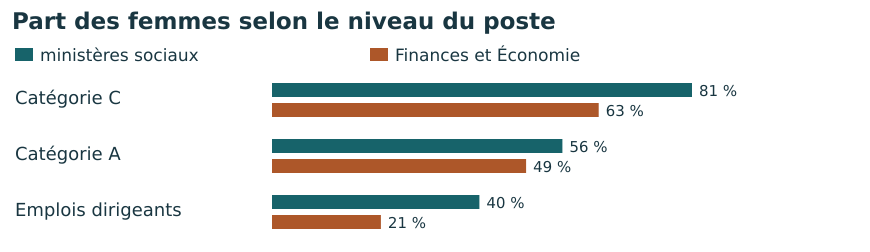

# BEL · B/L · Sociologie, dossier commun 2 du 12 juin 2024 · Corrigé guidé

*Corrigé rédigé par IA, non officiel. Signalez toute erreur.*

**Rédaction** · GPT-6.2 Astra Ultra · vitesse non renseignée

**Autocontrôle** · GPT-6.2 Astra Ultra · vitesse non renseignée

## Gens du public

Que reste-t-il de commun entre un agent territorial de catégorie C et une cadre hospitalière mobilisée le dimanche ? Le statut public définit un employeur et des règles. Il laisse varier la position hiérarchique, la trajectoire et le travail concret. On peut partir des modes de recrutement, puis suivre la manière dont le service distribue les horaires, les contraintes et les chances de carrière.

> [!METHODE]
> Préparer en 90 minutes une réponse qui rapproche les documents. Le rapport prévoit quinze minutes d’exposé puis quinze minutes d’entretien. Dans chaque tableau, lire d’abord la population et le dénominateur. Les valeurs lues sur les courbes sont arrondies.

## Cheminement de l’exposé

Les règles d’entrée distribuent des positions. Rapprocher les documents 1, 2 et 5 : des concours ouverts à des diplômés de niveaux différents et des contrats temporaires alimentent des versants aux catégories très dissemblables. Le premier emploi public et l’accès à une carrière stable sont deux étapes distinctes.

Les positions décident du contenu du travail. L’emploi hospitalier, très féminisé au document 1, associe permanence des soins le week-end (document 4) et port de charges (document 6). Dans l’enquête sur les conditions de travail, rapprocher ouvriers et cadres montre pourquoi la comparaison moyenne entre public et privé est insuffisante.

Des institutions communes peuvent reproduire des hiérarchies. À qualification comparable il resterait à étudier les accès aux promotions et aux postes géographiquement mobiles. Les écarts de féminisation aux sommets (document 3) et de positions des métropolitains et ultramarins (document 7) situent les lieux où mener l’enquête.

## Lecture des pièces du dossier

### Trois fonctions publiques, plusieurs hiérarchies

Document 1, p. 2. Le tableau de l’Insee décrit la composition de chaque versant en 2021. Dans l’ensemble, 66 % des agents sont fonctionnaires et 21,5 % contractuels. L’État compte 55,2 % d’agents de catégorie A, la territoriale 74,7 % de catégorie C. L’hospitalière est féminine à 78,1 %, contre 57,4 % à l’État. Ces écarts mettent en jeu les métiers effectivement assurés. Le niveau de recrutement des enseignants, par exemple, contribue à la composition du versant d’État. Les lignes du sexe, du statut et de la catégorie décrivent des propriétés qui se croisent.

### Le contrat comme séquence de carrière

Document 2, p. 3. Peyrin suit jusqu’en 2015 les personnes entrées contractuelles en 2011. Sur 100 personnes entrées dans la territoriale, 19 deviennent fonctionnaires C, contre 3 dans le versant État. Les contrats courts non renouvelés représentent 48 % dans la territoriale et 40 % à l’État. L’accès initial à un employeur public n’assure donc ni maintien ni titularisation. Il faudrait connaître les origines et métiers des entrants pour isoler un effet du versant.

### Le plafond de verre au sein du public

Document 3, p. 4. Marry et ses collègues comparent, à chaque niveau, la part des femmes. Dans les ministères sociaux elle passe de 81 % en catégorie C à 56 % en A, 47 % en A+ et 40 % dans les emplois supérieurs et dirigeants. Aux Finances et à l’Économie, les proportions extrêmes sont 63 % et 21 %. Le recrutement sectoriel et l’accès différencié au sommet se cumulent. Ces coupes hiérarchiques ne donnent cependant pas la probabilité de promotion d’une femme entrée en C.

### La continuité du service a un horaire

Document 4, p. 5. L’enquête Emploi 2022 compte au moins une occurrence au cours des quatre dernières semaines. À l’hôpital, 58 % ont travaillé le samedi, 54 % le dimanche et 26 % la nuit. Pour le dimanche, l’État est à 36 %, la territoriale à 16 % et le privé à 18 %. Le soir, l’État est à 45 %, proche de l’hôpital (44 %). Le continu des soins donne un sens précis au travail de fin de semaine. Un agent peut figurer dans plusieurs séries, et une occurrence n’équivaut pas à un horaire permanent.

### Diplômes des lauréats et catégorie de recrutement

Document 5, p. 6. Les barres empilées à 100 % décrivent les recrutés externes de l’État de 2021. Près de la moitié des recrutés A ont un bac +5 ou un doctorat, contre environ un sixième en B et un dixième en C. En C, près de la moitié sont diplômés au-delà du bac, en additionnant les segments supérieurs au baccalauréat. L’accès aux postes d’exécution peut ainsi mettre en concurrence des titulaires de diplômes très différents. Il faudrait le nombre de candidats par niveau pour calculer leurs chances de réussite.

### Les tâches et les corps

Document 6, p. 7. L’enquête Conditions de travail de 2019 mesure des expositions déclarées. Porter des charges concerne 59 % à l’hôpital, 42 % dans la territoriale et 25 % à l’État. L’écart est encore plus large entre ouvriers et cadres, 75 % contre 13 %. Les poussières ou fumées concernent respectivement 65 % et 9 %. Les comparaisons par sexe donnent d’autres écarts, par exemple 21 % des hommes et 8 % des femmes pour les vibrations. La seule moyenne publique, 38 % pour les charges contre 41 % dans le privé, masque cette division des tâches.

### Mobilités géographiques et division du travail

Document 7, p. 8. Haddad rapproche lieu de naissance, mobilité et position. Les départs de métropolitains pour les départements d’outre-mer sont souvent liés à une mutation en milieu de carrière. Les ultramarins vivant dans l’Hexagone sont plus jeunes. Le poids de l’emploi public outre-mer tient aussi à la rareté relative de l’emploi privé. Parmi les agents publics, le rapport de chances d’occuper un poste d’ouvrier ou d’employé pour les ultramarins relativement aux métropolitains varie de 1,5 à La Réunion à 2,6 en Martinique. Ce rapport ne mesure pas directement un effet de discrimination à qualification et trajectoire identiques.

## Réponse au sujet

Le document 1 décrit qui entre dans chaque versant, le 2 comment on y reste. Les documents 3 et 7 montrent que des règles communes de carrière coexistent avec des écarts de position. Enfin les conditions de travail des documents 4 et 6 donnent leur contenu concret aux grandes catégories. L’analyse de l’emploi public doit relier un statut, un métier et une carrière.

> [!INDICATION]
> Que veut dire « 74,7 % » ?

Parmi les agents territoriaux, 74,7 % relèvent de C. Pour savoir où travaillent les agents C, il faudrait les effectifs de chaque versant.

> [!INDICATION]
> Le recrutement sur concours garantit-il la même carrière ?

Le document 5 renseigne les qualifications à l’entrée. Le document 3 renseigne la composition de la hiérarchie. Pour étudier les promotions il faudrait suivre dans le temps des cohortes initialement comparables.

> [!INDICATION]
> Peut-on parler d’une pénibilité propre à l’hôpital ?

Le port de charges est plus fréquent à l’hôpital, mais les postes et tâches diffèrent selon le versant. Une enquête pourrait comparer la même profession puis observer le travail des équipes.

[Feuillet officiel du 12 juin, pp. 1–8](https://www.ens.psl.eu/sites/default/files/bl_sujets_oraux_sociologie_2_12062024.pdf) · [Rapport de sociologie 2024](https://www.ens.psl.eu/sites/default/files/2024_bl_rapport_oral_sociologie_epreuve_commune.pdf)
