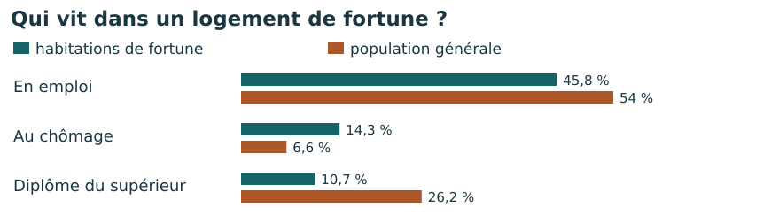

# BEL · B/L · Sociologie, dossier commun 4 du 12 juin 2024 · Corrigé brut

*Corrigé rédigé par IA, non officiel. Signalez toute erreur.*

**Rédaction** · GPT-6.2 Astra Ultra · vitesse non renseignée

**Autocontrôle** · GPT-6.2 Astra Ultra · vitesse non renseignée

## Le mal-logement en France

Posséder une adresse suffit-il pour disposer d’un logement habitable ? L’enquête doit compter l’absence de domicile et les conditions dégradées de personnes déjà logées. Ces situations résultent d’un rapport entre les ressources du ménage, les propriétés du parc et le traitement des difficultés par les institutions.

## Cheminement de l’exposé

Compter requiert de préciser ce qu’habiter veut dire. Les documents 1 et 2 mettent en évidence l’absence de logement personnel et le défaut d’espace ; le document 3 complète l’adresse et la surface par le coût ou l’impossibilité de se chauffer. La définition change les personnes visibles dans la statistique.

Les conditions de logement affectent des populations socialement situées. Un emploi déclaré n’assure pas un logement adéquat (document 4). Le niveau de vie, les conditions d’occupation et l’accès aux réparations permettent de relier le froid au logement (document 3) et l’inégale fréquence de symptômes (document 6).

Une difficulté devient durable au fil des procédures. Les étapes judiciaires du document 5 indiquent différents moments d’intervention. Les portraits du document 7 montrent comment une dette d’énergie se transporte d’un logement à l’autre, ou comment la remise en état tardive du bâti alourdit une facture et compromet le paiement du loyer.

## Lecture des pièces du dossier

### Définir et éviter les doubles comptes

Document 1, p. 2. La Fondation Abbé Pierre recense 4 156 000 personnes mal logées sans double compte. Parmi elles, 1 098 000 n’ont pas de logement personnel, dont 330 000 sans domicile et 643 000 en hébergement contraint chez des tiers. Les conditions très difficiles touchent 2 885 000 personnes sans double compte ; 1 874 000 sont privées de confort et 1 128 000 sont en surpeuplement accentué. Leur somme dépasserait 2 885 000, car les deux difficultés se recouvrent. Il faut aussi distinguer personnes et ménages, colonnes différentes.

### La norme d’occupation et ses effets sociaux

Document 2, p. 3. L’enquête Logement 2013 attribue des pièces selon les âges et la composition du ménage. 9,5 % des ménages sont surpeuplés, 16,5 % chez les ouvriers contre 7,4 % chez les cadres. Les taux sont de 5 % pour les propriétaires ou accédants, 16,8 % pour les locataires sociaux et 16,4 % dans le privé. Les 26,1 % de ménages immigrés concernés contre 7 % des ménages non immigrés invitent à examiner composition familiale, ressources et accès aux fractions du parc. Le seuil de surpeuplement accentué du document 1 exige un manque d’au moins deux pièces.

### Le froid et la dépense mesurent deux choses

Document 3, p. 4. Dans l’enquête Logement, 3 631 000 ménages, soit 14 %, consacrent plus de 10 % de leurs revenus à l’énergie. 18,8 % ont eu froid chez eux dans l’année. Parmi les ménages pauvres et modestes, 34,7 % franchissent le premier seuil et 27,3 % déclarent le froid ; 20,5 % ont eu froid pour des motifs liés à la précarité. Se restreindre peut garder une facture basse tout en détériorant le confort. Additionner les indicateurs compterait deux fois certains ménages.

### La diversité des habitants d’un logement de fortune

Document 4, p. 5. Dans le recensement 2012 exploité par Gaspard Lion, 45,8 % des habitants de logements de fortune ont un emploi, contre 54 % dans la population générale ; le chômage en représente 14,3 % contre 6,6 %. Un ménage d’une personne représente 48,3 % contre 34,3 %. Les diplômés du supérieur sont 10,7 % contre 26,2 %. Ces pourcentages en colonne décrivent la population logée. Ils montrent que travailler peut coexister avec un habitat précaire, sans livrer la probabilité pour un actif occupé d’y vivre.

### Une procédure d’expulsion comporte plusieurs seuils

Document 5, p. 6. En 2018, 154 583 contentieux locatifs, dont 146 870 pour impayés, sont enregistrés. On compte aussi 119 554 décisions prononçant l’expulsion, 68 241 commandements à quitter les lieux et 15 993 interventions effectives de la force publique, contre 6 337 en 2001. Les procédures ont leurs délais. La division des interventions de l’année par les contentieux de la même année ne donnerait pas la probabilité d’expulsion d’une cohorte. Un départ anticipé échappe en outre au dernier indicateur.

### L’association avec la santé

Document 6, p. 7. Chez les ménages suivis par les services sociaux, les problèmes de santé sont plus fréquents dans le groupe exposé à la précarité énergétique, par exemple environ trois quarts pour rhume ou angine contre la moitié dans l’autre groupe. Pour bronchite chronique, les barres approchent respectivement 22 % et 10 %. L’étude comprend 197 logements exposés et 165 autres logements. Les groupes peuvent différer par âge, état antérieur ou ressources. La figure décrit une association dans cette population sélectionnée.

### Deux portraits permettent de reconstruire les chaînes de difficultés

Document 7, p. 8. Mme Viride découvre qu’un reliquat, hérité d’un tarif mal compris dans son ancien logement, augmente les factures malgré moins de 5 000 kWh annuels. Chez M. Moutarde, handicap, perte d’emploi, fenêtre brisée et ventilation défaillante s’ajoutent. Il doit 1 900 euros de loyer et 800 euros d’électricité et dit ne conserver que 30 euros mensuels après paiements. Les deux cas montrent comment une dette persiste au-delà d’un changement de logement et comment une réparation différée dégrade à la fois confort et budget. Ils éclairent le lien des documents 3 et 5 sans en mesurer la fréquence.

## Réponse au sujet

La délimitation statistique rend comparables des besoins que l’adresse administrative laisse invisibles. L’usage des taux situe les inégalités d’accès à un logement adéquat. Le passage aux trajectoires montre comment les factures, les dettes et les interventions publiques peuvent prolonger la précarité après l’événement initial.

[Feuillet officiel du 12 juin, pp. 1–8](https://www.ens.psl.eu/sites/default/files/bl_sujets_oraux_sociologie_4_12062024.pdf) · [Rapport de sociologie 2024](https://www.ens.psl.eu/sites/default/files/2024_bl_rapport_oral_sociologie_epreuve_commune.pdf)
