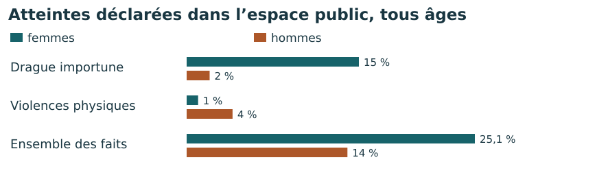

# BEL · B/L · Sociologie, dossier commun 1 du 14 juin 2024 · Corrigé guidé

*Corrigé rédigé par IA, non officiel. Signalez toute erreur.*

**Rédaction** · GPT-6.2 Astra Ultra · vitesse non renseignée

**Autocontrôle** · GPT-6.2 Astra Ultra · vitesse non renseignée

## Violences et genre

Qu’est-ce qui rend certaines violences plus visibles que d’autres ? L’enquête Virage de 2015 interroge sur des faits précis et sur plusieurs scènes de vie. Elle permet de comparer expositions, répétitions et prises de parole. L’histoire du mouvement féministe permet ensuite de comprendre comment ces faits, souvent traités isolément, sont devenus un objet d’enquête.

> [!METHODE]
> Préparer en 90 minutes une réponse qui rapproche les documents. Le rapport prévoit quinze minutes d’exposé puis quinze minutes d’entretien. Dans chaque tableau, lire d’abord la population et le dénominateur. Les valeurs lues sur les courbes sont arrondies.

## Cheminement de l’exposé

Définir un acte et sa scène d’exercice. Les liens de parenté au document 1, les faits sur la voie publique au document 5 et les classifications des atteintes au travail au document 6 produisent des configurations de genre différentes. Commencer par ces contrastes évite un palmarès global des victimes.

Comprendre comment la répétition installe un pouvoir. Les documents 3 et 4 distinguent fréquence d’une atteinte, contrôle régulier et désaccord conjugal. Examiner le motif et la gravité aide à comprendre ce qui se joue quand l’un des partenaires perd la maîtrise de ses relations.

Expliquer ce qui peut être dit. Les délais du document 2 rappellent que des faits vécus restent longtemps hors des archives institutionnelles. Delage (document 7) montre comment la mobilisation féministe a rendu les comparaisons entre scènes pensables. La mesure par enquête constitue elle-même une condition de visibilité.

## Lecture des pièces du dossier

### Qui est l’auteur des violences avant 18 ans ?

Document 1, p. 2. Le tableau porte sur les liens avec les auteurs pour les victimes de violences dans ou autour de la famille. Les personnes enquêtées mentionnent le père dans 53,3 % des cas de violences psychologiques chez les femmes, 56,7 % chez les hommes. Pour les violences sexuelles, un oncle est cité dans 20,2 % et 16,3 % des cas respectivement. Les catégories de proches et de personnes intervenant auprès d’un enfant ont des bases propres. Énoncer le type de violence, le sexe de la victime et la relation avec l’auteur permet d’éviter d’attribuer au sexe de l’auteur une colonne qui concerne celui de la victime.

### Dire les violences ou les garder pour soi

Document 2, p. 3. Avant l’enquête, 81,6 % des femmes déclarant des violences sexuelles assez ou très graves avant 18 ans en avaient parlé, contre 65,7 % des hommes. Parmi celles qui en avaient parlé, 29,2 % l’ont fait dix à dix-neuf ans après, et 17,1 % vingt ans ou davantage. Chez les hommes, l’effectif de référence pour le délai n’est que de 38. Avoir parlé peut désigner une confidence à un proche et ne signifie pas avoir déposé plainte. Une enquête rétrospective accède à des faits très éloignés du moment où ils ont été dits.

### La répétition dans le couple

Document 3, p. 4. À droite de la figure on lit la proportion ayant subi un fait dans les douze mois. La longueur des barres mesure, parmi les victimes de ce fait, sa régularité. Ainsi 1,1 % des femmes déclarent avoir été empêchées au moins une fois de rencontrer leurs proches ; parmi elles, 42 % disent que cela arrivait régulièrement. L’écart entre ces deux nombres éclaire le contrôle durable d’une vie relationnelle. Les faits de dévalorisation, contrôle des communications ou confiscation de papiers ne se réduisent pas aux violences physiques.

### Conflit, gravité des atteintes et rapport de pouvoir

Document 4, p. 5. Les panneaux séparent hommes et femmes et distinguent les atteintes fréquentes, graves ou très graves, les atteintes modérées et l’absence d’atteintes. Chez les femmes du premier groupe (178), les conflits réguliers liés aux enfants ou à la répartition des tâches dépassent environ trois cas sur dix. Dans le groupe sans atteintes (9 593), la fréquence de chaque motif est basse. Les groupes masculins comptent respectivement 101, 274 et 7 960 personnes. L’association invite à chercher comment s’impose une décision dans le couple. Un désaccord ne suffit pas à qualifier une violence.

### L’espace public distribue différemment les risques

Document 5, p. 6. Dans les douze derniers mois, 25,1 % des femmes et 14 % des hommes déclarent au moins un des faits recensés. Chez les 20–24 ans, ces proportions sont 58,3 % et 29,5 %. Les violences physiques concernent 12,4 % des jeunes hommes et 2,1 % des jeunes femmes, alors que les comportements de drague importune concernent 40,8 % de ces dernières et 6,2 % de leurs homologues masculins. Un indicateur global dissimule ces distributions opposées. Mesurer le temps passé dehors et les conduites d’évitement préciserait l’exposition.

### Le lieu de travail réunit plusieurs formes d’atteinte

Document 6, p. 7. Les deux tableaux distinguent les faits vécus une fois, deux à cinq fois, ou six fois et plus. Dans l’ensemble, 20,1 % des femmes et 15,5 % des hommes déclarent une atteinte au travail. Pour insultes et pressions psychologiques, les taux sont 14,9 % et 11,6 %, pour les violences sexuelles sans contact 3,6 % et 1,7 %. Toutes les rubriques ne présentent pas d’écart statistiquement signalé. Les victimes peuvent déclarer plusieurs faits. L’étude des métiers, de la hiérarchie et de la possibilité de protester aiderait à comprendre ces écarts.

### La construction d’un problème public

Document 7, p. 8. Pauline Delage décrit, pour les années 1970, le rapprochement militant de violences auparavant expliquées par la pathologie ou la marginalité de certains foyers. Le tribunal symbolique de Bruxelles en 1976 en fournit un exemple. La peur dans l’espace public peut restreindre les déplacements alors que des auteurs sont aussi des proches et que le foyer peut constituer un espace de danger. Rapprocher les scènes éclaire la domination et la mobilité, tout en gardant les différences de fréquence et de forme établies aux documents 1 à 6.

## Réponse au sujet

Le genre intervient dans l’exposition, dans le type d’atteinte et dans les conditions pour la nommer. Un même dispositif d’enquête rend ces scènes comparables à condition de conserver leurs populations et leurs dénominateurs. La visibilité publique et la déclaration individuelle ont elles-mêmes une histoire.

> [!INDICATION]
> Que mesure 42 % dans le document 3 ?

La fréquence de la répétition parmi les femmes qui ont déclaré ce fait précis. Le taux sur l’ensemble des femmes interrogées est donné séparément à droite.

> [!INDICATION]
> L’absence de plainte signale-t-elle une absence de violence ?

Le document 2 interroge la première parole, parfois des décennies après les faits. La plainte est une démarche différente, auprès d’une institution. Un questionnaire sur les faits peut donc recueillir des situations absentes des archives judiciaires.

> [!INDICATION]
> Pourquoi comparer espace public et entourage ?

Le document 5 établit des expositions sexuées dehors ; le premier document montre l’importance des auteurs connus. Ensemble ils permettent d’étudier comment la perception du danger et les pratiques de déplacement se construisent.

[Feuillet officiel du 14 juin, pp. 1–8](https://www.ens.psl.eu/sites/default/files/bl_sujets_oraux_sociologie_1_14062024.pdf) · [Rapport de sociologie 2024](https://www.ens.psl.eu/sites/default/files/2024_bl_rapport_oral_sociologie_epreuve_commune.pdf)
