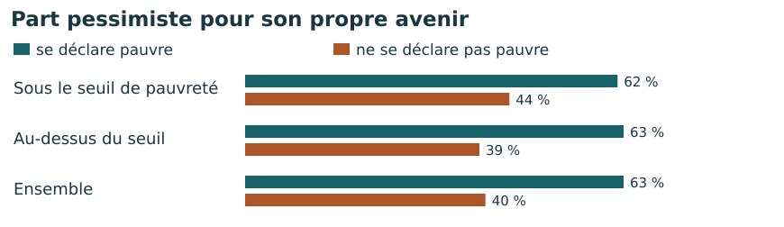

# BEL · B/L · Sociologie, dossier commun 2 du 14 juin 2024 · Corrigé guidé

*Corrigé rédigé par IA, non officiel. Signalez toute erreur.*

**Rédaction** · GPT-6.2 Astra Ultra · vitesse non renseignée

**Autocontrôle** · GPT-6.2 Astra Ultra · vitesse non renseignée

## L’espace social des rapports au temps

Pourquoi des individus disposant du même nombre d’heures par jour ont-ils des possibilités très inégales d’anticiper, d’attendre ou de s’arrêter ? Trois dimensions organisent le dossier : les ressources qui protègent l’avenir, le pouvoir sur les horaires quotidiens et la manière dont les institutions apprennent à se servir du temps.

> [!METHODE]
> Préparer en 90 minutes une réponse qui rapproche les documents. Le rapport prévoit quinze minutes d’exposé puis quinze minutes d’entretien. Dans chaque tableau, lire d’abord la population et le dénominateur. Les valeurs lues sur les courbes sont arrondies.

## Cheminement de l’exposé

Les ressources économiques ouvrent ou ferment l’horizon. Mettre face à face les dépenses déjà promises du document 1 et le patrimoine de précaution du document 4 explique pourquoi un même imprévu peut être un accident absorbable pour les uns et engager plusieurs années pour les autres.

Anticiper est une pratique socialement située. Les réponses d’orientation du document 2 et le pessimisme du document 3 ne mesurent pas la même attitude. Ils donnent cependant prise à une même question : à quelles conditions une personne peut-elle représenter l’avenir comme un domaine où elle a le choix ?

Pouvoir découper le présent est une autre ressource. Les horaires contraints du document 5 et le partage domestique du document 6 précisent qui dispose de temps continu. En prépa, le document 7 en montre une traduction scolaire : la capacité à borner son travail permet de tenir l’urgence collective tout en apparaissant à l’aise.

## Lecture des pièces du dossier

### Des ressources déjà engagées

Document 1, p. 2. Le graphique empile les dépenses pré-engagées, notamment loyers, charges, remboursements et abonnements. De 2001 à 2017, elles passent de 31 % à 41 % de la dépense pour les ménages pauvres. En 2017 elles représentent 32 % pour l’ensemble, dont 14 % pour le loyer et les charges. Les quatre dates tracées vont jusqu’à 2017 bien que le titre de la fiche se termine par « 2007 ». Des ressources engagées avant arbitrage réduisent la latitude face à un imprévu. La part dans la dépense totale diffère d’une part dans le revenu.

### Se projeter dans une carrière scolaire

Document 2, p. 3. En 2008, les parents d’élèves entrés en sixième ou en SEGPA l’année précédente répondent sur l’orientation envisagée. 60 % des cadres et professions intermédiaires visent le bac général pour leur enfant, contre 21 % des ouvriers agricoles dont 39 % envisagent l’entrée dans la vie active dès 16 ans, l’apprentissage ou une voie professionnelle. La fréquence des réponses indécises invite à distinguer l’absence de projet arrêté et le refus d’études. L’orientation anticipée dépend de l’information disponible, du coût d’une formation longue et du parcours scolaire déjà observé.

### L’avenir vécu en situation de pauvreté

Document 3, p. 4. Dans le baromètre DREES 2015–2017, 63 % des adultes se déclarant pauvres sont pessimistes pour leur avenir, contre 40 % de ceux qui ne se déclarent pas pauvres. Sous le seuil monétaire, les proportions sont 62 % et 44 % selon cette déclaration. Au-dessus du seuil, 63 % et 39 %. Le ressenti renseigne sur des événements et charges que le seul revenu instantané saisit mal. Le tableau croisé ne dit pas si le pessimisme précède la perception de pauvreté ou s’il en résulte.

### Convertir un patrimoine en durée de protection

Document 4, p. 5. Duvoux rapporte le patrimoine immédiatement disponible à des revenus, pour les actifs de cinq pays européens. De 18 à 34 ans, les indépendants disposent de l’équivalent d’un an et neuf mois, les cadres de sept mois, les chômeurs de quatre semaines. À 50–64 ans, les durées sont trois ans et neuf mois, deux ans et quatre mois, deux mois et trois semaines. Cet indicateur donne un contenu à la capacité d’attendre. Il ne prévoit pas le nombre de mois réellement vécus sans revenu, qui dépend des dépenses et de l’accès à d’autres aides.

### Qui peut déplacer une heure de travail ?

Document 5, p. 6. L’enquête Emploi du temps 2010 sépare travail à des heures non standards, choix des horaires et prévisibilité. Les indépendants effectuent 11 % de leur travail professionnel entre 5 h et 9 h, contre 20 % pour les employés et ouvriers non qualifiés. Un jour travaillé, 1 % des cadres publics subissent une interruption de 2 h 30 à 6 h imposée, contre 8 % des employés et ouvriers non qualifiés. La disponibilité d’un intervalle n’équivaut pas à sa libre utilisation, surtout lorsque les déplacements et les obligations de reprise interdisent d’autres activités.

### Le travail, le loisir et leur partage entre les sexes

Document 6, p. 7. Le graphique situe chaque sexe à quatre dates. L’abscisse rapporte l’activité professionnelle au travail professionnel et domestique réuni. Entre 1974 et 2010 elle passe de 33 % à 39 % pour les femmes, de 72 % à 60 % pour les hommes. L’ordonnée rapporte le temps libre au temps libre et au travail total ; elle monte pour les deux groupes. Le rapprochement des positions laisse un partage du domestique inégal. Les deux axes sont des fractions distinctes, sans unité d’heures au cadran.

### Apprendre la maîtrise temporelle en classe préparatoire

Document 7, p. 8. Dans les entretiens de Muriel Darmon, être en avance sur le raisonnement du cours vaut signe d’excellence. Marie borne ses séances et se préserve des temps de repos ; Marc explique qu’il peut travailler jusqu’à deux ou trois heures du matin. Une tâche assignée dans un créneau et un objectif laissé ouvert, tel que comprendre un cours, n’exposent pas au même débordement. L’institution valorise l’aisance temporelle de certains élèves. Les témoignages documentent le mécanisme de reconnaissance, sans transformer deux trajectoires en distribution nationale.

## Réponse au sujet

L’argent déjà engagé fixe des limites au présent, l’épargne protège la durée disponible et l’employeur règle l’horaire effectif. À l’école, prévoir et tenir son temps deviennent des qualités évaluées. Un espace social des rapports au temps associe donc ressources, contraintes et reconnaissance de certaines manières de s’organiser.

> [!INDICATION]
> Comment traduire « quatre semaines » ?

Le patrimoine immédiatement mobilisable de jeunes chômeurs représente quatre semaines de leur revenu dans cette mesure. Cela ne garantit pas quatre semaines de consommation au niveau antérieur.

> [!INDICATION]
> La barre des indécis indique-t-elle un manque d’ambition ?

La question s’adresse aux parents en début de collège. Une réponse ouverte peut traduire l’attente d’informations sur les résultats ou sur l’offre de formation.

> [!INDICATION]
> Que comparer pour tester l’effet du contrôle des horaires ?

À durée de travail comparable, observer des salariés qui choisissent leurs horaires et d’autres qui en prennent connaissance tardivement, puis mesurer les déplacements, le repos et les arrangements familiaux.

[Feuillet officiel du 14 juin, pp. 1–8](https://www.ens.psl.eu/sites/default/files/bl_sujets_oraux_sociologie_2_14062024.pdf) · [Rapport de sociologie 2024](https://www.ens.psl.eu/sites/default/files/2024_bl_rapport_oral_sociologie_epreuve_commune.pdf)
