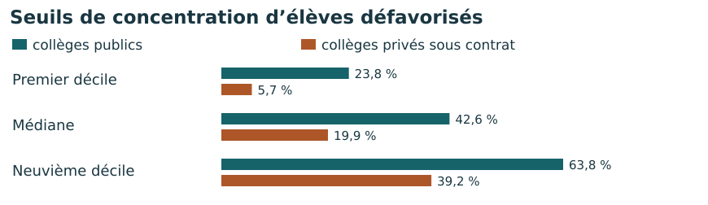

# BEL · B/L · Sociologie, dossier commun 3 du 19 juin 2024 · Corrigé guidé

*Corrigé rédigé par IA, non officiel. Signalez toute erreur.*

**Rédaction** · GPT-6.2 Astra Ultra · vitesse non renseignée

**Autocontrôle** · GPT-6.2 Astra Ultra · vitesse non renseignée

## L’enseignement privé en France

Que choisit une famille lorsqu’elle inscrit un enfant dans le privé ? Les possibilités locales d’inscription, les autres élèves de l’établissement et les trajectoires scolaires entrent en jeu. L’existence d’un secteur hors contrat et les parcours des enseignants empêchent de réduire l’ensemble à la seule recherche de réussite par des parents favorisés.

> [!METHODE]
> Préparer en 90 minutes une réponse qui rapproche les documents. Le rapport prévoit quinze minutes d’exposé puis quinze minutes d’entretien. Dans chaque tableau, lire d’abord la population et le dénominateur. Les valeurs lues sur les courbes sont arrondies.

## Cheminement de l’exposé

Le choix du privé est d’abord un usage situé de l’offre. Les documents 1 et 2 confrontent les choix différenciés entre enfants d’une famille aux passages effectivement observés entre secteurs. Le document 5 montre que choisir le privé n’a pas le même sens là où son offre est rare et là où elle est dense.

Ces usages composent les publics qui seront ensuite évalués. Le document 3 établit une concentration sociale à l’échelle des collèges et le document 4 mesure des écarts très tôt au primaire. Ces pièces rendent crédible un mécanisme de sélection et montrent les données supplémentaires nécessaires pour isoler ce que ferait l’établissement lui-même.

Enfin on choisit des institutions concrètes. Le diagramme du hors contrat (document 6) en expose l’hétérogénéité ; l’enquête sur les enseignantes du privé musulman (document 7) découvre les arbitrages professionnels et religieux qu’un simple classement public/privé ne peut restituer.

## Lecture des pièces du dossier

### Les choix peuvent varier dans une même fratrie

Document 1, p. 2. Barrault-Stella et Hugrée demandent si les enfants ont déjà été inscrits dans le privé à un moment de leur scolarité. Pour l’ensemble des familles enquêtées, 20 % répondent que tous l’ont été, 15 % que certains l’ont été, 65 % qu’aucun ne l’a été. Chez les indépendants, les deux premières proportions sont 30 % et 15 %. Parmi les classes supérieures du secteur public, 20 % ont inscrit tous les enfants et 26 % seulement certains. La question autorise des usages circonstanciels. Elle mesure l’histoire des inscriptions familiales et non une part d’élèves scolarisés dans le privé aujourd’hui.

### Les passages entre secteurs dans une trajectoire

Document 2, p. 3. Les élèves entrés en sixième à Marseille en 2009 sont suivis jusqu’en 2014. 46 % de ceux qui restent dans le même secteur sont alors en première, contre 33 % après un changement et 24 % après au moins deux. Les proportions en CAP sont 7 %, 18 % et 21 %. Les enfants de milieu très favorisé représentent respectivement 25 %, 23 % et 17 %. Un changement peut répondre à une difficulté scolaire. Les trajectoires stables englobent tout-public et tout-privé ; le tableau ne permet pas d’isoler le rendement de l’inscription dans un établissement privé.

### La ségrégation se mesure entre établissements

Document 3, p. 4. Les collèges publics comptent en moyenne 42,6 % d’élèves de milieu défavorisé, les collèges privés sous contrat 18,3 %. Pour les élèves très favorisés, les moyennes sont 19,5 % et 40,1 %. Les médianes de la part des élèves défavorisés sont 42,6 % et 19,9 % et le premier décile vaut 23,8 % et 5,7 %. Le décile est un seuil entre collèges classés, non la répartition de tous les élèves entre établissements. Les établissements sont classés à nouveau pour l’autre indicateur.

### Écarts mesurés au début du primaire

Document 4, p. 5. En 2020, la maîtrise jugée satisfaisante de la compréhension des mots à l’oral au CP atteint 80,3 % dans le privé, 72,7 % dans le public hors éducation prioritaire, 49,9 % en REP et 39,2 % en REP+. Le tableau, annoncé sous le français, comprend aussi des items numériques, par exemple résoudre des problèmes, avec 73,5 % dans le privé et 41,5 % en REP+. Les écarts interviennent au début de la scolarité primaire et les populations diffèrent. Une estimation de l’effet pédagogique demanderait des niveaux initiaux comparables et un suivi.

### Le sens du privé varie avec l’offre locale

Document 5, p. 6. En 1989, dans les départements où le privé est rare, les cadres constituent 21,8 % des familles du privé contre 11,9 % du public. Là où le privé est le plus développé, ces parts sont 8,5 % et 10,8 %. Parallèlement la part des ouvriers qualifiés dans le privé passe de 17,3 % à 27,1 % entre les deux configurations territoriales. Une offre ancienne et dense peut rendre le privé plus ordinaire. L’écart avec 2021 ne constitue pas une tendance chiffrée à lui seul, puisque populations et définitions diffèrent.

### La pluralité du hors contrat

Document 6, p. 7. Le diagramme sénatorial de 2018 donne la répartition des élèves hors contrat. Le réseau laïc en accueille 42 %, le réseau non identifié 23 %, le catholique hors Secrétariat général de l’enseignement catholique 14,4 %, le musulman 8,8 %, le juif 5,1 %, le protestant 3,2 %. Le reste comporte notamment les langues régionales. Ces parts ne décrivent ni l’ensemble du privé ni des effectifs d’établissements. Elles empêchent d’assimiler le hors contrat à un seul projet religieux.

### Les arbitrages professionnels des enseignantes

Document 7, p. 8. L’enquête de Diane-Sophie Girin rapporte le parcours de Lina, issue d’une famille ouvrière et formée au professorat des écoles. Elle renonce à la titularisation dans le public et perd 200 euros mensuels après son entrée dans l’enseignement privé musulman. Le port du foulard et la sociabilité avec les collègues comptent dans cet arbitrage, malgré la moindre sécurité sur l’avenir de l’école. Cette trajectoire documente la valeur accordée aux conditions de travail et à la reconnaissance. Elle ne renseigne pas directement sur les intentions des parents du document 1.

## Réponse au sujet

La sélection du public scolaire et le choix de l’établissement se renforcent, mais passent par des mécanismes différents selon les moments de la scolarité et les territoires. La diversité des établissements et les conditions d’emploi des enseignants élargissent cette analyse du privé au-delà du choix des parents.

> [!INDICATION]
> Peut-on additionner 20 et 15 dans le document 1 ?

Oui, ces modalités exclusives signifient que 35 % des familles ont scolarisé au moins un enfant dans le privé à un moment donné. Le chiffre concerne les familles.

> [!INDICATION]
> Comment expliquer le contraste entre les documents 3 et 5 ?

Le document 3 décrit en 2021 tous les collèges étudiés, le 5 oppose en 1989 des territoires selon l’offre. Un contexte de privé majoritaire ou largement accessible modifie la composition du secteur.

> [!INDICATION]
> Quel protocole pour mesurer un effet propre du privé ?

Suivre des élèves comparables avant la transition, observer résultats antérieurs, ressources familiales et raisons du changement. Si l’admission dépend d’un tirage, comparer candidats admis et non admis sur cette base serait instructif.

[Feuillet officiel du 19 juin, pp. 1–8](https://www.ens.psl.eu/sites/default/files/bl_sujets_oraux_sociologie_tc_3_19062024.pdf) · [Rapport de sociologie 2024](https://www.ens.psl.eu/sites/default/files/2024_bl_rapport_oral_sociologie_epreuve_commune.pdf)
